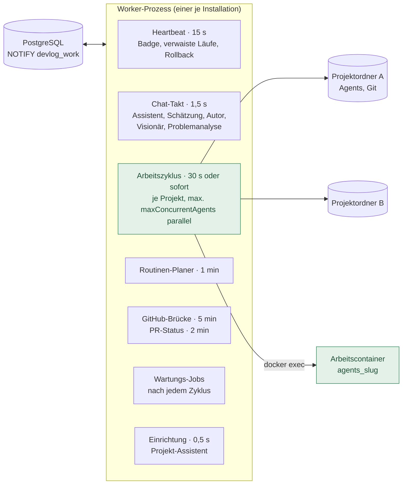
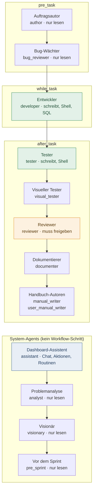
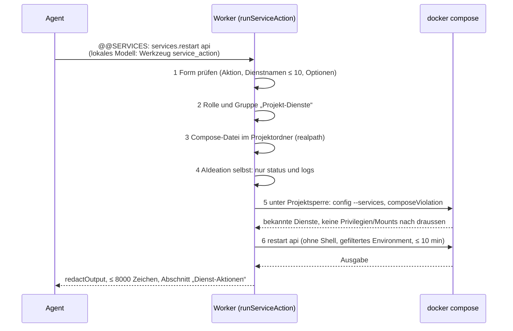
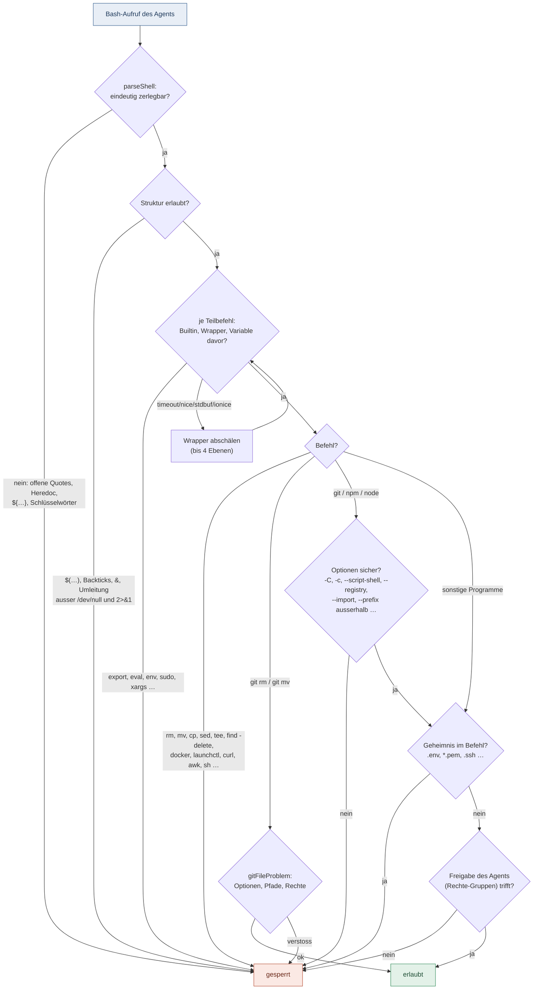
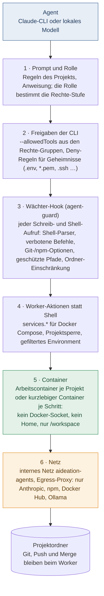
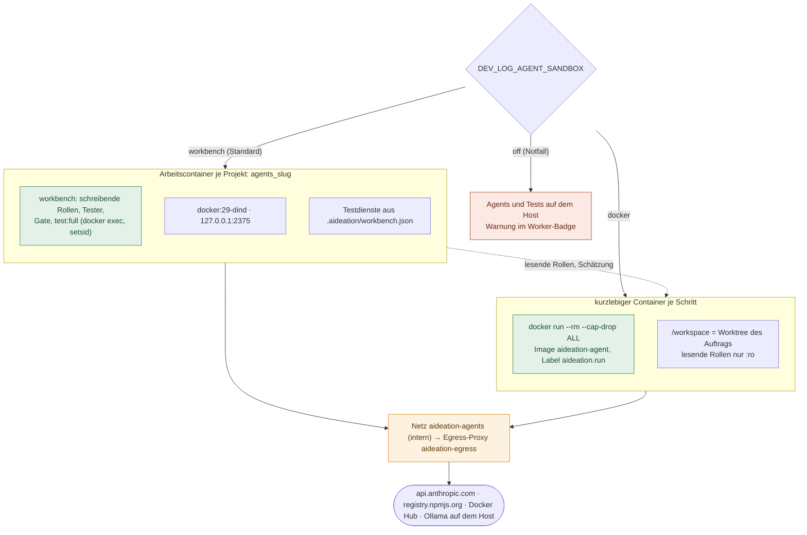
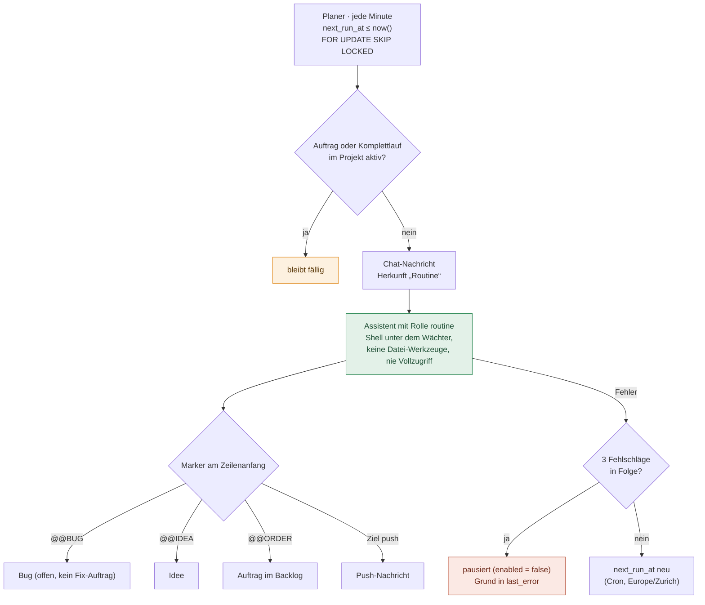
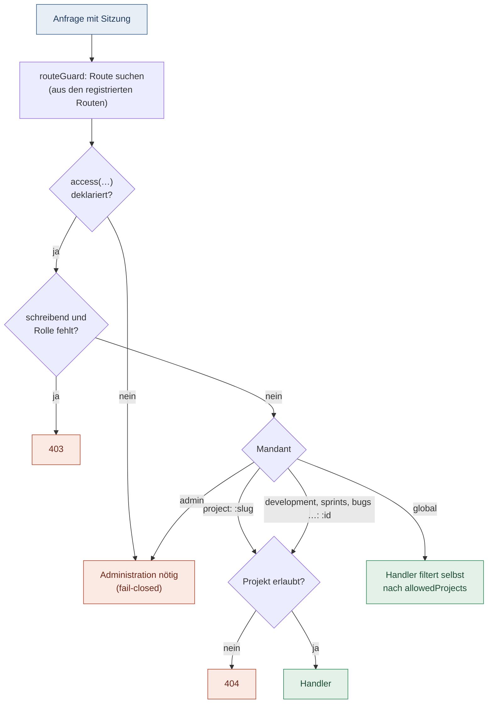

# Worker, Agents und Rechte

## 1. Der Worker-Prozess

Es gibt **einen** Worker (`npm run worker` = `tsx src/runner/runner-cli.ts --all --watch --limit 3`), nie im Docker-Container `dev-log`. Er läuft entweder als Compose-Dienst `worker` (Profil `worker`, `restart: unless-stopped`, siehe [Betrieb](betrieb.md#worker-im-container)) oder auf dem Host, unter macOS per launchd (`com.aideation.worker`, `./scripts/install-worker.sh`, Log `~/Library/Logs/aideation-worker.log`), unter Linux per systemd. Auf dem Host liest er Datenbank-URL und Schlüssel beim Start aus `~/.config/aideation/worker.env` (Rechte 600, unter macOS per `node --env-file`, unter Linux über `scripts/run-with-env.sh`). In Plist bzw. Unit stehen sie nicht.

- Er bedient **alle registrierten Projekte**, jeweils mit dem Projektordner (`projects.repository`) als Arbeitsverzeichnis. Fehlt der Ordner, zeigt das Worker-Badge den Fehler und Chat-Nachrichten werden mit dem Grund beantwortet.
- Er lädt Code nur beim Start. **Nach jeder Code-Änderung muss er neu gestartet werden:** „AIdeation neu starten“,
  auf dem Mac auch `launchctl kickstart -k gui/$(id -u)/com.aideation.worker`.
- Alle 15 s sendet er einen Heartbeat (Worker-Badge im Dashboard).
- Gleichzeitig laufen höchstens `maxConcurrentAgents` Projekte (Einstellung, Standard 2). Das Projekt, das am längsten wartet, kommt zuerst.



## 2. Automatische Trigger

| Trigger                                                     | Takt                                                                        | Was passiert                                                                                                                                                                                                                                                                                 |
| ----------------------------------------------------------- | --------------------------------------------------------------------------- | -------------------------------------------------------------------------------------------------------------------------------------------------------------------------------------------------------------------------------------------------------------------------------------------- |
| Chat-Nachricht im Dashboard                                 | alle 1,5 s, unabhängig von Aufträgen                                        | Assistent beantwortet die älteste offene Nachricht (`processChat`); danach wird eine angeforderte Problemanalyse bearbeitet (`analyzeBlocked`).                                                                                                                                              |
| Arbeitszyklus pro Projekt                                   | alle 30 s (`--interval-seconds`), sofort bei neuen Aufträgen (`NOTIFY devlog_work`) | `runWorkflow`: Ideen schätzen → Ideen zu Aufträgen ausarbeiten → Sprint mit Git synchronisieren → Aufträge abarbeiten → Repo-Doku spiegeln → Sprint-Bericht → Git-Sync.                                                                                                                      |
| Auftrag ausführbar                                          | im Arbeitszyklus                                                            | Status `planned` und (Sprint aktiv **oder** fester Agent gesetzt **oder** `auto_run`). Backlog-Aufträge im aktiven Sprint werden automatisch auf `planned` gesetzt. Reihenfolge: Sprint-Rang, dann Priorität hoch → niedrig, dann Alter. **Ausnahme:** Aufträge zu Bugs aus fremden Quellen (Betrieb, GitHub) laufen erst nach der Freigabe durch einen Menschen (`POST /api/bugs/:id/approve`, Recht „Ausführen“), auch nicht per `--item`. |
| Idee mit Status `requested`                                 | im Arbeitszyklus                                                            | Auftragsautor schreibt daraus einen Backlog-Auftrag (Sprint-Zuordnung bleibt manuell). Hängende `drafting`-Ideen werden nach einer Frist zurückgesetzt.                                                                                                                                      |
| Ideen ohne Schätzung                                        | im Arbeitszyklus                                                            | Aufwand, Tokens, Nutzen, Kosten werden geschätzt.                                                                                                                                                                                                                                            |
| Analyse blockierter Aufträge                                | über den Chat-Takt                                                          | Wenn `analysis_status = requested`, analysiert der Assistent Fehlerausgaben und bekannte Bugs.                                                                                                                                                                                               |
| „Ideen vorschlagen lassen“ (Ideation, Dashboard → Aktionen) | über den Chat-Takt                                                          | Ein angefragter Lauf in `visionary_runs` wird abgearbeitet (`processVisionaryRun`). Danach folgen Kontext, Visionär (nur lesen), `@@IDEA`-Zeilen, Dubletten-Prüfung, höchstens N Ideen und eine Push-Meldung „N neue Ideen vom Visionär“. Läuft je Projekt einzeln und lässt sich abbrechen. |
| Zeitgesteuerte Routine (Agent-Aufgabe mit Zeitplan)          | jede Minute (Planer)                                                        | Fällige Routinen (`next_run_at <= now()`) werden mit `FOR UPDATE SKIP LOCKED` gesperrt und als Chat-Nachricht mit Herkunft „Routine“ eingereiht; danach wird `next_run_at` neu berechnet (Cron, Europe/Zurich). Läuft für das Projekt ein Auftrag oder ein kompletter Test (Projektsperre), bleibt die Routine fällig. Siehe Abschnitt 6. |
| Bestätigter Rollback (Bug-Detail „Betrieb“)                 | im Heartbeat (alle 15 s)                                                    | `processRollback`: nimmt einen von einem Menschen bestätigten Rollback (`POST /api/bugs/:id/rollback`, Rolle „Planung“ wie „Live schalten“) an, sobald keine Agents und kein Deploy laufen, checkt den vorherigen Sprint-Tag im Projektordner aus und rollt ihn über `deployProject` aus. Ergebnis mit Text in `production_rollbacks`; der Bug bleibt offen. |
| Start des Workers                                           | einmalig                                                                    | Unterbrochene Läufe werden wiederhergestellt: Aufträge gehen zurück auf „Geplant“, laufende Schritte und Läufe gelten als fehlgeschlagen. Beim Belegen eines Auftrags gilt ein fremder Lauf erst nach rund 9 h ohne Lebenszeichen als verwaist (`ABANDONED_RUN_MS`).                    |
| Herunterfahren                                              | Signal                                                                      | Laufende Chat-Anfragen gehen zurück auf `pending`.                                                                                                                                                                                                                                           |
| Dashboard-Seite öffnen / Tab wieder sichtbar                | Browser                                                                     | Daten laden automatisch; zusätzlich Polling (Worker 10 s, laufende Runs 3 s).                                                                                                                                                                                                                |

Pro Auftrag läuft immer nur **ein** Lauf (`agent_runs` mit Status `running` ist eindeutig).

## 3. Workflow-Agents (pro Projekt konfigurierbar)

Ein Auftrag durchläuft die aktivierten Agents nach Phase und Position: `pre_task` → `while_task` → `after_task` (dazu `pre_sprint`, `on_done`, `on_rejected`, siehe [Workflows](./workflows.md), Abschnitt 4a). Jeder Agent kann einen eigenen Befehl (`command`) haben; sonst gilt `DEV_LOG_AGENT_COMMAND`, sonst das lokale Ollama-Modell (`qwen3.5:9b`).



**Befehl und Rolle nur für Administration:** Der `command` läuft als Prozess auf dem Worker (mit dessen Rechten), die `role` bestimmt Ablauf und Rechte des Agents. Beide Felder setzt oder ändert nur die Rolle `admin` (`adminFieldsCheck` in `src/api/agents.ts`, gemeinsam für `POST /projects/:slug/agents` und `PATCH /agents/:id`). Die Rolle `agents` bekommt sonst 403, auch bei `null` oder `[]`; ohne angemeldeten Benutzer gilt dasselbe. Erlaubt ist nur ein exakt unveränderter Wert (JSON-Gleichheit mit dem gespeicherten Stand; beim Anlegen: kein Befehl, Rolle `custom`). Er wird dann nicht geschrieben. Ein PATCH ohne `command` und `role` (Name, Anweisung, Rechte, Weitergabe) bleibt für `agents` erlaubt. `POST …/agents/defaults` legt die Standard-Agents immer ohne Befehl an. Der Reviewer, den `ensureReviewer` einmalig nachrüstet, übernimmt den gespeicherten Befehl des Entwicklers, also einen Wert, den nur die Administration gesetzt haben kann. In der Oberfläche sind Modell, Befehl und Rolle für Nicht-Admins gesperrt; maßgeblich ist die Prüfung im Backend. Der Chat-Assistent schreibt keine Agents: Sein `run_sql` läuft nur auf der Projekt-Datenbank, nie auf der AIdeation-Datenbank (`targetsDevLogDatabase`).

| Agent                  | Rolle                | Phase      | Aufgabe                                                                                                                                    | Dateien ändern                                                     | Befehle                                                    |
| ---------------------- | -------------------- | ---------- | ------------------------------------------------------------------------------------------------------------------------------------------ | ------------------------------------------------------------------ | ---------------------------------------------------------- |
| Auftragsautor          | `author`             | pre_task   | Auftrag beschreiben (Ziel, Kriterien, Dateien, Diagramme). Wird übersprungen, wenn der Auftrag aus einer Idee stammt.                      | nein                                                               | nein                                                       |
| Bug-Wächter            | `bug_reviewer`       | pre_task   | Bekannte Bugs prüfen → Risiken beim Auftrag. Übersprungen, wenn schon Risiken vorhanden.                                                   | nein                                                               | nein                                                       |
| Entwickler             | `developer`          | while_task | Auftrag umsetzen. Bei Bug-Aufträgen wird die Ausgabe als Fix-Notiz am Bug gespeichert.                                                     | **ja**, mit Backup in `.dev-log-backups/`                          | npm test/run/install, git status/diff/log                  |
| Tester                 | `tester`             | after_task | Tests schreiben, danach führt der Runner Build und Projekttests aus; Abnahme der Kriterien.                                                | **ja** (Claude-CLI: alle freigeschalteten Gruppen)                 | über die Rechte-Gruppen; Projekttests führt der Runner aus |
| Visueller Tester       | `visual_tester`      | after_task | Nur bei Frontend/Fullstack: Screenshots der Vorschau (Desktop, Handy), Pixel-Vergleich, Layout-Prüfungen. Ohne `preview_url` übersprungen. | nein (Bilder nur temporär unter `.dev-log/visual/` fürs KI-Urteil) | nein; der eigene Befehl dient nur dem optionalen KI-Urteil |
| Reviewer               | `reviewer`           | after_task | Änderungen prüfen; muss mit `@@REVIEW: FREIGEGEBEN` ausdrücklich freigeben.                                                                | nur lesen (Prompt); Claude-CLI: alle Gruppen                       | über die Rechte-Gruppen                                    |
| Dokumentierer          | `documenter`         | after_task | Ergebnis dokumentieren → Auftragsdoku.                                                                                                     | lokales Modell nein; Claude-CLI anlegen + ändern                   | nein                                                       |
| Handbuch-Autor         | `manual_writer`      | after_task | Technisches Handbuch pflegen.                                                                                                              | lokales Modell nein; Claude-CLI anlegen + ändern                   | nein                                                       |
| Benutzerhandbuch-Autor | `user_manual_writer` | after_task | Benutzerhandbuch pflegen.                                                                                                                  | lokales Modell nein; Claude-CLI anlegen + ändern                   | nein                                                       |
| eigene                 | `custom`             | frei       | Beliebige Zusatzrolle.                                                                                                                     | nein                                                               | nein                                                       |

Die Agent-Übersicht zeigt im aufklappbaren Bereich „Was machen die Rollen?“ zu jeder Rolle Aufgabe und Nutzen. Die Texte stehen in `frontend/public/data/agent-rollen-texte.json` (je Rollenschlüssel `rolle`, `beschreibung`, `nutzen`). Die App lädt sie zur Laufzeit; nach einer Änderung an der Datei ist kein Code-Umbau nötig. Ändert sich die Tabelle oben oder die Rechtevergabe (`TRUSTED_ROLES`, `READ_ONLY_ROLES`), müssen die Texte angepasst werden. Kommt in `AGENT_ROLES` eine neue Rolle hinzu, braucht sie einen Eintrag, sonst schlägt `agent-role-text.spec.ts` fehl.

Die Marketing-Seite im Dashboard (Dokumentation → Marketing → „Agents, Aufgaben und Rechte“, `frontend/src/app/features/docs/marketing/agent-permissions.ts`) gibt diese Tabelle statisch wieder. Wer sie hier ändert, muss die Seite nachziehen; ein Test (`agent-permissions.spec.ts`) vergleicht Phase und Dateirechte mit diesem Abschnitt.

Das Dashboard („Agent-Status“) zeigt je Agent ein Rollen-Icon, die Rolle und die Rechte-Stufe „Dateien ändern: ja/nein“ und „Befehle: ja/nein“. Angezeigt wird der Standardwert der Rolle. Hängen die Rechte vom Befehl ab (Claude-CLI oder lokales Modell, Rechte-Gruppen), steht zusätzlich „je nach Befehl“ dabei. Die einzige Quelle dafür ist `AGENT_RIGHTS` in `frontend/src/app/features/agents/agent-options.ts`. Ändert sich die Tabelle oben, muss diese Zuordnung nachgezogen werden; `agent-rights.spec.ts` vergleicht sie mit dieser Tabelle. Die Rechte-Stufe beschreibt Agents, nicht Benutzerrollen. Darunter zeigt „Offene Aufträge je Agent“, wie die offenen Aufträge (nicht erledigt oder abgelehnt) auf die Agents verteilt sind, inklusive „Ohne Agent“. Ein Klick auf einen Abschnitt öffnet die Auftragsliste mit dem Filter in der Spalte „Agent“.

Mit der Claude-CLI bekommen Assistent, Entwickler, Tester, Reviewer und Routinen alle freigeschalteten Rechte-Gruppen (`TRUSTED_ROLES` in `src/agent/permission-rules.ts`); alle anderen Rollen nur „Dateien anlegen“ und „Dateien ändern“, Visionär, Problemanalyse und `pre_sprint` gar nichts (`READ_ONLY_ROLES`). Zeitgesteuerte Routinen (`routine`) bekommen die Befehle der Rechte-Gruppen und zusätzlich die Gruppe „Prüfbefehle“ (`npm audit`, `npm outdated`, `git ls-files`, `git grep`), aber keine Datei-Werkzeuge (`NO_FILE_WRITE_ROLES`, siehe Abschnitt 6). Beim lokalen Modell schreiben nur Entwickler und Assistent. Ohne Schreibrecht erhalten Agents nur Lese-Werkzeuge (Verzeichnis, Datei lesen, Suche) mit 25 Werkzeugschritten; Rollen mit Schreibrecht haben 80 Schritte (ein am Agent eingestellter Wert ab 10 gilt bis 200, `src/agent/ollama-agent.ts`).

**Eigene Werkzeug-Regeln im Befehl:** Ein Admin kann im Agent-Befehl `--allowedTools` bzw. `--disallowedTools` setzen (auch als `--allowed-tools=…`). Die Datei-Rechte und die Ordner-Einschränkung im Wächter kommen trotzdem immer aus der Zuweisung des Agents. Mit eigenem `--allowedTools` hängt AIdeation keine eigenen Freigaben an. Eigene Sperren werden mit den Sperren von AIdeation zu einem einzigen `--disallowedTools` zusammengeführt und schränken nur weiter ein.

**Chat mit gewähltem Agent: Rechte seiner eigenen Rolle:** Wählt ein Projektmitglied im Chat einen Agent, übernimmt `runAuthorAgent` dessen Befehl, Freigaben und Ordnergrenze und lädt zusätzlich seine Rolle (`permissionRole` in `requirements.ts`). Vollzugriff (`--dangerously-skip-permissions` ohne Wächter) gilt nur, wenn der gewählte Agent selbst die Rolle `assistant` hat. Ein Entwickler-Agent läuft im Chat mit dem Wächter (`--settings`, Hook, Ordnergrenze), auch wenn sein Befehl das Flag enthält. Lesende Rollen (Visionär, `pre_sprint`) und Agents ohne Rolle bekommen nur die Nur-lesen-Rechte (`READ_ONLY_PERMISSION_ROLE`, fail-closed). Ohne gewählten Agent bleibt es bei den Rechten des Assistenten. Der Ollama-Weg nutzt dieselben Datei- und Befehlsrechte (`agentRights`). Dienst-Aktionen (`services.*`, siehe unten) hängen an der Gruppe „Projekt-Dienste“ (`services`) und an der Rolle, die der Worker bei jeder Anfrage erneut prüft. Bekannte Lücke: Die Einrichtung per `git clone`/`npm install` (`canManageServices` in `ollama-agent.ts`) hängt beim lokalen Modell weiter an der Rolle `assistant` und ist daher auch für einen gewählten Entwickler-Agent erlaubt. Dafür ist ein eigener Auftrag nötig. Regressionstests: `src/agent/chat-rights.test.ts` (Entwickler, Visionär, Assistent-Gegenprobe).

**Geheimnisse sind für jeden Claude-Agent unlesbar:** `withAgentPermissions` gibt jeder Rolle per `--settings` Deny-Regeln mit (`SECRET_READ_DENY` in `tool-permissions.ts`: `Read(**/.env*)`, `Read(**/*.pem)`, `Read(**/*.key)`, SSH-Schlüssel `id_*`, Zugangsdaten-Dateien `.npmrc` (Registry-Tokens), `.netrc` und `.git-credentials`, `.ssh`, `.aws`, `.gnupg`, auch unter `~`). Die CLI wendet sie auch auf Grep und Glob an. Zusätzlich prüft der Wächter-Hook `Read|Grep|Glob|NotebookRead` (`secretReadProblem` in `agent-guard.ts`): Er normalisiert den Pfad (`..`, `~`, symbolische Links) und prüft jeden Pfadteil mit `SECRET_NAME` aus `tool-paths.ts` sowie die Schlüssel-Ordner. Bei Grep wird auch der `glob`-Filter geprüft, bei Glob das Muster. Die Sperre gilt unabhängig von der Richtlinie, also auch für Visionär, Routinen und den Assistenten mit Vollzugriff. Dort kommen nur die Deny-Regeln und ein Hook für die Lese-Werkzeuge dazu; Schreiben und Shell bleiben ohne Wächter. Die Meldung nennt nur den Pfad, nie den Inhalt. Shell-Zugriffe (`cat .env`, `grep … .env`) sperrt weiterhin `SECRET_IN_COMMAND`. Wie bisher bleiben auch `.env.example` und ähnliche Dateien gesperrt, weil `SECRET_NAME` alles erfasst, was mit `.env` beginnt. `.npmrc`, `.netrc` und `.git-credentials` zählen nur als ganzer Dateiname; `npmrc.md` oder `environment.ts` bleiben lesbar. Dasselbe `SECRET_NAME` gilt für den Ollama-Agent, der diese Dateien damit ebenfalls weder liest noch auflistet. Bekannte Grenze: Ein Grep über einen ganzen Ordner prüft der Wächter nicht Datei für Datei; dort greifen nur die Deny-Regeln der CLI. Lesen ausserhalb des Projekts begrenzt weiterhin die CLI selbst (Arbeitsordner plus `--add-dir`); der Wächter sperrt dort nur Geheimnisse, damit die Log-Ordner lesbar bleiben. Die System-Agents (Analyse, Schätzung, `readOnlyCommand`) laufen nicht über `withAgentPermissions` und sind nicht Teil dieser Änderung. Regressionstests: `agent-permissions.test.ts` (Befehlszeile jeder Rolle) und `agent-guard.test.ts` (Hook-Fälle).

**Lokales Modell an dieselbe Richtlinie gebunden:** Das lokale Modell (auch der Chat-Assistent über Ollama) bekommt dieselben Datei- und Befehlsrechte wie die Claude-CLI (`agentRights` in `requirements.ts`, `runner-steps.ts`). Fehlt dieser Rechte-Kontext, gilt fail-closed: Das Modell darf nur lesen, also keine Datei-Werkzeuge, keine Befehle und kein SQL (`runOllamaAgent`). Auch `executeTool` schreibt ohne Dateirechte nicht. Schreibzugriffe prüft `fileProblem`: geschützte Pfade, Ordner-Einschränkung, Anlegen und Ändern. Befehle prüft zuerst `bashProblem`, derselbe Wächter wie bei der Claude-CLI (Geheimnisse, npm-Optionen wie `--script-shell`, `--node-options`, `--prefix` ausserhalb, Git-Optionen, Wrapper, Shell-Konstrukte). Danach kommen die Freigaben des Agents (`rulesAllow`) und die feste Liste des lokalen Modells. `docker` steht in keiner dieser Listen mehr; Dienste verwaltet das lokale Modell nur mit dem Werkzeug `service_action`.

**Dienst-Aktionen (`services.*`) statt docker und launchd:** Kein Agent ruft `docker`, `docker compose` oder Dienst-Befehle des Betriebssystems (`launchctl`, `systemctl`) selbst auf. Wer den Docker-Socket hat, hat Root auf dem Host. Agents fordern stattdessen feste Aktionen beim Worker an:

| Aktion             | Wirkung (im Worker)                                          | Optionen                                                       |
| ------------------ | ------------------------------------------------------------ | -------------------------------------------------------------- |
| `services.status`  | `docker compose ps --all [dienste]`                          | Dienste                                                        |
| `services.logs`    | `docker compose logs --no-color --timestamps --tail=N`       | Dienste, `--lines=1…1000` (Standard 200), `--since=15m` (≤ 24h) |
| `services.restart` | `docker compose restart [dienste]`                           | Dienste                                                        |
| `services.up`      | `docker compose up -d [--build] [dienste]`                   | Dienste, `--build`                                             |
| `services.stop`    | `docker compose stop [dienste]`                              | Dienste                                                        |



Alle Aktionen nehmen optional `--file=<compose-datei>` relativ zum Projektordner; sonst gilt `compose.yaml`, `compose.yml`, `docker-compose.yaml` bzw. `docker-compose.yml` im Projektordner. Angefordert wird so: Das lokale Modell ruft das Werkzeug `service_action` auf (`ollama-tools.ts`) und bekommt das Ergebnis sofort zurück. Die Claude-CLI schreibt je Aktion eine Zeile `@@SERVICES: services.restart api` (bzw. `@@SERVICES: services.logs api --lines=200 --since=15m`). Der Worker führt diese Zeilen nach der Antwort aus (höchstens 5 je Antwort, `runServiceMarkers` in `src/agent/service-actions.ts`) und hängt das Ergebnis im Chat als Abschnitt „Dienst-Aktionen“ an. Der Worker prüft jede Anfrage, bevor er etwas ausführt (`runServiceAction`):

1. Form (`parseServiceRequest` in `service-request.ts`): bekannte Aktion, Dienstnamen nur `[A-Za-z0-9][\w.-]*` mit höchstens 63 Zeichen (höchstens 10 Dienste), Zeilenlimit und Zeitraum nur bei `services.logs`, `--build` nur bei `services.up`, Compose-Datei nur relativ ohne `..`, mit Endung `.yml` oder `.yaml` und nur aus `[\w@.+-]` und `/`.
2. Rolle und Recht (`serviceRoleProblem`): Gruppe `services` am Agent; Rollen `assistant`, `developer`, `tester`; Routinen (`routine`) nur `services.status` und `services.logs`; lesende Rollen nie.
3. Projektordner und Compose-Datei: Die Datei muss nach Auflösen symbolischer Links (`realpath`) im Projektordner liegen. Ein Link nach draussen wird abgelehnt.
4. AIdeation selbst: Im Installationsordner von AIdeation sind nur `services.status` und `services.logs` erlaubt.
5. Unter der Projektsperre (`withProjectLock`, auch bei Fehlern freigegeben): `docker compose config --services` – nur bekannte Dienste; vor `services.up` und `services.restart` zusätzlich `composeViolation` auf der aufgelösten Konfiguration (wie bisher: nichts Privilegiertes, keine Mounts oder Builds ausserhalb).
6. Ausführen mit Argumentliste (keine Shell), mit dem gefilterten Environment (`projectEnvironment`, in Agent-Ordnern eigener Compose-Projektname `<projekt>-agent`) und höchstens 10 Minuten. Die Ausgabe läuft durch `redactOutput` und wird auf 8000 Zeichen gekürzt.

Die Gruppe „Projekt-Dienste“ (`services`) ist betriebssystem-neutral und gibt nur diese Aktionen frei, keine Shell-Regel. Die frühere Gruppe „Docker-Dienste“ (`docker`) gibt es nicht mehr. Gespeicherte alte Regeln ersetzt `normalizeCommands` beim Laden: `Bash(launchctl kickstart -k gui/<uid>/…)` (jede Benutzer-ID), `Bash(launchctl list:*)`, `Bash(docker compose …:*)`, `Bash(docker ps:*)` und `Bash(docker logs:*)` werden zu `services`; eine freigeschaltete Projektgruppe `docker` gilt als `services` (`normalizeGroups`). Die Muster stehen in `src/agent/legacy-rules.ts`. Eigene Gruppen mit `docker`-Regeln sortiert `loadProjectPermissions` aus. Regressionstests: `service-actions.test.ts`, `tool-permissions.test.ts`, `agent-guard.test.ts`.

**Projekt-Assistent: Hinweis auf launchd-Dienste.** Der Neustart der Live-Dienste eines Projekts läuft über Compose (`services.restart`), nicht mehr über launchd. Findet die Ordnerprüfung (`check_folder`, `launchdServicesFor` in `src/setup/setup-jobs.ts`) in `~/Library/LaunchAgents` eine Plist, die den Projektordner nutzt, zeigt der Projekt-Assistent einen Hinweis mit den Namen der Dienste. Er empfiehlt, die Dienste auf eine `compose.yaml` im Projektordner umzustellen. Auf Linux und Windows fehlt der Ordner, dann gibt es keinen Hinweis.

**Geschützte Pfade (für alle Agents, nie beschreibbar):** `.git/`, `.husky/` und `.githooks/` (Git-Hooks, auch in Unterordnern und über symbolische Links), `.claude/` und `.mcp.json` (Agent-Einstellungen: Ein Agent könnte sich sonst Rechte geben oder einen Hook für den nächsten Claude-Agent hinterlegen), `.vscode/` (`tasks.json` startet Befehle), `node_modules/` (per `.gitignore` für Reviewer unsichtbar, läuft aber bei jedem Test mit), `.dev-log-backups/` (Sicherungen liessen sich sonst fälschen), `.npmrc`, `.yarnrc*` und `.pnpmrc` (`script-shell=`, `node-options=` oder eine Registry umgingen sonst die npm-Optionsprüfung), `.ssh/`, `.aws/`, `.gnupg/` sowie alle Geheimnisse nach `SECRET_NAME` (`.env*`, `*.pem`, `*.key`, `id_rsa*`, `.netrc`, `.git-credentials`). Die Liste steht genau einmal in `src/agent/path-policy.ts` (`protectedPath`, `checkProjectPath`); der Claude-Wächter (`fileProblem` in `agent-guard.ts`) und die Datei-Werkzeuge des lokalen Modells (`resolveInside` in `tool-paths.ts`) nutzen dieselbe Liste und dieselbe Pfadauflösung (`realTarget`, `realPath`). Geprüft wird jeder Pfadteil ohne Rücksicht auf Gross- und Kleinschreibung, sowohl wie angegeben als auch nach dem Auflösen von `..` und symbolischen Links. Ähnliche Namen wie `src/node_modules_info.ts`, `docs/npmrc.md` oder `src/vscode.ts` bleiben beschreibbar. `dist` und `coverage` werden beim Durchsuchen nur übersprungen (`SKIPPED_DIRECTORIES`), sind aber nicht geschützt. Regressionstest: `path-policy.test.ts` prüft beide Wächter mit derselben Tabelle.

**Offene Testnachweise (`@@NACHWEIS`) statt stiller Lücken:** Kann ein Tester oder Dokumentierer einen Test nicht selbst ausführen, meldet er ihn je Befehl mit einer Zeile `@@NACHWEIS {"datei":"src/a.test.ts","befehl":"npm test -- a","grund":"nicht_freigegeben"}`. Gültige Gründe sind `nicht_freigegeben` (der Befehl ist für den Agent gesperrt, z. B. `npx --no-install tsx --test …` oder vom Wächter blockierte Flags wie `--experimental-test-coverage`) und `gegenprobe_fehlt` (der Befehl ist erlaubt, der Lauf steht nur noch aus). Die Anweisung dazu steht in `EVIDENCE_INSTRUCTIONS` (`src/runner/acceptance.ts`) und geht an die Rollen in `EVIDENCE_ROLES` (`runner-prompts.ts`). Nach dem Schritt liest der Worker die Zeilen (`parseEvidence`), speichert sie in `test_evidence` (Status `open`, `saveEvidence`) und entfernt alle Markerzeilen aus Schrittausgabe und Auftragsdoku (`stripEvidence` in `runStep`). Zeilen mit unbekanntem Grund, ohne Befehl oder mit unlesbarem JSON werden verworfen. Ein Nachweis gehört zu genau einem Auftrag. Derselbe Befehl wird je Auftrag nur einmal gespeichert (`UNIQUE (development_id, befehl)`), auch über mehrere Läufe. Eine einzige Ausnahme ändert die vorhandene Zeile: Meldet der Agent einen offenen Nachweis mit Grund `nicht_freigegeben` nach der Freigabe erneut mit `gegenprobe_fehlt`, wird er wieder `open` und startbar. Abgehakte Nachweise bleiben abgehakt. Offene Nachweise setzen kein `action_todo`; Autopilot und Sprintabschluss (`sprintSettled`) bleiben dadurch unverändert.

Unter **Aktionen** steht jeder offene Nachweis mit Datei, Befehl und Grund. Der Knopf „Testlauf starten“ (nur mit dem Recht `run`) ruft `POST /projects/:slug/test-evidence/:id/run` auf. Übergeben wird nur die ID: Ein Body mit `befehl`, `command` oder einem anderen Feld außer `comment` wird mit 400 abgelehnt. Der Worker liest den Befehl ausschließlich aus der gespeicherten Zeile (`evidenceCommand` in `test-request.ts`). Der Befehl stammt aus einer Agent-Ausgabe und gilt deshalb als nicht vertrauenswürdig. Vor dem Start prüfen API und Worker ihn mit `isAllowedCommand` (`src/agent/command-checks.ts`, dieselbe Liste wie für das lokale Modell: `npm test …`, `npm run <skript> …`, `git status|diff|log …` usw.). Lehnt die Prüfung ihn ab, startet nichts, und der Nachweis bekommt den Status `nicht_freigegeben`. Erlaubte Befehle laufen als normaler Projekttestlauf (`test_requests` mit Umfang `befehl` und `evidence_id`, `test_runs` mit einem `test_run_step`). Sie laufen wie die übrigen Projekttests auf dem aktuellen `main` im Testcontainer (`gateExecutor`), als Argumentliste (`shellWords`) ohne Shell und mit `--ignore-scripts` bei Installationen. Grün setzt `passed`, `run_id` und `checked_at`, und der Eintrag verschwindet aus „Aktion notwendig“. Rot setzt `failed` mit `run_id`, der Eintrag bleibt sichtbar. Aus dem Einzelbefehl entstehen keine Bugs. Solange ein Test des Projekts angefordert ist oder läuft (`test_requests` `requested`/`running`, auch ein kompletter Test), antwortet der Endpunkt mit 409 und der Knopf ist gesperrt. Bei Grund oder Status `nicht_freigegeben` gibt es keinen Knopf, sondern einen Link zu **Einstellungen → Rechte-Kategorien** (`#permission-groups`). Die Gruppen selbst werden beim Agent zugewiesen. Agents erteilen sich keine Freigaben. Alt-Aufträge ohne strukturierte Nachweise erscheinen nur, wenn der Tester sie neu meldet. Nach einem Update braucht es zuerst die Migration 23 (`testnachweise`) und dann einen Neustart des Workers (siehe Abschnitt 1). Regressionstests: `src/runner/test-evidence.test.ts`, `src/api/test-evidence.test.ts`, `frontend/src/app/shared/order-attention.spec.ts`.

## 4. Der Dashboard-Assistent (Problemlöser)



**Wächter für Shell-Befehle:** Die CLI-Freigaben prüfen nur den Anfang eines Befehls, der Wächter-Hook (`agent-guard.ts`) den Rest. Gesperrt sind: Befehlsersetzung, Prozessersetzung, Subshells und Hintergrund-Befehle (`$(…)`, Backticks, `<(…)`, `(…)`, einzelnes `&`, `&>`); Umgebungsvariablen vor dem Befehl (`VAR=… befehl`) und Wrapper wie `env`/`nohup`/`command`/`xargs`/`sudo`; Datei-Befehle, die Dateien anlegen, ändern oder löschen: `mkdir`, `touch`, `rm`, `rmdir`, `mv`, `cp`, `sed` (diese sieben gibt die CLI mit `--permission-mode acceptEdits` ohne Rückfrage und ohne `--allowedTools`-Regel frei, also an Rechten und Ordner-Einschränkung vorbei), dazu `gsed`, `ln`, `tee`, `truncate`, `install`, `unlink`, `shred`, `patch`, `chflags`, `ditto`, `dd` (`FILE_COMMAND_NAMES` und `FORBIDDEN_COMMAND_NAMES` in `command-checks.ts`) und `find` mit `-delete`, `-exec`/`-execdir`, `-ok`/`-okdir`, `-fprint`/`-fprint0`/`-fprintf` oder `-fls` (`FIND_WRITING`) – Dateien anlegen und ändern Agents nur über die Datei-Werkzeuge, löschen und umbenennen nur mit `git rm` bzw. `git mv` (siehe unten); alle Befehle, die keine eigene Gruppe freigeben darf (`FORBIDDEN_COMMANDS`, z. B. `curl`, `chmod`, `sh`, `python`), ausser `node` und `npx`, die eingebaute Gruppen nur mit festem Präfix freigeben. `docker`, `docker-compose`, `podman`, `nerdctl`, `launchctl` und `systemctl` sind für jede Rolle gesperrt, auch mit Pfad (`/usr/local/bin/docker`), hinter Wrappern (`timeout 60 docker …`) und in Ketten. Die Meldung verweist auf die Worker-Aktionen `services.*` (Abschnitt 3). Ein Shell-Tokenizer (`parseShell` in `shell-parse.ts`) zerlegt jeden Befehl wie Bash: Anführungszeichen (`'…'`, `"…"`, `$'…'`), Backslash-Escapes, Fortsetzungszeilen (Backslash am Zeilenende), Kommentare, Ketten (`;`, `&&`, `||`, `|`, Zeilenumbruch) und Umleitungen samt File-Deskriptor. Alle Prüfungen (`bashProblem`, `forbiddenCommand`, `forbiddenSubcommand`, Git- und npm-Optionen, `isAllowedCommand` des lokalen Modells) sehen dieselben Wörter. Was sich nicht eindeutig zerlegen lässt, ist gesperrt: offene Anführungszeichen, ein Backslash am Ende, escapte Anführungszeichen (`\'`, `\"`), Heredocs (`<<`), `${…}`, Shell-Schlüsselwörter an Befehlsposition (`if`, `for`, `while`, `!`, `{ … }`, `time`) und Syntaxfehler wie ein leerer Teilbefehl. Ausgabe-Umleitungen sind nur nach `/dev/null` und als Verdopplung (`2>&1`) erlaubt. In `git`- und `npm`-Befehlen sind Variablen und Shell-Erweiterungen (`$X`, `$'…'`, `{a,b}`, `~`) gesperrt, weil ein vorheriges `export` sonst eine gesperrte Option einschleusen könnte. Geprüft wird je Teilbefehl, auch mit Pfad (`/bin/rm`); Befehlsnamen, die erst die Shell zusammensetzt (`$X`, `r?`), sind gesperrt; Git-Optionen vor dem Unterbefehl (`git -C …`) sowie `--no-index`, `--textconv`, `-c`, `--upload-pack` & Co.; npm mit `--script-shell`, `--userconfig`, `--globalconfig`, `--cache`, `-g`, `--prefix` ausserhalb des Projekts und `npm install` aus Git-, Datei- oder URL-Quellen. Das schützt vor Fehlgriffen und naheliegenden Umgehungen. Es ist die zweite Linie hinter der Docker-Sandbox (Abschnitt 4): Tests und npm-Skripte führen Code aus, den Agents geschrieben haben, und laufen darum im Container.

**Wrapper, Builtins und eigene Regeln:** Vor `timeout`, `nice`, `stdbuf` und `ionice` schält der Wächter den Wrapper ab und prüft den Befehl dahinter wie einen direkt aufgerufenen (`unwrapCommand` in `command-checks.ts`), auch verschachtelt bis zu vier Ebenen. `timeout 60 sh -c '…'` und `timeout 5 nice -n 5 git push` sind damit gesperrt, `timeout 60 npm test` bleibt erlaubt. Gesperrt ist der Befehl auch, wenn eine Option unklar ist, ein Wert aus einer Variablen kommt, hinter dem Wrapper kein Befehl folgt oder mehr als vier Wrapper ineinander stecken. Immer gesperrt sind Shell-Builtins, die spätere Befehle verändern (`SHELL_BUILTINS`): `export`, `declare`, `typeset`, `readonly`, `local`, `unset`, `set`, `shopt`, `alias`, `unalias`, `hash`, `cd`, `pushd`, `popd`, `source`, `.`, `eval`, `exec`, `trap`, `enable`, `builtin`, `command` und `let`. Ebenso gesperrt ist `awk` samt `gawk`, `nawk` und `mawk`, weil `system()` Programme startet. Eigene Gruppen dürfen nur Programme aus einer Allowlist freigeben (`CUSTOM_RULE_PROGRAMS`): `git`, `npm`, `make` sowie lesende Werkzeuge wie `ls`, `cat`, `grep`, `head`, `tail`, `wc`, `diff`, `jq`, `cut`, `tr`, `stat`, `du`, `df`, `pwd`, `echo`, `printf`, `date`, `which`, `basename`, `dirname`, `realpath`, `uname`, `whoami`, `ps`, `lsof`; dazu `WebFetch(domain:localhost)` bzw. `127.0.0.1`. Regeln wie `Bash(timeout:*)`, `Bash(find:*)`, `Bash(awk:*)`, `Bash(sed:*)`, `Bash(tee:*)`, `Bash(cp:*)` oder `Bash(ln:*)` lehnt die API mit 400 ab, ebenso jede `docker`-Regel (`Bash(docker compose ps:*)`). Liegen solche Regeln schon in der Datenbank, sortiert `loadProjectPermissions` sie beim Laden aus, ohne den Start abzubrechen. Den Projektordner bekommt der Wächter in der kodierten Richtlinie (`root`, gesetzt von `withAgentPermissions` aus dem Arbeitsordner des Laufs). Nur wenn er dort fehlt, gilt `CLAUDE_PROJECT_DIR` bzw. das `cwd` der Hook-Eingabe.

**Löschen und Umbenennen (`git rm`, `git mv`):** Die Datei-Werkzeuge können nicht löschen, und `rm`/`mv`/`cp` bleiben gesperrt (`FILE_COMMAND_NAMES` unverändert). Vorher entstand ein „Umbenennen“ darum als Kopie und das Original blieb liegen (z. B. zwei Migrationen mit derselben Nummer). Jetzt hängt `withAgentPermissions` bei laufendem Wächter `Bash(git rm:*)` an, wenn der Agent „Dateien ändern“ hat, und `Bash(git mv:*)`, wenn er „Dateien anlegen“ und „Dateien ändern“ hat (`fileGitRules` in `permission-rules.ts`). Rollen ohne Schreibrechte (Routinen, Visionär, Problemanalyse, Vor-dem-Sprint) bekommen beides nie. Der Wächter prüft jeden Aufruf mit `gitFileProblem` (`command-checks.ts`) gegen die Richtlinie des Agents, auch bei breiten eigenen Regeln wie `Bash(git:*)`: Erlaubt sind nur die Optionen `-q`/`--quiet`, `-n`/`--dry-run`, `--cached`, `-r` (rm) bzw. `-v`/`--verbose`, `-n`/`--dry-run` (mv), genau so geschrieben – also kein `-f`/`--force`, kein `--pathspec-from-file`, keine Abkürzungen. Jeder Pfad, Quelle wie Ziel, ist ein einfacher relativer Pfad ohne `..`, Platzhalter (`*`, `?`, `[`), Variablen, `~` und Pathspec-Magie (`:(top)`, `:!`, `:/`); er liegt samt aufgelöster Links im Projekt und in den erlaubten Ordnern, ist nicht das Projekt selbst (`git rm -r .`) und nicht geschützt (`checkProjectPath`, also auch nicht `.env`, `.git/`, `.claude/`, `.npmrc` als Ziel). Bei einem Ordner sucht der Wächter darin nach geschützten Einträgen (höchstens 5000, sonst gesperrt), damit `git rm -r paket` nicht `paket/.husky` mitnimmt. `git -C …` und andere Optionen vor dem Unterbefehl bleiben gesperrt, ebenso Ketten mit `rm`/`mv`/`cp` und Wrapper wie `command` oder `env`; `timeout 30 git rm …` wird wie `git rm …` geprüft. Ohne Datei-Rechte (z. B. `bashProblem` ohne Richtlinie beim lokalen Modell) sind `git rm`/`git mv` gesperrt; das lokale Modell hat dafür bisher auch keine Freigabe in `isAllowedCommand`. Grenze: `git rm` löscht nur Dateien, die Git kennt; eine im selben Schritt neu angelegte, noch nicht committete Datei lässt sich so nicht löschen. Tests: `command-checks.test.ts` (`gitFileProblem` direkt: Optionen samt Abkürzungen, Pfade, Rechte, Ordner, versteckte Unterbefehle wie `git m\v`), `agent-guard.test.ts` („git rm und git mv …“, über den ganzen Wächter samt Ketten und Wrappern), `agent-permissions.test.ts`, `tool-permissions.test.ts`.

**Voller Zugriff (optional):** Enthält der Befehl des Dashboard-Assistenten `--dangerously-skip-permissions` oder `--permission-mode bypassPermissions` (Agents → Dashboard-Assistent → Eigener Befehl), startet AIdeation ihn ohne Wächter und ohne Sperrlisten: alle Befehle, alle Dateien, mit den Rechten des Workers – auch außerhalb des Projektordners. Gilt nur für den Assistenten; alle anderen Rollen behalten den Wächter, auch mit dieser Option. Wer sich im Dashboard anmelden kann, steuert damit den Rechner.

Der Assistent ist **kein** Workflow-Agent, sondern bedient den Chat und die Problemanalyse. Er führt Anfragen **selbst** aus, erstellt keine Aufträge und delegiert nicht; Fortschritt wird live im Chat gemeldet.

Er hat höhere Rechte als alle anderen, bleibt aber im Projektordner:

- **Lesen/Schreiben:** `read_file`, `list_files`, `search`, `write_file`, `replace_in_file` – nur innerhalb des Projektordners (Backups in `.dev-log-backups/`). Geschrieben wird über `writeProjectFile` (`src/agent/tool-paths.ts`): erst nach dem Anlegen der Ordner wird der wirkliche Pfad (`realpath`) geprüft, dann in eine neue Temp-Datei im Zielordner geschrieben (`O_EXCL`, folgt keinem Link) und per `rename` ersetzt. Ein Link, der zwischen Prüfung und Schreiben gesetzt wird, lenkt so nicht nach draussen oder in geschützte Ordner um. Links im Projekt bleiben erhalten (geschrieben wird ihr Ziel), Dateirechte bleiben.
- **Datenbank:** `run_sql` (Entwickler und Assistent) – lesen und schreiben in der Projekt-Datenbank (`projects.database_url`, in den Einstellungen gepflegt, wird nie ans Frontend ausgegeben). Genau eine Anweisung pro Aufruf (mehrere werden abgelehnt), in einer Transaktion; vor dem `COMMIT` wird geprüft, dass sie noch offen ist, sonst gibt es keine Erfolgsmeldung. Zeitlimits stehen schon in der Verbindung (`statement_timeout` 15 s, `lock_timeout` 5 s, `idle_in_transaction_session_timeout` 20 s per `options`), dazu ein Client-Zeitlimit von 20 s und 5 s für den Verbindungsaufbau; bricht der Agent ab (Zeitlimit, Stopp, Herunterfahren), endet auch die Abfrage. Das Ergebnis wird Zeile für Zeile gelesen: höchstens 50 Zeilen und 1 MB, darüber wird die Abfrage auf dem Server abgebrochen (`pg_cancel_backend` über eine zweite Verbindung), die Verbindung geschlossen und nichts gespeichert; jede Zelle wird in der Ausgabe auf 500 Zeichen gekürzt (Konstanten oben in `src/agent/tool-sql.ts`). `UPDATE`/`DELETE` nur mit echter `WHERE`-Bedingung (nicht `WHERE true`, `1=1`, `2>1`, `id IS NOT NULL`, `… OR true` …); Unicode-Escapes `U&'…'`/`U&"…"` sind gesperrt; erlaubt sind Daten-Änderungen und additive DDL (`CREATE TABLE`, `ALTER TABLE … ADD`); gesperrt: DROP/ALTER/CREATE DATABASE/ROLE/EXTENSION, `DROP TABLE/VIEW/SEQUENCE/TYPE/SCHEMA`, `TRUNCATE`, `ALTER TABLE … DROP`, `DO`-Blöcke, `EXECUTE`, eigene Funktionen/Trigger, GRANT/REVOKE, COPY, Rollenwechsel, Server- und Large-Object-Funktionen. Die AIdeation-Datenbank selbst wird abgelehnt. Das ist ein Schutz gegen Fehlgriffe, keine Sicherheitsgrenze – dafür einen Datenbank-Benutzer mit eingeschränkten Rechten hinterlegen.
- **Schleifenschutz:** Wiederholt ein Modell denselben Absatz (3×) oder denselben Werkzeugaufruf (4× in Folge), bricht der Lauf ab. Über ein Fenster der letzten Aufrufe werden auch Kreise erkannt: Eine Folge aus zwei oder drei Aufrufen mit denselben Argumenten, die sich 3× wiederholt (z. B. `read_file` → `search` → `read_file` → `search` …). Die Reihenfolge der Argument-Schlüssel spielt keine Rolle. Ein Aufruf mit neuen Argumenten (z. B. geänderter Inhalt) unterbricht den Kreis. Absätze unter 40 Zeichen zählen nicht; derselbe Absatz insgesamt 8-mal (auch nicht in Folge) bricht ebenfalls ab (`src/agent/loop-guard.ts`).
- **Git:** `status`, `diff`, `log`, `show`, `branch`, `remote -v`, `ls-files`, `pull --ff-only`, `fetch`, `checkout <branch>`, `clone <https/ssh-URL> [Unterordner|.]`. Bei `fetch` und `pull` (auch für Claude-Agents) nur ein eingerichtetes Remote (`git remote`, ohne Abfrage nur `origin`) und einfache Branch-Namen: URLs, Hosts (`git@host:r`), Pfade, Refspecs mit `:` und `--multiple` sperrt der Wächter, sonst gingen Daten im Pfad an einen fremden Host. Optionen mit Wert nur als `--option=wert`. Erlaubt sind z. B. `git fetch origin`, `git fetch --prune origin`, `git pull --ff-only origin main`; gesperrt sind z. B. `git fetch https://…`, `git fetch upstream` (solange kein Remote `upstream` eingerichtet ist) und `git fetch origin main:refs/heads/x`. Die Sperre nennt den Befehl und die erlaubten Remotes.
- **npm/node:** `npm test`, `npm run <skript>`, `npm install|ci [Pakete]` (immer mit `--ignore-scripts`; nur aus der eingestellten Registry: `--registry`, `--@scope:registry`, `--//host/:…`, `--proxy`, `--https-proxy`, `--noproxy` und `--replace-registry-host` sind gesperrt, auch abgekürzt; `.npmrc` können Agents nicht schreiben), `npm ls|outdated|audit`, `node --version`, `node --check <Datei>`, tsc/eslint/prettier/jest/vitest. Für `node --check` gilt genau eine relative Datei im Projektordner (kein `..`, kein absoluter Pfad, keine `data:`- oder `file:`-URL). Jede weitere Option ist gesperrt, auch `--import`, `-r`/`--require`, `--loader` und `--experimental-loader` (ebenso in der `=`-Schreibweise) und `NODE_OPTIONS` vor dem Befehl. Node lädt Module aus diesen Optionen auch bei `--check` und führt sie aus. `node --check src/a.js` bleibt erlaubt. Beispiel: `npm ci --ignore-scripts` läuft, `npm ci --ignore-scripts --registry=https://…` wird abgelehnt.
- **Dienste** (Gruppe „Projekt-Dienste“): nur über die Worker-Aktionen `services.status`, `services.logs` (Zeilenlimit, Zeitraum), `services.restart`, `services.up` (optional mit Build) und `services.stop` – nie per Shell (Abschnitt 3). Logs liest der Assistent mit `services.logs`, einen hängenden Dienst startet er mit `services.restart` neu. Sein Prompt (`buildChatPrompt` in `chat.ts`) nennt keine macOS-Pfade oder -Befehle mehr (kein `~/Library/Logs`, kein `launchctl`, kein `lsof`).

**Compose-Schutz:** Vor `services.up` und `services.restart` prüft der Worker die aufgelöste Konfiguration (`docker compose config --format json`, `composeViolation` in `compose-check.ts`): keine privilegierten Dienste, keine Host- oder fremden Container-Namensräume, keine Capabilities, Geräte, gelockerten `security_opt` oder `cgroup_parent`; alle Bind-Mounts, Build-Kontexte, Dockerfiles, zusätzlichen Build-Kontexte, env-Dateien, `configs`/`secrets`-Dateien und Volume-`device`s liegen nach Auflösen symbolischer Links im Projektordner (also z. B. kein `docker.sock`).

**Projektsperre:** Befehle (git, npm, Dienst-Aktionen) des Assistenten, der Agents und des Git-Syncs laufen pro Projektordner nacheinander, nie gleichzeitig. Dateischreibzugriffe sind davon nicht betroffen.

**Tester:** Testbefehle laufen mit dem Zeitlimit des Workers, ohne `DEV_LOG_*`-Variablen, und lassen sich über „Abbrechen“ stoppen. Der Worker überschreibt dabei nie den gespeicherten Projektordner.

**Projektordner:** Müssen absolut, ohne `..` und spezifisch sein (nicht `/`, `/Users`, `/Users/<name>`, `/Volumes/<Datenträger>`, Systemordner). Mit `DEV_LOG_PROJECT_ROOTS` lassen sie sich zusätzlich auf feste Wurzeln beschränken.

**Problemanalyse:** Läuft mit der Rolle `analyst` (`READ_ONLY_ROLES`) – nur Lesen, keine Befehle, keine Schreibrechte. Bei der Claude-CLI gelten dieselben Sperren wie beim Visionär (`Write`, `Edit`, `MultiEdit`, `NotebookEdit`, `Bash` gesperrt, Wächter-Hook mit `shell: false`). Auch mit einer externen CLI werden Rechte-Flags entfernt, außer der Schalter für volle Werkzeugrechte ist an (siehe System-Agents).

**Visionär:** Läuft mit der Rolle `visionary` (`READ_ONLY_ROLES` in `permission-rules.ts`) und darf nur lesen. Beim lokalen Modell bekommt er nur die Lese-Werkzeuge. Bei der Claude-CLI sind `Write`, `Edit`, `MultiEdit`, `NotebookEdit` und `Bash` gesperrt, und zwar auch dann, wenn am Agent eigene Befehle zugewiesen oder im Befehl eigene Werkzeug-Regeln gesetzt sind. Der Wächter-Hook lehnt Schreib- und Befehlsaufrufe zusätzlich ab (`shell: false`). Andere CLIs (Copilot, Gemini) bekommen ihre Befehlszeile unverändert; für sie gilt die Sperre nur über den Prompt. Ideen legt der Visionär nicht selbst an. Er gibt `@@IDEA {…}`-Zeilen aus, und der Worker legt daraus die Ideen an.

**Nicht erlaubt (für alle Agents):** Dateien außerhalb des Projektordners, `.env`, Schlüssel, `.git`, `node_modules`, Backup-Ordner, Symlink-Ausbrüche, jeder `docker`- und `docker compose`-Aufruf, `launchctl`/`systemctl`, `git push`, `rm`, Git-Hooks (`.git/hooks`, `.husky`, `.githooks`), verkettete Befehle (`;`, `&&`, Pipes – Befehle laufen ohne Shell), `git clone` mit `file://`, Optionen oder Zielen außerhalb des Projekts.

Zusätzlich gilt: Ist `DEV_LOG_AGENT_COMMAND` oder ein eigener Agent-Befehl gesetzt, läuft dieser statt des lokalen Modells und die obigen Werkzeugregeln greifen dafür nicht.

**Claude-CLI als Assistent oder Entwickler:** Die Rechte-Gruppen in den Projekteinstellungen werden als `--allowedTools` übergeben. Shell-Lesebefehle (`cat`, `tail`, `grep` …) und `curl` sind bewusst nicht freigegeben – damit ließen sich Dateien außerhalb des Projekts lesen und verschicken. Dateien liest Claude mit seinem Lese-Werkzeug (Projektordner und, mit der Gruppe „Dienst-Logs“, `~/Library/Logs`), lokale URLs mit `WebFetch` (nur `localhost`/`127.0.0.1`). Ebenfalls nicht freigegeben: `npx --prefix` und `npx tsx`; Installationen nur als `npm install|ci --ignore-scripts`.

**Grenze:** Diese Regeln verhindern Fehlgriffe. Sie sind die zweite Linie. Die eigentliche Grenze zum Rechner ist der Container. Alle Schichten im Überblick:





**Arbeitscontainer (`DEV_LOG_AGENT_SANDBOX=workbench`, Standard):** Schreibende Rollen, Tester und alle Projekttests laufen per `docker exec` im dauerhaften Arbeitscontainer des Projekts (`src/core/workbench.ts`, Einrichtung in [Betrieb](betrieb.md#arbeitscontainer-für-agents)). Er hat ein eigenes Docker (`docker:29-dind`, `DOCKER_HOST=tcp://127.0.0.1:2375`) und die Testdienste aus `.aideation/workbench.json` des Live-Ordners, alles unter `localhost`. Ein Abbruch beendet die Prozessgruppe des Laufs im Container (`setsid -w`). Lesende Rollen und die Schätzung bleiben kurzlebige Container mit `:ro` (unten). Die Regeln des Wächters gelten im Arbeitscontainer unverändert; Dienste starten Agents weiterhin über `services.*`.

**Docker-Sandbox (`DEV_LOG_AGENT_SANDBOX=docker`, kurzlebige Container, seit Phase 3 für alle Rollen):** Der Schalter steht global in `worker.env` oder je Projekt in den Einstellungen. Jeder Agent-Schritt läuft in einem eigenen kurzlebigen Container aus dem Image `aideation-agent` (`deploy/agent/Dockerfile`). Das gilt für Autor, Entwickler, Tester, Reviewer, Dokumentierer, (Benutzer-)Handbuch-Autor, Bug-Wächter, den Assistenten (Chat), Routinen, Visionär, Problemanalyse und `pre_sprint`. Auch die System-Agents laufen dort: die Schätzung im leeren Ordner `:ro`, die Analyse und die Läufe mit `readOnlyCommand`. Der Host führt damit keinen Code aus, den Agents geschrieben haben. `off` ist der ausdrückliche Notfallmodus. Dann laufen Agents und Projekttests wieder auf dem Host, und das Worker-Badge zeigt eine Warnung (`sandboxOffWarning`). Unter dem Node-Test-Runner (`NODE_TEST_CONTEXT`) gilt ohne ausdrückliche Angabe `off`, weil Unit-Tests mit Attrappen arbeiten. `runInSandbox` in `src/core/sandbox.ts` baut den Aufruf:

- `docker run --rm --cap-drop ALL --security-opt no-new-privileges`, CPU-, Speicher- und Prozesslimit (`--cpus` aus `DEV_LOG_AGENT_SANDBOX_CPUS`, Standard 2; `--memory` aus `DEV_LOG_AGENT_SANDBOX_MEMORY`, Standard 4g; `--pids-limit 2048`; der Arbeitscontainer nutzt dieselben Variablen mit den Standards 4 und 6g), Label `aideation.run=<Lauf-ID>`. `--user <uid>:<gid>` des Worker-Benutzers, unter Windows ohne `--user` (dann der Image-Benutzer `pwuser`).
- Eingebunden sind nur der Worktree des Auftrags als `/workspace` und `node_modules` als Volume je Projekt (`aideation-node-modules-<projekt>`). Lesende Rollen bekommen beides nur als `:ro` (`readOnlyWorkspace`: alle aus `READ_ONLY_ROLES`, also Visionär, Problemanalyse und `pre_sprint`). Kein Docker-Socket, kein Home, kein `~/.ssh`, kein `~/.claude`, keine `.env` des Hosts. Windows-Pfade werden für `-v` umgewandelt (`C:\…` → `/c/…`).
- Das Volume füllt AIdeation vor dem Lauf selbst (`npm ci --ignore-scripts` in einem Hilfscontainer mit nur `package.json` und `package-lock.json`, `modulesInstallArgs`), wenn es leer ist oder das Lockfile sich geändert hat. Der Agent braucht dafür kein `npm install`, das bleibt für ihn gesperrt. Der npm-Cache liegt unter `/tmp/npm-cache`.
- Anmeldung der Claude-CLI über `CLAUDE_CODE_OAUTH_TOKEN` (oder `ANTHROPIC_API_KEY`) aus `worker.env`. Übergeben wird nur der Name (`-e CLAUDE_CODE_OAUTH_TOKEN`); den Wert reicht der Docker-Client aus seiner Umgebung weiter. Er steht nie in Argumenten oder Logs. Der Docker-Client bekommt aus der Worker-Umgebung nur PATH, Docker-Kontext, Proxy und diese Anmeldedaten.
- Netzwerk: Die Agent-Container hängen im internen Docker-Netzwerk `aideation-agents` (`--internal`, ohne Route nach aussen). Ein gleichnamiges, nicht internes Netzwerk sperrt den Lauf. Einziger Weg hinaus ist der Egress-Proxy `aideation-egress` (`src/core/egress-proxy.ts`, im Image gebündelt). Er läuft ohne Rechte, ohne Mounts und mit `--read-only` am Bridge-Netz. Er erlaubt nur `api.anthropic.com:443`, `registry.npmjs.org:443`, `host.docker.internal:11434` (Ollama) und Docker Hub (`DOCKER_HUB_HOSTS` in `src/core/sandbox.ts`, für Docker im Arbeitscontainer). Weitere Ziele lassen sich ausdrücklich über `DEV_LOG_AGENT_SANDBOX_EGRESS` (`host:port,…`) freigeben. Rohe IP-Adressen und öffentliche Namen, die auf private Adressen auflösen (DNS-Rebinding ins LAN), weist der Proxy ab. LAN, Host-Dienste und die AIdeation-Datenbank (`db:5432`, `127.0.0.1:5433`) sind so nicht erreichbar. `HTTPS_PROXY`/`npm_config_https_proxy` im Container zeigen auf den Proxy. Ollama erreicht der Container über `DEV_LOG_OLLAMA_URL=http://host.docker.internal:11434`, ebenfalls über den Proxy.
- Projekttests im Container (`src/runner/test-sandbox.ts`): Tester-Schritt, Projekttests-Gate beim Live schalten (`runTestGate`), Komplettlauf `npm run test:full` und Abdeckungsmessung. Git bleibt beim Worker auf dem Host. Braucht ein Projekt Dienste (z. B. eine Datenbank), markiert es sie in seiner Compose-Datei mit dem Label `aideation.test: "true"`. Der Worker prüft sie wie `services.up` und startet sie im Compose-Projekt der Agent-Kopie. Den Testcontainer hängt er dann nur an das Netzwerk dieses Compose-Projekts. Scheitert das, scheitern die Tests mit Meldung, und nichts läuft auf dem Host. Ein Komplettlauf im Container hat keinen Zugang zur AIdeation-Datenbank. Er meldet darum nur Exit-Code und Ausgabe.
- Visueller Tester: Die Vorschau nimmt Playwright aus dem Image auf (`/opt/aideation/visual-capture.mjs`, `src/runner/visual-sandbox.ts`), für Desktop und Handy. Dieser Container bindet keinen Worktree ein und hängt am Bridge-Netz, damit er die Vorschau erreicht. `localhost` des Hosts heisst dort `host.docker.internal`. Die Zugangsdaten des Test-Logins gehen nur als Name (`-e`) weiter. Das KI-Urteil läuft im Container des Schritts.
- Nutzungslimit der Claude-CLI („monthly spend limit“, „session limit“): Der Schritt gilt als unterbrochen und nicht als Fehler. Der Auftrag startet nach dem Reset wieder (`usageLimitReset`, `retry_after`), ohne Fehlversuch und ohne Bug-Bericht. Der Container endet wie bei jedem Abbruch.
- Der Wächter bleibt aktiv: Das Image enthält ihn gebündelt (`/opt/aideation/agent-guard.mjs`), der PreToolUse-Hook prüft gegen `/workspace`. `.dev-log-backups/` liegt wie bisher im Worktree. Die Log-Ordner (`--add-dir`) entfallen im Container.
- Abbruch und Zeitlimit beenden den Container (`docker kill`), nicht nur den Client. Nach jedem Ende folgt `docker rm -f`, auch bei Fehlern. Der Docker-Client steht wie jeder Befehl im Prozessregister. Beim Start entfernt der Worker übrig gebliebene Container mit dem Label `aideation.run`.
- Fail-closed: Fehlen Docker, das Image, die Anmeldung, das interne Netzwerk oder der Egress-Proxy, scheitert der Schritt mit Meldung (auch im Worker-Badge). Nichts läuft dann auf dem Host. Limit- und Anmeldefehler der Claude-CLI werden als solche gekennzeichnet, getrennt von Docker-Fehlern. Alle Ausgaben laufen durch `redactOutput`.
- Mit dem lokalen Modell (Ollama) laufen die Shell-Befehle jeder Rolle im Container. Die Datei-Werkzeuge arbeiten weiterhin vom Worker aus im Worktree.
- Bekannte Grenzen: Der Git-Ordner des Hauptprojekts ist nicht eingebunden. Git-Befehle im Container (`git status`, `git diff`) funktionieren darum im Worktree nicht. Commits und der Auftrags-Branch macht wie bisher der Worker auf dem Host. Fortgesetzte Claude-Sitzungen (`--resume`) gibt es im Container nicht, der Schritt startet dann frisch.

## 5. Weitere Hintergrundaufgaben (ohne eigenes Modell)

- **AIdeation neu starten** (Assistent → Aktionen → System, nur Administration): Der Worker wartet, bis keine Aufgabe mehr läuft (höchstens 15 Minuten; solange er wartet, nimmt „Neustart abbrechen“ in der Statusleiste die Anforderung zurück: `DELETE /api/system/restart`, Status `cancelled`, nichts wird gebaut; ab „building“ antwortet die API mit 409), prüft den AIdeation-Ordner (ausgecheckt ist `main` bzw. `DEV_LOG_RESTART_BRANCH`, `*` = jeder Branch; keine nicht committeten Änderungen an versionierten Dateien – sonst kein Neubau, Meldung im Menü), führt bei abweichendem Lockfile zuerst `npm ci --ignore-scripts` auf dem Host aus (scheitert es: „fehlgeschlagen“, kein Neubau, der Worker beendet sich nicht), führt dort `docker compose up -d --build` aus und beendet sich danach (Exit-Code 75); launchd, systemd bzw. unter Windows `run-with-env.ps1` starten ihn mit dem neuen Code und den neuen Agents neu. Schlägt der Build fehl, läuft alles mit dem bisherigen Stand weiter und die Ausgabe steht im Menü. **Im Worker-Container** baut er alle Dienste ausser `worker`, `worker-volumes` und `watchdog` neu, prüft über `DEV_LOG_HEALTH_URL` (`http://frontend:8080/health`) und wird von `restart: unless-stopped` neu gestartet. Nach dem Build prüft der Worker bis zu 2 Minuten, ob AIdeation unter `http://127.0.0.1:3100/health` (im Container: `DEV_LOG_HEALTH_URL`) antwortet. Wenn nicht, setzt er den Dienst `dev-log` auf das vorherige Abbild zurück (`docker tag` + `docker compose up -d --no-build dev-log`), startet sich selbst nicht neu und schickt eine Push-Nachricht. Die Container bekommen dabei nur die Werte aus der `.env` von AIdeation, nicht die Umgebung des Workers: Variablen `DEV_LOG_*` und `COMPOSE_*` aus `worker.env` werden für Compose herausgefiltert, auch wenn sie leer sind. Ein Schlüssel, der später in der `.env` ergänzt wurde (z. B. `DEV_LOG_SECRET_KEY`), gilt daher beim nächsten Neustart; ein leerer Wert im Worker überschreibt ihn nicht mehr. Mit der Projekteinstellung „Nach dem Sprint-Abschluss AIdeation neu starten“ wird der Neustart nach einem abgeschlossenen Sprint automatisch angefordert (siehe workflows.md, Git im Sprint). Stand in `app_settings` (`system:restart`), API `GET/POST /api/system/restart`.
- **Git-Sync:** committet den Arbeitsstand mit dem Sprintnamen, setzt einen Tag und pusht, wenn das Projekt eine Repository-URL hat.
- **Repo-Doku-Sync:** spiegelt `README.md` und `docs/*.md` ins Dashboard. Symlinks werden nie verfolgt, auch nicht, wenn sie im Projekt enden. Übersprungen werden: Datei-Links (z. B. `docs/x.md -> ~/.ssh/id_rsa`), ein verlinkter `docs`-Ordner, Links ins Leere, Hardlinks (`nlink > 1`) und Dateien über 200 000 Zeichen. Die Dateien werden mit `O_NOFOLLOW` geöffnet, Elternordner per `lstat` geprüft, und der echte Pfad muss im Projektordner liegen (`src/core/project-paths.ts`).
- **Bild-Anhänge für CLI-Agents:** Bilder der Idee bzw. des Bugs landen vor dem Lauf in `.dev-log/attachments/<Auftrag>/`. Ist `.dev-log` oder `attachments` ein Link, wird nichts gelöscht und nichts geschrieben; der Agent bekommt dann keine Bilder. Ist der Auftragsordner selbst ein Link, wird nur der Link entfernt, nie sein Ziel. Ordner werden Teil für Teil angelegt, Dateien nur neu erstellt (`O_EXCL`, `O_NOFOLLOW`).
- **Sprint-Bericht:** wird nach jedem Zyklus für den aktiven Sprint erzeugt.
- **Test-Agent** (`test-agent.ts`): führt konfigurierte Testbefehle aus und protokolliert Läufe und Schritte.

## 6. Zeitgesteuerte Routinen

Jede Agent-Aufgabe (Assistent → Aktionen) kann einen Zeitplan bekommen: „Täglich um…“, „Wöchentlich am…“ oder ein eigener Cron-Ausdruck mit 5 Feldern (Minute Stunde Tag Monat Wochentag; Listen, Bereiche, `*/n`, Namen wie `mon`, `jan`). Alle Zeiten gelten in **Europe/Zurich**. Eine Uhrzeit, die es beim Wechsel auf Sommerzeit nicht gibt (02:30), läuft um die Lücke später; eine doppelte Uhrzeit beim Wechsel auf Winterzeit läuft genau einmal. Der Parser (`src/core/cron.ts`) kommt ohne Abhängigkeit aus und wird auch von der Oberfläche für die Vorschau „nächster Lauf: Mo 07:00“ genutzt.



- **Daten:** `agent_tasks.schedule`, `enabled`, `next_run_at`, `output_target` (`chat` | `push` | `bug` | `idea` | `order`), `run_window` (optional, z. B. `22:00-06:00`), `last_status`, `last_error`, `failure_streak`, `template`. Ein Trigger löscht `next_run_at`, wenn kein Zeitplan gesetzt oder die Aufgabe pausiert ist. `next_run_at` berechnen API (Speichern, Fortsetzen) und Planer gleich (`nextRoutineRun`).
- **Läufe:** `agent_task_runs` protokolliert jeden Lauf (Zeitplan oder Klick): Start, Dauer, Ergebnis (`ok`, `failed`, `cancelled`), Tokens, Chat-Nachricht und Antwort, Hinweise zu verworfenen Markern und die angelegten Einträge. Die Verlaufsliste im Aktionen-Menü (☰) zeigt die letzten 50 Läufe; ein Klick auf „Start“ kehrt die Sortierung um.
- **Ausführung:** Der Assistent führt die Routine mit der Rolle `routine` aus (`NO_FILE_WRITE_ROLES` in `permission-rules.ts`): Shell-Befehle der freigegebenen Gruppen plus die Gruppe „Prüfbefehle“ (`npm audit`, `npm outdated`, `git ls-files`, `git grep`; `CHECK_ROLES`) unter dem Wächter, aber keine Datei-Werkzeuge und nie Vollzugriff, auch wenn der Befehl des Assistenten `--dangerously-skip-permissions` enthält. Ohne Chat-Verlauf, ohne Rückfragen und ohne Express-Auftrag.
- **Ergebnis-Weiterleitung:** Am Ende der Antwort darf der Assistent Marker-Zeilen ausgeben: `@@BUG {"title", "severity", "description"}`, `@@IDEA {"title", "category", "priority", "description"}`, `@@ORDER {"title", "priority", "description"}`. Der Worker legt daraus je einen Bug, eine Idee oder einen Auftrag im Backlog an (Quelle `routine`, Spalte `routine_run_id`, Herkunftszeile mit Routine, Lauf und Chat-Nachricht). Offene Einträge mit gleichem Titel werden nicht doppelt angelegt; ungültiges JSON legt nichts an und steht als Hinweis im Lauf. Bugs aus Routinen starten keinen automatischen Behebungsauftrag – sie landen offen in der Bug-Liste. Der Parser ist derselbe wie beim Visionär (`parseMarkerLines` in `visionary.ts`). Ein Marker zählt nur am Zeilenanfang (davor höchstens Einrückung und ein Listenpunkt wie `- ` oder `1. `) und nicht in Codeblöcken (```` ``` ```` oder `~~~`). Marker mitten im Satz, in Backticks, in Zitaten (`> `) oder in zitiertem Dateiinhalt legen nichts an.
- **Push:** bei jedem Fehlschlag genau eine Meldung; bei Erfolg nur mit dem Ziel „Push“.
- **Fehlschläge:** Nach 3 Fehlschlägen in Folge wird die Routine pausiert (`enabled = false`), der Grund steht in `last_error` und im Aktionen-Menü. Umgebungsfehler (Agent-Befehl fehlt, `ENOENT`, Projektordner weg, Budget erreicht) werden gemeldet, zählen aber nicht mit. Ein Klick-Lauf zählt nie, „Pausieren“ bricht wartende Läufe ab, ohne dass das als Fehlschlag gilt. „Fortsetzen“ setzt die Zählung zurück.
- **Ruhe-Regeln:** Läuft für das Projekt ein Auftrag (`agent_runs.status = 'running'`) oder ein kompletter Test, wartet die Routine. Liegt sie danach außerhalb ihres Zeitfensters oder läuft der vorige Lauf noch, wird dieser Termin ausgelassen.
- **Vorlagen** (`ROUTINE_TEMPLATES` in `src/setup/templates.ts`, einmal je Projekt, immer deaktiviert, nur lesend): „Nächtlicher Sicherheits-Check“ (`npm audit`, `npm outdated` → Bugs, 02:00 im Fenster 22–06 Uhr), „Wöchentlicher Doku-Abgleich“ (→ Aufträge), „Tote Dateien und TODOs finden“ (→ Ideen), „Testabdeckung unter 75 % melden“ (→ Aufträge; fehlende Messwerte werden als Hinweis gemeldet, nicht als bestanden).
- **API:** `GET /api/agent-tasks/:id/runs`, `POST /api/agent-tasks/:id/pause`, `POST /api/agent-tasks/:id/resume`; Felder `schedule`, `outputTarget`, `runWindow`, `enabled` bei `POST /api/projects/:slug/agent-tasks` und `PATCH /api/agent-tasks/:id` (nicht mitgeschickte Felder bleiben unverändert). Alles mit der Rolle „Assistent nutzen“ (`chat`).

## System-Agents und ihre Modelle

Dashboard-Assistent, Problemanalyse, Schnellschätzung und Visionär (`visionary`, `DEV_LOG_OLLAMA_MODEL_VISIONARY`) laufen lokal über Ollama. Ihr Verbrauch erscheint unter „Verbrauch“ mit dem jeweiligen Namen, beim Visionär also unter „Visionär“. Im Bereich „Agents“ wählst du ihr Modell aus den installierten Ollama-Modellen. Statt eines lokalen Modells kann dieselbe Auswahl auch eine externe CLI (Claude, Copilot, Gemini) sein; sie wird als `command:<rolle>` gespeichert, die Anmeldung liegt bei der CLI. Ein eigener Befehl am Projekt-Agent hat Vorrang, die Dashboard-Wahl wiederum vor `DEV_LOG_AGENT_COMMAND`. Für Problemanalyse und Schnellschätzung entfernt der Worker standardmäßig Rechte-Flags wie `--permission-mode`, `--allow-all-tools` oder `--yolo`, damit die CLI nur liest bzw. antwortet. Mit dem Schalter „Volle Werkzeugrechte der CLI erlauben“ (gespeichert als `allow_tools:<rolle>`) bleiben die Flags des Presets erhalten; die „Regeln für Agents“ sind dann nur Text im Prompt und werden nicht technisch durchgesetzt; der Dashboard-Assistent behält die Flags des Presets. Die Schnellschätzung läuft zusätzlich in einem eigenen, danach gelöschten temporären Ordner. Die Wahl bei „Schnellschätzung“ gilt nur für die Schätzung, nicht für den Auftragsautor, der Anforderungen schreibt. Die Modellwahl wird in `app_settings` (`model:<rolle>`) gespeichert, der Worker übernimmt sie innerhalb von 15 Sekunden und sie hat Vorrang vor `DEV_LOG_OLLAMA_MODEL_<ROLLE>`.

**CLI-Wahl gilt auch für den Visionär:** Ohne eigenen Visionär-Agent im Projekt nimmt der Visionär die CLI aus den Einstellungen (`dashboardCommand` in `system-agents.ts`). Er bleibt dabei immer lesend: Rechte-Flags werden entfernt (`readOnlyCommand`), einen Schalter für volle Werkzeugrechte gibt es für ihn nicht, und `runAuthorAgent` sperrt Datei-Werkzeuge und Shell wie bisher. Vorher fiel der Visionär ohne Projekt-Agent und ohne `DEV_LOG_AGENT_COMMAND` still auf Ollama zurück, obwohl in den Einstellungen Claude gewählt war. Die Reihenfolge für Assistent, Problemanalyse und Visionär ist: eigener Agent der Rolle im Projekt, dann die Wahl in den Einstellungen, dann `DEV_LOG_AGENT_COMMAND`, sonst Ollama. Die Schnellschätzung kennt nur die Einstellung und Ollama. Scheitert eine gewählte CLI (fehlt, Limit erreicht), endet der Lauf mit deren Fehlermeldung; es gibt keinen stillen Wechsel auf Ollama.

**Anzeige „Verwendet“:** Unter Agents → System zeigt jeder System-Agent, was ein Lauf tatsächlich nimmt („CLI: Claude Opus“, „CLI: Claude (aus DEV_LOG_AGENT_COMMAND)“ oder „Lokales Modell: …“). Die API (`GET /system-agents`, Feld `usage`) rechnet das mit derselben Logik wie der Lauf (`systemAgentUsage` bzw. `settingCommand`); `PUT /system-agents/:role` liefert die neue Anzeige gleich mit. Vom Ersatzbefehl `DEV_LOG_AGENT_COMMAND` veröffentlicht der Worker nur den Programmnamen (`app_settings.agent_fallback_command`), weil Argumente Schlüssel enthalten könnten. Ein eigener Agent der Rolle im Projekt geht der Anzeige vor; das steht als Hinweis daneben. Regressionstests: `requirements.test.ts` (Visionär mit Claude-Einstellung, ohne Projekt-Agent) und `system-agents.test.ts`.

## Benutzerrollen und Mandanten an den API-Routen

Jede API-Route deklariert direkt bei ihrer Registrierung, welche Benutzerrolle sie zum Schreiben braucht und zu welchem Mandanten (Projekt) sie gehört (`access` in `src/api/access.ts`):



```ts
app.post('/development/:id/retry', access({ role: 'run', tenant: 'development' }), async (request, response) => …);
app.get('/projects/:slug/board', access({ tenant: 'project' }), async (request, response) => …);
```

- **`role`:** Gilt für `POST`, `PUT`, `PATCH` und `DELETE`. `null` heißt: jeder angemeldete Benutzer. Eine Funktion entscheidet nach dem Body (`developmentPatchRole`: `{ agentId }` allein ist `run`, andere Änderungen sind `plan`, beides zusammen braucht `[plan, run]`). Lesen braucht keine Rolle.
- **`tenant`:** `'project'` nimmt das Projekt aus `:slug`. Ein Datensatz-Typ wie `'development'`, `'sprints'` oder `'bugs'` (Liste `ENTITY_PROJECT` in `tenancy.ts`) sucht das Projekt über `:id`. `'global'` ist projektübergreifend; diese Routen filtern selbst nach `allowedProjects`. `'admin'` ist keinem Projekt zuordenbar und deshalb nur für Administratoren.
- **Prüfung:** `routeGuard` läuft nach der Anmeldung vor allen Routen. Er sucht die Route, die Express wählen wird, und zwar aus den registrierten Routen selbst, ohne eigene Pfadliste. Dabei übernimmt er die Einstellungen des Routers: Groß-/Kleinschreibung zählt, und ein Schrägstrich am Ende (`/development/<id>/`) trifft dieselbe Route wie ohne, solange der Router nicht `strict` ist. So gilt für `PATCH /development/<id>/` dieselbe Rolle wie ohne Schrägstrich. Dann prüft er erst die Rolle (403) und danach den Mandanten. Ein fremdes oder unbekanntes Projekt ergibt 404, eine nicht zuordenbare Route 403.
- **fail-closed:** Eine Route ohne `access(...)` und ein Pfad ohne Route verlangen Administration, sowohl als Rolle als auch als Mandant.
- **Test:** `src/api/access.test.ts` läuft über alle registrierten Routen. Jede Route braucht eine Deklaration, und jede schreibende Route nennt ihre Rolle ausdrücklich. Der Mandant muss zum Pfad passen: `/projects/:slug…` → `project`, `/<datensatz>/:id…` → Datensatz-Typ. Projektübergreifend (`global`) ist nur, was in der Liste `GLOBAL` im Test steht, alles andere ist `admin`.
- **Review-Container:** Freigeben (`PUT /review-slots/:slot`) ist Administration. Starten (`POST /projects/:slug/review-slots/start`) und Beenden (`POST /review-slots/:slot/stop`, global, die Abfrage trifft nur Container der eigenen Projekte) brauchen `run`. Beim Starten muss eine mitgeschickte `developmentId` zum Projekt im Pfad gehören, sonst kommt 404. Ein Auftrag aus einem anderen Projekt kann so keinen fremden Container übernehmen.
- **Hinweis beim Lesen:** `GET /system/restart` ist als `tenant: 'admin'` deklariert und damit auch lesend nur für Administratoren zugänglich (der Kommentar im Code sagte früher „lesen alle“ und wurde angepasst). Sollen alle Benutzer den Neustartstatus sehen, muss die Route auf `'global'` umgestellt werden.
