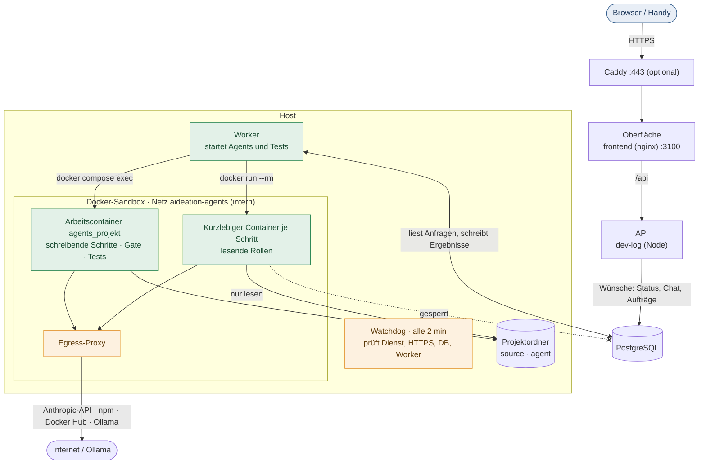
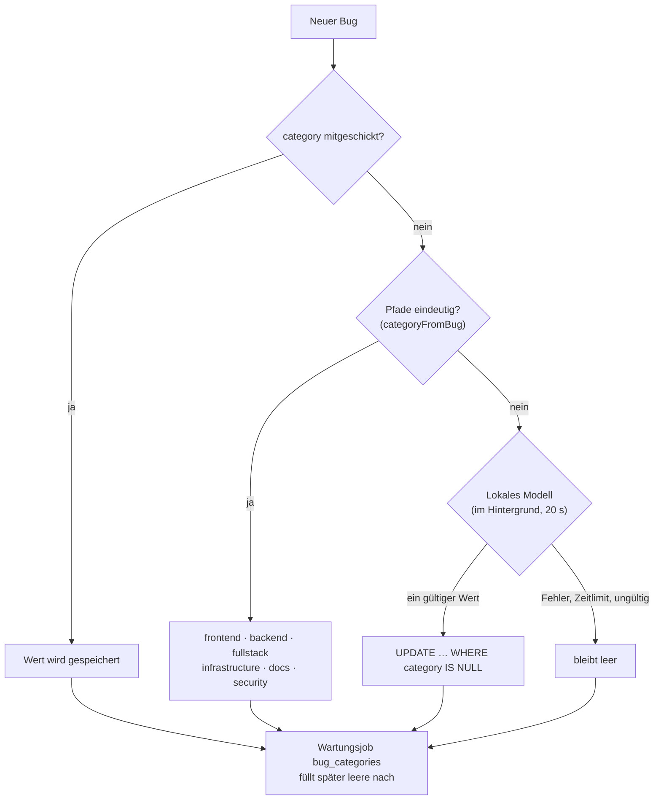
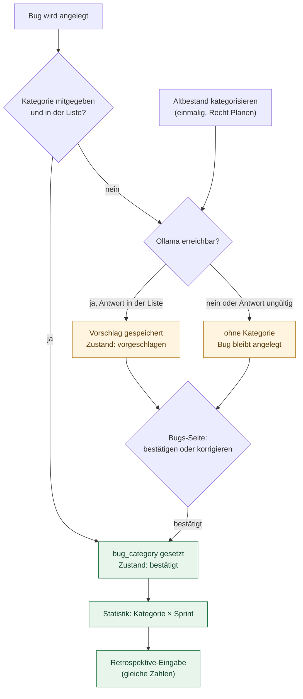
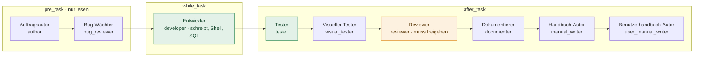
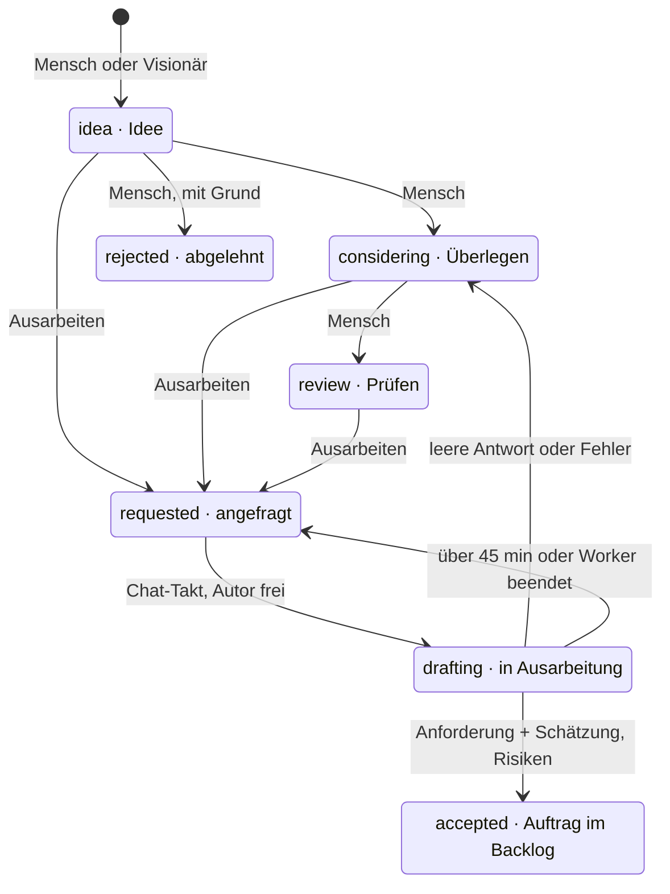
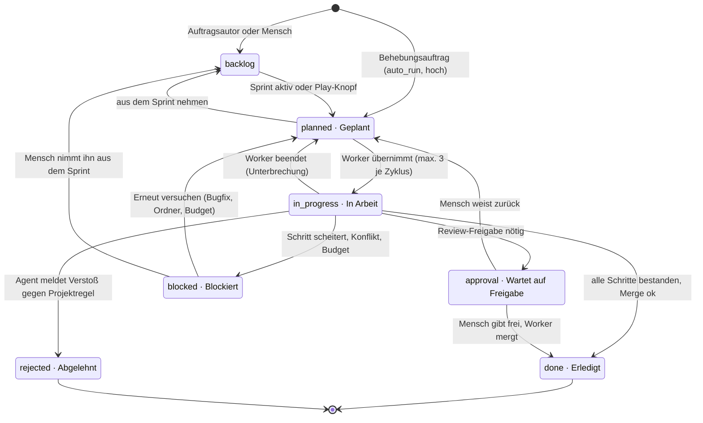
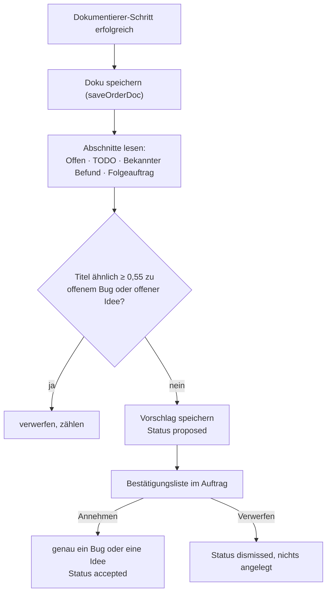
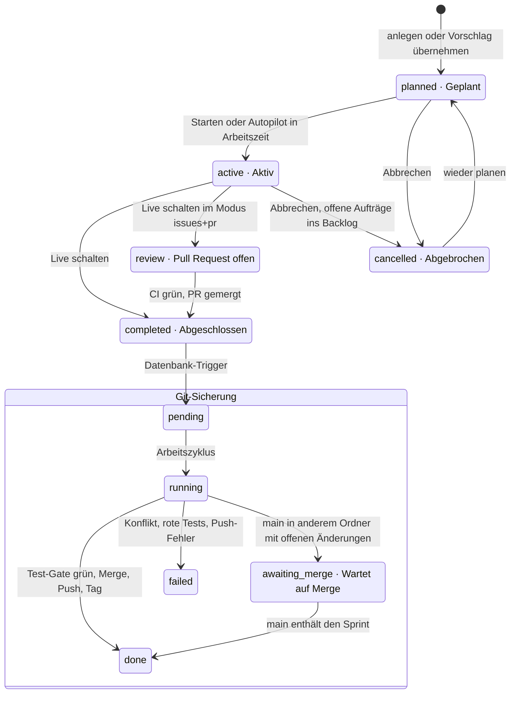
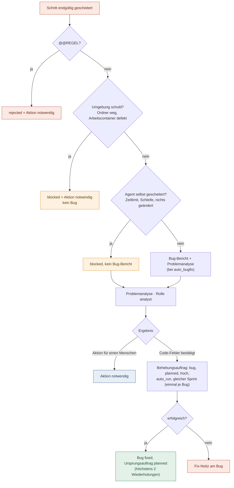
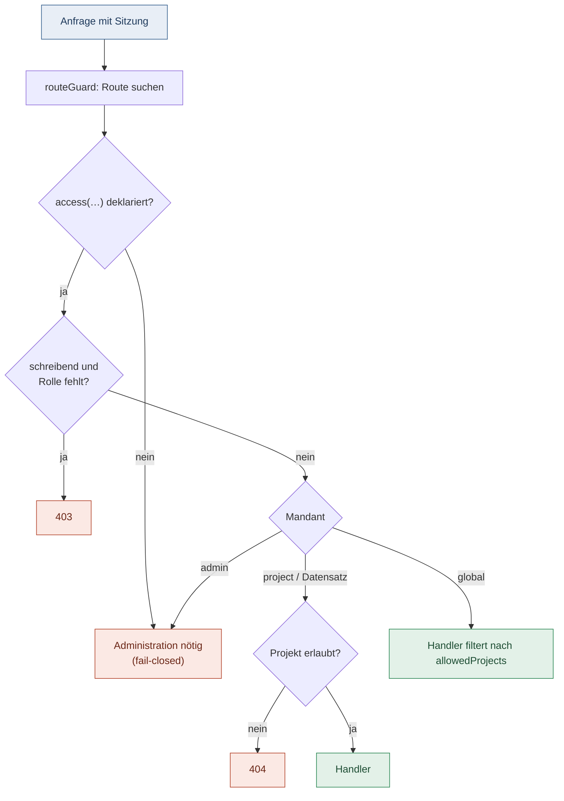

# AIdeation – Anwendungshandbuch

Das Handbuch von A bis Z: Zweck, Bedienung, Architektur, Konfiguration und Betrieb. Es fasst die Fachdokumente zusammen
und verweist für Details auf sie: [Installation](installation.md), [Betrieb](betrieb.md), [Workflows](workflows.md),
[Agents und Rechte](agents-und-rechte.md), [Laufzeit](laufzeit.md), [Bug-Kategorien](bug-kategorien.md).

**Stand:** 11.11.2026. Abgeglichen mit `src/` (Migrationen bis Version 30) und den Fachdokumenten. Wo sie sich
widersprechen, gilt der Code; die Abweichung steht in Anhang B.

## Inhalt

1. Zweck
2. Bedienung im Überblick
3. Architektur
4. Bugs und Kategorien
5. Agents und Rollen
6. Ablauf eines Auftrags
7. Sprint, Autopilot und Git
8. Fehler, Problemanalyse und Bugfix
9. Rechte und Sicherheit
10. Konfiguration
11. Betrieb
- Anhang A: Begriffe und Statuswerte
- Anhang B: Quellen, Korrekturen und offene Punkte

---

## 1. Zweck

AIdeation verbindet Ideen, Aufträge, Sprints und Bugs mit KI-Agents, die in den Projektordnern arbeiten. Ein Mensch
legt Ideen an und plant Sprints. Der Worker lässt die Agents die Aufträge umsetzen, testen, prüfen und dokumentieren.
Freigaben, Live-Schaltungen und Betriebs-Eingriffe bleiben beim Menschen.

Was AIdeation **nicht** tut:

- Es legt keine Bugs oder Ideen ohne Anlass selbst an, außer ein Test, ein Agent oder ein Betriebsereignis meldet sie.
- Es führt keinen Code aus, den Agents geschrieben haben, auf dem Host. Dafür gibt es die Arbeitscontainer
  (Abschnitt 3).
- Es schaltet nichts live, ohne dass der Sprint abgeschlossen ist und der Git-Schritt (Test-Gate, Merge, Tag) läuft.

## 2. Bedienung im Überblick

| Bereich | Wozu |
| --- | --- |
| **Dashboard** | Worker-Badge, Budget heute/Sprint, Agent-Status, offene Aktionen |
| **Ideation** | Ideen erfassen, schätzen, zu Aufträgen ausarbeiten lassen; Herkunft-Filter (Mensch, Visionär, Routine, Produktion, GitHub) |
| **Aufträge** | Anforderung, Schätzung, Risiken, Zeitleiste, Rückfragen, Nachweise, Play-Knopf |
| **Sprints** | Planen, starten, abschließen; „Aufträge hinzufügen“; Autopilot |
| **Bugs** | Liste mit Kategorie-Filter, Statistik, Detail mit „Betrieb“-Reiter (Rollback) |
| **Aktionen** | Alles, was ein Mensch entscheiden muss: Freigaben, Testnachweise, blockierte Aufträge |
| **Chat** | Dashboard-Assistent; Aktionen, Routinen, gewählter Agent |
| **Einstellungen** | Projekt, Agents, Rechte-Kategorien, Budget, Betrieb, Git |
| **Hilfe** | Interaktive Tour, Benutzerhandbuch |

Der Sprint- und Auftragsstatus wird in der Oberfläche aus denselben Werten angezeigt wie in der API
(`src/core/status.ts`, Anhang A).

## 3. Architektur

Vier Teile arbeiten zusammen. Nur der Worker führt Arbeit aus; der Backend-Container schreibt lediglich Wünsche in die
Datenbank.

| Teil | Läuft als | Aufgabe |
| --- | --- | --- |
| Oberfläche (`frontend`) | Container, nginx | Angular-Oberfläche, leitet `/api` weiter |
| API (`dev-log`) | Container, Node/Express | Routen, Rechte, Schreiben der Wünsche |
| Datenbank (`db`) | Container, PostgreSQL | Alle Daten; Schema-Migrationen beim Start |
| Worker | Compose-Dienst oder Host-Dienst | Arbeitszyklus, Chat-Takt, Wartungs-Jobs |
| Watchdog | Dienst | Ausfall-Wächter, Push-Meldungen |
| Backup | Container | tägliches Datenbank-Backup nach `backups/` |

Die Container liegen im internen Netz. Der Arbeitscontainer je Projekt (`agents_<projekt>`, Docker in Docker ohne
Privilegien) führt die Tests und Agents aus. Die Container dürfen nur zu Anthropic, npm, Docker Hub und Ollama
(Egress-Proxy), nicht zur Datenbank oder ins LAN.

Die Datenbank-Migrationen laufen beim Start von API und Worker unter einer gemeinsamen Sperre. Bestehende Schritte
werden nie geändert; neue kommen hinten an (`src/db/migrations.ts`, Version 30 ist der aktuelle Stand).

## 4. Bugs und Kategorien

Jeder Bug kann eine **Kategorie** aus sechs Werten haben: `frontend`, `backend`, `fullstack`, `infrastructure`, `docs`,
`security` (`BUG_CATEGORIES` in `src/core/bug-category.ts`). Ohne eindeutige Zuordnung bleibt die Kategorie leer.
Einen Ausweichwert gibt es nicht.

- **Mitgeschickt:** `POST /projects/:slug/bugs` mit `category` speichert genau diesen Wert.
- **Aus Pfaden:** `frontend/…` → `frontend`; `src/…` → `backend`; beides → `fullstack`. Nur `docs/` oder `README.md` →
  `docs`; nur Betriebsdateien (`deploy/`, `.github/`, `Dockerfile`, `docker-compose.yml`, `start.sh`) →
  `infrastructure`. Nur die Sicherheitsmodule (`agent-guard`, `path-policy`, `permission`) → `security`.
- **Lokales Modell:** Greift kein Pfad, fragt AIdeation das Modell der Rolle `author` (Ollama, ohne Werkzeuge). Das
  Anlegen des Bugs wartet nie darauf. Abschalten mit `DEV_LOG_BUG_CATEGORY_MODEL=off`.
- **Wartungsjob `bug_categories`:** Einmalig nach der Migration 26 (`bug-kategorien-nachtragen`). Er füllt Bugs ohne
  Kategorie in Stapeln zu 50 nach und schreibt nur bei `category IS NULL`. Von Hand gesetzte Werte bleiben. Am Ende
  steht `state.done = true`.
- **Erzeuger:** Tests (`fileBugs`), Auto-Fix und Bug-Wächter (`reportAgentBug`), Problemanalyse, GitHub-Import und
  CI-Fehler. Betriebs- und Routinen-Bugs setzen ihre Kategorie selbst.
- **Korrigieren:** im Bearbeiten-Formular (Recht „Planen“) oder per `PATCH /bugs/:id` mit `category`.
- **Anzeige:** Filter „Kategorie“ mit allen Werten und „Ohne Kategorie“; Statistik „Nach Kategorie“ zählt nur das Feld
  `category`.

### 4.1 Feste Bug-Kategorie `bug_category` *(geprüft gegen `src/core/bug-category-values.ts` und `src/db/migrations.ts`, Migration 29)*

Ein Bug hat zwei getrennte Kategorien:

- **`category`** (Bereich: frontend, backend, fullstack, infrastructure, docs, security). Er vererbt sich per Trigger `development_items_inherit_category` an Aufträge. Regeln: [Bugs automatisch nach Bereich kategorisieren](docs/bug-kategorien.md).
- **`bug_category`** (Thema: `security`, `git-sync`, `ci`, `ui`, `api`, `agent-guard`, `budget`, `docs`). Zustand in `bug_category_state`: `suggested` (vom Modell vorgeschlagen, zählt noch nicht) oder `confirmed` (von Mensch oder Agent gesetzt). Der Vorschlag steht getrennt in `bug_category_suggested`.

- **Anlegen:** Tester, Bug-Wächter und Auto-Fix schicken ihre Kategorie mit. Ist sie gültig, gilt sie sofort als bestätigt. Fehlt sie, fragt das lokale Modell an; der Bug wird in jedem Fall angelegt.
- **Sicherheit:** Modellantworten werden nur gegen die feste Liste geprüft. Texte aus Betrieb und GitHub sind Daten, keine Anweisungen. Der Klassifikator hat keine Werkzeuge.
- **Bestätigen:** Auf der Bugs-Seite einzeln oder gesammelt. Der Knopf „Altbestand kategorisieren“ erzeugt nur Vorschläge und ändert keine bestätigte Kategorie.
- **Filter und Statistik:** Die Bugs-Seite filtert nach `bug_category`. Die Statistik zeigt eine Tabelle Kategorie × Sprint (offen und begraben getrennt; Bugs ohne Sprint als „Kein Sprint“). `collectStats` liefert dieselben Zahlen an den Retrospektive-Agenten.

**Korrektur:** Der Auftrag nennt „Migration 20“. Im Code belegen die Versionen 20 bis 28 schon andere Änderungen; die Kategorie-Migration ist **Version 29**. Der CHECK in der Datenbank nennt exakt die acht Werte aus `BUG_CATEGORY_VALUES`.

## 5. Agents und Rollen

Jeder Agent hat eine **Rolle** (bestimmt Ablauf und Rechte) und eine **Phase** im Auftragsablauf. Die Standard-Agents
legt `POST …/agents/defaults` an.

| Agent | Rolle | Phase | Aufgabe | Dateien ändern | Befehle |
| --- | --- | --- | --- | --- | --- |
| Auftragsautor | `author` | pre_task | Anforderung, Akzeptanzkriterien, Schätzung | nein | nein |
| Bug-Wächter | `bug_reviewer` | pre_task | Risiken gegen bekannte Bugs | nein | nein |
| Entwickler | `developer` | while_task | Auftrag umsetzen (Backup in `.dev-log-backups/`) | ja | npm test/run/install, git lesen |
| Tester | `tester` | after_task | Tests schreiben, Abnahme der Kriterien | ja | über Rechte-Gruppen |
| Visueller Tester | `visual_tester` | after_task | Screenshots bei Frontend/Fullstack | nein | nein |
| Reviewer | `reviewer` | after_task | Prüfung, Freigabe mit `@@REVIEW: FREIGEGEBEN` | nur lesen | über Rechte-Gruppen |
| Dokumentierer | `documenter` | after_task | Auftragsdoku | Claude-CLI: anlegen + ändern | nein |
| Handbuch-Autor | `manual_writer` | after_task | technisches Handbuch pflegen | Claude-CLI: anlegen + ändern | nein |
| Benutzerhandbuch-Autor | `user_manual_writer` | after_task | Benutzerhandbuch pflegen | Claude-CLI: anlegen + ändern | nein |
| Eigene | `custom` | frei | Zusatzrolle | nein | nein |

System-Agents ohne Workflow-Schritt: Dashboard-Assistent (`assistant`), Problemanalyse (`analyst`), Visionär
(`visionary`), Vor dem Sprint (`pre_sprint`), Routinen (`routine`).

- **Befehl und Rolle ändern** darf nur die Rolle `admin` (`adminFieldsCheck` in `src/api/agents.ts`).
- **Lokales Modell** (Ollama, Standard `qwen3.5:9b`): schreiben nur Entwickler und Assistent. Schrittlimit 25 bei
  lesenden Rollen, 80 bei schreibenden (am Agent einstellbar von 10 bis 200).
- **Visionär:** legt Ideen mit Begründung an, überspringt Dubletten und abgelehnte Ideen. Ein Lauf je Projekt, abbrechbar.

## 6. Ablauf eines Auftrags

### 6.1 Von der Idee zum Auftrag

Eine Idee hat höchstens einen Auftrag. Schnellschätzungen (Stunden, Tokens, Nutzen, Kosten) füllt der Worker im
Chat-Takt für Ideen ohne Schätzung nach.

### 6.2 Auftragsstatus

Arten: `feature`, `bug` (Behebungsauftrag), `express` (Chat-Anfrage, läuft nie im Arbeitszyklus).

- **Ausgewählt** wird ein Auftrag nur, wenn er „planned“ ist **und** (Sprint aktiv **oder** fester Agent **oder**
  `auto_run`). Reihenfolge: Sprint-Rang, Priorität, Alter.
- **Review-Freigabe** (`projects.review_mode`): `off` mergt sofort, `ui` hält bei Oberflächen-Änderungen an, `always`
  bei jeder Änderung. Freigaben mergt der Worker zu Beginn jedes Zyklus.
- **Play-Knopf:** setzt einen festen Agent, plant ein und kehrt nach Erfolg in den alten Status zurück.
- **Automatik:** Bug-Auftrag in Arbeit → Bug `in_progress`; erledigt → `fixed`; abgelehnt → `rejected`; zurück → `open`.
- **Erneut versuchen:** Abgebrochene Aufträge neu einplanen braucht zusätzlich die Rolle „Agents ausführen“ (`run`);
  sonst 403.

### 6.3 Ablauf je Auftrag

Pro Auftrag läuft immer nur **ein** Lauf (`agent_runs` mit Status `running` ist eindeutig). Die Schritte folgen
nacheinander: `pre_task` → `while_task` → `after_task`. Gelingt ein Schritt nicht, geht er einmal zurück an den
Entwickler (Nachbesserung im selben Lauf). Ein Lauf ohne Lebenszeichen über rund 9 Stunden gilt als verwaist
(`ABANDONED_RUN_MS`).

Kurze Ausfälle (Modell nicht erreichbar, Rate-Limit, Zeitlimit) wiederholen den Schritt nach 30 Sekunden, bevor der
Auftrag blockiert. Vor dem zweiten Versuch prüft der Worker das Budget erneut.

Mehrstufige Änderungen der API laufen in einer Transaktion (`withTransaction`, `src/db/transaction.ts`). Das gilt
etwa für das Übernehmen eines Auftrags in einen Sprint oder das Löschen eines Projekts.

### 6.4 Vorschläge aus der Dokumentation

Nach einem erfolgreichen Dokumentierer-Schritt liest AIdeation die neue Auftragsdoku aus und schlägt daraus Bugs oder
Ideen vor. Angelegt wird erst, was ein Mensch in der Bestätigungsliste annimmt.

- **Erkennung:** Ein Abschnitt zählt nur als Überschrift (`#` bis `######`) oder als Zeile, die mit `**Stichwort…:**`
  beginnt (auch mit Listenpunkt davor). Erwähnungen mitten im Fließtext zählen nicht. Jeder Listenpunkt (bzw. Absatz)
  unter der Überschrift wird ein Eintrag.
- **Typ:** „Bekannter Befund“ ergibt einen Bug. Die übrigen Abschnitte ergeben eine Idee, außer der Titel beschreibt
  einen Fehler, dann einen Bug.
- **Titel:** Erster Satz des Eintrags, gekürzt auf 80 Zeichen (`TITLE_MAX`, wie bei `POST /bugs`). Die Vorgabe des
  Auftrags nannte 180 Zeichen; die Kürzung folgt dem bestehenden Bug-Titel.
- **Dubletten:** Gleiche Titel innerhalb einer Doku werden einmal gespeichert. Ähnlich ≥ 0,55 zu einem **offenen**
  Bug (Status `open`, `in_progress`) oder einer **offenen** Idee (nicht `accepted`, `rejected`) wird verworfen und
  gezählt. Bereits angenommene oder abgelehnte Einträge gelten nicht als Dublette.
- **Was nicht passiert:** Der Schritt legt selbst keinen Bug und keine Idee an, ruft kein Modell auf und ändert weder
  `bugs` noch `ideation_items`.
- **Fehler:** Ein Parserfehler blockiert den Auftrag nicht. Eine Doku ohne die Abschnitte erzeugt keinen Vorschlag und
  keinen Fehler. Der Schritt läuft in einer eigenen Fehlerbehandlung und verändert Tokens, Kosten und Status des
  Dokumentierer-Schritts nicht. Schlägt er fehl, steht es im Worker-Log; er erscheint nicht als Agent-Schritt.
- **Bestätigungsliste:** Im Auftrag stehen nur Vorschläge mit Status `proposed`. Annehmen legt genau einen Bug
  (`source = agent`, über dieselbe Anlage wie `POST /bugs`) bzw. eine Idee an und setzt den Vorschlag auf `accepted`.
  Verwerfen setzt `dismissed`. Ein zweiter Klick auf „Annehmen“ endet mit 409; das Umschalten läuft in einer
  bedingten Anweisung (`WHERE status = 'proposed'`), so entsteht nie ein zweiter Bug.
- **Rechte:** Liste, Annehmen und Verwerfen verlangen Projektbezug. Annehmen und Verwerfen brauchen die Rolle „Planen“.
- **Bekannte Lücke:** Befunde, die nur im Fließtext stehen, werden nicht erkannt. Zwei der drei Belege aus der Idee
  sind so geschrieben. Ob der Dokumentierer-Prompt die Befunde als eigene Abschnitte schreiben soll, ist offen
  (Anhang B).

## 7. Sprint, Autopilot und Git

Pro Projekt gibt es höchstens **einen aktiven** Sprint (Datenbank-Regel). Der Modus steht in den Einstellungen:
`manual`, `suggest` oder `autopilot`.

- **Abschließen** verlangt, dass kein Auftrag mehr läuft oder auf Freigabe wartet (sonst 409). Das Enddatum liegt nie
  vor dem Startdatum. Scheitert der Abschluss, bleiben Status, Bericht und Git-Sicherung gemeinsam unverändert.
- **Autopilot** wartet auf eine offene Git-Sicherung, startet keinen Sprint von einem veralteten `main` und übernimmt
  Vorschläge nur in den Arbeitszeiten (Standard Mo–Fr 08–18 Uhr).
- **Git je Ebene:** Auftrag → Branch `auftrag/…` vom Sprint-Branch; Sprint → `sprint/…`; Abschluss → Merge nach `main`
  (`--no-ff`), erneutes Test-Gate, Push, Tag `sprint-name-id`.
- **Nie committet:** `.env`, Backups, Schlüsseldateien, Zeilen mit Tokens.
- **AIdeation selbst:** Der Neustart nach dem Sprint-Abschluss läuft nur, wenn nichts offen ist, und prüft die Tests
  vorher.

## 8. Fehler, Problemanalyse und Bugfix

Scheitert ein Schritt endgültig, entscheidet der Worker nach Ursache:

- **`auto_bugfix`** ist für neue Projekte aus. Ohne diese Einstellung entsteht kein Behebungsauftrag.
- **Bugs aus fremden Quellen** (Betrieb-Rückkanal, GitHub-Issues) sind nicht vertrauenswürdig. Sie laufen erst nach
  einer Freigabe durch einen Menschen (Recht „Ausführen“, `POST /api/bugs/:id/approve`). Ein neuer Betriebs-Bug legt
  keinen Behebungsauftrag an. Fremder Text steht in einem markierten Block mit Sicherheitshinweis; Marker wie `<<<`
  werden entschärft.
- **Betriebs-Bugs:** Der Log-Scan (alle 15 Minuten und nach jedem Deploy) gruppiert gleiche Fehler. Zehn gleiche
  Fehler ergeben einen Bug mit Zähler 10. Ein erneutes Auftreten nach der Behebung öffnet ihn als Regression.
- **Rollback:** Ein Mensch bestätigt den Rollback im Bug-Detail. Der Worker checkt den vorherigen Sprint-Tag aus und
  führt ihn über den Deploy-Befehl aus. Das Ergebnis steht in `production_rollbacks`; der Bug bleibt offen.

## 9. Rechte und Sicherheit

### 9.1 Benutzerrollen an den API-Routen

Jede Route deklariert ihre Rolle und ihren Mandanten (`access` in `src/api/access.ts`).

- **`role`** gilt für Schreibzugriffe. Eine Funktion kann nach dem Body entscheiden (z. B. `{ agentId }` allein braucht
  `run`).
- **Fehlt die Deklaration**, verlangt die Route Administration. Dadurch bleibt eine vergessene Route gesperrt.
- **Review-Container:** Freigeben ist Administration. Starten und Beenden braucht `run`.

### 9.2 Rechte je Agent

Zwei Ausführungswege mit unterschiedlichen Grenzen:

- **Claude-CLI:** Die freigeschalteten Gruppen des Projekts werden als `--allowedTools` übergeben; der Wächter
  (`agent-guard.ts`) prüft jeden Schreib- und Shell-Zugriff.
- **Lokales Modell (Ollama):** eingebaute Werkzeuge; Schreiben nur für Entwickler und Assistent. Fehlt der Rechte-Kontext,
  darf das Modell nur lesen (fail-closed).

| Agent · Rolle | Lesen | Dateien schreiben (Claude) | Shell (Claude) |
| --- | --- | --- | --- |
| Auftragsautor, Bug-Wächter, Problemanalyse, Visionär, Vor dem Sprint | ✅ | ⛔ bzw. ⚠️ teils | ⛔ |
| Entwickler · `developer` | ✅ | ✅ | ✅ alle freigegebenen Gruppen |
| Tester, Reviewer | ✅ | ✅ | ✅ alle Gruppen |
| Visueller Tester | ✅ | ⛔ | ⛔ |
| Dokumentierer, Handbuch-Autoren | ✅ | ⚠️ anlegen + ändern | ⛔ |
| Dashboard-Assistent · `assistant` | ✅ | ✅ | ✅ alle Gruppen (Vollzugriff nur mit Flag) |
| Routine · `routine` | ✅ | ⛔ | ✅ freigegebene Gruppen plus „Prüfbefehle“ |

**Gruppen** schalten Befehle frei: Dateien (immer), Diagnose, Dienst-Logs, Projekt-Datenbank (nur lokales Modell),
Build und Tests, Pakete (`npm install --ignore-scripts`), Git (kein `checkout`: Branches verwaltet AIdeation),
Projekt-Dienste (`services.status|logs|restart|up|stop` über den Worker), Prüfbefehle (nur Routinen). Eigene Gruppen
dürfen keine Regeln für `.env`, `.ssh`, `.aws`, `.gnupg`, DevLog oder AIdeation enthalten.

### 9.3 Was immer gesperrt ist

- Schreiben außerhalb des Projekts oder der Ordner-Einschränkung des Agents.
- Geschützte Pfade (`src/agent/path-policy.ts`): `.git/`, `.husky/`, `.githooks/`, `.claude/`, `.mcp.json`, `.vscode/`,
  `node_modules/`, `.dev-log-backups/`, `.npmrc`, `.yarnrc*`, `.pnpmrc`, `.ssh/`, `.aws/`, `.gnupg/` sowie alle
  Geheimnisse (`.env*`, `*.pem`, `*.key`, `id_rsa*`, `.netrc`, `.git-credentials`).
- Lesen von Geheimnissen: Jeder Claude-Agent bekommt Deny-Regeln und einen Hook. Die Meldung nennt nur den Pfad, nie
  den Inhalt.
- Docker- und Dienstbefehle des Betriebssystems: Agents fordern nur feste Aktionen beim Worker an
  (`services.*`, mit Compose-Prüfung und ohne Shell).
- Projektcode läuft nur mit gefiltertem Environment (Allowlist). `DEV_LOG_*` und alles mit SECRET, TOKEN, PASSWORD,
  API_KEY oder DATABASE_URL im Namen fehlt immer.
- `run_sql` des Assistenten: eine Anweisung je Aufruf, Zeitlimits, höchstens 50 Zeilen, nie auf der AIdeation-Datenbank.

### 9.4 Anmeldung

- Fehlversuche werden je Herkunft und Benutzername gebremst: die ersten 10 sind frei, danach wächst die Wartezeit von
  1 Minute bis höchstens 15 Minuten (HTTP 429, `Retry-After`).
- Höchstens 300 Fehlversuche pro Minute je Herkunft über alle Namen.
- Die Client-IP kommt nur aus `X-Forwarded-For`, wenn `DEV_LOG_TRUST_PROXY` den Proxy kennt (Compose: `1`).
- Eine Passwortrotation beendet alle Sitzungen des Systemadministrators.

## 10. Konfiguration

### 10.1 Wo steht was

| Ort | Inhalt |
| --- | --- |
| `.env` (Ordner `source`) | Zugänge, `DEV_LOG_SECRET_KEY`, Domain, Projektbereich, Backup-Optionen |
| `~/.config/aideation/worker.env` | Worker auf dem Host (Rechte 600) |
| Projekt-Einstellungen | Testbefehle, Review-Befehl, Vorschau-Adresse, Regeln für Agents, `review_mode`, `auto_bugfix` |
| Einstellungen → Agents | Modell, Befehl (nur Administration), Rolle, Rechte, Schrittlimit |
| Einstellungen → Budget | Limits je Tag, Sprint und Auftrag (Tokens oder USD); Modell-Routing |
| Wartungs-Jobs (`GET`/`PATCH /api/scheduled-jobs`) | Takt, Zeitlimit und Ein-/Ausschalten je Job |

### 10.2 Wichtige Umgebungsvariablen

| Variable | Wirkung | Standard |
| --- | --- | --- |
| `DEV_LOG_SECRET_KEY` | verschlüsselt Projektzugänge, Zwei-Faktor-Schlüssel, Push-Schlüssel | wird beim Einrichten erzeugt |
| `DEV_LOG_DB_PASSWORD` | Datenbank-Passwort | zufällig beim Einrichten |
| `DEV_LOG_TRUST_PROXY` | vertraute Proxys für die Client-IP | aus |
| `DEV_LOG_ALLOWED_HOSTS` | zusätzliche Host-Namen (Schutz vor DNS-Rebinding) | leer |
| `DEV_LOG_BACKUP_MIN_KEEP` | Zahl der Backups, die immer bleiben | 7 |
| `DEV_LOG_BACKUP_KEEP_DAYS` | Aufbewahrung älterer Backups in Tagen | 14 |
| `DEV_LOG_BACKUP_USER` | Benutzer für den Backup-Container (Linux) | `70:70` |
| `DEV_LOG_PG_RESTORE` | Pfad zu `pg_restore` auf dem Host | Systemstandard |
| `DEV_LOG_BUG_CATEGORY_MODEL` | `off` schaltet das Modell für Bug-Kategorien ab | an |
| `DEV_LOG_AGENT_COMMAND` | Standardbefehl der Agents | lokales Modell |
| `COMPOSE_PROFILES` | Profil `worker` (Worker im Container), `https` | je nach Einrichtung |

### 10.3 Takte und Grenzen

| Takt | Was | Quelle |
| --- | --- | --- |
| 1,5 s | Chat-Takt: Assistent, Schätzung, Autor, Visionär, Problemanalyse | `src/runner/worker-loop.ts` |
| sofort · 30 s | Arbeitszyklus je Projekt; höchstens 2 Projekte gleichzeitig (Einstellung, max. 8) | `runWorkflow` |
| 15 s | Heartbeat, Rollbacks, Produktions-Rückkanal | Worker |
| 1 min | Routinen-Planer; GitHub-Issues alle 5 min, PR-Status alle 2 min | `scheduleRoutines` |
| 30 s | Wartungs-Jobs nach jedem Zyklus, nie zwei Durchgänge gleichzeitig | `src/runner/scheduler.ts` |

Budget-Regeln: Vor jedem Agent-Schritt gilt zuerst das Projektlimit, dann das Limit der Rolle (`budget_role_limits`).
Erreicht ein Limit, startet der Schritt nicht und der Auftrag wird blockiert. Die 80-%-Warnung kommt je Periode genau
einmal. Rollen-Limits lassen sich bisher nur über die API setzen (`PUT /api/projects/:slug/budget/roles/:role`).

## 11. Betrieb

### 11.1 Installation und Start

Die Schritt-für-Schritt-Anleitung steht in [Installation](installation.md). Kurz: Docker, Node.js 22.12 oder neuer und
Git installieren, `./start.sh` (Windows: `start.cmd`) starten und den Einrichtungs-Assistenten im Browser ausfüllen.
Danach ist AIdeation unter `http://localhost:3100` erreichbar.

### 11.2 Alltag

| Aufgabe | Befehl (im Ordner `AIdeation/source`) |
| --- | --- |
| Starten | `./start.sh` (Docker Desktop muss laufen) |
| Stoppen | `docker compose stop` |
| Zustand | `docker compose ps` |
| Protokoll der API | `docker compose logs -f dev-log` |
| Protokoll des Workers | `docker compose logs -f worker` |
| Einrichtung ändern | `./start.sh --setup` (sichert die `.env` und ergänzt sie) |
| Aktualisieren | `git pull`, dann `./start.sh` – oder „AIdeation neu starten“ im Chat (nur Administration) |

Die Container starten nach einem Neustart des Rechners von selbst wieder (`restart: unless-stopped`).

### 11.3 Worker

- Es gibt **einen** Worker je Installation (`npm run worker`). Er bedient alle registrierten Projekte.
- Er lädt Code nur beim Start. Nach jeder Code-Änderung neu starten („AIdeation neu starten“).
- Der Neustart beendet den Prozess mit Code 75; Container, launchd, systemd oder die Windows-Aufgabe starten ihn neu.
  Steht „restarting“ länger als 10 Minuten, nimmt der nächste Neustart an.
- Wartet ein Projekt auf den Ordner, zeigt das Worker-Badge den Grund.

### 11.4 Wartungs-Jobs

| Job | Takt | Aufgabe |
| --- | --- | --- |
| `backup_check` | 6 h | neuestes Backup prüfbar, mindestens 1 KB, `pg_restore --list` lesbar |
| `restore_probe` | 7 Tage | Wiederherstellung in einen Wegwerf-Container, Schlüssel-Test, danach gelöscht |
| `watchdog_logs` | 15 min | Wächter-Prüfungen; gleiche Probleme erst nach 6 h erneut per Push |
| `push_alert` | 1 h · bei Fehler sofort | Push bei fehlgeschlagenem Job; gleiche Fehler erst nach 6 h |
| `bug_categories` | 1 Tag · einmalig | Nachtrag der Bug-Kategorien (Abschnitt 4) |
| `close_old_sprints` | 1 Tag · standardmäßig aus | schließt inaktive Sprints, deren Aufträge erledigt sind |

### 11.5 Backups und Wiederherstellung

- Der Backup-Container schreibt täglich `aideation-*.dump` nach `./backups`. Gelöscht wird nur nach einem erfolgreichen
  Dump. Die neuesten 7 bleiben immer, ältere ab 14 Tagen werden entfernt.
- **Wiederherstellen:** `bash scripts/restore.sh backups/aideation-JJJJMMTT-HHMMSS.dump`. Das Skript stoppt Worker und
  Wächter auf dem Host. Laufen sie als Compose-Dienste, stoppst du sie vorher selbst
  (`docker compose --profile worker stop worker watchdog`). Die neue Datenbank wird erst geprüft (Schlüssel-Test), dann
  ersetzt sie `aideation`. Die alte bleibt als `aideation_vor_restore_<zeit>` erhalten.
- **Schlüssel:** Der `DEV_LOG_SECRET_KEY` aus der Zeit des Backups muss in `.env` und `worker.env` stehen. Bewahre ihn
  getrennt von den Backups auf.
- **Verschlüsselt** ist im Dump nur die Projekt-Datenbank-Zugänge, die Zwei-Faktor-Schlüssel und der Push-Schlüssel.
  Alles andere (Aufträge, Bugs, Doku, Benutzer, Passwort-Hashes) liegt lesbar im Dump. Behandle Backups wie die
  Datenbank selbst und kopiere sie außer Haus.
- **Probe:** `bash scripts/restore.sh --probe backups/<datei>.dump` testet ein Backup in einem Wegwerf-Container (Port 5439).

### 11.6 Netzwerk und Zugriff von unterwegs

- Ohne Domain ist AIdeation nur auf dem Rechner erreichbar.
- Mit Domain im Assistenten startet der Dienst `https` (Caddy) mit Let's-Encrypt-Zertifikat. Dafür muss der Router Port
  443 weiterleiten. Die App lässt sich dann auf dem Handy installieren; Push-Nachrichten gehen nur an die Dienste der
  Browser (FCM, Mozilla, Apple, Windows).
- Hinter nginx muss `DEV_LOG_TRUST_PROXY=1` gesetzt sein, sonst teilen sich alle Geräte eine Bremse. Caddy leitet an
  `frontend:8081` weiter, nicht an 8080.

### 11.7 Fehlerbehebung

| Problem | Lösung |
| --- | --- |
| „Docker läuft nicht“ | Docker Desktop starten, dann `./start.sh` |
| „Node.js … ist zu alt“ | Node.js 22.12 oder neuer |
| Seite `localhost:3100` lädt nicht | `docker compose logs dev-log`; oft fehlt `DEV_LOG_PASSWORD` (mind. 16 Zeichen) |
| Agents starten nicht | Worker-Badge prüfen; `npm run worker` zeigt Fehler direkt; ohne Anmeldung starten sie nicht |
| Worker-Log: „Env-Datei … fehlt“ | Installationsskript erneut ausführen oder `chmod 600` auf die Env-Datei |
| Backup-Container startet ständig neu (Linux) | `./backups` nicht beschreibbar: `DEV_LOG_BACKUP_USER=<uid>:<gid>` setzen |
| `backup_check`: „pg_restore nicht gefunden“ | Worker-Image neu bauen oder `DEV_LOG_PG_RESTORE` setzen |
| Restore: „Schlüssel-Test fehlgeschlagen“ | `DEV_LOG_SECRET_KEY` aus der Zeit des Backups eintragen |
| Start bricht ab: „Zwei-Faktor-Schlüssel brauchen DEV_LOG_SECRET_KEY“ | bisherigen Schlüssel in `.env` eintragen und neu starten |
| Start bricht ab: „Standardpasswort“ | `./start.sh --setup` erneut ausführen |
| „Unbekannter Host“ (421) | Name in `DEV_LOG_ALLOWED_HOSTS` eintragen, neu starten |
| Zu viele Fehlversuche | Wartezeit steht in der Meldung; sie gilt nur für dieses Konto von dieser Adresse |
| Wächter sendet nach einem Update keine Push-Nachricht | `DEV_LOG_SECRET_KEY` in `watchdog.env` fehlt |
| Smoke-Test: „Executable doesn't exist“ | `npx playwright install chromium` |
| Port 3100 oder 5433 belegt | anderes Programm beenden; AIdeation braucht diese Ports auf `127.0.0.1` |

---

## Anhang A: Begriffe und Statuswerte

| Begriff | Bedeutung |
| --- | --- |
| Auftrag (`development_items`) | Arbeitseinheit; Art `feature`, `bug` oder `express` |
| Sprint | Bündel von Aufträgen; höchstens ein aktiver je Projekt |
| Schritt (`agent_run_steps`) | ein Agent-Lauf innerhalb eines Auftrags |
| Git-Sicherung | Test-Gate, Merge nach `main`, Tag, Push nach Sprint-Abschluss |
| Routine | zeitgesteuerte Agent-Aufgabe (Cron, Europe/Zurich) |
| Testnachweis (`@@NACHWEIS`) | Test, den ein Agent nicht selbst ausführen darf; wird im Projekt gegengeprüft |
| Fremdtext | Text aus Betrieb oder GitHub; nur im markierten Block und nur nach Freigabe |

Statuswerte (Werte aus `src/core/status.ts`):

- **Auftrag:** `backlog`, `planned`, `in_progress`, `done`, `approval`, `blocked`, `rejected`
- **Sprint:** geplant, aktiv, Pull Request offen, abgeschlossen, abgebrochen
- **Git-Sicherung:** `pending`, `running`, `awaiting_merge`, `done`, `failed`
- **Vorschlag aus der Doku:** `proposed`, `accepted`, `dismissed`; Art `bug` oder `idea` (`FOLLOW_UP_STATUS`, `FOLLOW_UP_KIND`)
- **Bug-Kategorie:** `frontend`, `backend`, `fullstack`, `infrastructure`, `docs`, `security`, leer = ohne Kategorie

## Anhang B: Quellen, Korrekturen und offene Punkte

### B.1 Quellen

- `docs/installation.md`, `docs/betrieb.md`, `docs/workflows.md`, `docs/agents-und-rechte.md`, `docs/laufzeit.md`,
  `docs/bug-kategorien.md` und der Code (`src/`, Migrationen `src/db/migrations.ts`).

### B.2 Korrekturen gegenüber dem Vorlauf

- **Datei fehlte:** `docs/anwendungshandbuch.md` war im Workspace nicht vorhanden. Das Handbuch wurde neu angelegt, nicht
  fortgeschrieben. Der Abschnitt „Bugs und Kategorien“ enthält nur, was der Code belegt.
- **Migrationsnummern:** Version 26 ist `bug-kategorien-nachtragen` (der Wartungsjob für den Bereich `category`),
  Version 29 ist `bug-kategorie-fest` (das Feld `bug_category`, Abschnitt 4.1) und Version 30 ist
  `folgevorschlaege-aus-doku`. Beide Aufträge kamen im selben Sprint, darum wurden sie beim Zusammenführen hintereinander
  nummeriert.
- **`src/core/bug-category-values.ts`:** existiert nicht. Die Werte stehen in `src/core/bug-category.ts`.
- **Mermaid:** Die Diagramme sind Syntax-geprüft nur durch Lesen, nicht gerendert.

### B.3 Offene Punkte

- **Folgevorschläge aus Doku-Abschnitten** (Auftrag 2150f8c0): Abschnitt 6.4 beschreibt den Code (Migration 30,
  `src/runner/follow-up-proposals.ts`, `src/api/follow-up-proposals.ts`). Verhalten ist nur per Lesen des Codes geprüft,
  nicht im Browser oder mit Tests. Die Abnahme steht aus.
- **Dokumentierer-Prompt:** Befunde in den Doku-Texten werden nur erkannt, wenn sie als eigene Abschnitte stehen. Die
  Entscheidung, ob der Prompt geändert wird, liegt beim Entwickler (Risiko Erkennung im Auftrag 2150f8c0).
- **Prüfung:** Der Test für Kriterium 9 (`runner-steps.test.ts`, „fehlgeschlagener Dokumentierer-Schritt“) ist angelegt.
  `npm test` wurde nicht ausgeführt, weil die Freigabe fehlte. Ebenso `prettier --check` für dieses Handbuch.
- **Veraltete Kopien unter `docs/`:** Zwei Dateien sind veraltet; ihre Löschung über `git rm` steht aus.
- **Rollen-Limits:** Nur über die API setzbar, eine Oberfläche gibt es noch nicht (Abschnitt 10.3).
- **Benutzerhandbuch:** Die Bug-Kategorien sind dort nur für das Feld `category` beschrieben.
