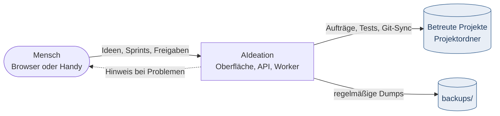
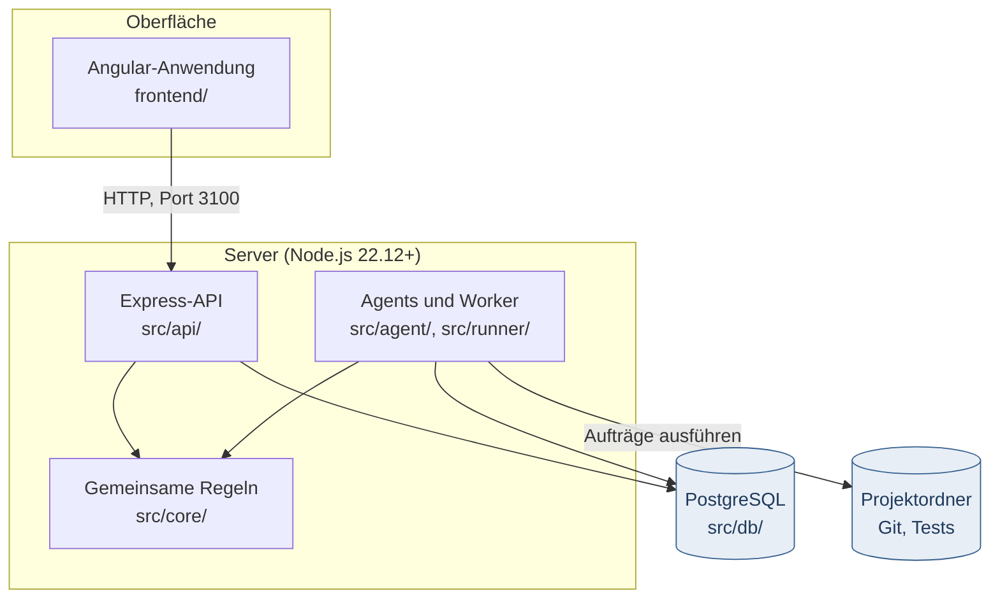
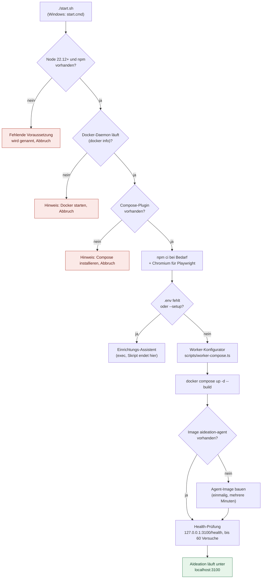
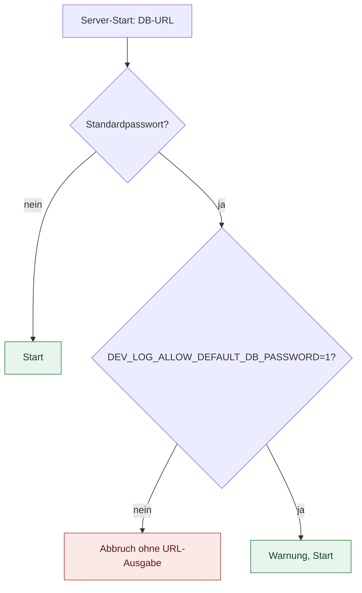
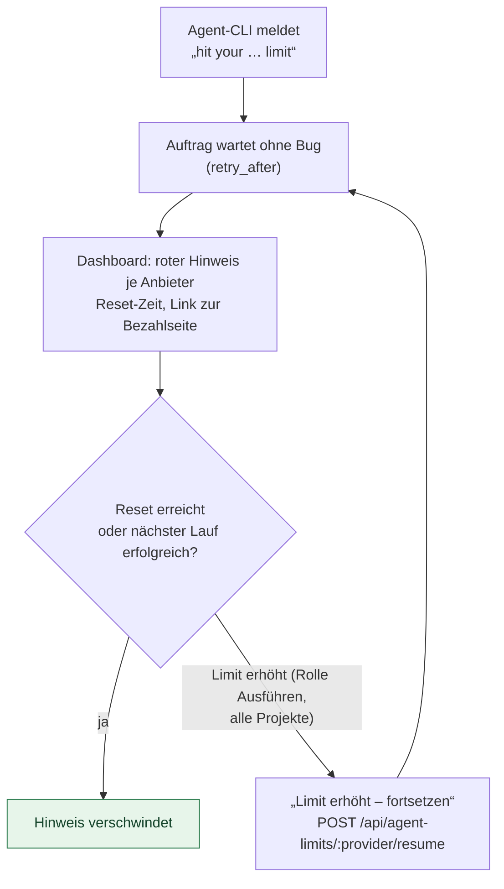
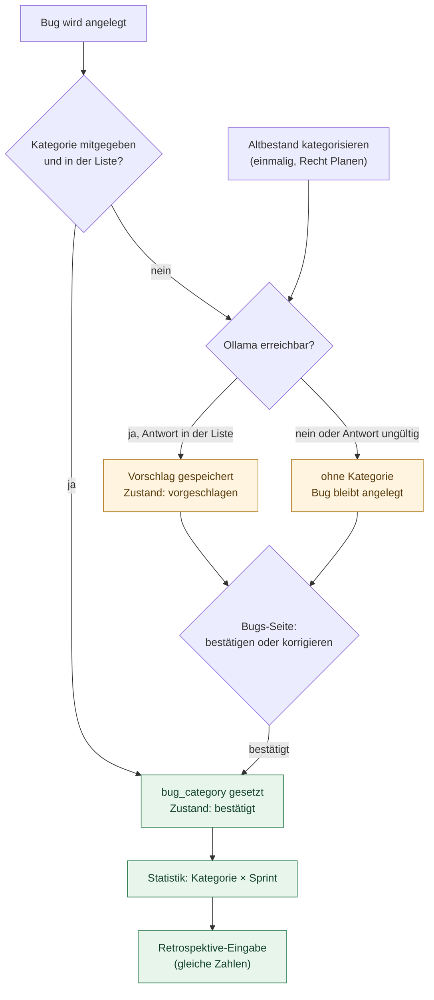

# AIdeation – Anwendungshandbuch

> **Stand:** 11.11.2026. **Status: teilweise.** Abschnitte 1 bis 4 sind geprüft (1 bis 3 gegen `start.sh`,
> `src/core/default-credentials.ts` und `README.md`; 4 gegen `src/core/bug-category-values.ts` und `src/db/migrations.ts`).
> Abschnitte 5 bis 11 und die Anhänge fehlen noch; ihre Quellen sind `docs/betrieb.md`, `docs/laufzeit.md`,
> `docs/workflows.md`, `docs/agents-und-rechte.md` und `docs/installation.md`.

## 1. Zweck

AIdeation verwaltet Sprints, Ideen, Aufträge, Bugs, Dokumentation und Statistik. Automatisch arbeitende Agents bearbeiten
Aufträge in den registrierten Projektordnern. Intern heißt das Projekt noch **Dev Log** (`DEV_LOG_`-Variablen, Dienst
`dev-log`).

## 2. Installation und Konfiguration

### 2.1 Voraussetzungen *(geprüft 11.11.2026)*

- **Docker** (Desktop oder Engine mit Compose-Plugin).
- **Node.js 22.12 oder neuer** mit npm (Begründung in `start.sh`, Zeile 17: Angular 20 und Vite 8).
- **Git**.
- Mindestens ein KI-Werkzeug für die Agents: Claude Code (`claude`) oder Ollama.

### 2.2 Erststart mit `./start.sh` *(geprüft 11.11.2026)*

Offen: Ob der Assistent den Start danach selbst anstößt, ist in `start.sh` nicht belegt. Das Skript endet dort mit `exec`.

### 2.3 Konfiguration über `.env` *(Quelle: README „Konfiguration“, Abgleich mit dem Code offen)*

| Variable | Zweck |
| --- | --- |
| `DEV_LOG_DATABASE_URL`, `DEV_LOG_ADMIN_DATABASE_URL` | Datenbankzugänge |
| `DEV_LOG_DB_PASSWORD` | Datenbank-Passwort, vom Einrichtungs-Assistenten gesetzt (siehe 2.4) |
| `DEV_LOG_TIMEZONE` | Zeitzone für Tagesgrenzen von Budget-Tag und Burndown (Standard `Europe/Zurich`); die Datenbank bleibt in UTC |
| `DEV_LOG_AUTH` | `off` = kein Login, nur in vertrauenswürdigen Netzen |
| `DEV_LOG_PROJECT_ROOTS` | Doppelpunkt-getrennte Ordner, unter denen Projektordner liegen müssen |
| `DEV_LOG_USERNAME` / `DEV_LOG_PASSWORD` | Anmeldung (Passwort ≥ 16 Zeichen) |
| `DEV_LOG_AGENT_COMMAND`, `DEV_LOG_MAX_TURNS` | Agent-Befehl und Turn-Grenze |
| `DEV_LOG_TEST_COMMANDS` | Fallback für Testbefehle (JSON) |
| `DEV_LOG_OLLAMA_URL`, `DEV_LOG_OLLAMA_MODEL` (+ `_<ROLLE>`), `DEV_LOG_OLLAMA_CTX`, `DEV_LOG_OLLAMA_KEEP_ALIVE` | lokales Modell; Standard `qwen3.5:9b`, Kontext 16384 (Entwickler 32768), Keep-Alive `30m` |
| `DEV_LOG_REVIEW_DATABASE_URL` | nur Worker: DB-Benutzer ohne Superuser-Rechte für Review-Container (`scripts/setup-review-db.sh`) |
| `DEV_LOG_SECRET_KEY` | ≥ 16 Zeichen; verschlüsselt Projekt-Datenbankzugänge, TOTP- und VAPID-Schlüssel (AES-256-GCM). Sind solche Schlüssel gespeichert und fehlt der Schlüssel, startet der Dienst nicht. Muss in `.env`, `worker.env` und `watchdog.env` gleich sein. |

Datenmodell: `docs/erm.md`.

### 2.4 Datenbank-Passwort *(geprüft 11.11.2026)*

- Ohne Freigabe wirft der Server einen Fehler (`src/core/default-credentials.ts:30`). Die Meldung enthält die URL nicht.
- Mit `DEV_LOG_ALLOW_DEFAULT_DB_PASSWORD=1` startet er mit Warnung (`:40`). Nur für Wegwerf-Umgebungen ohne Zugriff von außen.
- Abhilfe: `./start.sh --setup` erneut ausführen, danach den Worker neu installieren (`docs/betrieb.md`, „Standardpasswort“). Dass der Assistent dabei ein zufälliges Passwort setzt, steht nur in der Fehlermeldung; die Setup-Logik ist nicht nachgelesen.

## 3. Betrieb: Budget und Nutzungslimits

### 3.3 Nutzungslimits der Agent-Konten *(geprüft gegen README, „Ablauf“)*

Anbieter-Limits (Meldungen wie „You've hit your … limit · resets …“) sind **kein Code-Fehler**, sondern ein aufgebrauchtes
Kontingent. Erkannt wird der Anbieter am Programmnamen des Befehls (Claude, GitHub Copilot, Gemini).

- Erkennung: `src/core/provider-limits.ts` und `src/api/provider-limits.ts`.
- Status abfragen: `GET /api/agent-limits` (Status und erlaubte Aktionen).
- Der Link zur Bezahlseite kommt aus der Meldung nur bei https auf dem Host des Anbieters; sonst gilt eine feste Seite je Anbieter und Fall.
- Die 80-%-Warnung in `src/runner/budget.ts` ist nicht nachgeprüft *(offen)*.

### 3.4 Offene Ideen: Nutzen, Kosten, Wert *(offen)*

Der Ideen-Dialog zeigt Balken nur für **Nutzen** und **Kosten**. Der Wert hat in Dialog und Tabelle nur die Zahl. Die
Zeilenangabe `idea-detail.component.html:103–112` ist nicht nachgelesen *(offen)*.

## 4. Bugs und Kategorien *(geprüft gegen `src/core/bug-category-values.ts` und `src/db/migrations.ts`, Migration 29)*

Ein Bug hat zwei getrennte Kategorien:

- **`category`** (Bereich: frontend, backend, fullstack, infrastructure, docs, security). Er vererbt sich per Trigger `development_items_inherit_category` an Aufträge. Regeln: [Bugs automatisch nach Bereich kategorisieren](docs/bug-kategorien.md).
- **`bug_category`** (Thema: `security`, `git-sync`, `ci`, `ui`, `api`, `agent-guard`, `budget`, `docs`). Zustand in `bug_category_state`: `suggested` (vom Modell vorgeschlagen, zählt noch nicht) oder `confirmed` (von Mensch oder Agent gesetzt). Der Vorschlag steht getrennt in `bug_category_suggested`.

- **Anlegen:** Tester, Bug-Wächter und Auto-Fix schicken ihre Kategorie mit. Ist sie gültig, gilt sie sofort als bestätigt. Fehlt sie, fragt das lokale Modell an; der Bug wird in jedem Fall angelegt.
- **Sicherheit:** Modellantworten werden nur gegen die feste Liste geprüft. Texte aus Betrieb und GitHub sind Daten, keine Anweisungen. Der Klassifikator hat keine Werkzeuge.
- **Bestätigen:** Auf der Bugs-Seite einzeln oder gesammelt. Der Knopf „Altbestand kategorisieren“ erzeugt nur Vorschläge und ändert keine bestätigte Kategorie.
- **Filter und Statistik:** Die Bugs-Seite filtert nach `bug_category`. Die Statistik zeigt eine Tabelle Kategorie × Sprint (offen und begraben getrennt; Bugs ohne Sprint als „Kein Sprint“). `collectStats` liefert dieselben Zahlen an den Retrospektive-Agenten.

**Korrektur:** Der Auftrag nennt „Migration 20“. Im Code belegen die Versionen 20 bis 28 schon andere Änderungen; die Kategorie-Migration ist **Version 29**. Der CHECK in der Datenbank nennt exakt die acht Werte aus `BUG_CATEGORY_VALUES`.

## Korrekturen gegenüber dem Vorlauf

1. Zeilenangaben in 2.1, 2.2 und 2.4 stimmen mit `start.sh` und `default-credentials.ts` überein.
2. Ablaufdiagramm 2.2: Die Prüfung „Docker läuft“ (`docker info`, `start.sh:22`) und die Compose-Prüfung (`:27`) sind jetzt eigene Abbruchpunkte.
3. 3.3 „Details fehlen“ ist überholt: Die Limit-Regeln stehen im README und sind hier eingetragen.
4. Abschnitt 2.3 ist gefüllt. Ergänzt: `DEV_LOG_DB_PASSWORD` und `DEV_LOG_TEST_COMMANDS` (beide im README-Abschnitt nicht vollständig, aber im Betrieb relevant). Die Zeile zum Dienststart bei fehlendem `DEV_LOG_SECRET_KEY` ist präzisiert: nur wenn TOTP- oder VAPID-Schlüssel gespeichert sind.

## Offene Punkte

- Abschnitte 5 bis 11 und die Anhänge A und B fehlen.
- Die Mermaid-Diagramme sind nicht gerendert, nur die Syntax wurde gelesen.
- `docs/bug-kategorien.md` beschreibt nur das Feld `category`; das neue Feld `bug_category` ist dort nicht erwähnt.
- Git ist für Agents gesperrt. Die veralteten Kopien unter `docs/` (siehe Nachricht des Dokumentierers) sind nicht entfernt; das muss ein Mensch mit `git rm` tun. Quellen: `docs/betrieb.md`, `docs/laufzeit.md`, `docs/workflows.md`, `docs/agents-und-rechte.md`, `docs/installation.md`.
- 2.3 ist gegen das README geprüft, nicht gegen den Code.
- Widerspruch zwischen 3.10 und 3.10a ist nicht belegt; der dafür nötige Abschnitt 11 liegt nicht vor.
