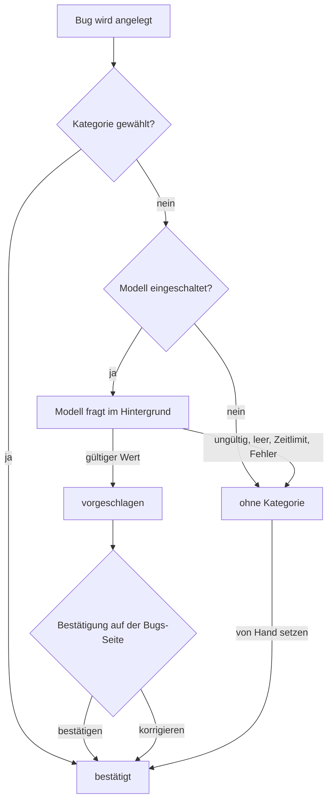

# Benutzerhandbuch: Bug-Kategorien mit Vorschlag, Filter und Statistik

Auftrag ff127e1a-6b7d-4358-a136-f9be1f6ca313 (Feature). Dieses Kapitel beschreibt die feste Bug-Kategorie (Feld `bug_category`): wann sie gesetzt wird, wann sie nur vorgeschlagen ist, wie du Vorschläge bestätigst oder korrigierst, wie du nach Kategorie filterst und wie die Statistik zählt.

> **Abgrenzung:** Die Bug-Kategorie ist **nicht** der Bereich (Frontend, Backend, Fullstack, Infrastructure, Docs, Security). Der Bereich steht im Feld `category` und wird an Aufträge vererbt. Er bleibt unverändert. In der Bugliste heißt diese Spalte jetzt „Bereich“. Zum Bereich siehe `docs/bug-kategorien.md`.

> **Printscreens:** keine in dieser Fassung. Die Oberfläche ist in dieser Sitzung nicht gestartet, und es wurden keine Aufnahmen gemacht. Die nötigen Aufnahmen stehen in Abschnitt 9 als Liste mit dem Zustand, den sie zeigen sollen. Die Beschreibungen stammen aus dem Code, geprüft in `src/api/bugs.ts`, `src/agent/bug-category.ts`, `src/agent/bug-classifier.ts`, `src/api/stats.ts`, `frontend/src/app/features/bugs/bugs.component.html` und `.ts`, `bug-stats.ts`, `bug-category-matrix.component.ts` sowie `frontend/src/app/features/stats/stats.component.html`.

> **Tests:** Der erste Tester-Lauf scheiterte, weil der Testbefehl nicht freigegeben war; die Kriterien blieben ungeprüft. Der Entwickler meldet danach grün: `npm run typecheck`, `npm run lint`, `npm run format:check` und `npm run test:unit` (2111 bestanden, 0 fehlgeschlagen, 10 übersprungen). Übersprungen sind die Datenbank-Tests (`DEV_LOG_TEST_ADMIN_DATABASE_URL` fehlt) und der Oberflächentest. Der Dokumentierer und ich haben keine Tests ausgeführt; die Angaben oben sind nicht nachgeprüft. Ob die Oberfläche so arbeitet, wie hier beschrieben, bestätigt der Tester.

---

## 1. Die acht Kategorien

Eine Bug-Kategorie ist genau einer dieser Werte. Die Datenbank lässt keine anderen zu.

| Wert | Bedeutung (Beispiele, wie sie das lokale Modell einordnet) |
| --- | --- |
| `security` | Rechte, Anmeldung, Zugriffsschutz, Mandantentrennung, Geheimnisse |
| `git-sync` | Git-Abgleich, Branches, Pull Requests, Merge, GitHub-Import |
| `ci` | CI, Build, Lint, Formatierung, Testlauf-Infrastruktur, Docker, Deployment |
| `ui` | Oberfläche: Anzeige, Formulare, Tabellen, Bedienung, Handy-Ansicht |
| `api` | Server, API-Routen, Datenbank, Migrationen, Runner-Logik |
| `agent-guard` | Agent-Wächter: gesperrte Befehle oder Pfade, Agent-Rechte, Prompt-Injection-Schutz |
| `budget` | Token- und Kostenbudget, Limits je Rolle, Verbrauchsmessung |
| `docs` | Dokumentation, Handbücher, Berichte, Diagramme |

In der Oberfläche steht statt des Werts die Bezeichnung: Sicherheit, Git-Abgleich, CI & Build, Oberfläche, API & Server, Agent-Wächter, Budget, Dokumentation. Ein Bug hat **höchstens eine** Kategorie.

Zusätzlich hat jeder Bug einen **Zustand**:

| Zustand | Bedeutung | Zählt in der Statistik? |
| --- | --- | --- |
| ohne | Keine Kategorie und kein Vorschlag | Ja, als „Ohne Kategorie“ |
| vorgeschlagen | Das lokale Modell hat einen Vorschlag gemacht, ein Mensch hat ihn noch nicht bestätigt | Nein, als „Ohne Kategorie“ |
| bestätigt | Kategorie gesetzt, von dir bestätigt oder von Hand gewählt | Ja, unter ihrer Kategorie |

---

## 2. Wo du die Kategorie siehst

- **Bugliste, Spalte Kategorie:**
  - bestätigt: die Bezeichnung als Marke, z. B. „API & Server“.
  - vorgeschlagen: die Bezeichnung mit Fragezeichen (z. B. „Oberfläche?“) und ein Link **Bestätigen**. Der Link erscheint nur mit dem Recht **Planen**.
  - ohne: ein Strich (–).
- **Aufgeklappter Bug:** Die Zeile **Kategorie** zeigt die Kategorie. Bei einem Vorschlag steht dort zusätzlich „(Vorschlag: …)“.
- **Bug anlegen:** Das Auswahlfeld **Kategorie** im Formular.
- **Statistik:** Die Karte **Nach Kategorie** und die Tabelle **Kategorie × Sprint** (Abschnitt 6).

---

## 3. Wie eine Kategorie entsteht

### 3.1 Beim Anlegen

Das Anlegeformular hat das Auswahlfeld **Kategorie**. Die Vorgabe lautet „Vom lokalen Modell vorschlagen lassen“.

| Angabe beim Anlegen | Ergebnis |
| --- | --- |
| Eine der acht Kategorien gewählt | Kategorie ist gesetzt, Zustand **bestätigt**. Das Modell wird nicht gefragt. |
| Keine Kategorie (Vorgabe) | Der Bug wird sofort angelegt. Das lokale Modell wird **danach** im Hintergrund gefragt. |

Bedingungen für den Vorschlag des Modells:

- Das Modell wird nur gefragt, wenn es eingeschaltet ist. Abschalten geht mit `DEV_LOG_BUG_CATEGORY_MODEL=off`. Unter dem Test-Runner ist es standardmäßig aus.
- Welches Modell läuft, bestimmt `DEV_LOG_OLLAMA_MODEL_BUG_CATEGORY` (Rolle `bug_category`); ohne Angabe gilt das Standardmodell.
- Die Anfrage bekommt nur Titel und Beschreibung des Bugs, keine Werkzeuge und keine Schreibrechte.
- Zeitlimit: 30 Sekunden für einen einzelnen Bug.
- Die Antwort wird **nur** übernommen, wenn sie genau einer der acht Werte ist. Jede andere Antwort wird verworfen. Dann bleibt der Bug ohne Kategorie.
- Ist der Text praktisch leer oder enthält er nur eine Kosten-, Limit- oder Verbindungsmeldung der Agent-CLI, schlägt das Modell nichts vor. Eine Limit-Meldung allein ist kein fachlicher Befund.
- Der Bugtext ist fremder Text (z. B. aus Betrieb oder GitHub). Das Modell bekommt ihn nur als Daten in einem eigenen Block. Anweisungen im Text folgt es nicht.
- Ist das Modell nicht erreichbar oder antwortet es nicht rechtzeitig, wird der Bug **trotzdem** angelegt. Es erscheint keine Fehlermeldung, und der Bug bleibt ohne Vorschlag.
- Der Vorschlag wird nur gespeichert, solange der Bug weder Kategorie noch Vorschlag hat.

### 3.2 Von den Erzeugern

- **Tester, Bug-Wächter und Auto-Fix:** Sie können beim Anlegen eine der acht Kategorien mitgeben. Der Auto-Fix gibt bei einer Sperre des Agent-Wächters `agent-guard` mit. Eine Angabe außerhalb der Liste wird verworfen, der Bug bekommt dann die Behandlung nach 3.1.
- **Manuelles Anlegen** (`POST /projects/:slug/bugs`): Ohne `bugCategory` gilt der Vorschlag, mit einem gültigen `bugCategory` gilt der gewählte Wert. Ein Wert außerhalb der Liste wird mit einer Fehlermeldung abgelehnt (keine stille Verwerfung wie bei den Erzeugern).

---

## 4. Vorschläge bestätigen oder korrigieren

Alle Aktionen in diesem Abschnitt brauchen das Recht **Planen**. Die Prüfung läuft auf dem Server. Ohne das Recht siehst du die Kategorie, aber keinen Knopf. Ein Aufruf ohne Recht wird abgewiesen.

### 4.1 Einzeln

- **Schnell:** In der Spalte Kategorie den Link **Bestätigen** klicken. Die vorgeschlagene Kategorie wird übernommen.
- **Mit Korrektur:** Den aufgeklappten Bug öffnen. Die Zeile **Kategorie** hat ein Auswahlfeld, vorausgewählt ist der Vorschlag. Wähle eine andere Kategorie und klicke **Kategorie bestätigen**. Der Knopf heißt **Kategorie setzen**, wenn kein Vorschlag da ist.
- Nach der Bestätigung hat der Bug den Zustand **bestätigt**. Das Auswahlfeld verschwindet, die Kategorie steht als Text.
- Bestätigst du ohne Vorschlag und ohne Auswahl, meldet der Server, dass kein Vorschlag vorliegt. Dann musst du eine Kategorie wählen.

### 4.2 Gesammelt

- Markiere in der Bugliste die Vorschläge, die du übernehmen willst. Markierbar sind nur Bugs mit Vorschlag.
- Sobald mindestens einer markiert ist, erscheint über der Liste **N Vorschläge bestätigen** und **Auswahl aufheben**.
- Gesammelt wird immer der Vorschlag übernommen, eine Korrektur geht nur einzeln.
- Pro Aufruf sind höchstens **500** Bugs erlaubt.
- Bugs ohne Vorschlag und Bugs in einem anderen Projekt bleiben unberührt.

### 4.3 Im Bearbeiten-Formular

- Der aufgeklappte Bug hat das Formular **Bearbeiten**. Es erscheint nur mit dem Recht **Planen**.
- Das Feld **Kategorie** zeigt die bestätigte Kategorie. Ist keine gesetzt, steht als Auswahl „Nur Vorschlag“ bzw. „Ohne Kategorie“.
- Wählst du eine Kategorie und speicherst, ist sie bestätigt.
- Wählst du „Nur Vorschlag“ (wenn ein Vorschlag da ist) oder „Ohne Kategorie“, wird die bestätigte Kategorie entfernt. Der Bug fällt auf den Vorschlag zurück, oder er hat danach keine Kategorie. Die Statistik zählt ihn dann nicht mehr unter der alten Kategorie (`src/api/bugs.ts`, PATCH: `bugCategoryStateSql`).
- Offen ist nur, ob das Formular den leeren Wert als `null` sendet. Das prüft der Tester (Abschnitt 10).

---

## 5. Altbestand kategorisieren

Mit dem Knopf **Altbestand kategorisieren** schlägt das lokale Modell für alle Bugs **ohne Kategorie und ohne Vorschlag** nacheinander eine Kategorie vor. Im Auftrag sind das 61 Bestandsbugs.

- **Wo:** Kopfzeile des Abschnitts „Bugs“, nur mit dem Recht **Planen**.
- **Wann klickbar:** Es gibt mindestens einen Bug ohne Kategorie und ohne Vorschlag, und gerade läuft kein anderer Lauf.
- **Bestätigung:** Vor dem Start fragt ein Dialog „Altbestand kategorisieren?“ nach. Bestätige mit **Lauf starten**.
- **Während des Laufs:** Eine Zeile zeigt „Altbestand wird kategorisiert: X von Y geprüft, Z Vorschläge“. Mit **Lauf abbrechen** stoppst du ihn.
- **Nach dem Lauf:** Ein Hinweis zeigt, ob der Lauf fertig oder abgebrochen war, und wie viele Vorschläge es gibt.
- **Was er nicht tut:** Er setzt **keine** Kategorie. Er legt nur Vorschläge an. Erst deine Bestätigung (Abschnitt 4) macht daraus eine Kategorie.
- **Was er überspringt:** Bugs mit Kategorie oder Vorschlag. Bugs, für die das Modell nichts liefert, bleiben ohne Kategorie.
- **Mehrere Läufe:** Es läuft höchstens **ein** Lauf je Server. Solange ein anderer Lauf läuft, ist der Knopf gesperrt; der Hinweis „Ein anderer Lauf belegt gerade das lokale Modell.“ erscheint als Tooltip. Ein Aufruf über die API wird mit 409 abgelehnt.
- **Abbruch:** Bereits gespeicherte Vorschläge bleiben. Der Lauf endet nach dem aktuellen Bug.
- **Zeitlimit:** 180 Sekunden je Bug. Ein Fehler bei einem Bug stoppt den Lauf nicht.
- **Modell abgeschaltet:** Der Knopf liefert „Das lokale Modell für Kategorien ist abgeschaltet.“ und startet nichts.
- **Dauer:** Bei einem langsamen Modell kann eine Antwort Minuten dauern. Der Lauf ist darum nacheinander und abbrechbar.

---

## 6. Filtern und zählen

### 6.1 Kategoriefilter in der Bugliste

- Der Filter gehört zur Spalte **Kategorie** und wirkt **zusätzlich** zu Titel, Status und Schweregrad.
- Die Auswahl enthält die acht Kategorien, **Vorschlag offen** und **Ohne Kategorie**. Auch Kategorien ohne Treffer stehen darin.
  - **Vorschlag offen** zeigt nur Bugs mit Vorschlag, der noch nicht bestätigt ist. Diese Bugs zählen sonst als „Ohne Kategorie“.
  - **Ohne Kategorie** zeigt Bugs ohne Kategorie und ohne Vorschlag.
- Der Filter wirkt zusammen mit den anderen Filtern. **Zurücksetzen** leert ihn mit den übrigen.
- Ohne Treffer zeigt die Liste den Leertext der Gruppe, z. B. „Keine offenen Bugs – alles ruht in Frieden.“ oder im Friedhof „Der Friedhof ist noch leer.“.

### 6.2 Karte „Nach Kategorie“ (Bugs-Seite)

- Zeigt je Kategorie die Zahl **offener** und **begrabener** Bugs.
- Zählt nur **bestätigte** Kategorien. Vorschläge stehen unter „Ohne Kategorie“.
- Ohne Bugs steht dort „Noch keine Bugs.“.
- **Achtung:** Diese Karte zählte früher den Bereich (`category`). Die Zahlen ändern sich dadurch bewusst.

### 6.3 Tabelle „Kategorie × Sprint“

Die Tabelle steht zweimal: auf der **Bugs-Seite** (Karte „Kategorie × Sprint“) und auf der **Statistik-Seite** (Abschnitt „Bugs je Kategorie und Sprint“). Beide zeigen dieselben Zahlen.

- **Zeilen:** alle acht Kategorien. Die Zeile **Ohne Kategorie** erscheint nur, wenn es solche Bugs gibt.
- **Spalten:** die Sprints, in der Reihenfolge der Sprint-Liste. Die Spalte **Kein Sprint** steht zuletzt. Dort landen Bugs ohne Sprint.
- **Zelle:** „offen · ✝begraben“, z. B. `2 · ✝1`. Nur offen: `2`. Leer: `–`. Die Zelle hat einen Tooltip mit beiden Zahlen.
- **Summe:** Die letzte Spalte und die letzte Zeile summieren. Die Gesamtsumme entspricht der Zahl aller Bugs im Projekt.
- Ohne Bugs steht dort „Noch keine Bugs.“.
- Vorschläge zählen nicht unter ihrer Kategorie, sondern unter „Ohne Kategorie“.

### 6.4 Für den Retrospektive-Agenten

- `GET /projects/:slug/stats` liefert die Felder `bugsByCategory` (je Kategorie) und `bugsByCategorySprint` (je Paar Kategorie und Sprint).
- Die Retrospektive bekommt dieselben Zahlen wie die Statistik-Seite (`retrospectiveInput` nutzt `bugCategoryStats`). Sie zählt nichts eigenes.
- **Hinweis:** Der Retrospektive-Agent selbst ist noch nicht gebaut. Diese Zahlen sind nur seine Eingabe.

---

## 7. Häufige Fragen

**Mein neuer Bug hat keine Kategorie, nur ein Fragezeichen.**
Das Modell hat einen Vorschlag gemacht. Bestätige ihn in der Spalte Kategorie oder im aufgeklappten Bug.

**Ich sehe nur einen Strich und kein Modell hat geantwortet.**
Das Modell war nicht erreichbar, zu langsam oder hat eine ungültige Antwort gegeben. Wähle die Kategorie von Hand (Abschnitt 4.1 oder 4.3).

**Der Altbestandslauf ist ausgegraut.**
Es gibt keine Bugs ohne Kategorie und ohne Vorschlag, oder ein anderer Lauf belegt das Modell, oder dir fehlt das Recht Planen.

**Die Statistik zählt meinen vorgeschlagenen Bug nicht unter seiner Kategorie.**
Richtig so. Erst die Bestätigung macht die Kategorie zählbar.

**Der Filter „Vorschlag offen“ zeigt nichts.**
Dann gibt es keine offenen Vorschläge. Prüfe, ob der Altbestandslauf schon gelaufen ist (Abschnitt 5).

---

## 8. Was sich nicht ändert

- Der Bereich (`category`: Frontend, Backend, …) und seine Vererbung an Aufträge bleiben unverändert.
- Die Kategorie ist nicht die Vorgabe für Aufträge. Aufträge erben nur den Bereich.
- Die Verarbeitung von Auto-Fix und Bug-Wächter (Start, Wiederholung, Fehlerbehandlung) bleibt gleich. Ein Fehler bei der Kategorie verhindert das Anlegen des Bugs nicht.

---

## 9. Printscreens (ausstehend)

Diese Aufnahmen fehlen noch. Der Agent konnte sie nicht erstellen: Der Browser-Cache liegt außerhalb des erlaubten Arbeitsordners, und der Start von Playwright verlangt eine Freigabe. Außerdem braucht die App eine laufende Datenbank. Die Aufnahmen entstehen darum von Hand, auf einem Host mit laufender App und Browser. Die Bilder kommen danach in dieses Kapitel:

1. **Anlegeformular:** Auswahlfeld „Kategorie“ mit der Vorgabe „Vom lokalen Modell vorschlagen lassen“ und der Liste der acht Kategorien.
2. **Bugliste mit Vorschlägen:** Spalte Kategorie mit einem bestätigten Bug, einem Vorschlag („Oberfläche?“ mit „Bestätigen“) und einem Bug ohne Kategorie (–). Dazu die Auswahlleiste mit „N Vorschläge bestätigen“.
3. **Aufgeklappter Bug (mit Recht Planen):** Zeile Kategorie mit Auswahlfeld und Knopf „Kategorie bestätigen“.
4. **Kategoriefilter:** Filtermenü der Spalte Kategorie mit „Vorschlag offen“ und „Ohne Kategorie“, dazu die gesetzten Filter nach Auswahl.
5. **Altbestand:** Knopf „Altbestand kategorisieren“ und der laufende Hinweis „X von Y geprüft“.
6. **Tabelle Kategorie × Sprint:** auf der Bugs-Seite und auf der Statistik-Seite, mit einer Zelle „offen · ✝begraben“ und der Spalte „Kein Sprint“.
7. **Dasselbe Bild ohne Recht Planen:** Kategorie nur als Text, kein Bestätigen-Knopf, kein Altbestand-Knopf.

---

## 10. Offen für den Tester

Die folgenden Prüfungen sind **nicht** erfolgt:

1. Testlauf mit freigegebenem Befehl: `npm run typecheck`, `npm run test:unit` mit gesetztem `DEV_LOG_TEST_ADMIN_DATABASE_URL` (damit die Datenbank-Tests laufen), die Frontend-Specs (`bug-stats.spec.ts`, `bug-form.spec.ts`) und `e2e/full-ui.check.ts`. Die Tests zuerst ohne Abdeckungs-Flags starten (`npx --no-install tsx --test …`).
2. Summe der Tabelle Kategorie × Sprint gleich der Zahl aller Bugs.
3. Altbestandslauf: genau ein Vorschlag je Bug ohne Kategorie und ohne Vorschlag; `bug_category` bleibt dabei unverändert. Ein zweiter Start während eines Laufs startet nichts.
4. Modell nicht erreichbar: Bug wird angelegt, ohne Vorschlag. Ungültige Modellantwort: keine Kategorie.
5. Rechte: `POST /projects/:slug/bugs/categorize-backlog`, `POST /bugs/:id/category/confirm` und die gesammelte Bestätigung ohne Recht Planen liefern eine Ablehnung.
6. Migration: Die Datenbank lehnt einen Wert außerhalb der acht Kategorien ab; `bugs.category` und der Trigger `development_items_inherit_category` sind unverändert. Der Auftrag nennt Migration 20, im Code ist es Migration **29**, weil die Nummern 20 bis 28 belegt sind.
7. Oberflächentest „Tabellen“: Kategoriefilter, Zurücksetzen und der Leertext.
8. Bearbeiten-Formular: Der Server setzt bei leerem `bugCategory` den Zustand zurück (Code geprüft). Offen ist nur die Sendung des leeren Werts durch das Formular.
9. Printscreens aus Abschnitt 9 auf einem Host mit Browser erstellen und in dieses Kapitel einfügen.
