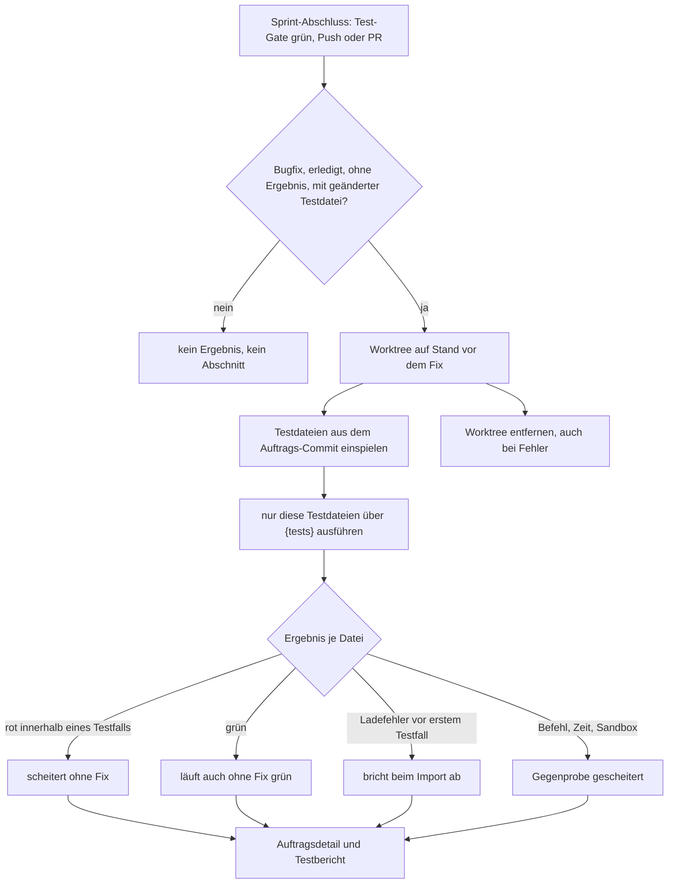

# Benutzerhandbuch: Gegenprobe der neuen Tests (ohne den Fix)

Gilt ab Auftrag 37938d19-af5a-4da8-8d16-6c6834db49f7. Betrifft den Sprint-Abschluss (Test-Gate, Push bzw. Pull Request), das Auftragsdetail eines Bugfixes und den Testbericht.

Stand: gegen den Code geprüft am 31.10.2026, Korrektur zum Tester-Schritt (Abschnitt 1a) am selben Tag. Der Auftragsbericht steht in `docs/auftraege/gegenprobe-neue-tests-gegen-stand-vor-dem-fix-2026-10-31.md`.

**Hinweis zum Prüfstand:** Die Umsetzung ist im Code belegt. Die Tests und der Typecheck sind in der Agent-Umgebung noch nicht grün nachgewiesen (`tsc` fehlt im Sandbox-Image, `npx` scheitert am npm-Cache). Printscreens fehlen (siehe Abschnitt 6).

## Was sich ändert

Ein Bugfix soll mit seinen neuen Tests einen Fehler belegen. Ein Test, der auch ohne den Fix grün läuft, beweist nichts. Deshalb führt das System beim Sprint-Abschluss die geänderten Testdateien eines Bugfixes auf dem Stand **vor** dem Fix aus. Das Ergebnis steht am Auftrag und im Testbericht.

Jetzt gibt es zwei Prüfungen:

- **Im Tester-Schritt** (während des Auftrags) prüft das System jeden **neu hinzugekommenen Testfall** (`test(…)`/`it(…)`) eines Bugfixes. Besteht ein neuer Testfall auch ohne den Fix, bekommt der Auftrag die Markierung „Test belegt den Fix nicht“ und **geht an den Entwickler zurück**. Siehe Abschnitt 1a.
- **Nach dem Test-Gate beim Sprint-Abschluss** läuft für jeden erledigten Bugfix mit geänderter Testdatei eine Gegenprobe je Datei. Sie läuft nach Push bzw. Pull Request und blockiert beides nicht.
- **Das Ergebnis je Testdatei** (Sprint-Abschluss) lautet „scheitert ohne Fix“, „läuft auch ohne Fix grün“ oder „bricht beim Import ab“. Eine Datei, die nicht bewertet werden kann, erhält „nicht bewertet“, und ein Fehler der Gegenprobe selbst erhält „Gegenprobe gescheitert“.
- **Das Auftragsdetail** zeigt einen Abschnitt „Gegenprobe ohne Fix“ mit dem Ergebnis je Datei.
- **Der Testbericht** enthält je geprüfter Testdatei genau eine Zeile.

Die Prüfung im Tester-Schritt blockiert dagegen: Der Schritt gilt als fehlgeschlagen, solange ein neuer Testfall auch ohne den Fix besteht. Die Prüfung beim Sprint-Abschluss blockiert nicht. Keine Änderung gibt es bei Push, Merge, Budget und Abnahme. Es gibt keine neue Seite und keine neue Schaltfläche.

## Bedingungen

### 1. Wann eine Gegenprobe läuft

Alle folgenden Bedingungen müssen zutreffen:

- Der Auftrag ist ein **Bugfix** (Art `bug`). Feature-Aufträge bekommen keine Gegenprobe.
- Der Auftrag ist **erledigt** (Status „erledigt“) und hat **noch kein Ergebnis**. Ein Ergebnis wird nur einmal geschrieben; einen bereits geprüften Auftrag prüft der Sprint-Abschluss nicht erneut.
- In der Liste der geänderten Dateien (`changed_files`) steht mindestens **eine Testdatei**. Das erkennt die Dateinamensregel für Tests, Internes wie Agent- und Abhängigkeitsordner zählt nicht.
- Der Sprint-Abschluss läuft mit **Push oder Pull Request**. Der Modus „Pull“ (nur Übernahme aus dem Hauptzweig) führt keine Gegenprobe aus.

Liegt keine geänderte Testdatei vor, bleibt das Ergebnis leer. Im Auftragsdetail erscheint dann kein Abschnitt und auch kein Hinweis „offen“.

### 1a. Gegenprobe im Tester-Schritt

Alle folgenden Bedingungen müssen zutreffen:

- Die Rolle ist **Tester**, der Auftrag ist ein **Bugfix** (Art `bug`) und der Auftrag hat einen Auftrags-Branch.
- Der Tester-Schritt ist **erfolgreich beendet** (Exit-Code 0) und hat die Ausgabe akzeptiert. Ein Lauf, der vorher abbricht, bekommt keine Gegenprobe.
- Der Lauf ist **kein Beobachter-Lauf** (ohne Beobachter-Option).

Gibt es im Auftrag **keine neuen Testfälle**, lautet das Urteil „keine neuen Testfälle“. Die Markierung entsteht dann nicht.

**Was geprüft wird:** Neu sind Testfälle mit einem Namen, den es vor dem Auftrag in dieser Datei nicht gab. Eine neue Testdatei zählt mit allen ihren Testfällen. Jeder Testfall läuft einzeln über einen Namensfilter. Der Produktivcode stammt vom Stand vor dem Auftrag.

**Ergebnisse je Testfall:**

| Ergebnis | Bedeutung |
|---|---|
| **scheitert wie erwartet** | Der Testfall ist vor dem Fix rot. Er belegt den Fix. |
| **besteht (Fix nicht belegt)** | Der Testfall ist auch vor dem Fix grün. Er beweist den Fix nicht. |
| **nicht auswertbar** | Lade-, Import- oder Kompilierfehler, fehlende Abhängigkeit, Zeitüberschreitung oder ein Befehl, der nicht lief. Das zählt nie als Beleg. |

**Urteil über den Auftrag:**

- **Alle** neuen Testfälle scheitern: Der Auftrag bleibt ohne Markierung.
- **Mindestens einer besteht:** Der Auftrag bekommt die Markierung **„Test belegt den Fix nicht“**. Der Tester-Schritt gilt als fehlgeschlagen, und der Auftrag geht an den Entwickler zurück.
- **Keiner besteht, aber nicht alle sind auswertbar:** Das Urteil lautet „nicht auswertbar“ und ist kein Rückgabegrund.

**Wo es läuft:** im Sandbox-Container des Test-Gates, mit derselben Umgebungsfilterung. Der Arbeitsordner des Projekts und der Agent-Worktree bleiben unverändert. Der temporäre Worktree wird nach dem Lauf immer entfernt.

**Printscreen fehlt:** `[Printscreen 3: Tester-Schritt eines Bugfixes mit Markierung „Test belegt den Fix nicht“ im Auftragsdetail]`

### 2. Was geprüft wird

- **Der Produktivcode** stammt vom Stand **ohne** den Fix: dem ersten Elternteil des Auftrags-Commits.
- **Die Testdateien** stammen aus dem Auftrags-Commit selbst.
- **Nur die Testdateien des Auftrags** laufen, nicht die ganze Testsuite. Dafür gilt der auftragsspezifische Testbefehl mit dem Platzhalter `{tests}` (Testbefehle je Auftrag). Gibt es keinen solchen Befehl, lautet das Ergebnis „Gegenprobe gescheitert“ mit dem Hinweis, dass kein Befehl mit `{tests}` hinterlegt ist.
- **Jede Testdatei läuft einzeln** über den Befehl.

### 3. Wo die Gegenprobe läuft

- **Im Worktree:** Die Gegenprobe legt einen eigenen, losgelösten Worktree an, getrennt vom Hauptordner und vom Sprint-Branch. Hauptordner, Sprint-Branch, Index und `HEAD` bleiben unverändert.
- **Mit Projekt-Sandbox:** Läuft die Sandbox, laufen die Testbefehle im Container, mit derselben Umgebungsfilterung und Sandbox-Wahl wie beim Test-Gate.
- **Ohne Sandbox:** Die Abhängigkeiten (`node_modules`) des Hauptordners werden verlinkt. Sonst scheitern die Tests schon beim Import.
- **Aufräumen:** Der Worktree wird nach jedem Lauf entfernt, auch bei Fehler oder Zeitüberschreitung. Verwaiste Worktrees aus einem Absturz entfernt der Worker beim nächsten Start.

### 4. Zeitgrenzen

- **Gesamtbudget:** 10 Minuten für alle Gegenproben eines Sprints. Ist das Budget aufgebraucht, bekommen die restlichen Testdateien das Ergebnis „Gegenprobe gescheitert“ mit dem Hinweis „Zeitbudget der Gegenprobe erschöpft“.
- **Je Testbefehl:** 5 Minuten. Überschreitet ein Befehl diese Zeit, lautet das Ergebnis für diese Datei „Gegenprobe gescheitert“ mit dem Hinweis „Zeitüberschreitung“.
- Das Test-Gate hat eine Stundengrenze für den Sprint-Abschluss. Die Gegenprobe läuft erst danach, und die Uhr dieser Grenze wird vorher neu gestellt. So nimmt die Gegenprobe der Gate-Prüfung keine Zeit weg.

### 5. Die vier Ergebnisse

| Ergebnis | Bedeutung | Erwartet? |
|---|---|---|
| **scheitert ohne Fix** | Der Test ist auf dem Stand vor dem Fix rot. Er belegt den Fehler. | Ja, das ist das gewünschte Ergebnis. |
| **läuft auch ohne Fix grün** | Der Test ist auch vor dem Fix grün. Er beweist den Fix nicht. | Nein. Der Hinweis „der Test beweist den Fix nicht“ erscheint. |
| **bricht beim Import ab** | Der Test ist vor seinem ersten Testfall abgebrochen, zum Beispiel wegen eines fehlenden Moduls oder eines Syntaxfehlers. | Nein. Ein fehlender Import ist kein Beleg. |
| **nicht bewertet** | Playwright-Tests (e2e) werden in dieser Version nicht gegengeprüft. | Hinweis, kein Fehler. |
| **Gegenprobe gescheitert** | Die Gegenprobe selbst ist gescheitert: kein Commit, kein Worktree, kein Testbefehl, Sandbox-Fehler, Zeitüberschreitung. | Nein. Der Grund steht dabei. |

Wichtig für die Auswertung:

- **Ein Ladefehler zählt nie als „scheitert ohne Fix“.** Ein Fehler erst *innerhalb* eines laufenden Testfalls (auch ein Modulfehler dort) zählt als „scheitert ohne Fix“.
- **Die Zuordnung** erfolgt über die Ausgabe des Testlaufs. Sie ist bei anderen Test-Runnern weniger sicher als bei den getesteten Runnern. Verdächtige Zuordnungen am Ergebnis prüfen.
- **„Gegenprobe gescheitert“** ist kein Testergebnis. Der Auftrag bleibt davon unberührt.

### 6. Blockade

- **Die Gegenprobe im Tester-Schritt blockiert.** „Test belegt den Fix nicht“ lässt den Tester-Schritt fehlschlagen, der Auftrag geht an den Entwickler zurück. Das ist derselbe Weg wie bei roten Tests.
- **Die Gegenprobe beim Sprint-Abschluss blockiert nicht.** Eine rote Gegenprobe verhindert weder Push noch Merge. Sie ist eine Information.
- **Eine fehlgeschlagene Gegenprobe** (Befehl, Worktree, Zeit) verhindert ebenfalls nichts. Sie erscheint im Auftragsdetail und im Testbericht, nicht nur im Worker-Log.
- **Sprint-Abschluss nur bei grünem Test-Gate:** Ist das Test-Gate rot, läuft der Sprint-Abschluss nicht bis zur Gegenprobe. Die Gegenprobe läuft erst, wenn das Gate grün ist.

## Wo Sie das Ergebnis sehen

### Auftragsdetail

- Der Abschnitt **„Gegenprobe ohne Fix“** steht im Auftragsdetail und ist standardmäßig geöffnet. Er listet je Testdatei das Ergebnis.
- Bei „läuft auch ohne Fix grün“ steht zusätzlich der Hinweis „der Test beweist den Fix nicht (grün auch vor dem Fix)“.
- Bei den anderen Ergebnissen steht bei Bedarf der Grund dahinter (Ausgabe des Testlaufs, gekürzt auf 300 Zeichen).
- Ohne Ergebnis erscheint **kein** Abschnitt, auch kein Hinweis „offen“.

**Printscreen fehlt:** `[Printscreen 1: Auftragsdetail eines Bugfixes mit Abschnitt „Gegenprobe ohne Fix“, je eine Zeile mit „scheitert ohne Fix“ und „läuft auch ohne Fix grün“ mit Hinweis]`

### Testbericht

- Der Bericht trägt den Titel „Gegenprobe: neue Tests ohne den Fix (Sprintname)“.
- Er enthält je geprüfter Testdatei **genau eine Zeile**: Pfad, Auftragstitel, Ergebnis und gegebenenfalls Grund.
- Er steht im Testbericht (`test_runs.report`) und wird in der Dokumentation angezeigt. Der Lauf erscheint als Testlauf mit dem Auslöser „Gegenprobe“.
- Der Lauf gilt im Dashboard nicht als rot, auch wenn einzelne Dateien „scheitert ohne Fix“ nicht erreichen. Die Ergebnisse stehen im Bericht.

**Printscreen fehlt:** `[Printscreen 2: Testbericht „Gegenprobe: neue Tests ohne den Fix“ mit mehreren Zeilen]`

### Sprint-Log

- Der Sprint-Abschluss hängt eine Zeile an das Log, z. B. „Gegenprobe (3 Testdateien): 2 scheitern ohne Fix, 1 auch ohne Fix grün, 0 brechen beim Import ab.“
- Ist eine Gegenprobe nicht gelaufen, steht dort „Gegenprobe nicht gelaufen: …“ mit dem Grund.

## Was die Gegenprobe nicht tut

- Sie **prüft nicht die Qualität** des Tests. Sie bewertet nur das Ergebnis gegen den Stand vor dem Fix.
- Sie **prüft keine Playwright-/e2e-Tests** in dieser Version.
- Sie **ändert keinen Code**, nicht den Fix und nicht den Hauptordner oder den Sprint-Branch.
- Sie **prüft keine abgeschlossenen Aufträge rückwirkend**. Nur Aufträge im Sprint-Abschluss ohne Ergebnis werden geprüft.
- Sie **ersetzt die Abnahme nicht.** Ein Mensch entscheidet weiter über die Freigabe.

## Fehler und typische Fälle

| Situation | Ergebnis am Auftrag |
|---|---|
| Bugfix, Testdatei geändert, Test rot ohne Fix | „scheitert ohne Fix“ |
| Bugfix, Testdatei geändert, Test grün ohne Fix | „läuft auch ohne Fix grün“ mit Hinweis |
| Test bricht vor dem ersten Testfall ab | „bricht beim Import ab“ |
| Feature-Auftrag | kein Ergebnis, kein Abschnitt |
| Bugfix ohne geänderte Testdatei | kein Ergebnis, kein Abschnitt |
| Bugfix ohne Auftrags-Commit (z. B. nach einer Review-Freigabe) | „Gegenprobe gescheitert“: kein Auftrags-Commit vermerkt |
| Keine Testbefehle mit `{tests}` | „Gegenprobe gescheitert“ mit Hinweis |
| Playwright-Test | „nicht bewertet“ |
| Tester-Schritt, neuer Testfall besteht ohne Fix | „besteht (Fix nicht belegt)“, Markierung „Test belegt den Fix nicht“, Tester-Schritt rot, Auftrag zurück an den Entwickler |
| Tester-Schritt, neuer Testfall wegen Import- oder Kompilierfehler | „nicht auswertbar“, kein Rückgabegrund |

## Offene Punkte

1. **Printscreens (offen):** Keine erstellt. Der Agent-Wächter hat die Suche nach einem Browser und `node -e` blockiert, daher ist nicht geprüft, ob Chromium vorhanden ist. Die vier Motive stehen als Platzhalter oben (Platzhalter 3 neu: Tester-Schritt). Im Arbeitscontainer mit Browser nachholen.
1a. **Zwei Prüfpfade:** Der Tester-Schritt (blockiert, Abschnitt 1a) und der Sprint-Abschluss (blockiert nicht, Abschnitt 1) sind verschieden. Die Abnahme soll bestätigen, dass beide Texte zum Verhalten passen.
2. **Tests und Typecheck (offen):** `npm run typecheck` und `npm run test:unit` sind in der Agent-Umgebung nicht grün nachgewiesen. Die Gegenprobe-Tests sind deshalb nicht abgenommen. Im Arbeitscontainer neu ausführen.
3. **Spalte `counter_check` (offen):** Die Spalte steht in der Migration `src/db/migrations.ts` (Zeile 611), nicht in `src/db/schema.ts`. CLAUDE.md verlangt, Migration und Schema gemeinsam zu ändern. Prüfen, ob `schema.ts` nachgezogen werden muss.
4. **Alte Datei im Dokumentenordner (offen):** `docs/benutzerhandbuch-gegenprobe-neue-tests-gegen-den-stand-vor-dem-fix-2026-10-30.md` liegt noch direkt in `docs/`. CLAUDE.md verlangt Auftragshandbücher in `docs/auftraege/`. Diese Datei mit `git rm` entfernen, sobald das Repository repariert ist. Dieses Handbuch ersetzt sie.
5. **Testbefehle je Auftrag:** Der Befehl mit `{tests}` ist die Voraussetzung der Gegenprobe. Die Anleitung dazu steht in `docs/auftraege/benutzerhandbuch-testbefehle-je-auftrag.md`.

## Anhang: Ablauf

