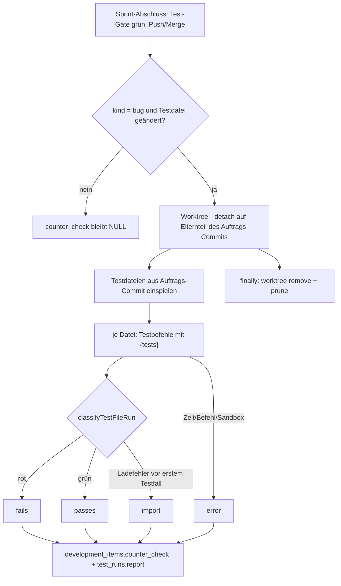

# Gegenprobe: neue Tests gegen den Stand vor dem Fix

Auftrag `37938d19-af5a-4da8-8d16-6c6834db49f7` · Dokumentiert am 2026-10-31 (Phase `after_task`).

## Aufträge

### Was umgesetzt wurde

Nach dem grünen Test-Gate eines Sprint-Abschlusses führt der Runner für jeden erledigten Bugfix-Auftrag (`kind = 'bug'`)
mit mindestens einer geänderten Testdatei eine **Gegenprobe** aus: Die Testdateien des Auftrags laufen auf dem Stand
**vor** dem Fix. Je Testdatei gibt es genau eines von drei Ergebnissen:

| Ergebnis | Bedeutung |
| --- | --- |
| `fails` – „scheitert ohne Fix“ | erwartet: der Test erkennt den Fehler |
| `passes` – „läuft auch ohne Fix grün“ | der Test beweist den Fix nicht (Hinweis im Auftragsdetail) |
| `import` – „bricht beim Import ab“ | Ladefehler (`Cannot find module`, `ERR_MODULE_NOT_FOUND`, Syntaxfehler …) **vor** dem ersten Testfall |

Zusätzlich gibt es `skipped` („nicht bewertet“: Playwright/e2e oder kein `{tests}`-Befehl für die Datei) und `error`
(„Gegenprobe gescheitert“: Zeitüberschreitung, Sandbox lehnt ab, Befehl nicht ausführbar, kein Commit). `error` steht
sichtbar im Bericht und im Auftragsdetail, ist aber weder „grün“ noch ein Blocker.

Ablauf (`counterCheckOrder` in `src/runner/git-sync/counter-check.ts`):

1. Auftrags-Commit (`development_items.git_commit`) auflösen; Basis ist sein **erster Elternteil** (nicht der
   Branch-Kopf, daher unabhängig von fremden WIP-Commits).
2. Nur Testdateien, die der Commit gegenüber der Basis wirklich ändert; Berichtsordner sind ausgenommen
   (`CHANGED_FILES_IGNORED`).
3. Losgelöster Worktree (`git worktree add --detach`) im Temp-Ordner mit Präfix `aideation-gegenprobe-`; Testdateien
   per `checkout <commit> -- <dateien>` nur dort eingespielt. Hauptordner, Sprint-Branch, Index und `HEAD` bleiben
   unberührt.
4. Ohne Sandbox wird `node_modules` über `linkDependencies` verlinkt (nichts sonst, keine `.env`); mit Sandbox läuft
   alles über den `testExecutor` (`gateExecutor`) im Container.
5. Jede Datei einzeln mit den auftragsspezifischen Testbefehlen (`{tests}`) über `runProjectCommand` mit gefiltertem
   Environment, Timeout 5 min je Befehl, Gesamtbudget 10 min.
6. Klassifikation über `classifyTestFileRun` (`ci.ts`): Ladefehler zählt nur, wenn er **vor** dem ersten Testfall
   steht. Ein Modul-/ENOENT-Fehler innerhalb eines laufenden Testfalls ist „scheitert ohne Fix“.
7. `finally`: Worktree entfernen, löschen, `git worktree prune`. Verwaiste Worktrees früherer Abbrüche
   (SIGKILL) entfernt `pruneCounterCheckWorktrees` beim nächsten Lauf.

Nicht-Ziele (eingehalten): keine Blockade von Push/Merge, keine Gegenprobe für Features oder Bugfixes ohne Testdatei,
keine Playwright-Prüfung, keine rückwirkende Prüfung abgeschlossener Aufträge.

### Geänderte Dateien

- `src/runner/git-sync/counter-check.ts` (neu): Gegenprobe, Bericht (`counterCheckLines`, `counterCheckReport`),
  Sprint-Schleife `runSprintCounterChecks`.
- `src/runner/git-sync/counter-check.test.ts` (neu): Tests in echtem Git-Repo mit Bugfix-Fixture.
- `src/runner/git-sync/ci.ts`: `classifyTestFileRun`, `loadErrorLine` (Ladefehler-Muster).
- `src/runner/git-sync/sprint-sync.ts`: Aufruf nach Gate, Push und Merge (nicht bei `action === 'pull'`); setzt vorher
  `sprints.updated_at` neu für die Stundengrenze; Fehler landen nur im Sprint-Log.
- `src/db/migrations.ts` (+ `migrations.test.ts`): Migration `gegenprobe-je-auftrag`, Spalte
  `development_items.counter_check JSONB` (`NULL` = keine Gegenprobe, Check `jsonb_typeof = 'object'`).
- `src/db/development-repository.ts`: Feld `counterCheck` in der Auftragsantwort.
- `src/runner/runner-prompts.ts`: `COUNTER_CHECK_NOTE` im Dokumentierer-Prompt für Bugfixes – „Gegenprobe offen“ ist
  nicht mehr zu vermerken.
- `frontend/src/app/core/models.ts`: `CounterCheck`, `CounterCheckResult`, `DevelopmentItem.counterCheck`.
- `frontend/src/app/features/development/order-detail.component.{ts,html}`: Abschnitt „Gegenprobe ohne Fix“.
- Weitere im Lauf berührte Dateien (u. a. `git-helpers.ts`, `order-branch.ts`, `test-sandbox.ts`) siehe Diff.

### Worauf zu achten ist

- **Testbericht**: je Lauf ein `test_runs`-Eintrag mit `trigger = 'counter-check'`, Bericht mit einer Zeile je
  Testdatei; der Lauf wird als erfolgreich beendet (kein roter Lauf im Dashboard). `counter_check.runId` verweist
  darauf.
- **Idempotenz**: Es werden nur Aufträge mit `counter_check IS NULL` geprüft. Beim Worker-Neustart wird abgebrochen,
  ohne zu speichern; der Auftrag wird bei der nächsten Sicherung geprüft.
- **Fehlender Commit** (z. B. nach Review-Freigabe): Fehler „Kein Auftrags-Commit vermerkt“, sichtbar, kein Blocker.
- **Fehlende Testbefehle mit `{tests}`**: ebenfalls sichtbarer Fehler statt stillem Ausfall.
- Ladefehler-Erkennung per Textmuster kann bei exotischen Runnern danebenliegen; die Tests decken mehrere Runner ab.
- Im Auftragsdetail erscheint nichts (auch kein „offen“), solange `counterCheck` leer ist.
- `schema.ts` enthält die Spalte nicht gesondert; sie kommt ausschließlich über die Migration (`ADD COLUMN IF NOT
  EXISTS`).

### Teststand

Der Tester-Lauf (`b7498450-…`) ist **fehlgeschlagen, aber umgebungsbedingt**: `tsc: not found` (Sandbox-Image
„aideation-agent“, Exit 127) und `npx` scheitert an `EACCES` im npm-Cache. Es gibt daher **keinen belegten Testlauf**
für `src/db/migrations.test.ts` und `src/runner/git-sync/counter-check.test.ts`; `npm run typecheck` und
`npm run test:unit` sind für diesen Auftrag nicht grün nachgewiesen. Manuell offen: Freigabe in der Vorschau durch einen
Menschen sowie Bestätigung von Basis-Commit und Zeitpunkt der Gegenprobe.

## Sprint

| Auftrag | Zustand | Details |
| --- | --- | --- |
| Gegenprobe: neue Tests gegen den Stand vor dem Fix (`37938d19`) | Umsetzung fertig (Entwickler grün), Tester-Lauf wegen Umgebung rot | aus Sprint 29 zurückgestellt, jetzt im Arbeitscontainer neu umgesetzt; Testnachweis und Freigabe ausstehend |

## Anfrage / TODO

- Tests ausführen, sobald `tsc` und ein beschreibbarer npm-Cache im Testumfeld vorhanden sind:
  `npm run typecheck`, `npx tsx --test src/db/migrations.test.ts src/runner/git-sync/counter-check.test.ts`,
  danach `npm run test:unit`.
- Menschliche Freigabe in der Vorschau (Kriterium 3).
- Später möglich: Playwright-Gegenprobe; optional eine Blockade bei „läuft auch ohne Fix grün“ (eigene Entscheidung).

## Technische Dokumentation

Datenform `counter_check`: `{ checkedAt, base, commit, files: [{ path, result, detail? }], error?, runId? }`.
