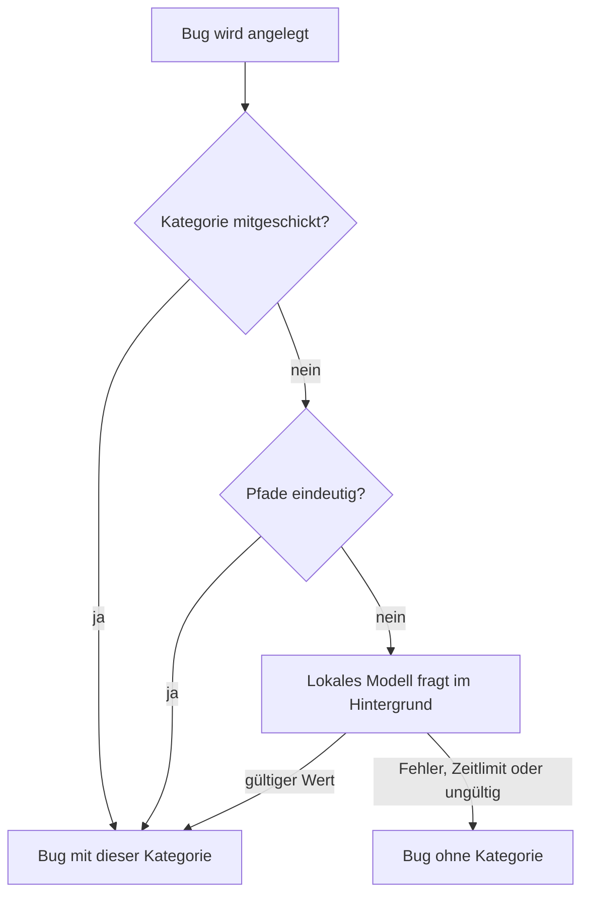

# Benutzerhandbuch: Bugs automatisch nach Bereich kategorisieren

Auftrag 26680790-2de3-45a2-8bc1-f71fd969d4e2 (Feature). Dieses Kapitel beschreibt, welche Kategorie ein Bug bekommt, wann sie leer bleibt, wie du sie von Hand änderst und wie du in der Bugliste und in der Statistik nach Kategorie filterst oder zählst.

> **Was sich geändert hat:** Bugs hatten bisher überwiegend keine Kategorie. Jetzt bekommt jeder neue Bug beim Anlegen eine Kategorie aus den betroffenen Dateipfaden. Ist keine Zuordnung eindeutig, fragt das lokale Modell. Bestehende Bugs ohne Kategorie füllt einmalig ein Wartungsjob. Bugliste und Statistik haben einen Kategoriefilter bzw. eine Verteilung nach Kategorie.
>
> **Printscreens:** keine. Auf dem Agent-Host ist kein Browser installiert, und der Browser-Cache ist für den Agenten gesperrt. Die Beschreibungen stammen aus dem Code (`frontend/src/app/features/bugs/bugs.component.ts` und `.html`, `frontend/src/app/features/bugs/bug-stats.ts`, `frontend/src/app/shared/data-table/columns.ts`, `frontend/src/app/shared/labels.ts`, `src/core/bug-category.ts`, `src/agent/bug-classifier.ts`, `src/runner/bug-category-job.ts`). Die Aufnahmen stehen in Abschnitt 8.
>
> **Tests:** In diesem Lauf wurden keine Tests ausgeführt. Ob die Oberfläche so arbeitet, wie hier beschrieben, bestätigt der Tester.

---

## 1. Die sechs Kategorien

Eine Kategorie ist genau einer dieser Werte:

| Kategorie | Anzeige | Typische Bedeutung |
| --- | --- | --- |
| `frontend` | Frontend | Oberfläche (Ordner `frontend/`) |
| `backend` | Backend | Server und API (Ordner `src/`) |
| `fullstack` | Fullstack | Oberfläche und Server zugleich |
| `infrastructure` | Infrastructure | Betrieb, Deployment, Container |
| `docs` | Docs | Dokumentation |
| `security` | Security | Agent-Schutz (Wächter, Pfadregeln, Berechtigungen) |

Einen weiteren Wert gibt es nicht. Ein Bug ohne eindeutige Zuordnung hat **keine** Kategorie und wird in der Anzeige als „Ohne Kategorie“ geführt.

---

## 2. Wo du die Kategorie siehst

- **Bugliste:** Die Spalte **Kategorie** zeigt die Anzeige der Kategorie oder „Ohne Kategorie“.
- **Bug anlegen:** Im Formular gibt es das Auswahlfeld **Kategorie**. Der Eintrag „Ohne Kategorie“ ist die Vorgabe.
- **Bug bearbeiten:** Im aufgeklappten Bug steht ebenfalls das Auswahlfeld **Kategorie**.
- **Statistik:** Die Karte **Nach Kategorie** (Abschnitt 5).

---

## 3. Automatische Kategorie beim Anlegen

Jeder neue Bug bekommt beim Anlegen eine Kategorie, nach dieser Reihenfolge:

1. **Mitgeschickt.** Kommt beim Anlegen eine Kategorie mit (z. B. über `POST /projects/:slug/bugs` mit `category`), bleibt genau dieser Wert. Die Automatik greift nicht.
2. **Aus Pfaden.** Die Regeln lesen die betroffenen Dateipfade. Dazu zählen Pfade, die der Erzeuger ausdrücklich mitschickt (z. B. die Testdatei), und Dateipfade, die im Titel oder in der Beschreibung stehen.
3. **Lokales Modell.** Nur wenn die Pfade nicht eindeutig zuordnen, fragt das lokale Modell mit Titel und Beschreibung. Das Modell muss einen der sechs Werte liefern.

### 3.1 Regeln aus Pfaden

| Gefundene Pfade | Kategorie |
| --- | --- |
| nur `frontend/…` | `frontend` |
| nur `src/…` | `backend` |
| `frontend/…` und `src/…` zusammen | `fullstack` |
| nur `src/agent/agent-guard…`, `src/agent/path-policy…` oder `src/agent/permission…` | `security` |
| nur `deploy/`, `.github/`, `Dockerfile`, `docker-compose.yml` oder `start.sh` | `infrastructure` |
| nur `docs/` oder `README.md` | `docs` |

Bedingungen im Detail:

- `security` gilt nur für das ganze Pfadsegment. `src/agent/agent-guard.ts` zählt, `src/agent/my-agent-guard.ts` zählt als `backend`.
- Betrieb zusammen mit Code ergibt keine eindeutige Zuordnung. Ein Pfad `deploy/…` neben `src/…` bleibt also ohne Regel und geht an das Modell.
- Doku zusammen mit Code zählt nicht als `docs`. Dann entscheidet ebenfalls das Modell.
- `node_modules`, `..` und URLs zählen nicht als Pfad.

### 3.2 Lokales Modell

- Das Modell wird **nach** dem Anlegen im Hintergrund gefragt. Das Anlegen wartet nicht darauf. Der Bug erscheint sofort, die Kategorie kann danach nachgetragen werden.
- Die Anfrage läuft nur an das lokale Modell (Ollama). Es bekommt nur Titel und Beschreibung, keine Werkzeuge und keine Schreibrechte.
- Zeitlimit: 20 Sekunden je Bug. Höchstens 50 Einstufungen warten gleichzeitig.
- Übernommen wird nur ein gültiger Wert aus der Liste. Eine andere Antwort wird verworfen.
- Die Kategorie wird nur gesetzt, solange der Bug noch keine hat.
- **Abschalten:** Mit `DEV_LOG_BUG_CATEGORY_MODEL=off` wird das Modell nicht gefragt. Dann bleiben Bugs ohne eindeutigen Pfad ohne Kategorie. Unter dem Test-Runner ist das Modell standardmäßig aus.

### 3.3 Wann die Kategorie leer bleibt

Die Kategorie bleibt leer, wenn:

- kein Pfad eindeutig zuordnet **und** das Modell nicht antwortet (nicht erreichbar, Zeitlimit überschritten, Fehler) **oder** keinen gültigen Wert liefert,
- das Modell abgeschaltet ist und kein Pfad eindeutig zuordnet.

In diesen Fällen wird der Bug **trotzdem** angelegt. Es erscheint keine Fehlermeldung. Der Bug ohne Kategorie kann von Hand eingeordnet werden (Abschnitt 4).

### 3.4 Welche Erzeuger die Kategorie setzen

| Erzeuger | Bemerkung |
| --- | --- |
| Tester und Oberflächentest | Die Testdatei zählt als Pfad. Eine Testdatei unter `src/core/` ergibt `backend`, eine unter `frontend/` ergibt `frontend`. |
| Auto-Fix und Bug-Wächter | Die Kategorie wird beim Anlegen gesetzt. Am Ablauf des Auto-Fix ändert sich nichts. |
| Problemanalyse | Die Kategorie wird beim Anlegen gesetzt. |
| GitHub- und CI-Sync | Die Kategorie wird beim Anlegen gesetzt. |
| Manuell (`POST /projects/:slug/bugs`) | Ohne `category` gilt die Automatik. Mit `category` bleibt genau dieser Wert. |

Produktionsfehler und Routinen setzen ihre Kategorie wie bisher selbst. Daran ändert sich nichts.

---

## 4. Kategorie von Hand ändern

- **Bearbeiten:** Im Bug-Formular wählst du eine Kategorie oder „Ohne Kategorie“ und speicherst.
- **Bedingung:** Das Auswahlfeld im bearbeiteten Bug erscheint nur, wenn du das Recht **Planen** hast. Ohne dieses Recht siehst du die Kategorie, kannst sie aber nicht ändern.
- **API:** `PATCH /bugs/:id` mit `{"category": "docs"}` ändert nur die Kategorie. Die übrigen Felder bleiben unverändert.
- **Vorrang:** Eine gesetzte oder von Hand geänderte Kategorie wird nicht überschrieben. Auch der Wartungsjob (Abschnitt 6) und spätere Läufe der Modell-Einstufung ändern sie nicht.

---

## 5. Filtern und zählen

### 5.1 Kategoriefilter in der Bugliste

- Öffne das Filtermenü in der Kopfzeile **Kategorie**.
- Das Menü listet alle sechs Kategorien und **„Ohne Kategorie“**. Auch Kategorien ohne Treffer stehen darin.
- Wähle **Backend**: Es bleiben nur Bugs mit der Kategorie Backend sichtbar.
- Mehrere Kategorien kannst du gleichzeitig wählen. Dann erscheinen Bugs, die einer der Kategorien entsprechen.
- Wähle **Ohne Kategorie**, um nur Bugs ohne Kategorie zu sehen.
- Den Filter setzt du mit „Zurücksetzen“ zurück. Die aktiven Filter erscheinen als Chips über der Tabelle.
- Ohne Treffer zeigt die Liste den Leertext der Gruppe: in den offenen Bugs „Keine offenen Bugs – alles ruht in Frieden.“, im Friedhof „Der Friedhof ist noch leer.“.
### 5.2 Karte „Nach Kategorie“ in der Statistik

- Die Karte **Nach Kategorie** zeigt je Zeile eine Kategorie mit der Zahl **offener** und **begrabener** Bugs.
- Die Zeile **„Ohne Kategorie“** zählt alle Bugs ohne gesetzte Kategorie.
- Die Karte zählt **nur** das Feld Kategorie. Eine Kategorie, die nur aus dem Text eines Bugs abgeleitet wäre, erscheint hier nicht.
- Die Karte **„Wo“** (Seite / Bereich) arbeitet weiter mit dem Pfad aus der Beschreibung. Das ist eine andere Auswertung.
- Ohne Bugs zeigt die Karte „Noch keine Bugs.“.

---

## 6. Wartungsjob `bug_categories` (einmaliger Nachtrag)

Bestehende Bugs ohne Kategorie bekommen die Kategorie einmalig über den Wartungsjob `bug_categories`.

- **Was er tut:** Er geht alle Bugs mit `category IS NULL` durch, in Stapeln zu 50. Er setzt die Kategorie aus den Pfaden, sonst aus dem lokalen Modell.
- **Was er nicht tut:** Er ändert keinen Bug mit gesetzter Kategorie, auch wenn die Pfade etwas anderes ergäben. Von Hand gesetzte Kategorien bleiben.
- **Wann er endet:** Ist alles durchlaufen, merkt sich der Job das. Danach läuft er ohne Wirkung weiter. Ein zweiter Lauf ändert nichts.
- **Abbruch:** Bricht der Lauf am Zeitlimit ab, setzt der nächste Lauf dort fort, wo er aufgehört hat.
- **Bugs ohne Zuordnung:** Bugs, die weder Pfade noch Modell einordnen, bleiben ohne Kategorie. Der Job versucht sie nicht erneut.
- **Aufträge:** Bestehende Aufträge ändern sich nicht. Die Vererbung der Kategorie auf einen Auftrag greift nur beim Anlegen des Auftrags.

Die Ergebnisnachricht des Jobs nennt, wie viele Bugs gesetzt wurden und wie viele ohne eindeutige Zuordnung geblieben sind.

---

## 7. Was sich nicht ändert

- Produktionsfehler und Routinen setzen ihre Kategorie wie bisher.
- Die Liste der Kategorien ist fest. Es gibt keine neuen Kategorien.
- Die Visionär-Auswertung nutzt das Kategoriefeld wie bisher.
- Die Verarbeitung von Auto-Fix und Bug-Wächter (Start, Wiederholung, Fehlerbehandlung) bleibt gleich. Die Kategorie wirkt nur auf das Feld des Bugs.

---

## 8. Häufige Fragen

**Warum hat mein neuer Bug keine Kategorie?**
Kein Pfad hat eindeutig zugeordnet, und das lokale Modell hat nicht geantwortet oder einen ungültigen Wert geliefert. Ordne den Bug von Hand zu (Abschnitt 4).

**Warum steht die Kategorie nicht sofort im Bug?**
Bei Pfaden, die nicht eindeutig sind, fragt das Modell im Hintergrund. Die Kategorie erscheint, sobald die Antwort da ist, und nur, wenn der Bug bis dahin keine Kategorie hat.

**Ich habe eine Kategorie von Hand gesetzt. Ändert sie sich später?**
Nein. Weder der Wartungsjob noch die Modell-Einstufung überschreiben sie.

**Warum zählt die Statistik „Nach Kategorie“ einen Bug nicht, den die Beschreibung eindeutig zuordnet?**
Die Karte zählt nur das gesetzte Feld. Die Zuordnung aus dem Pfad wird beim Anlegen vergeben, nicht bei der Auswertung.

**Ich sehe das Auswahlfeld zur Kategorie nicht.**
Im bearbeiteten Bug ist es nur mit dem Recht **Planen** sichtbar.

---

## 9. Printscreens (ausstehend)

Diese Aufnahmen fehlen noch. Sie entstehen auf einem Host mit laufender App und Browser:

1. **Bugliste:** Spalte Kategorie mit einem Bug je Kategorie und einem Bug „Ohne Kategorie“.
2. **Kategoriefilter:** Filtermenü mit den sechs Kategorien und „Ohne Kategorie“, dazu Chip „Backend“ nach der Auswahl.
3. **Bug-Formular:** Auswahlfeld „Kategorie“ beim Anlegen und beim Bearbeiten (mit Recht „Planen“).
4. **Statistik:** Karte „Nach Kategorie“ mit offenen und begrabenen Zahlen und der Zeile „Ohne Kategorie“.

---

## 10. Offen für den Tester

Die folgenden Prüfungen sind **nicht** erfolgt:

1. `npm run typecheck`, `npm test`, die Frontend-Specs und `e2e/full-ui.check.ts` (mit `npm` bzw. `npm run`, nicht `npx tsx`).
2. Zweiter Lauf des Wartungsjobs: ändert keinen Bug mehr. Eine gesetzte Kategorie bleibt auch dann, wenn die Pfade etwas anderes ergäben.
3. `PATCH /bugs/:id` mit `{"category":"docs"}`: Die übrigen Felder bleiben unverändert.
4. Oberflächentest „Tabellen“ (Desktop): Kategoriefilter, Zurücksetzen, Chips und Leertext.
5. Oberflächentest „Rollen“: Das Auswahlfeld erscheint nur mit dem Recht „Planen“.
6. Printscreens aus Abschnitt 9 auf einem Host mit Browser erstellen und in dieses Kapitel einfügen.
