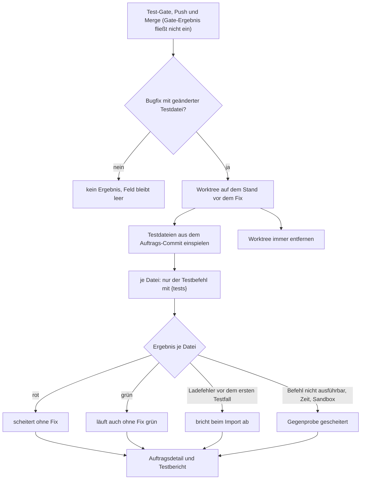

# Benutzerhandbuch: Gegenprobe der Bugfix-Tests (Auftrag 37938d19)

Dieses Kapitel beschreibt die Gegenprobe. Nach dem Sprint-Abschluss prüft AIdeation bei Bugfix-Aufträgen, ob die geänderten Tests ohne den Fix scheitern. Das Ergebnis steht im Auftrag, im Testbericht und im Auftragsdetail. Die Gegenprobe ist rein informativ: Sie blockiert weder Push noch Merge.

> **Printscreens:** keine. In dieser Sitzung gab es keinen Browser (`chromium`, `google-chrome` und `firefox` sind nicht installiert), und die App wurde nicht gestartet. Die Beschreibung stammt aus dem Quelltext: `src/runner/git-sync/counter-check.ts`, `src/runner/git-sync/ci.ts`, `src/runner/git-sync/sprint-sync.ts` (Zeilen 499–515), `src/runner/runner-prompts.ts` (Zeilen 22–26), `frontend/src/app/features/development/order-detail.component.{ts,html}` (Zeilen 402–423) und `docs/gegenprobe-neue-tests-gegen-den-stand-vor-dem-fix-2026-10-30.md`. Abschnitt 8 nennt die Aufnahmen, die noch fehlen.
>
> **Stand:** Der Code liegt auf dem Auftrags-Branch, nicht committet. Die Tests `counter-check.test.ts`, `npm run typecheck` und `npm run test:unit` sind in dieser Sitzung nicht gelaufen. Die Aussagen unten sind aus dem Code belegt, nicht aus einem Testlauf.

---

## 1. Was die Gegenprobe macht

Ein Bugfix bringt meist einen neuen oder geänderten Test mit. Die Frage ist: Würde dieser Test ohne den Fix scheitern? Läuft er auch auf dem alten Stand grün, beweist er den Fix nicht.

Die Gegenprobe führt die geänderten Testdateien des Auftrags auf dem Stand **vor** dem Fix aus:

- **Produktivcode:** aus dem Stand vor dem Auftrag.
- **Testdateien:** aus dem Auftrags-Commit.
- **Ausgeführt werden nur diese Testdateien**, über die Testbefehle des Auftrags mit `{tests}`. Die vollständige Testsuite läuft nicht.
- **Hauptordner, Sprint-Branch, `HEAD` und Index** bleiben unverändert.

## 2. Wann eine Gegenprobe läuft

| Bedingung | Ergebnis |
|---|---|
| Auftrag ist ein **Bugfix** (`kind = bug`), hat mindestens eine **geänderte Testdatei** und ist im Sprint **erledigt** (`done`) | Gegenprobe läuft beim Sprint-Abschluss |
| Auftrag ist ein **Feature** | keine Gegenprobe, Ergebnisfeld bleibt leer |
| Bugfix ohne geänderte Testdatei | keine Gegenprobe, Ergebnisfeld bleibt leer |
| Bugfix ohne Auftrags-Commit (z. B. nach einer Review-Freigabe) | Hinweis „Gegenprobe gescheitert“: kein Auftrags-Commit vermerkt |
| Bugfix ohne Testbefehl mit `{tests}` | Hinweis „Gegenprobe gescheitert“: keine Testbefehle mit `{tests}` hinterlegt |
| Testdatei ist ein Playwright-/e2e-Test | „nicht bewertet“ (in dieser Version nicht gegengeprüft) |
| Dateien in `.dev-log/` und in den Berichtsordnern (`REPORT_DIRECTORIES`, z. B. `docs/tests/`) | zählen nicht als geänderte Testdatei |

Ein Auftrag bekommt die Gegenprobe nur einmal: Solange das Ergebnisfeld gesetzt ist, läuft sie nicht erneut. Abgeschlossene Aufträge werden nicht rückwirkend geprüft.

## 3. Die Ergebnisse je Testdatei

Jede Testdatei bekommt genau eines dieser Ergebnisse:

| Ergebnis im Bericht | Bedeutung | Erwartet? |
|---|---|---|
| **scheitert ohne Fix** | Der Test schlägt auf dem alten Stand fehl. Er prüft also den Fix. | ja |
| **läuft auch ohne Fix grün** | Der Test läuft auf dem alten Stand grün. Er beweist den Fix nicht. Im Auftragsdetail steht zusätzlich: „der Test beweist den Fix nicht“. | nein, prüfen |
| **bricht beim Import ab** | Die Testdatei lässt sich vor dem ersten Testfall nicht laden: fehlendes Modul, Syntaxfehler, nicht auflösbarer Import. | nein, prüfen |
| **nicht bewertet** | Playwright-/e2e-Test oder kein passender Testbefehl mit `{tests}` für diese Datei. | – |
| **Gegenprobe gescheitert** | Die Gegenprobe selbst ist nicht gelaufen: Zeitbudget erschöpft, Testbefehl nicht ausführbar, Zeitüberschreitung, Sandbox-Fehler. Das ist **kein** Testergebnis und **kein** Blocker. | – |

**Wichtig zur Unterscheidung:**

- Ein Ladefehler **vor dem ersten Testfall** ist „bricht beim Import ab“. Ein Fehler wie „Cannot find module“ **innerhalb** eines laufenden Testfalls ist dagegen „scheitert ohne Fix“. Ein Fehler beim Laden ist nie „scheitert ohne Fix“.
- Die Erkennung nutzt Textmuster der Testausgabe (`Cannot find module`, `ERR_MODULE_NOT_FOUND`, `SyntaxError`, `Failed to load` und weitere) und erkennt Testfälle bei node:test, Jest, Vitest und TAP. Bei einem anderen Runner kann die Zuordnung daneben liegen. Deshalb gibt es dazu Tests mit mehr als einem Runner (noch nicht ausgeführt).

## 4. Wo du das Ergebnis siehst

**Auftragsdetail** (Auftrag öffnen, Bereich „Gegenprobe ohne Fix“):

- Eine Zeile je Testdatei mit Pfad und Ergebnis.
- Bei „läuft auch ohne Fix grün“ der Zusatz: der Test beweist den Fix nicht.
- Bei den anderen Ergebnissen steht der Grund dahinter, wenn es einen gibt (gekürzt auf 300 Zeichen).
- Bei „Gegenprobe gescheitert“ steht der Grund als eigene Zeile.
- **Ohne Ergebnis erscheint der Bereich nicht.** Es steht dort kein Hinweis „offen“.

**Testbericht** (`test_runs.report`, Trigger `counter-check`): Überschrift „Gegenprobe: neue Tests ohne den Fix (Sprintname)“, danach eine Zeile je geprüfter Testdatei mit dem Ergebnis. Der Lauf wird als erfolgreich beendet, auch wenn die Dateien rot sind. Er erscheint daher nicht als roter Testlauf im Dashboard.

**Sprint-Log:** eine Zusammenfassung, zum Beispiel „Gegenprobe (3 Testdateien): 2 scheitern ohne Fix, 1 auch ohne Fix grün, 0 brechen beim Import ab“. Gab es Fehler der Gegenprobe selbst, folgt „N nicht prüfbar“. Das Sprint-Log wird nur geschrieben, wenn es überhaupt Bugfixes mit geänderter Testdatei gibt.

## 5. Wann der Lauf stattfindet

1. Das Test-Gate des Sprint-Abschlusses läuft, danach Push beziehungsweise Pull Request und Merge.
2. Die Gegenprobe wertet das Ergebnis des Gates **nicht** aus. Sie läuft nach dem Push-Schritt, auch wenn das Gate rot war. Sie kann Push und Merge weder verhindern noch zurücknehmen.
3. Die Stundengrenze des Gates wird neu gestellt, damit die Gegenprobe sie nicht sprengt.
4. Die Gegenprobe läuft für alle erledigten Bugfixes des Sprints ohne Ergebnis.

Bei einem reinen **Pull** des Sprints (`action = 'pull'`) läuft keine Gegenprobe.

Hat der Worker während des Laufs einen Neustart (Shutdown), bleiben die Aufträge ohne Ergebnis. Sie werden bei der nächsten Sicherung wieder geprüft. Befehle, die dabei abgebrochen wurden, sind kein Ergebnis.

## 6. Zeitgrenzen und Aufräumen

- **5 Minuten je Testbefehl** (Zeitüberschreitung ergibt „Gegenprobe gescheitert“).
- **10 Minuten Budget je Sprint-Lauf.** Ist es erschöpft, bekommen die restlichen Dateien „Gegenprobe gescheitert“ mit dem Hinweis „Zeitbudget erschöpft“.
- **Der Worktree wird immer entfernt**, auch bei Fehler oder Zeitüberschreitung. Er liegt im Temp-Ordner mit dem Präfix `aideation-gegenprobe-`.
- **Beim nächsten Start einer Gegenprobe** räumt AIdeation verwaiste Worktrees mit diesem Präfix weg (nach einem Absturz oder SIGKILL).

## 7. Sandbox und Abhängigkeiten

- Ist die Projekt-Sandbox aktiv, laufen die Testbefehle der Gegenprobe über denselben Executor wie das Test-Gate, also im Container.
- Ohne Sandbox (`off`) werden `node_modules` aus dem Hauptordner in den Worktree verlinkt. Keine `.env` und keine Zugangsdaten gehen in den Worktree.
- **Nicht belegt:** Dass die Gegenprobe im Container läuft und dass die Compose-Projektwahl (`agentComposeProject`) zum temporären Pfad passt. Das ist offen (Abschnitt 9).

## 8. Noch offen

- **Printscreens fehlen** (keine laufende App, kein Browser). Nötig sind mindestens:
  1. Auftragsdetail mit „scheitert ohne Fix“ (grün, erwartet).
  2. Auftragsdetail mit „läuft auch ohne Fix grün“ und dem Hinweis, dass der Test den Fix nicht beweist.
  3. Auftragsdetail mit „bricht beim Import ab“.
  4. Testbericht „Gegenprobe: neue Tests ohne den Fix“ mit einer Zeile je Datei.
  5. Auftragsdetail eines Features oder Bugfixes ohne Testdatei: kein Bereich „Gegenprobe ohne Fix“.
- **Tests nicht gelaufen:** `counter-check.test.ts` (echtes Git-Repo mit Bugfix-Fixture, alle drei Ergebnisse), `npm run typecheck` und `npm run test:unit`. Die erwarteten Ergebnisse der tsx-Fixtures (`parse.test.ts` mit Syntaxfehler, `neu.test.ts` mit fehlendem Modul) hängen an der echten Ausgabe von node:test und tsx. Weicht eine Erwartung ab, muss die echte Ausgabe geprüft werden.
- **Basis-Commit weicht vom Auftragstext ab.** Der Auftrag verlangt `git merge-base` aus Auftragsbranch und Basis-Branch. Umgesetzt ist der **erste Elternteil des Auftrags-Commits** (`git_commit`). Begründung laut Entwickler: Der Auftragsbranch ist nach dem Merge gelöscht, `merge-base` ist dann nicht mehr bestimmbar. Das ist eine Entscheidung, die noch bestätigt werden muss.
- **Zusätzliche Ergebnisse** gegenüber dem Auftrag: „nicht bewertet“ (Playwright und fehlende `{tests}`-Befehle) und „Gegenprobe gescheitert“ (Fehler der Gegenprobe selbst). Beide sind im Auftrag nicht genannt.
- **Migration 19** (`counter_check JSONB`): `NULL` heisst „keine Gegenprobe“, bestehende Aufträge bleiben `NULL`. Der Worker muss nach der Änderung neu gestartet werden.
- **Sandbox-Pfad nicht belegt** (Abschnitt 7).
- **Testbefehle mit `{tests}` ohne Freigabe:** Der Hinweis des Bug-Wächters (`npx --no-install tsx --test …` braucht eine Freigabe) ist nicht geprüft. Ein Befehl, der eine Freigabe verlangt, würde als „Gegenprobe gescheitert“ enden und nicht hängen.
- **Playwright-Gegenprobe** ist in dieser Version nicht vorgesehen.

## 9. Ablauf auf einen Blick

---

*Quelle: Auftrag 37938d19, Stand Entwickler-Commit nicht committet. Code: `src/runner/git-sync/counter-check.ts`, `ci.ts`, `sprint-sync.ts`, `runner-prompts.ts`, `order-detail.component.{ts,html}`. Gegenprobe-Doku: `docs/gegenprobe-neue-tests-gegen-den-stand-vor-dem-fix-2026-10-30.md`. Nicht committet.*
