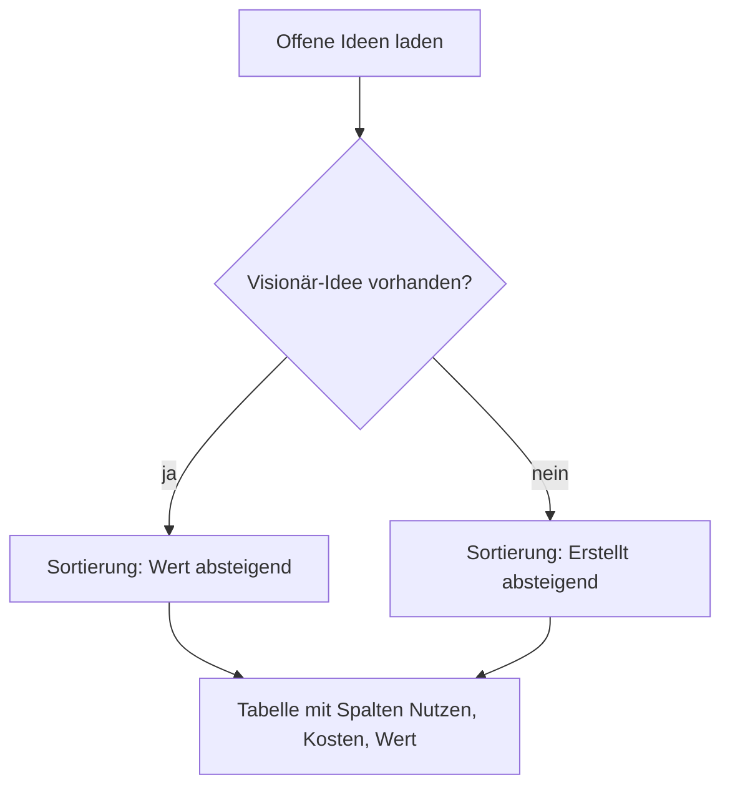

# Benutzerhandbuch: Nutzen-, Kosten- und Wertspalten in „Offene Ideen“

Auftrag ef5e6c78 (Entwicklung, Frontend). Dieses Kapitel beschreibt, welche Spalten die Tabelle „Offene Ideen“ auf der Ideen-Seite jetzt zeigt, wie du sie sortierst und filterst, und unter welchen Bedingungen einzelne Werte leer bleiben.

> **Was sich geändert hat:** Die Tabelle „Offene Ideen“ hatte bisher keine Spalten für Nutzen und Kosten. Du musstest eine Idee aufklappen, um die Meter im Ideen-Dialog zu sehen. Jetzt stehen Nutzen, Kosten und ein Wert aus beiden direkt in der Tabelle. Bei Visionär-Ideen ist der Wert die Standard-Sortierung, damit du die besten Ideen ohne Aufklappen findest.
>
> **Printscreens:** keine. Im Agent-Image ist kein Chromium installiert (`which chromium` ohne Treffer), und der Dev-Server wurde nicht gestartet. Die Beschreibungen unten stammen aus dem Code (`frontend/src/app/features/ideation/ideation.component.ts`, `ideation.component.html`, `idea-options.ts`, `frontend/src/app/shared/data-table/data-table.component.ts`, `sort.ts`), nicht aus einem Lauf der App. Printscreens sollten auf einem Host mit `npm run dev:ui` und einem Browser entstehen. Zielbilder: Tabelle „Offene Ideen“ mit Spalten Nutzen, Kosten, Wert; Kopfzeile „Wert“ mit Sortierpfeil; Filtermenü „Nutzen“ mit Auswahl 0–10.
>
> **Tests:** Für dieses Kapitel wurde nichts ausgeführt. Ob die Oberfläche so funktioniert, wie hier beschrieben, bestätigt erst der Tester (siehe Abschnitt 8).

---

## 1. Wo du die Spalten findest

Öffne die **Ideen**-Seite. Die Tabelle **Offene Ideen** zeigt alle Ideen, die weder „In Bearbeitung“ noch „Abgeschlossen“ sind. Die Spalten sind:

| Spalte | Inhalt | Sortierbar | Filterbar |
| --- | --- | --- | --- |
| **Nutzen** | Balken mit Zahl, Wert 0–10 | ja | ja, Auswahl 0–10 |
| **Kosten** | Balken mit Zahl, Wert 0–10 | ja | ja, Auswahl 0–10 |
| **Wert** | Nutzen geteilt durch Kosten, eine Nachkommastelle, z. B. „2,7“ | ja | nein |
| Aufwand (Agent-Std.) | wie bisher, geht **nicht** in den Wert ein | wie bisher | wie bisher |

Die Gruppen **In Bearbeitung** und **Abgeschlossen** auf derselben Seite zeigen weiterhin die alten Spalten. Dort gibt es die neuen Spalten nicht.

---

## 2. Nutzen und Kosten

- Jede Zelle zeigt einen kleinen Balken mit der Zahl daneben. Die Balken sind gleich aufgebaut wie die Meter im Ideen-Dialog.
- Die Füllung entspricht dem Wert: Nutzen **8** füllt den Balken zu **80 %**, Kosten **3** zu **30 %**.
- Fehlt der Wert (die Idee hat keinen Nutzen oder keine Kosten), bleibt die Zelle leer.
- Du kannst die Werte in der Tabelle **nicht** ändern. Bearbeiten geht nur im Ideen-Dialog, der sich nicht verändert hat.

### 2.1 Sortieren

- Ein Klick auf die Kopfzeile sortiert aufsteigend, ein zweiter Klick absteigend, ein dritter hebt die Sortierung auf (so wie bei den anderen Tabellen).
- Ideen **ohne** Wert (bzw. ohne Nutzen oder Kosten, wenn du nach Nutzen oder Kosten sortierst) stehen **immer am Ende**, egal ob du auf- oder absteigend sortierst.

### 2.2 Filtern

- Öffne das Filtermenü in der Kopfzeile „Nutzen“ oder „Kosten“.
- Wähle einen Wert von **0 bis 10**. Es werden nur Ideen mit genau diesem Wert angezeigt.
- Die Spalte „Wert“ hat **keinen** Filter. Du kannst sie nur sortieren.

---

## 3. Wert (Nutzen / Kosten)

### 3.1 Berechnung

Wert = **Nutzen ÷ Kosten**, mit einer Nachkommastelle und deutschem Komma. Beispiel: Nutzen 8, Kosten 3 ergibt **2,7**.

### 3.2 Wann die Zelle leer bleibt

Die Zelle „Wert“ bleibt leer, wenn eines davon zutrifft:

- Die Idee hat keinen **Nutzen**.
- Die Idee hat keine **Kosten**.
- Die **Kosten sind 0**. Durch 0 teilen ist nicht erlaubt, deshalb gibt es dann keinen Wert.

Eine Idee mit leerem Wert ist nicht falsch. Sie hat nur nicht genug Angaben, um den Wert zu rechnen. Ändere Nutzen oder Kosten im Ideen-Dialog, damit der Wert erscheint.

### 3.3 Der Aufwand zählt nicht mehr

Die Spalte „Aufwand (Agent-Std.)“ ist noch da und zeigt dieselben Werte wie vorher. Sie fließt aber **nicht** in den Wert ein. Der Wert kommt allein aus Nutzen und Kosten.

---

## 4. Standard-Sortierung

Die Tabelle öffnet sich nach einer von zwei Regeln:

| Liste enthält … | Sortierung beim Öffnen |
| --- | --- |
| **mindestens eine Visionär-Idee** | **Wert, absteigend** (die höchsten Werte oben) |
| keine Visionär-Idee | **Erstellt, absteigend** (die neuesten Ideen oben) |

Eine Visionär-Idee erkennst du an der Herkunft „Visionär“ (der Visionär-Agent hat sie erzeugt). Sobald eine davon in der Liste ist, wechselt die Tabelle auf Wert.

### 4.1 Umkehren der voreingestellten Sortierung

Wenn die Tabelle mit „Wert, absteigend“ startet, bringt ein **Klick auf „Wert“** die Reihenfolge **um** (aufsteigend). Ein Klick auf „Erstellt“ wechselt auf diese Spalte. Das gilt auch, wenn die Tabelle mit „Erstellt“ startet.

---

## 5. Ablauf

---

## 6. Was sich nicht ändert

- Der **Ideen-Dialog** zeigt die Meter für Nutzen und Kosten unverändert an.
- Die Gruppen **In Bearbeitung** und **Abgeschlossen** zeigen dieselben Spalten wie vorher.
- Der **Aufwands-Schätzer** und die Spalte „Aufwand (Agent-Std.)“ bleiben gleich.
- Die Bewertung im Backend, der Visionär-Lauf und die Datenbank bleiben gleich.

---

## 7. Häufige Fragen

**Warum fehlt der Wert bei einer Idee, die Nutzen und Kosten hat?**
Prüfe, ob die Kosten 0 sind. In dem Fall gibt es keinen Wert.

**Warum steht eine Idee ganz unten, obwohl sie einen hohen Nutzen hat?**
Sie hat keinen Wert (keine Kosten oder keinen Nutzen). Leere Werte stehen immer am Ende.

**Kann ich nach Wert filtern?**
Nein. Die Spalte Wert ist nur sortierbar. Filtern kannst du nach Nutzen und Kosten.

**Ändert sich die Formel später?**
Die Formel Nutzen ÷ Kosten ist eine Annahme aus dem Auftrag. Sollte sie sich ändern, betrifft das nur die Berechnung des Werts.

---

## 8. Offen für den Tester

Die folgenden Prüfungen sind **nicht** erfolgt. Sie gehören zum Tester:

1. `npm run typecheck`, `npm run lint`, `npm run format:check`, `npm run test:unit`.
2. Oberflächentest „Tabellen“ (Desktop): Ein Klick auf „Wert“ bei voreingestellter Sortierung muss die Reihenfolge umkehren. Ideen ohne Wert müssen in beiden Richtungen hinten stehen. Das Suchfeld im Filtermenü muss den Fokus bekommen.
3. Oberflächentest „Ideen“ (Desktop): Der Ideen-Dialog bleibt unverändert, die Meter sehen gleich aus, Escape schließt den Dialog.
4. Oberflächentest „Dashboard“ (Desktop) und „Projektwechsel“ (Desktop).
5. E2E-Locators in `e2e/full-ui.check.ts` gegen die neuen Spaltenköpfe „Nutzen“, „Kosten“ und „Wert“ prüfen und bei Bedarf anpassen.
6. Printscreens auf einem Host mit Browser erstellen und in dieses Kapitel einfügen.

Verwandte Dokumente: [`offene-ideen-nutzen-kosten-wert-spalten-2026-10-30.md`](offene-ideen-nutzen-kosten-wert-spalten-2026-10-30.md) (technische Begleitnotiz), [`benutzerhandbuch-regeln-auftraege-sprints-bugs.md`](benutzerhandbuch-regeln-auftraege-sprints-bugs.md).
