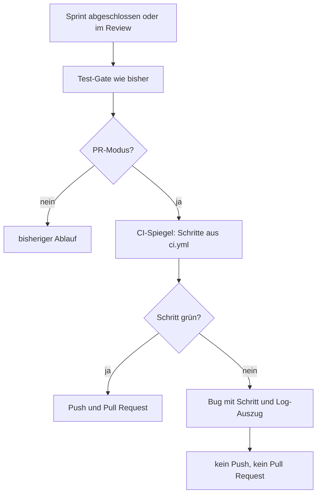

# CI-Spiegel vor dem Pull Request lokal ausführen

Auftrag dca86e51.

## Ziel

Im PR-Modus (`issues+pr`) führt der Worker vor dem Push des Sprint-Branches die Prüfschritte aus `.github/workflows/ci.yml` lokal aus. Ein roter Schritt verhindert Push, Pull Request und Merge und legt einen Bug an.

## Umsetzung

- **Neues Modul `src/runner/git-sync/ci-mirror.ts`**
  - `mirroredSteps(workflow)`: einfacher Zeilenparser (keine YAML-Bibliothek) für `run: npm run …`-Zeilen. Übernommen werden nur `lint`, `format:check`, `typecheck` und `test:unit`, in der Reihenfolge der Datei, jeder Schritt einmal. `npm ci`, Docker, Playwright, `test:e2e` und `build:ui` werden nicht gespiegelt. Die Datei wird bei jedem Lauf neu gelesen, die Liste steht nicht im Code.
  - `runCiMirror(execute, cwd, log)`: führt die Schritte über `runProjectCommand` (gefilterte Umgebung, ohne AIdeation-Zugänge) aus und hält beim ersten roten Schritt an. Fehlt die Datei oder enthält sie keinen spiegelbaren Schritt, vermerkt der Log „CI-Spiegel übersprungen“.
  - Fehlende Datenbank: Ist `test:unit` rot und zeigt die Ausgabe eine fehlende Datenbank (`keine PostgreSQL-Datenbank`, `DEV_LOG_TEST_REQUIRE_DATABASE`, `ECONNREFUSED …:543x`), gilt der Schritt als „nicht prüfbar“. Der Log vermerkt das, kein Bug, der Pull Request wird geöffnet.
  - `reportCiMirrorFailure(pool, project, sprintName, failure)`: legt einen Bug „CI-Spiegel rot vor Pull Request von „<Sprintname>““ an (höchstens 180 Zeichen, Priorität `high`, Quelle `github`). Im Text stehen `Fehlgeschlagener Schritt: \`npm run …\`` und der mit `ciLogExcerpt` gekürzte (60 Zeilen / 3000 Zeichen), maskierte Log-Auszug. Pro Sprint und Schritt gibt es nur einen offenen Bug (`INSERT … WHERE NOT EXISTS`).
- **`src/runner/git-sync/sprint-sync.ts`**: Der Spiegel (`mirror`) wird in `pushSprint` vor dem Push eingehängt, beim Sprint-Abschluss und bei der Nachbesserung im Review. Er läuft zusätzlich zum Test-Gate. Bei Rot wirft er einen Fehler „Push abgelehnt: CI-Spiegel rot bei …“, die Git-Sicherung steht auf „gescheitert“.
- **`src/runner/git-sync/ci.ts`**: kleine Anpassung für die Wiederverwendung (`ciLogExcerpt`, `maskSecrets`, `gateFailureSummary`, `TEST_TIMEOUT_MS`).
- **Tests**: `src/runner/git-sync/ci-mirror.test.ts` (neu) und Ergänzungen in `src/runner/git-sync.test.ts`.
- **Doku**: `docs/ci.md` (Abschnitt „CI-Spiegel vor dem Pull Request“), `docs/workflows.md`, `docs/benutzerhandbuch-live-schalten-pr-modus.md`, `docs/benutzerhandbuch-ci-spiegel-vor-pull-request.md`.

## Ablauf

## Tests und Prüfung

- Testdateien decken ab: vier Schritte in Dateireihenfolge, `npm ci`/Docker/E2E nicht gespiegelt, roter Schritt ohne `push`/`createPullRequest`, genau ein Bug mit Schrittnamen, kein zweiter Bug beim zweiten roten Lauf, Log-Auszug ohne Zugangsdaten und höchstens 3000 Zeichen, „nicht prüfbar“ ohne Datenbank (PR wird geöffnet), grüner Ablauf (Push, dann Pull Request).
- **Nicht verifiziert:** Der Tester-Lauf scheiterte an der Umgebung (`node_modules` in `/workspace` ist ein toter macOS-Symlink, `tsc` nicht gefunden, npm-Cache nicht beschreibbar). Weder `npm run lint`, `format:check`, `typecheck` noch `test:unit` oder der bestehende PR-Modus-Test in `git-sync.test.ts` wurden in diesem Auftrag erfolgreich ausgeführt. Die Dokumentation hat nichts davon erneut ausgeführt; die Prüfung muss in einer Umgebung mit funktionierender Installation nachgeholt werden.

## Geänderte Dateien

- `src/runner/git-sync/ci-mirror.ts` (neu)
- `src/runner/git-sync/ci-mirror.test.ts` (neu)
- `src/runner/git-sync/ci.ts`
- `src/runner/git-sync/sprint-sync.ts`
- `src/runner/git-sync.test.ts`
- `docs/ci.md`
- `docs/workflows.md`
- `docs/benutzerhandbuch-live-schalten-pr-modus.md`
- `docs/benutzerhandbuch-ci-spiegel-vor-pull-request.md`

## Worauf zu achten ist

- **Nur PR-Modus.** Ohne PR-Modus (reine Sprint-Sicherung) läuft der Spiegel nicht; ein Test deckt das ab. Offene Frage an den Auftraggeber, ob das so bleiben soll.
- **Sicherheit:** Befehle laufen nur über `runProjectCommand` (gefilterte Umgebung). Log-Auszüge gehen immer durch `maskSecrets` und `ciLogExcerpt`.
- **Bug-Quelle `github`:** vorhanden in `bugs_source_check`, keine Schema- oder Migrationsänderung. Der Titel unterscheidet sich von „CI rot im Pull Request von …“, die Bereinigung in `migrations.ts` erfasst ihn nicht.
- **Offen:** Ein Bug „CI-Spiegel rot vor Pull Request von …“ wird nach erfolgreichem Merge nicht automatisch geschlossen. Falls gewünscht, in `pollSprintReviews` analog zu `ciBugTitle` ergänzen.
- **Laufzeit:** Die vier Schritte (vor allem die Tests) verlängern die Sprint-Sicherung im PR-Modus.
- **Datenbank-Erkennung ist musterbasiert** (`NO_DATABASE`) und gilt nur für `test:unit`. Ändern sich die Meldungen der Test-Datenbank, muss das Muster nachgezogen werden. Enthält die Ausgabe den Datenbank-Hinweis, gilt der ganze Schritt als „nicht prüfbar“, auch wenn daneben andere Tests rot sind. Diese prüft dann die echte CI.
- **Bestehender PR-Modus-Test** (`git-sync.test.ts`, ab Zeile 444): Dort legt `ensureCiWorkflow` eine `ci.yml` mit `run: true` an. Ohne `npm run`-Schritt überspringt der Spiegel, der Ablauf bleibt wie bisher.
- Der Spiegel ist eine Vorprüfung. Die echte CI bleibt maßgeblich; `waitForCi` und der Merge sind unverändert.

## Sprint

| Auftrag | Zustand | Details |
| --- | --- | --- |
| dca86e51 CI-Spiegel vor dem Pull Request lokal ausführen | umgesetzt, Prüfung offen | Tester-Lauf wegen kaputter Umgebung nicht aussagekräftig. Erneuter Versuch am 30.10.2026: Die Umgebung ist weiter kaputt. `node_modules` und `.git` im Worktree verweisen auf den Host-Pfad `/Volumes/DroneShots/Coding/AIdeation/source/…`, den es im Container nicht gibt (`tsc: not found`, `git` meldet „not a git repository“). Der Code wurde statisch geprüft und nicht geändert. |

## Anfrage / TODO

- Prüfung (`lint`, `format:check`, `typecheck`, `test:unit`, `npx tsx --test src/runner/git-sync/ci-mirror.test.ts src/runner/git-sync.test.ts`) in einer Umgebung mit funktionierendem `node_modules` nachholen.
- Entscheidung: Spiegel auch ohne PR-Modus?
- Entscheidung: Spiegel-Bug nach Merge automatisch schließen?
