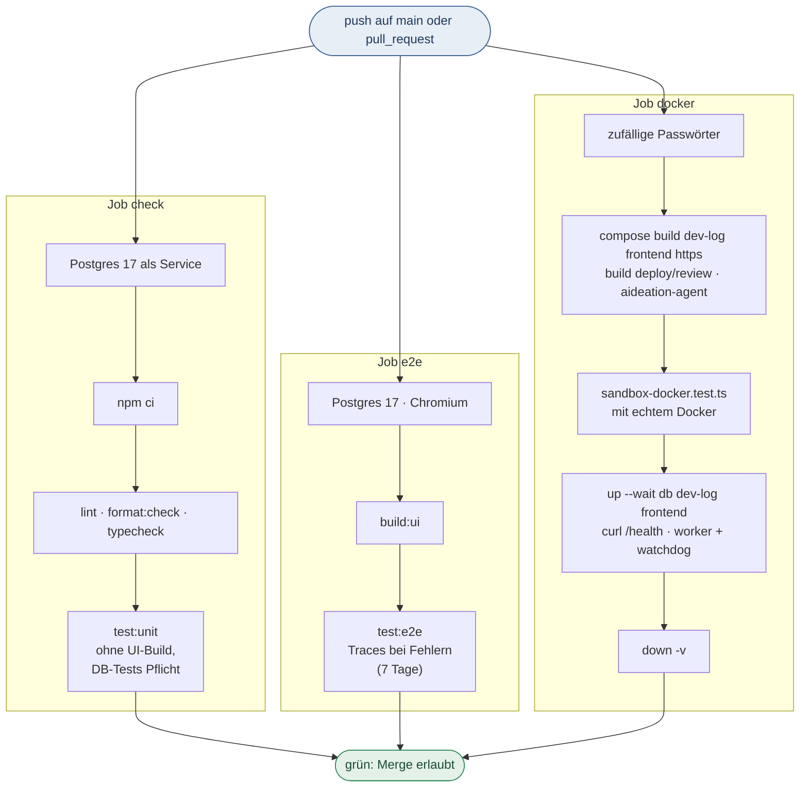

# CI (GitHub Actions)

Workflow: `.github/workflows/ci.yml`. Läuft bei `push` auf `main` und bei `pull_request`. Ein Push auf einen anderen Branch startet keinen eigenen Lauf, das übernimmt sein Pull Request. So läuft ein Commit nicht doppelt. Der Workflow hat `permissions: contents: read`, kein Job schreibt ins Repository.

`concurrency` gruppiert nach Workflow und Pull-Request-Nummer bzw. Ref. Ein neuer Push auf denselben Pull Request bricht den laufenden Lauf ab. Läufe auf `main` werden nicht abgebrochen (`cancel-in-progress` nur bei `pull_request`).

## Jobs

Alle `actions/checkout`-Schritte nutzen `persist-credentials: false`: Das `GITHUB_TOKEN` landet nicht in `.git/config`, Projektcode (Tests, Testserver, Docker-Build) kann es nicht lesen. Kein Job nutzt Secrets.

- **`check`**: Postgres 17 als Service (`DEV_LOG_TEST_REQUIRE_DATABASE=1`: Datenbank-Tests dürfen nicht übersprungen werden), `npm ci`, `lint`, `format:check`, `typecheck` (inkl. Tests), `npm run test:unit`. `test:unit` baut die Oberfläche nicht, kein Unit-Test liest `dist/ui`. `npm test` (= `build:ui` + `test:unit`) bleibt der lokale Komplettlauf. Die Oberfläche baut in der CI nur der Job `e2e`.
- **`e2e`**: Postgres 17 als Service (Wegwerf-Datenbank, kein Secret), Chromium installieren, `build:ui`, `npm run test:e2e`. Der Playwright-Reporter ist in der CI `list` plus `github`, Fehler stehen also im Log und als Annotation. Bei Fehlern werden die Traces als Artefakt `playwright-traces` (7 Tage) hochgeladen.
- **`docker`**:
  1. Zufällige, maskierte Werte für `DEV_LOG_PASSWORD` und `DEV_LOG_DB_PASSWORD` (sonst griffe das bekannte Standardpasswort aus compose).
  2. `docker compose build dev-log frontend https` (Caddy wird nur gebaut, nicht gestartet), `docker build deploy/review` und `docker build -t aideation-agent -f deploy/agent/Dockerfile .`.
  3. `src/core/sandbox-docker.test.ts` mit echtem Docker (`DEV_LOG_TEST_REQUIRE_DOCKER=1`).
  4. `up -d --wait` für `db`, `dev-log`, `frontend`, dann `curl /health` auf Port 3100; danach `--profile worker up -d --build --wait` für `worker` und `watchdog`.
  5. Bei Fehlern `docker compose logs` (db, dev-log, frontend, worker, watchdog) im Log, am Ende immer `down -v`.

## CI-Spiegel vor dem Pull Request

Im PR-Modus (`issues+pr`) führt der Worker die Prüfschritte aus `.github/workflows/ci.yml` lokal aus, bevor er den Sprint-Branch pusht. Das gilt beim Sprint-Abschluss (der Push öffnet den Pull Request) und bei der Nachbesserung im Review (der Push aktualisiert den offenen Pull Request). Ohne PR-Modus läuft der Spiegel nicht. Er läuft zusätzlich zum Test-Gate (Projekt-Testbefehle) und ersetzt es nicht. Die echte CI bleibt maßgeblich.

- **Schritte:** Die Datei wird bei jedem Lauf neu gelesen. Übernommen werden nur `- run: npm run …`-Zeilen mit `lint`, `format:check`, `typecheck` und `test:unit`, in der Reihenfolge der Datei. Kommt ein Schritt in mehreren Jobs vor, läuft er einmal. `npm ci`, `docker …`, `npx … playwright`, `build:ui` und `test:e2e` werden nicht gespiegelt. Fehlt die Datei oder enthält sie keinen dieser Schritte, vermerkt der Log „CI-Spiegel übersprungen“. Der Parser ist ein einfacher Zeilenleser, keine YAML-Bibliothek (`mirroredSteps` in `src/runner/git-sync/ci-mirror.ts`).
- **Ausführung:** über `runProjectCommand` mit dem gefilterten Environment (keine AIdeation-Zugänge, auch kein `DEV_LOG_*`) und, wie das Test-Gate, im Testcontainer der Sandbox. Der Spiegel hält beim ersten roten Schritt an.
- **Roter Schritt:** kein Push, kein Pull Request, kein Merge. Die Git-Sicherung steht auf „gescheitert“ mit dem Schritt in der Meldung. Es entsteht ein Bug „CI-Spiegel rot vor Pull Request von „<Sprintname>““ (höchstens 180 Zeichen, Priorität `high`, Quelle `github`). Im Text stehen `Fehlgeschlagener Schritt: \`npm run …\`` und ein gekürzter, maskierter Log-Auszug (`ciLogExcerpt`: höchstens 60 Zeilen bzw. 3000 Zeichen). Pro Sprint und Schritt gibt es höchstens einen offenen Bug, ein weiterer roter Lauf legt keinen zweiten an. Der Titel unterscheidet sich von „CI rot im Pull Request von …“, die Bereinigung in Migration 8 erfasst ihn nicht.
- **Keine Datenbank:** Lokal fehlt oft die Postgres-Instanz der CI. Der Spiegel setzt `DEV_LOG_TEST_REQUIRE_DATABASE` nicht (das Environment filtert `DEV_LOG_*`), Datenbank-Tests werden dann übersprungen. Ist `test:unit` rot und zeigt die Ausgabe eine fehlende Datenbank (`keine PostgreSQL-Datenbank`, `DEV_LOG_TEST_REQUIRE_DATABASE`, `ECONNREFUSED …:543x`), gilt der Schritt als „nicht prüfbar“: Der Log vermerkt das, es entsteht kein Bug und der Pull Request wird geöffnet. Die echte CI prüft ihn dann. Diese Regel gilt nur für `test:unit`.
- **Liegengebliebene Ausgaben:** Der Spiegel läuft im Worktree, nicht in einem frischen Checkout. Gitignorierte Testausgaben (`test-results/`) schließt `eslint.config.mjs` deshalb aus; sonst wäre `lint` lokal rot, obwohl die echte CI diese Dateien nie sieht.
- **Laufzeit:** Die vier Schritte verlängern die Sicherung im PR-Modus (Zeitlimit je Schritt wie beim Test-Gate: 45 Minuten).

## Gegenprobe im Tester-Schritt (Bugfix-Aufträge)

Nach einem grünen Tester-Schritt prüft `src/runner/counter-probe.ts` bei `kind = 'bug'`, ob die im Auftrag neuen Testfälle den Fehler belegen. Sie laufen in einem eigenen, detached Worktree auf `merge-base` von HEAD und Basis-Branch, mit den Testdateien des Auftrags und altem Produktivcode. Es laufen nur die neuen Fälle (`--test-name-pattern`), über `runProjectCommand` (gefiltertes Environment) und `gateExecutor` (Testcontainer). Der Worktree wird in `finally` entfernt, Reste älter als zwei Stunden räumt der nächste Lauf ab.

- **Urteil:** `proven` (alle scheitern), `unproven` (mindestens einer besteht, nach einer Wiederholung), `inconclusive` (Import-/Kompilierfehler, Zeitüberschreitung, Filter ohne Treffer; weder Beleg noch Rückgabegrund), `none` (keine neuen Fälle, kein Lauf).
- **Bei `unproven`:** Tester-Schritt rot mit „Test belegt den Fix nicht“, Rückgabe über den Weg für rote Tests (einmal je Lauf, dann Bug-Bericht).
- **Ablage:** `development_items.counter_check` (Felder `cases`, `verdict`, `reason`), Abschnitt „## Gegenprobe“ im jüngsten `docs/tests/<Lauf>/bericht.md`, sonst `docs/tests/<Datum_Uhrzeit>_gegenprobe/`.
- **Grenzen:** nur `node:test`/`tsx --test`; kein E2E. Die Sprint-Prüfung je Datei (`git-sync/counter-check.ts`) bleibt Rückfall für Aufträge ohne Ergebnis. Bericht: `docs/auftraege/gegenprobe-neue-testfaelle-2026-10-31.md`.

## Typprüfung der Tests

`npm run typecheck` prüft jetzt vier Konfigurationen:

- `tsconfig.json` (Backend) und `frontend/tsconfig.app.json` (Oberfläche) wie bisher.
- `tsconfig.test.json` (neu): `src/**`, `e2e/**`, `scripts/**` inklusive Test-Dateien, `--noEmit`.
- `frontend/tsconfig.spec.json` (neu): Frontend-Specs.

`tsx` prüft keine Typen. Ohne diese Konfigurationen fielen Typfehler in Tests nie auf. Die dabei gefundenen Fehler wurden im Code behoben, nicht per `any`, `@ts-ignore` oder Ausnahme in der tsconfig.

## Weitere Änderungen

- Lint: die 2 `no-regex-spaces`-Fehler sind im Code behoben (0 Fehler). Die rund 370 Warnungen sind nicht Teil dieses Auftrags.
- `.dockerignore` geprüft: kein `.env` und keine Zugangsdaten im Build-Kontext.
- `e2e/full.config.ts`, `e2e/playwright.config.ts` (CI-Reporter), `e2e/app.spec.ts`, `README.md` angepasst.
- Nach dem Merge von `main` kamen 2 neue Typfehler in Tests dazu (`src/api/agents.test.ts`, `frontend/src/app/shared/role-icon.spec.ts`); beide sind im Code behoben.

## Worauf zu achten ist

- Die CI misst keine Abdeckung und hat bewusst keine Coverage-Schwelle; der Worker misst sie selbst (`src/runner/measured-coverage.ts`).
- Neue Test-Dateien müssen typsicher sein, sonst schlägt `typecheck` in der CI fehl.
- **Actions noch per Tag statt SHA gepinnt** (`actions/checkout@v4`, `actions/setup-node@v4`, `actions/upload-artifact@v4`). Die Commit-SHAs ließen sich in der Agent-Umgebung nicht ermitteln (kein Netzzugriff), geraten wird nicht. Nachtragen mit `git ls-remote --tags https://github.com/actions/<name>`, dann `uses: actions/<name>@<sha> # v4.x.y`.
- Die Standard-Testbefehle des Runners (`npm run build` + `npm test`) gelten für alle Projekte und bleiben unverändert, denn andere Projekte haben kein Skript `test:unit`. Für AIdeation selbst in den Projekteinstellungen unter „Testbefehle“ `npm run build` und `npm run test:unit` eintragen, sonst baut der Lauf die Oberfläche zweimal.

## Angular-Builder und Node-Version

Die Oberfläche baut mit `@angular/build:application` und läuft beim Entwickeln mit `@angular/build:dev-server` (vorher `@angular-devkit/build-angular`). `package.json` verlangt Node ≥ 22.12 (`engines`), die Dockerfiles nutzen `node:22.22.3`. `.github/dependabot.yml` hält `npm`, `docker` und `github-actions` wöchentlich aktuell. Offen: `@angular/cdk` auf ^20.3 anheben und die Lockfile mit `npm install` neu erzeugen, siehe `angular-builder-umstellen-und-versionen-angleichen-2026-10-29.md`.
