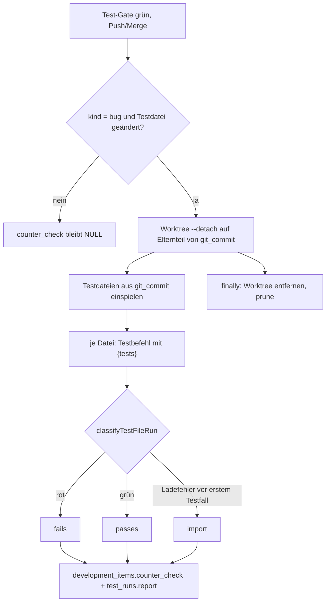

# Gegenprobe: neue Tests gegen den Stand vor dem Fix

## Aufträge

### Auftrag 37938d19

Gegenprobe für Bugfix-Aufträge (Agent „Entwickler“). Nach dem grünen Test-Gate beim Sprint-Abschluss werden die geänderten Testdateien eines Bugfixes auf dem Stand ohne Fix ausgeführt. Das Ergebnis steht am Auftrag und im Testbericht, sodass „Gegenprobe offen“ nicht mehr vermerkt werden muss.

**Ergebnis je Testdatei (genau eines):** „scheitert ohne Fix“ (`fails`, erwartet), „läuft auch ohne Fix grün“ (`passes`, der Test beweist den Fix nicht), „bricht beim Import ab“ (`import`). Zusätzlich „nicht bewertet“ (`skipped`: Playwright/e2e oder kein passender `{tests}`-Befehl) und „Gegenprobe gescheitert“ (`error`: Zeitbudget, Befehl nicht ausführbar, Sandbox-Fehler, kein Commit). `error` ist weder grün noch ein Blocker, steht aber sichtbar im Bericht und im Auftragsdetail.

**Anforderung → Umsetzung**

- Nur `kind = 'bug'` mit mindestens einer geänderten Testdatei in `changed_files` (`needsCounterCheck`, `counterCheckFiles` in `src/runner/git-sync/counter-check.ts`; interne Ordner wie Testberichte zählen nicht). Sonst bleibt `counter_check` `NULL`.
- Eigener losgelöster Worktree (`git worktree add --detach`, Temp-Ordner mit Präfix `aideation-gegenprobe-`) auf dem Basis-Commit. Testdateien kommen per `git checkout <git_commit> -- <dateien>` aus dem Auftrags-Commit; der Produktivcode bleibt der des Basis-Commits. Hauptordner, Sprint-Branch, Index und HEAD werden nicht angefasst.
- Es laufen nur die Testdateien des Auftrags, je Datei einzeln, über die Testbefehle je Auftrag mit `{tests}` (`expandOrderCommands`). Ausführung über `runProjectCommand` mit dem Executor aus `gateExecutor` (Container, wenn die Projekt-Sandbox läuft); ohne Sandbox wird `node_modules` per `linkDependencies` verlinkt. Keine `.env`, keine Zugangsdaten.
- Klassifikation `classifyTestFileRun` in `ci.ts`: Ein Ladefehler (`Cannot find module`, `ERR_MODULE_NOT_FOUND`, `Cannot find package`, `SyntaxError`, `Failed to load`, `Failed to resolve import`, `Transform failed`, `Test suite failed to run`) zählt nur dann als „Import“, wenn er **vor dem ersten Testfall** der Ausgabe steht. Ein Modul-/ENOENT-Fehler innerhalb eines laufenden Testfalls ist „scheitert ohne Fix“. Testfall-Zeilen erkennen node:test, Jest, Vitest und TAP. `loadErrorLine` liefert die Meldung.
- Aufräumen: `finally` entfernt den Worktree immer (`worktree remove --force`, `rm`, `worktree prune`), auch bei Fehler oder Zeitüberschreitung. Beim Start jeder Gegenprobe räumt `pruneCounterCheckWorktrees` verwaiste Worktrees mit dem Präfix weg (SIGKILL, Neustart).
- Zeitgrenzen: 5 Minuten je Befehl, 10 Minuten Budget je Sprint-Lauf (`COUNTER_CHECK_BUDGET_MS`). Vor dem Lauf setzt `sprint-sync.ts` `sprints.updated_at` neu, damit die Stundengrenze des Gates nicht greift.
- Speicherung: Spalte `development_items.counter_check JSONB` (`NULL` = keine Gegenprobe; Feld `checkedAt`, `base`, `commit`, `files[]`, `error`, `runId`). Testbericht: eigener Testlauf mit Trigger `counter-check`, `saveTestReport` schreibt eine Zeile je Testdatei; der Lauf wird als erfolgreich beendet (kein roter Lauf im Dashboard).
- Aufruf in `sprint-sync.ts` nach grünem Gate, Push und Merge (nicht bei `action = 'pull'`). Rein informativ: sie wirft nie und kann Push und Merge weder verhindern noch zurücknehmen. Eine Zusammenfassung geht ins Sprint-Log.
- Auftragsdetail (`order-detail.component.{ts,html}`, `models.ts`, Antwort in `src/api/development.ts`): zeigt das Ergebnis je Datei; bei „läuft auch ohne Fix grün“ den Hinweis, dass der Test nichts beweist. Ohne Ergebnis erscheint nichts, auch kein „offen“.
- Dokumentierer-Prompt (`runner-prompts.ts`, `COUNTER_CHECK_NOTE`, nur für Rolle `documenter` und `kind = 'bug'`): verlangt keinen Vermerk „Gegenprobe offen“ mehr.

**Geänderte Dateien:** `src/runner/git-sync/{counter-check,counter-check.test,ci,sprint-sync}.ts`, `src/runner/runner-prompts.ts`, `src/db/{schema,migrations}.ts`, `src/api/development.ts`, `frontend/src/app/core/models.ts`, `frontend/src/app/features/development/order-detail.component.{ts,html}`. Neu: `counter-check.ts`, `counter-check.test.ts`.

**Tests (laut Entwickler)**

- `counter-check.test.ts`: echtes Git-Repo mit Bugfix-Fixture, alle drei Ergebnisse (u. a. `parse.test.ts` mit Syntaxfehler, `neu.test.ts` mit fehlendem Modul), Worktree fehlt danach in `git worktree list`, HEAD/Status unverändert, Feature-Auftrag und Bugfix ohne Testdatei ohne Gegenprobe. Klassifikation mit mehr als einem Runner.
- Der Entwickler konnte nichts ausführen (node_modules und Git nicht erreichbar). Die Dokumentation hat ebenfalls nichts ausgeführt. `npm run typecheck` und `npm run test:unit` (insbesondere `counter-check.test.ts`, `git-sync.test.ts`, `schema.test.ts`, `migrations.test.ts`) sind ungeprüft.

**Worauf zu achten ist**

- **Basis-Commit:** Abweichend vom Auftragstext ist es der erste Elternteil von `git_commit`, nicht `git merge-base` (der Auftragsbranch ist nach dem Merge gelöscht). Bei Aufträgen ohne `git_commit` (z. B. nach Review-Freigabe) gibt es nur den Fehlerhinweis „Gegenprobe nicht möglich“.
- Die erwarteten Ergebnisse der tsx-Fixtures hängen an der Ausgabe von node:test/tsx. Weicht ein Test ab, die echte Ausgabe prüfen (Muster `LOAD_ERROR`/`TEST_CASE` in `ci.ts`).
- Neue Migration 19 (`gegenprobe-je-auftrag`) und `schema.ts` gleichzeitig geändert; bestehende Daten bleiben `NULL`. Worker nach der Änderung neu starten.
- Fehlen Testbefehle mit `{tests}`, steht „Gegenprobe nicht möglich“ im Auftrag. Playwright-Tests bekommen „nicht bewertet“.
- Bei Worker-Neustart während des Laufs bleibt der Auftrag ohne Ergebnis und wird bei der nächsten Sicherung erneut geprüft. Keine rückwirkende Prüfung abgeschlossener Aufträge außer dieser Fälle (nur `counter_check IS NULL`, Status `done`, im Sprint).
- Die Gegenprobe prüft nicht die Qualität des Tests, nur das Ergebnis gegen den Basis-Stand.

## Sprint

| Auftrag | Inhalt | Zustand |
| --- | --- | --- |
| 37938d19 | Gegenprobe: neue Tests gegen den Stand vor dem Fix | Entwickler fertig, Dokumentation hier; Tester/Review/Merge offen, Tests nicht ausgeführt |

## Anfrage / TODO

- `npm run typecheck`, `npm run test:unit` und gezielt `src/runner/git-sync/counter-check.test.ts` ausführen; bei abweichenden Fixture-Ergebnissen die echte Ausgabe mitgeben.
- Einen echten Sprint-Abschluss mit einem Bugfix-Auftrag mit Testdatei laufen lassen und prüfen: Zeile je Datei im Testbericht, Anzeige im Auftragsdetail, `git worktree list` ohne Gegenprobe-Worktree, HEAD/Status unverändert.
- Mit Sandbox `docker` prüfen, dass die Gegenprobe über `gateExecutor` im Container läuft und `agentComposeProject` zum temporären Worktree-Pfad passt (Entwickler hat das nicht belegt).
- Prüfen, ob der Testbefehl `{tests}` ohne Freigabe durchläuft (Hinweis aus dem Bug-Wächter).
- Offen, eigene Entscheidung: Playwright-Gegenprobe; Blockade durch rote Gegenprobe (bewusst nicht gewollt).

## Technische Dokumentation

Ablauf nach dem Sprint-Abschluss:

- Modul: `src/runner/git-sync/counter-check.ts` (`counterCheckOrder`, `runSprintCounterChecks`, `counterCheckReport`, `pruneCounterCheckWorktrees`); Klassifikation in `src/runner/git-sync/ci.ts`.
- Datenmodell: `development_items.counter_check JSONB` (Objekt oder `NULL`), Migration 19.
- API: `counterCheck` in der Auftragsantwort (`src/api/development.ts`).
- Testbericht: `test_runs` mit Trigger `counter-check`, Anzeige über `src/api/generated-docs.ts`.
