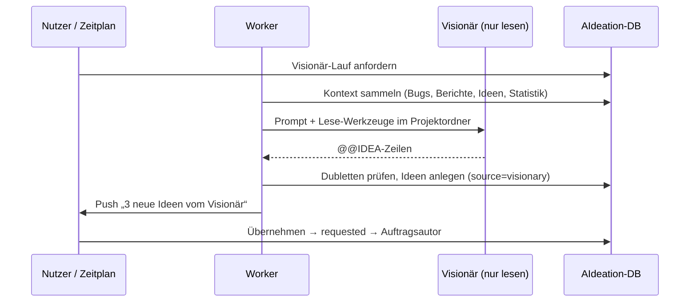

# 01 · Visionär-Agent (Ideen-Radar)

## Steckbrief

| Feld | Wert |
| --- | --- |
| Titel (Ideation) | Visionär-Agent: Projekt regelmäßig analysieren und Erweiterungsideen vorschlagen |
| Kategorie | backend |
| Priorität | hoch |
| Nutzen | 8 |
| Kosten | 4 |
| Aufwand | ca. 16 h |
| Abhängigkeit | nutzt idealerweise 02 (Zeitgesteuerte Routinen); geht auch per Knopf |

## Beschreibung für Ideation (kopierfertig)

Neue Systemrolle „Visionär“ (`visionary`), die das Projekt nur lesend analysiert (Code, Doku, Bugs, Statistik, Sprintberichte, offene Ideen) und daraus 3–8 begründete Erweiterungsideen ableitet. Die Ideen landen mit Status `idea`, Herkunft „Visionär“, Kategorie, Nutzen/Kosten und einer Begründung in Ideation. Start per Knopf in Ideation („Ideen vorschlagen lassen“) oder per Zeitplan. Doppelte Vorschläge (gleiche oder ähnliche offene/abgelehnte Ideen) werden vermieden. Der Mensch entscheidet: übernehmen (→ `requested`, Auftragsautor läuft) oder ablehnen (Begründung wird beim nächsten Lauf berücksichtigt).

## Problem heute

Der Trichter beginnt bei einem Menschen: Ideen entstehen nur, wenn jemand sie eintippt. Genau die Analyse, die hier von Hand gemacht wurde („Lies meine Anwendung, was fehlt?“), ist wiederholbar und lässt sich automatisieren. Die Daten dafür liegen bereits in AIdeation: Bugs nach Kategorie, blockierte Aufträge, „Aktion notwendig“, Coverage-Lücken, Schätzabweichungen, Review-Befunde.

## Vorschlag

1. **Neue Systemrolle** `visionary` in `src/agent/system-agents.ts` (`SYSTEM_ROLES`), Modellwahl wie bei Assistent/Analyse im Bereich „Agents“ (lokal oder externe CLI).
2. **Kontextpaket** (nur lesen): Projektbeschreibung und Leitlinien, `README.md` + `docs/*.md`, Dateibaum, die letzten Sprintberichte, Bugs der letzten 60 Tage gruppiert nach Kategorie, Aufträge mit „Aktion notwendig“, Coverage je Bereich, Top-5-Schätzabweichungen aus `collectUsage`, alle offenen **und abgelehnten** Ideen (Titel + Ablehnungsgrund).
3. **Ausgabeformat** analog `@@CHECK`/`@@REVIEW`: je Idee eine Zeile `@@IDEA {"title","category","benefit","cost","priority","reason","description"}` → robust parsbar.
4. **Ablage:** `ideation_items` mit `status='idea'`, neues Feld `source` (`human` | `visionary` | `routine` | `production` | `github`) und `agent_note` = Begründung. Ein Kommentar in `ideation_comments` hält fest, worauf sich die Idee stützt (z. B. „5 Bugs in frontend/sprints in 30 Tagen“).
5. **Dubletten-Schutz:** vor dem Anlegen Titelähnlichkeit (Trigramm, `pg_trgm` oder einfache Normalisierung) gegen offene und abgelehnte Ideen; Treffer werden verworfen bzw. als Kommentar an die bestehende Idee gehängt.
6. **Oberfläche:** Knopf in Ideation, Filter „Herkunft: Visionär“, Badge am Eintrag, Aktion „Übernehmen“ (= `requested`) und „Ablehnen mit Grund“.
7. **Grenze:** maximal N Ideen pro Lauf (Einstellung, Standard 5) und max. ein Lauf pro Tag automatisch.

## Ablauf

## Andockpunkte im Code

- `src/agent/system-agents.ts` – Rolle registrieren
- `src/agent/requirements.ts` – Vorbild für Prompt, Verbrauchserfassung (`agent_usage`) und Lauf mit lokalem Modell bzw. CLI
- `src/runner/runner-cli.ts` – eigene Schleife wie `authorActive`/`estimateActive`
- `src/api/ideation.ts` – Route `POST /api/projects/:slug/ideation/visionary`
- `src/api/usage.ts`, `src/api/stats.ts` – Kennzahlen als Kontext
- `src/db/schema.ts` – `ideation_items.source`, Anforderungsstatus z. B. in `app_settings` oder eigener Tabelle `visionary_runs`
- `frontend/src/app/features/ideation/` – Knopf, Filter, Badge
- `src/api/roles.ts` – Route der Rolle `plan` zuordnen

## Akzeptanzkriterien (Entwurf)

- In Ideation gibt es „Ideen vorschlagen lassen“; der Lauf ist im Fortschritt sichtbar und abbrechbar.
- Der Visionär hat nur Lese-Werkzeuge (Rolle wie `analyst`), keine Befehle, keine Schreibrechte.
- Jede erzeugte Idee hat Titel, Kategorie, Nutzen, Kosten, Begründung und `source = visionary`.
- Ideen, die einer offenen oder abgelehnten Idee entsprechen, werden nicht erneut angelegt.
- Pro Lauf höchstens die eingestellte Anzahl Ideen; Verbrauch erscheint in der Statistik unter „Visionär“.
- Nach dem Lauf kommt eine Push-Meldung mit der Anzahl neuer Ideen.

## Umsetzungsstand: Herkunft-Filter (Auftrag 937b94a4)

Der Filter „Herkunft“ (Alle, Mensch, Visionär, Routine, Produktion, GitHub) sitzt im Trichter-Menü der Spalte „Herkunft“ in der Ideation-Liste „Offene Ideen“ und ist mit den anderen Spaltenfiltern kombinierbar (z. B. Visionär + Status). Reines Frontend, keine Schema- oder API-Änderung.

- `idea-options.ts`: `IDEA_SOURCES` und `SOURCE_FILTER_OPTIONS` werden aus den Beschriftungen von `sourceLabel` abgeleitet; Spalte, Filter und Badge heißen dadurch gleich.
- `data-table`: neue Spaltenoption `options` (feste Werte, auch ohne Treffer, plus „Alle“ zum Zurücksetzen); Logik in `shared/data-table/filter.ts` (`matchesSelection`, `filterFacets`). Andere Tabellen zeigen weiter nur vorhandene Werte.
- Zustand und Zurücksetzen laufen über die gemeinsame `DataTableComponent`, also wie bei den übrigen Filtern.
- Test: `frontend/src/app/features/ideation/source-filter.spec.ts` (alle Herkunftswerte, Kombination mit Status, feste Optionen).
- Beachten: Die Anzeige im Browser wurde nicht geprüft. Zeitplan (Ausbaustufe 2) und Visionär-Lauf sind unverändert.

## Risiken & Grenzen

- Kleine lokale Modelle liefern oft generische Ideen → Prompt verlangt Bezug auf konkrete Daten („stützt sich auf …“); ohne Bezug wird die Idee verworfen.
- Ideenflut → Limit pro Lauf, Ablehnungsgründe als Gegenbeispiele im nächsten Prompt.
- Token-Kosten bei großen Projekten → Kontext kürzen (Dateibaum statt Inhalte, Zusammenfassungen), Budget aus 04.

## Ausbaustufen

1. Knopf + Ablage + Dubletten-Schutz.
2. Zeitplan über 02 (z. B. montags 07:00).
3. Themen-Fokus beim Start („nur Sicherheit“, „nur Bedienbarkeit“, „Automatisierung“).
4. Bewertung der Treffsicherheit: Anteil übernommener Visionär-Ideen in der Statistik.

## Offene Fragen

- Soll der Visionär auch projektübergreifend arbeiten (Ideen, die in Projekt A gut liefen, für Projekt B vorschlagen)?
- Externe Recherche (Web) zulassen oder bewusst nur lokal?
