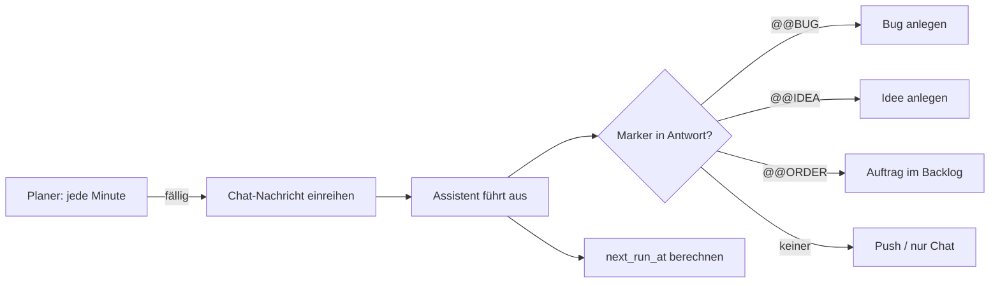

# 02 · Zeitgesteuerte Routinen

## Steckbrief

| Feld | Wert |
| --- | --- |
| Titel (Ideation) | Zeitgesteuerte Routinen: Agent-Aufgaben nach Zeitplan ausführen und Ergebnisse automatisch weiterleiten |
| Kategorie | fullstack |
| Priorität | hoch |
| Nutzen | 8 |
| Kosten | 3 |
| Aufwand | ca. 12 h |
| Abhängigkeit | baut auf den neuen Agent-Aufgaben (`agent_tasks`) auf |

## Beschreibung für Ideation (kopierfertig)

Agent-Aufgaben bekommen einen optionalen Zeitplan (täglich/wöchentlich/Cron-Ausdruck, Zeitzone Europe/Zurich) und ein Ziel für das Ergebnis: nur Chat, Push, neuer Bug, neue Idee oder neuer Auftrag im Backlog. Der Worker prüft fällige Routinen und führt sie wie heute per Klick über den Assistenten aus. Mitgelieferte Vorlagen: „Nächtlicher Sicherheits-Check“ (`npm audit`, `npm outdated`), „Wöchentlicher Doku-Abgleich“ (README/Docs gegen Code), „Tote Dateien und TODOs finden“, „Testabdeckung unter 75 % melden“. Jede Ausführung wird protokolliert (letzter Lauf, Ergebnis, Dauer, Tokens), Fehlschläge melden sich per Push.

## Problem heute

Agent-Aufgaben (`src/api/agent-tasks.ts`) lassen sich nur per Klick starten (`run_count`, `last_run_at`). Wiederkehrende Pflege – Abhängigkeiten, Sicherheitslücken, veraltete Doku – passiert nur, wenn jemand daran denkt. Der Worker läuft ohnehin rund um die Uhr; die Zeit nachts ist ungenutzt.

## Vorschlag

1. **Datenmodell** `agent_tasks`: `schedule TEXT` (Cron, 5 Felder), `enabled BOOLEAN`, `next_run_at TIMESTAMPTZ`, `output_target TEXT` (`chat` | `push` | `bug` | `idea` | `order`), `last_status`, `last_error`.
2. **Planer im Worker** (`runner-cli.ts`): einmal pro Minute `SELECT … WHERE enabled AND next_run_at <= now() FOR UPDATE SKIP LOCKED`, Aufgabe als Chat-Nachricht einreihen (wie `taskMessage`), `next_run_at` neu berechnen. Kleiner eigener Cron-Parser (keine neue Abhängigkeit nötig) oder `cron-parser`.
3. **Ergebnis-Weiterleitung:** Der Assistent beendet die Antwort mit Marker-Zeilen (`@@BUG {…}`, `@@IDEA {…}`, `@@ORDER {…}`) – der Worker legt daraus Einträge an (Quelle = Routine, Verweis auf die Chat-Nachricht). Ohne Marker: nur Chat und optional Push.
4. **Ruhe-Regeln:** Routinen laufen nur, wenn kein Auftrag des Projekts die Projektsperre hält; optional Zeitfenster („nur 22–06 Uhr“).
5. **Oberfläche:** im Panel Agent-Aufgaben ein Uhr-Symbol, Auswahl „Täglich um…“, „Wöchentlich am…“, „Eigener Cron“, Vorschau „nächster Lauf: Mo 07:00“; Verlaufsliste.
6. **Vorlagen** in `src/setup/templates.ts` beim Anlegen eines Projekts (deaktiviert).

## Ablauf

## Andockpunkte im Code

- `src/api/agent-tasks.ts` – Felder, Validierung (`parseTask`), Routen
- `src/runner/runner-cli.ts` – neuer Timer neben `chatTimer`/`setupTimer`
- `src/agent/chat.ts` – Nachricht mit Herkunft „Routine“, Auswertung der Marker
- `src/core/push.ts` – Meldung bei Ergebnis/Fehler
- `frontend/src/app/features/chat/agent-tasks.component.*` – Zeitplan-UI
- `src/setup/templates.ts` – Vorlagen

## Akzeptanzkriterien (Entwurf)

- Eine Agent-Aufgabe lässt sich mit Zeitplan speichern; „nächster Lauf“ wird korrekt in Europe/Zurich angezeigt.
- Fällige Routinen starten innerhalb von 2 Minuten, auch wenn niemand die Oberfläche geöffnet hat.
- Eine Routine läuft nie doppelt (auch bei zwei Workern) und nicht, während das Projekt gesperrt ist.
- `@@BUG`/`@@IDEA`/`@@ORDER` in der Antwort erzeugen je einen Eintrag mit Verweis auf die Routine.
- Fehlgeschlagene Routinen erzeugen eine Push-Meldung; nach 3 Fehlschlägen in Folge wird die Routine pausiert.
- Mindestens vier Vorlagen stehen zur Auswahl.

## Risiken & Grenzen

- Der Assistent hat Schreibrechte → Vorlagen standardmäßig mit „nur lesen“-Hinweis; optional Routine an Rolle `analyst` binden.
- Zeitumstellung (Sommer/Winter) → Berechnung in lokaler Zeitzone testen.
- Viele Routinen verbrauchen Tokens → Budget aus 04.

## Ausbaustufen

1. Zeitplan + Chat-Ausgabe.
2. Marker-Weiterleitung (Bug/Idee/Auftrag).
3. Ereignis-Auslöser statt Uhrzeit: „nach Sprint-Abschluss“, „nach Deploy“, „nach 3 Bugs in einer Kategorie“ – Grundlage für 05 und 08.

## Offene Fragen

- Soll eine Routine auch einen Workflow-Agent (z. B. Tester) statt des Assistenten nutzen dürfen?
