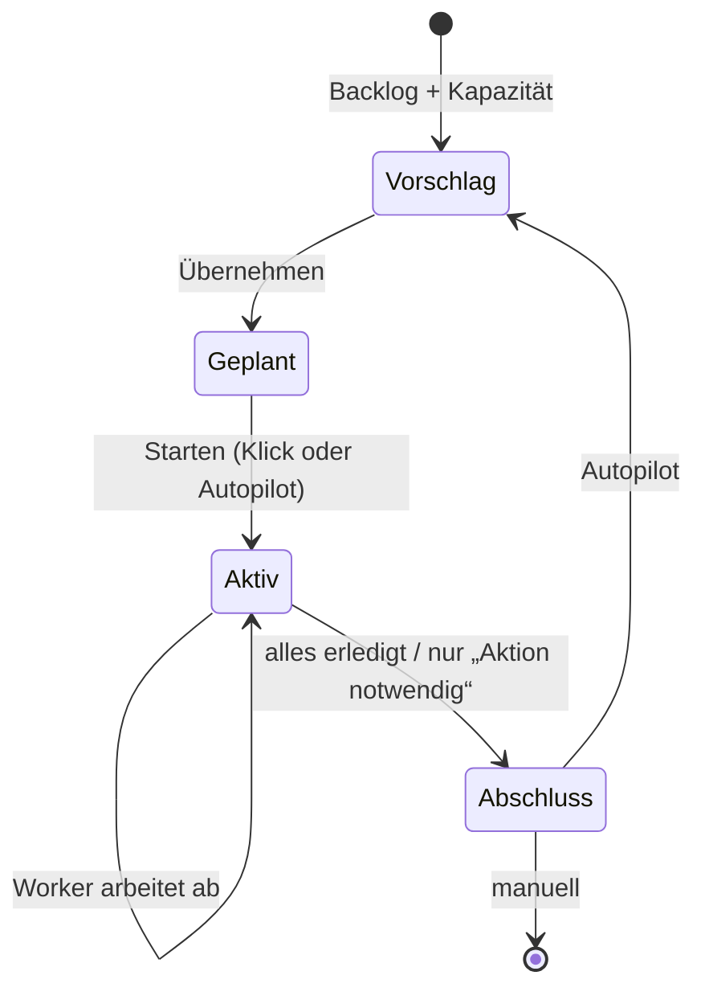

# 03 · Autopilot-Sprintplanung

## Steckbrief

| Feld | Wert |
| --- | --- |
| Titel (Ideation) | Autopilot-Sprintplanung: Sprint aus dem Backlog vorschlagen, nach Freigabe starten und automatisch abschließen |
| Kategorie | fullstack |
| Priorität | hoch |
| Nutzen | 9 |
| Kosten | 5 |
| Aufwand | ca. 20 h |
| Abhängigkeit | profitiert von 04 (Budget) für die Kapazität in Tokens/CHF |

## Beschreibung für Ideation (kopierfertig)

AIdeation schlägt den nächsten Sprint vor: Aus dem Backlog werden Aufträge nach Priorität, Nutzen/Kosten-Verhältnis, Abhängigkeiten (Folgeaufträge, gleiche Dateien), offenen Bugs und der gemessenen Kapazität (Velocity der letzten Sprints, Stunden und Tokens) ausgewählt. Der Vorschlag erscheint in Sprints mit Begründung je Auftrag und Summen (Stunden, Tokens, Kosten). Ein Klick übernimmt ihn (Sprint anlegen, Aufträge zuordnen, Reihenfolge `sprint_rank` setzen) und startet ihn optional. Im Modus „Autopilot“ läuft das ohne Klick: Sind alle Aufträge erledigt oder nur noch „Aktion notwendig“ offen, wird der Sprint abgeschlossen (Bericht, Test-Gate, Merge, Tag) und der nächste vorgeschlagen bzw. gestartet.

## Problem heute

Laut `docs/workflows.md` bleibt die Sprint-Zuordnung manuell, und ein Sprint läuft erst nach manuellem Start. Wenn der Worker nachts fertig ist, steht er still, obwohl der Backlog voll ist. Die Daten für eine gute Auswahl (Velocity, Schätzung vs. Ist, Nutzen/Kosten) werden bereits berechnet (`src/api/stats.ts`, `src/api/usage.ts`), aber nicht genutzt.

## Vorschlag

1. **Planungsfunktion** (deterministisch, ohne Modell): Bewertung je Auftrag  
   `score = Prioritätsgewicht × (Nutzen + 1) / (Kosten + 1)` + Bonus für Bugs, Folgeaufträge nach ihrem Vorgänger, Malus für Aufträge, die blockiert waren.  
   Auffüllen bis zur Kapazität = Median der erledigten Stunden/Tokens der letzten 3 Sprints (Fallback: Einstellung).
2. **Abhängigkeiten:** `follow_up_of` und „betroffene Dateien“ aus der Anforderung → Aufträge, die dieselben Dateien ändern, nicht gleichzeitig, sondern hintereinander einplanen (passt zur Projektsperre).
3. **Optionaler KI-Feinschliff:** Der Auftragsautor kommentiert den Vorschlag in 3–5 Sätzen (Sprintziel, Risiken) – nur Text, keine Auswahl.
4. **Modi pro Projekt:** `manuell` (heute), `vorschlagen` (Vorschlag + Klick), `autopilot` (vorschlagen, starten, abschließen). Autopilot respektiert Budget (04) und Arbeitszeiten.
5. **Auto-Abschluss:** Wenn kein Auftrag `planned`/`in_progress` mehr ist und alle verbleibenden `blocked` nur „Aktion notwendig“ haben → Abschluss; diese Aufträge wandern in den nächsten Sprint.
6. **Oberfläche:** in Sprints Karte „Vorschlag für Sprint N“ mit Tabelle (Auftrag, Score, Begründung, h, Tokens), Summenzeile, Knöpfe „Übernehmen“, „Übernehmen und starten“, einzelne Aufträge ab-/zuwählen.

## Ablauf

## Andockpunkte im Code

- `src/api/sprints.ts` – neue Routen `GET …/sprints/proposal`, `POST …/sprints/proposal/apply`
- `src/api/stats.ts` – Velocity; `src/api/usage.ts` – Ist-Werte je Auftrag
- `src/runner/runner.ts` / `runner-selection.ts` – Auto-Abschluss-Prüfung am Ende des Zyklus
- `src/runner/git-sync.ts` – Abschluss löst schon heute Sicherung aus (DB-Trigger)
- `src/runner/action-todo.ts` – Erkennung „Aktion notwendig“
- `src/db/schema.ts` – `projects.sprint_mode`, `projects.sprint_capacity_hours`
- `frontend/src/app/features/sprints/` – Vorschlagskarte

## Akzeptanzkriterien (Entwurf)

- Für ein Projekt mit Backlog wird ein Vorschlag mit Begründung je Auftrag und Summen angezeigt.
- Die Kapazität stammt aus den letzten 3 abgeschlossenen Sprints; ohne Historie gilt die Einstellung.
- Ein Folgeauftrag wird nie vor seinem Vorgänger eingeplant.
- „Übernehmen und starten“ legt Sprint an, ordnet zu, setzt Reihenfolge und startet ihn.
- Im Modus Autopilot wird ein Sprint automatisch abgeschlossen, sobald nur noch „Aktion notwendig“-Aufträge offen sind; diese wandern in den nächsten Sprint.
- Der Modus ist pro Projekt einstellbar, Standard bleibt `manuell`.

## Risiken & Grenzen

- Autopilot ohne Aufsicht kann Kosten treiben → nur zusammen mit Budget (04).
- Schätzungen kleiner Modelle sind ungenau → Kapazität aus Ist-Werten, nicht aus Schätzungen.
- Merge-Konflikte beim Auto-Abschluss → Abbruch wie heute, Push-Meldung, Autopilot pausiert.

## Ausbaustufen

1. Vorschlag + Übernehmen (Modus `vorschlagen`).
2. Auto-Abschluss.
3. Vollautopilot mit Arbeitszeiten und Budget.
4. Roadmap-Ansicht: die nächsten 3 Sprints vorausberechnet.

## Umsetzungsstand

Umgesetzt sind die Stufen 1–4, ausser der Budgetprüfung. Beschreibung und Grenzen stehen in [workflows.md, Abschnitt 3a](../workflows.md#3a-sprintplanung-und-autopilot).

- Kapazität aus Ist-Werten (gemessene Laufzeit und Tokens erledigter Aufträge), Kosten aus dem gemessenen Preis je Token.
- KI-Kommentar des Auftragsautors auf Knopfdruck (nur Text, nicht gespeichert).
- Arbeitszeiten je Projekt; Pause bei gescheitertem Abschluss mit Meldung und manueller Freigabe.
- Auto-Abschluss nur, wenn alle verbleibenden Blockierten „Aktion notwendig“ haben.
- **Offen:** Budgetprüfung, sobald Idee 04 umgesetzt ist (Andockpunkt `autopilotGuard` in `src/api/sprint-planning.ts`).
