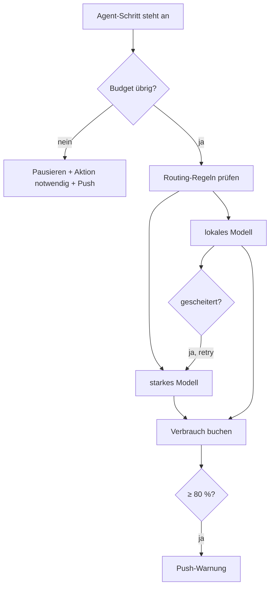

# 04 · Budget-Wächter & Modell-Routing

## Steckbrief

| Feld | Wert |
| --- | --- |
| Titel (Ideation) | Budget-Wächter und Modell-Routing: Kostenlimits je Projekt/Sprint und passendes Modell je Auftrag |
| Kategorie | backend |
| Priorität | mittel (hoch, sobald Autopilot/Routinen kommen) |
| Nutzen | 8 |
| Kosten | 5 |
| Aufwand | ca. 20 h |
| Abhängigkeit | Voraussetzung für unbeaufsichtigten Betrieb (01, 02, 03) |

## Beschreibung für Ideation (kopierfertig)

Pro Projekt lassen sich Limits für Tokens und Kosten (USD/CHF) je Tag, je Sprint und je Auftrag festlegen. Der Worker prüft vor jedem Agent-Schritt das verbleibende Budget: Bei 80 % kommt eine Push-Warnung, bei 100 % pausieren neue Läufe (laufende werden sauber beendet) mit Hinweis „Budget erreicht“ als „Aktion notwendig“. Zusätzlich wählt ein Modell-Routing das Modell je Auftrag: einfache Aufträge (Doku, kleine Frontend-Änderungen, niedrige Schätzung) laufen lokal über Ollama, komplexe oder zweimal gescheiterte Aufträge eskalieren auf das stärkere Modell (z. B. Claude-CLI). Die Statistik zeigt Verbrauch gegen Budget und die Ersparnis durch Routing.

## Problem heute

Verbrauch wird sauber erfasst (`agent_run_steps.cost_usd`, `agent_usage`, `src/api/usage.ts`), aber nichts begrenzt ihn. Die Modellwahl ist statisch je Rolle (`model:<rolle>`, `DEV_LOG_OLLAMA_MODEL_<ROLLE>`, eigener `command` je Agent). Ein schwieriger Auftrag scheitert mit dem lokalen Modell zweimal, obwohl ein stärkeres Modell ihn gelöst hätte; ein trivialer Doku-Auftrag läuft teuer über die Cloud.

## Vorschlag

1. **Budget-Tabelle** `budgets` (Projekt, Zeitraum `day|sprint|order`, `max_tokens`, `max_cost_usd`) oder Felder in `projects`.
2. **Prüfpunkt** vor jedem Schritt in `runner-steps.ts` und vor Chat-/Autor-/Visionär-Läufen: Summe aus `agent_run_steps` + `agent_usage` im Zeitraum. Bei Überschreitung: Lauf nicht starten, Auftrag `blocked` mit `action_todo = 'Budget erhöhen oder warten'`.
3. **Routing-Regeln** (pro Projekt, Reihenfolge = Priorität):
   - Kategorie `docs` oder Schätzung < 1 h → lokales Modell
   - Kategorie `backend` + Schätzung > 4 h → starkes Modell
   - `retry_count ≥ 1` oder Bug-Auftrag nach Fehlschlag → eine Stufe höher (Eskalation)
   - Budget > 80 % verbraucht → eine Stufe tiefer (Sparmodus)
   Die Regel, die gegriffen hat, wird am Lauf gespeichert und angezeigt.
4. **Lernende Schätzung:** Der Auftragsautor erhält im Prompt die Ist-Werte ähnlicher erledigter Aufträge (gleiche Kategorie, Median Stunden/Tokens) → Schätzungen werden realistischer; die Statistik „Schätzung vs. Ist“ zeigt die Verbesserung.
5. **Oberfläche:** Einstellungen → Budget; Dashboard-Kachel „Budget heute / Sprint“ als Fortschrittsbalken (Share-Bar); Lauf-Detail zeigt „Modell: qwen3.5:9b (Regel: docs → lokal)“.

## Ablauf

## Andockpunkte im Code

- `src/runner/runner-steps.ts` – Prüfpunkt vor dem Schritt, Modellwahl übergeben
- `src/agent/system-agents.ts` – `systemCommand`/`resolveModel` um Routing erweitern
- `src/agent/claude-stream.ts` – liefert bereits `total_cost_usd`
- `src/agent/requirements.ts` – Ist-Werte ähnlicher Aufträge in den Autor-Prompt
- `src/api/usage.ts`, `src/api/stats.ts` – Auswertung Budget
- `src/runner/action-todo.ts` – neuer Fall „Budget erreicht“
- `frontend/src/app/features/settings/`, `features/dashboard/`, `features/stats/`

## Akzeptanzkriterien (Entwurf)

- Limits je Tag/Sprint/Auftrag sind pro Projekt einstellbar; leer = unbegrenzt (heutiges Verhalten).
- Bei 80 % kommt genau eine Push-Warnung je Zeitraum; bei 100 % startet kein neuer Lauf, der Auftrag zeigt „Aktion notwendig: Budget“.
- Jeder Lauf speichert das verwendete Modell und die greifende Routing-Regel.
- Ein zweimal gescheiterter Auftrag läuft beim nächsten Versuch mit dem höheren Modell, sofern konfiguriert.
- Der Autor-Prompt enthält Median-Ist-Werte ähnlicher Aufträge (sichtbar im Prompt-Protokoll).
- Das Dashboard zeigt Verbrauch gegen Budget.

## Risiken & Grenzen

- Ollama liefert keine Kosten → lokal mit 0 USD, aber Tokens zählen gegen das Token-Limit.
- Externe CLIs melden Kosten teils erst am Ende → Prüfung vor dem Schritt, nicht mittendrin; Auftragslimit als Obergrenze pro Schritt übergeben, wo die CLI es kann.
- Wechselkurs CHF/USD → Einstellung, kein Live-Kurs.

## Ausbaustufen

1. Limits + Warnung + Pause.
2. Routing nach Kategorie/Schätzung.
3. Eskalation bei Fehlschlag.
4. Lernende Schätzung.
