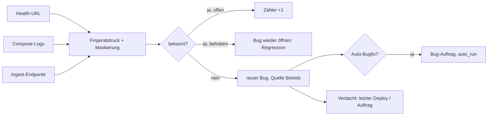

# 05 · Produktions-Rückkanal (Betrieb meldet Fehler als Bugs)

## Steckbrief

| Feld | Wert |
| --- | --- |
| Titel (Ideation) | Produktions-Rückkanal: Fehler der betreuten Anwendung automatisch erkennen, bündeln und als Bug erfassen |
| Kategorie | fullstack |
| Priorität | hoch |
| Nutzen | 9 |
| Kosten | 5 |
| Aufwand | ca. 22 h |
| Abhängigkeit | nutzt Deploy-Befehle; Auto-Bugfix existiert bereits |

## Beschreibung für Ideation (kopierfertig)

Dev Log überwacht nicht nur sich selbst (Wächter), sondern auch die betreuten Anwendungen. Drei Quellen: (1) Health-URL des Projekts wird regelmäßig abgefragt, (2) nach jedem Deploy und periodisch werden `docker compose logs --since` nach Fehlermustern (Stacktraces, `ERROR`, HTTP 5xx) durchsucht, (3) ein Fehler-Endpunkt `POST /api/ingest/<projekt>/<token>` nimmt Frontend- und Backend-Fehler direkt aus der Anwendung an (kleines Snippet in der Doku). Gleiche Fehler werden über einen Fingerabdruck (Meldung + oberster Stack-Frame) gebündelt und zählen hoch statt neue Bugs zu erzeugen. Neue Fehler werden zu Bugs mit Quelle „Betrieb“, Schwere nach Häufigkeit; mit aktivem Auto-Bugfix entsteht direkt ein Bug-Auftrag. Fällt ein Fehler direkt nach einem Deploy neu auf, wird der letzte Sprint/Auftrag als Verdacht verlinkt.

## Problem heute

Die Kette endet beim Deploy (`src/runner/deploy.ts`): „Aktualisiert um 14:05“. Ob die Anwendung danach funktioniert, weiß Dev Log nicht. Der Wächter (`src/runner/watchdog.ts`) prüft nur Dev Log selbst. Fehler im Betrieb müssen heute von Hand als Bug eingetragen werden – dabei ist der Bug-Workflow inklusive Auto-Bugfix und Bug-Wächter schon vollständig da.

## Vorschlag

1. **Projekt-Einstellungen:** `health_url` (nur http(s) auf localhost/LAN oder eigene Domain), `log_services` (Compose-Dienste), Ingest-Token (zufällig, rotierbar, nur Hash gespeichert).
2. **Tabelle `production_events`:** Projekt, Fingerabdruck, Quelle (`health|logs|ingest`), erste/letzte Sichtung, Anzahl, Beispiel (gekürzt, maskiert), `bug_id`.
3. **Sammler im Worker:** Health alle 2 min (2 Fehlschläge in Folge = Ereignis), Log-Scan nach Deploy und alle 15 min (`docker compose logs --since 15m --no-color` – bereits erlaubter Befehl), Ingest über die API mit Rate-Limit.
4. **Maskierung:** vor dem Speichern Tokens, Passwörter, E-Mails, IPs maskieren (Muster wie im Git-Secret-Scan in `git-sync.ts`).
5. **Bug-Erzeugung:** neuer Fingerabdruck → Bug (Quelle `production`, Kategorie aus Pfad/Dienst geraten), Schwere: ≥ 50/h oder Health down = `critical`. Bekannter Fingerabdruck eines behobenen Bugs taucht wieder auf → Bug wieder öffnen („Regression“).
6. **Deploy-Verdacht:** Ereignisse in den 30 min nach einem Deploy verlinken die seitdem committeten Aufträge.
7. **Oberfläche:** Bugs zeigen Badge „Betrieb · 37× seit gestern“, Detail mit Verlauf; Dashboard-Kachel „Betrieb“ grün/rot; Push bei kritisch.

## Ablauf

## Andockpunkte im Code

- `src/runner/deploy.ts` – nach erfolgreichem Deploy Log-Scan anstoßen
- `src/runner/watchdog.ts` – Vorbild für Melde-Logik (neu sofort, anhaltend alle 6 h, Erholung)
- `src/runner/autofix.ts` – Bug → Bug-Auftrag
- `src/api/bugs.ts` – Quelle, Zähler, Wiederöffnen
- `src/runner/git-sync.ts` – Muster für Geheimnisse (Maskierung)
- `src/api/security.ts` – Rate-Limit für den Ingest-Endpunkt; `src/api/roles.ts` – Ingest ohne Login, nur Token
- `src/core/command.ts` / Compose-Schutz – Log-Befehl
- `frontend/src/app/features/bugs/`, `features/dashboard/`

## Akzeptanzkriterien (Entwurf)

- Mit gesetzter Health-URL erscheint nach 2 fehlgeschlagenen Abfragen ein Bug „Anwendung nicht erreichbar“ (kritisch) und eine Push-Meldung; nach Erholung eine Entwarnung.
- Ein Fehler, der 10× in den Logs auftaucht, erzeugt genau einen Bug mit Zähler 10.
- Taucht der Fingerabdruck eines behobenen Bugs wieder auf, wird dieser Bug als Regression wieder geöffnet.
- Der Ingest-Endpunkt nimmt nur Anfragen mit gültigem Token an, ist rate-limitiert und speichert keine Geheimnisse im Klartext.
- Ereignisse innerhalb von 30 min nach einem Deploy verlinken die Aufträge dieses Deploys.
- Die Doku enthält ein kopierbares Snippet für Browser (`window.onerror`) und Node (`process.on('uncaughtException')`).

## Risiken & Grenzen

- Personendaten in Logs → Maskierung + kurze Aufbewahrung (Einstellung, Standard 30 Tage).
- Fehlalarme durch laute Logs → Ausschlussmuster pro Projekt.
- Ingest-Endpunkt ist öffentlich erreichbar → Token, Größenlimit (16 KB), Rate-Limit, kein HTML-Rendering der Inhalte.

## Ausbaustufen

1. Health-URL + Bug.
2. Log-Scan mit Fingerabdruck.
3. Ingest-Endpunkt + Snippet.
4. Automatischer Rollback-Vorschlag: bei kritischem Fehler nach Deploy Knopf „Vorherigen Sprint-Tag wieder ausrollen“.
