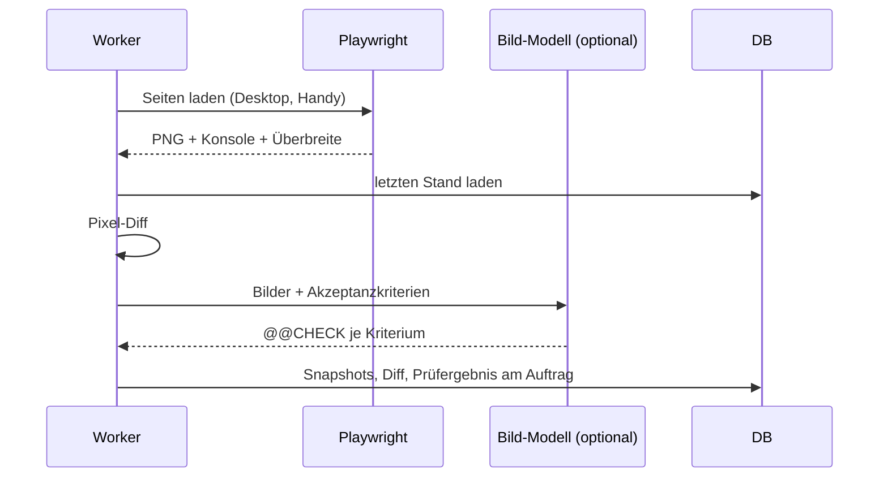

# 06 · Visuelle Abnahme mit Screenshots

## Steckbrief

| Feld | Wert |
| --- | --- |
| Titel (Ideation) | Visuelle Abnahme: Screenshots vor/nach Frontend-Aufträgen (Desktop und Handy) automatisch erstellen und vergleichen |
| Kategorie | fullstack |
| Priorität | mittel |
| Nutzen | 7 |
| Kosten | 5 |
| Aufwand | ca. 18 h |
| Abhängigkeit | Playwright ist bereits im Projekt (`e2e/`), Deploy-Befehle oder Dev-Server des Projekts |

## Beschreibung für Ideation (kopierfertig)

Bei Aufträgen der Kategorie `frontend`/`fullstack` erstellt ein neuer Schritt nach dem Tester Screenshots der betroffenen Seiten in zwei Größen (Desktop, Handy) – einmal vom Stand vor dem Auftrag (Sprint-Branch-Basis) und einmal danach. Die Bilder hängen am Auftrag, ein Pixel-Vergleich markiert geänderte Bereiche. Zusätzlich laufen automatische Layout-Prüfungen: horizontales Scrollen auf dem Handy (wie `?layoutcheck`), abgeschnittene Texte, Konsolenfehler, fehlende Bilder. Ein Bild-fähiges Modell (optional) beurteilt die Screenshots gegen die Akzeptanzkriterien. Viele heutige „manuelle Abnahmepunkte“ („auf dem Handy prüfen“) werden damit automatisch prüfbar; der Mensch sieht in der Auftragsansicht vorher/nachher nebeneinander und gibt per Klick frei.

## Problem heute

Der Tester prüft Build und Tests, die automatische Abnahmeprüfung (`verify-acceptance.ts`) kann lokale Seiten nur als Text per WebFetch lesen. Punkte wie „sieht auf dem Handy richtig aus“ landen als `manual` in „Aktion notwendig“. Die letzten Commits zeigen viele Layout-Korrekturen (Handy-Kopfzeile, seitliches Scrollen) – genau die Art Fehler, die Screenshots früh zeigen würden. `frontend/src/app/core/layout-check.ts` misst Überbreite bereits, aber nur von Hand mit `?layoutcheck`.

## Vorschlag

1. **Projekt-Einstellung** `preview_url` (z. B. `http://localhost:4200`) und `preview_pages` (Liste von Pfaden, z. B. `/#dashboard`, `/#sprints`); optional Login-Schritt mit Test-Zugang aus der Projekt-`.env.example`.
2. **Schritt „Visuelle Prüfung“** (Rolle `visual_tester`, Phase `after_task`, nur für Frontend-Kategorien): startet Playwright (Chromium, `Desktop Chrome` + `Pixel 7` wie in `e2e/playwright.config.ts`), lädt jede Seite, speichert PNG.
3. **Vorher-Stand:** Screenshots vom letzten erfolgreichen Lauf derselben Seite (gespeichert) dienen als Basis – kein zweiter Checkout nötig.
4. **Vergleich:** `pixelmatch` (oder eigener einfacher Diff) → Diff-Bild + Prozent geändert.
5. **Automatische Prüfungen** im Browser: Überbreite (Logik aus `layout-check.ts` wiederverwenden), Konsolenfehler, HTTP-Fehler bei Ressourcen, leere Seite.
6. **KI-Urteil (optional):** Screenshots + Akzeptanzkriterien an ein Bild-fähiges Modell (Claude-CLI oder Ollama-Vision) → `@@CHECK`-Zeilen, gleiches Format wie die Abnahmeprüfung.
7. **Ablage:** Tabelle `visual_snapshots` (Auftrag, Seite, Gerät, PNG BYTEA ≤ 2 MB, Diff-Prozent) – analog `ideation_attachments`.
8. **Oberfläche:** Reiter „Ansicht“ im Auftrag: Vorher | Nachher | Diff, Umschalter Desktop/Handy, Knopf „Optisch freigeben“.

## Ablauf

## Andockpunkte im Code

- `e2e/playwright.config.ts` – Geräteprofile wiederverwenden
- `frontend/src/app/core/layout-check.ts` – Messlogik als Prüfung im Browser
- `src/runner/runner-steps.ts` – neuer Schritt nach dem Tester
- `src/runner/verify-acceptance.ts`, `src/runner/acceptance.ts` – `@@CHECK`-Format, manuelle Punkte
- `src/api/attachments.ts` – Vorbild für Bildablage und Auslieferung
- `frontend/src/app/features/development/order-detail.component.*` – Reiter „Ansicht“

## Akzeptanzkriterien (Entwurf)

- Für einen Frontend-Auftrag entstehen je konfigurierter Seite zwei Screenshots (Desktop, Handy) und sind am Auftrag sichtbar.
- Ab dem zweiten Lauf gibt es ein Diff-Bild und den geänderten Anteil in Prozent.
- Seitliches Scrollen auf dem Handy, Konsolenfehler und fehlende Ressourcen werden als nicht erfüllte Prüfpunkte gemeldet.
- Ohne `preview_url` wird der Schritt übersprungen (kein Fehler).
- Screenshots enthalten keine Zugangsdaten; Test-Logins kommen nur aus Projektdateien für Testwerte.
- Der Schritt bricht nach 3 min ab und blockiert den Auftrag nicht, sondern meldet „visuelle Prüfung nicht möglich“.

## Risiken & Grenzen

- Playwright-Browser muss auf dem Worker installiert sein → Einrichtungsassistent prüft und installiert (`npx playwright install chromium`).
- Dynamische Inhalte (Zeiten, Zahlen) erzeugen Diff-Rauschen → Bereiche maskieren, Toleranz einstellbar.
- Speicherbedarf → nur letzte 3 Stände je Seite behalten.

## Ausbaustufen

1. Screenshots + Anzeige.
2. Automatische Layout-Prüfungen.
3. Diff zum letzten Stand.
4. KI-Urteil gegen Akzeptanzkriterien; Screenshots auch im Sprintbericht („Was sich sichtbar geändert hat“).
