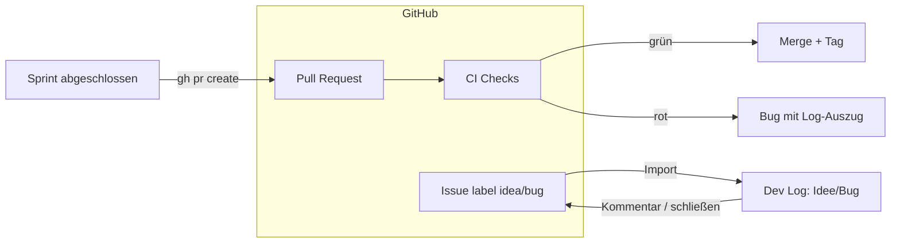

# 07 · GitHub-Brücke: Issues & Pull Requests

## Steckbrief

| Feld | Wert |
| --- | --- |
| Titel (Ideation) | GitHub-Brücke: Issues als Ideen/Bugs übernehmen und Sprint-Abschluss als Pull Request mit CI-Status |
| Kategorie | backend |
| Priorität | mittel |
| Nutzen | 7 |
| Kosten | 4 |
| Aufwand | ca. 18 h |
| Abhängigkeit | Projekt mit `git_remote` auf GitHub; die CI-Vorlage `devlog-ci.yml` existiert bereits |

## Beschreibung für Ideation (kopierfertig)

Dev Log verbindet sich (per `gh`-CLI-Anmeldung des Workers oder fein eingeschränktem Token) mit dem GitHub-Repository des Projekts. Eingang: Issues mit Label `idea` werden zu Ideen, mit Label `bug` zu Bugs (mit Link zurück); Status-Änderungen in Dev Log werden als Kommentar ins Issue geschrieben und beim Erledigen wird das Issue geschlossen. Ausgang: Statt beim Sprint-Abschluss direkt nach `main` zu mergen, kann Dev Log einen Pull Request vom Sprint-Branch öffnen (Beschreibung = Sprintbericht), den CI-Status der Checks am Sprint anzeigen und erst nach grüner CI (und optional Freigabe eines Menschen) mergen. Rote CI erzeugt einen Bug mit dem Log-Auszug.

## Problem heute

Git-Sync (`src/runner/git-sync.ts`) pusht und mergt direkt; die CI-Vorlage wird ins Projekt gelegt, ihr Ergebnis kommt aber nicht zurück. Wer Dev Log mit anderen nutzt, hat Anliegen meist schon als Issues – die müssen von Hand übertragen werden. Ein direkter Merge nach `main` ohne Review-Möglichkeit ist für Team-Projekte zu hart.

## Vorschlag

1. **Verbindung:** Einstellung `github_mode` (`aus` | `issues` | `issues+pr`). Zugang über `gh auth` des Worker-Benutzers (kein Token in der DB) – passt zur bestehenden Regel „Zugang über SSH-Key, nie Zugangsdaten in der URL“.
2. **Issue-Import** (alle 5 min oder per Routine 02): `gh issue list --label idea,bug --json …` → `ideation_items`/`bugs` mit `source='github'`, Feld `external_ref` (`owner/repo#123`). Bilder aus dem Issue werden nicht geladen (nur Link).
3. **Rückmeldung:** Statuswechsel (ausgearbeitet, im Sprint, erledigt, blockiert) → ein gebündelter Kommentar; bei `done` Issue schließen mit Verweis auf Commit/Tag.
4. **PR-Modus beim Sprint-Abschluss:** Push des Sprint-Branches → `gh pr create` (Titel `Sprint: <Name>`, Text = Sprintbericht) → Sprint-Status `review`. Worker fragt `gh pr checks` ab: grün + (optional) Approve → `gh pr merge --merge` und Tag wie heute; rot → Bug mit Auszug aus `gh run view --log-failed`.
5. **Oberfläche:** Links „GitHub #123“ an Ideen/Bugs, am Sprint PR-Link + CI-Ampel.

## Ablauf

## Andockpunkte im Code

- `src/runner/git-sync.ts` – Abschluss-Pfad (Merge/Tag) um PR-Modus erweitern; `CI_WORKFLOW` existiert bereits
- `src/core/command.ts` – `gh`-Befehle ohne Shell, feste Unterbefehle
- `src/agent/tool-permissions.ts` – `gh` bleibt für Agents gesperrt; nur der Worker selbst nutzt es
- `src/api/ideation.ts`, `src/api/bugs.ts` – `source`, `external_ref`
- `src/db/schema.ts` – `projects.github_mode`, `sprints.pr_url`, `sprints.ci_status`
- `frontend/src/app/features/sprints/`, `features/bugs/`, `features/ideation/`

## Akzeptanzkriterien (Entwurf)

- Ein Issue mit Label `bug` erscheint innerhalb von 5 min als Bug mit Link zum Issue; kein Doppelimport.
- Wird der zugehörige Auftrag erledigt, wird das Issue mit Kommentar (Commit/Tag) geschlossen.
- Im PR-Modus öffnet der Sprint-Abschluss einen PR mit dem Sprintbericht als Beschreibung, statt direkt zu mergen.
- Der Sprint zeigt den CI-Status; erst bei grüner CI wird gemergt und getaggt.
- Rote CI erzeugt einen Bug mit gekürztem, maskiertem Log-Auszug.
- Ohne `gh`-Anmeldung zeigt die Einstellung einen klaren Hinweis und es läuft alles wie heute.

## Risiken & Grenzen

- Issues sind fremder Text → wie Webinhalte behandeln: nur als Daten an den Auftragsautor, keine Anweisungen ausführen (Prompt-Injection-Hinweis im Autor-Prompt).
- Rate-Limits der GitHub-API → Abfrage-Intervall, ETag/`--search updated:>`.
- Andere Hoster (GitLab, Gitea) → Schnittstelle so schneiden, dass ein zweiter Adapter möglich ist.

## Ausbaustufen

1. Issue-Import + Link.
2. Rückmeldung/Schließen.
3. PR-Modus mit CI-Ampel.
4. Review-Kommentare im PR als Folgeauftrag (`follow_up_of`) übernehmen.
