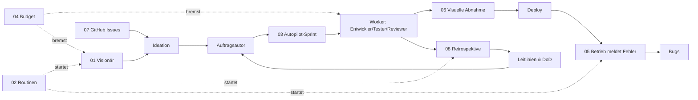

# Visionär: Erweiterungsvorschläge für Dev Log

Stand: 18.10.2026 · Rolle: Visionär · Grundlage: Code (`src/`, `frontend/src/`), `docs/*.md`, Datenmodell (`src/db/schema.ts`), inkl. der noch nicht committeten Arbeit (Agent-Aufgaben, Folgeaufträge, „Aktion notwendig“, automatische Abnahmeprüfung, Git-Graph).

Es wurde **nichts umgesetzt**. Jede Datei ist so aufgebaut, dass sie direkt als Idee in **Ideation** erfasst und vom Auftragsautor zu einem Auftrag ausgearbeitet werden kann:

- **Titel** → Ideen-Titel (max. 180 Zeichen)
- **Steckbrief** → Kategorie, Priorität, Nutzen, Kosten, Aufwand
- **Beschreibung für Ideation** → Inhalt des Beschreibungsfelds (kopierfertig)
- Der Rest (Problem, Ablauf, Andockpunkte, Akzeptanzkriterien-Entwurf, Risiken, Ausbaustufen) ist Material für den Auftragsautor und den Bug-Wächter.

Zu jedem Vorschlag gibt es einen Foliensatz (siehe Links in der Antwort des Visionärs).

## Was Dev Log heute schon kann (Kurzbild)

Idee → Schätzung → Auftragsautor (Anforderung + Akzeptanzkriterien) → Bug-Wächter (Risiken) → manuelle Sprint-Zuordnung → Worker: Entwickler → Tester → Reviewer → Dokumentierer → Handbücher → Abnahme (DoR/DoD, automatische Prüfung offener Punkte) → Commit auf Sprint-Branch → Sprint-Abschluss mit Test-Gate, Merge, Tag, Push → optional Deploy. Fehlschläge erzeugen Bugs und Bug-Aufträge (max. 2 Wiederholungen), Problemanalyse, „Aktion notwendig“. Dazu Chat-Assistent mit Werkzeugen, Agent-Aufgaben per Klick, Verbrauchs- und Schätzstatistik, Coverage, Push, Wächter, Rollen, Doku-Redaktion.

**Die Lücken liegen an den beiden Enden der Kette:** Vorne entstehen Ideen nur durch Menschen, und die Sprintplanung ist manuell. Hinten endet die Kette beim Deploy – was in der laufenden Anwendung passiert, kommt nicht zurück. Dazwischen fehlt eine Steuerung über Kosten und Zeit (Budget, Zeitpläne) und ein Lernkreislauf, der Erfahrungen in Leitlinien zurückführt.

## Vorschläge

| Nr. | Vorschlag | Kategorie | Prio | Nutzen | Kosten | Aufwand | Schließt die Lücke |
| --- | --- | --- | --- | --- | --- | --- | --- |
| 01 | [Visionär-Agent (Ideen-Radar)](01-visionaer-agent.md) | backend | hoch | 8 | 4 | 16 h | Ideen entstehen automatisch |
| 02 | [Zeitgesteuerte Routinen](02-zeitgesteuerte-routinen.md) | fullstack | hoch | 8 | 3 | 12 h | Wartung ohne Klick |
| 03 | [Autopilot-Sprintplanung](03-autopilot-sprintplanung.md) | fullstack | hoch | 9 | 5 | 20 h | Planung ohne Handarbeit |
| 04 | [Budget-Wächter & Modell-Routing](04-budget-und-modell-routing.md) | backend | mittel | 8 | 5 | 20 h | Kosten unter Kontrolle |
| 05 | [Produktions-Rückkanal](05-produktions-rueckkanal.md) | fullstack | hoch | 9 | 5 | 22 h | Fehler aus dem Betrieb werden Bugs |
| 06 | [Visuelle Abnahme mit Screenshots](06-visuelle-abnahme.md) | fullstack | mittel | 7 | 5 | 18 h | Oberflächen werden sichtbar geprüft |
| 07 | [GitHub-Brücke: Issues & Pull Requests](07-github-bruecke.md) | backend | mittel | 7 | 4 | 18 h | Anschluss an Team-Werkzeuge |
| 08 | [Retrospektive & lernende Leitlinien](08-retrospektive-lernende-leitlinien.md) | backend | mittel | 8 | 3 | 12 h | Agents lernen aus Fehlern |

Nutzen/Kosten auf der Skala 0–10 wie in Ideation; Aufwand grob, der Auftragsautor schätzt neu.

## Empfohlene Reihenfolge

1. **02 Routinen** – kleiner Baustein, auf dem 01, 05 und 08 aufsetzen (Zeitplan-Infrastruktur).
2. **04 Budget** – bevor mehr automatisch läuft, muss es eine Kostenbremse geben.
3. **01 Visionär** und **08 Retrospektive** – nutzen die Routinen, füllen vorne den Trichter und verbessern die Qualität.
4. **03 Autopilot-Sprint** – sobald genug Ideen fließen und Budget geregelt ist.
5. **05 Produktions-Rückkanal** und **06 Visuelle Abnahme** – schließen den Kreis nach hinten.
6. **07 GitHub-Brücke** – sobald weitere Personen mitarbeiten.

## Der geschlossene Kreislauf (Zielbild)

