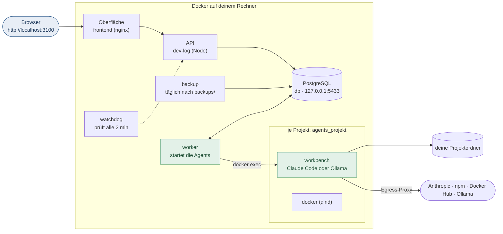

# AIdeation installieren

Diese Anleitung führt Schritt für Schritt von einem leeren Rechner bis zur ersten Anmeldung. Für macOS, Linux und
Windows gilt derselbe Weg: herunterladen, `start.sh` bzw. `start.cmd` starten, den Einrichtungs-Assistenten im Browser
ausfüllen. Alles Weitere (Worker, Container, Backups, Fehlerbehebung im Betrieb) steht in [Betrieb](betrieb.md).

**Video:** [Tutorial „AIdeation installieren“](video/aideation-installieren.mp4) – der ganze Ablauf in wenigen Minuten.

## Überblick

| Teil | Läuft | Aufgabe |
|---|---|---|
| Oberfläche + API | Docker | Projekte, Ideen, Aufträge, Sprints, Dokumentation unter `http://localhost:3100` |
| Datenbank + Backup | Docker | PostgreSQL, tägliche Sicherung nach `backups/` |
| Worker + Ausfall-Wächter | Docker (empfohlen) oder direkt auf dem Rechner | startet die Agents in deinen Projektordnern |
| Agents | Docker (eigene Container je Projekt) | Claude Code oder ein lokales Modell (Ollama) |



## 1. Voraussetzungen

| | macOS | Windows | Linux |
|---|---|---|---|
| Docker | [Docker Desktop](https://docs.docker.com/get-docker/), gestartet | Docker Desktop (WSL 2), gestartet | Docker Engine mit Compose-Plugin und Buildx; dein Benutzer in der Gruppe `docker` |
| Node.js | 22.12 oder neuer ([nodejs.org](https://nodejs.org/)) | 22.12 oder neuer | 22.12 oder neuer |
| Git | `git` (Xcode-Tools oder Homebrew) | [Git für Windows](https://git-scm.com/downloads) | `git` aus der Paketverwaltung |

- **Arbeitsspeicher für Docker:** mindestens 12 GB, besser 16 GB (Docker Desktop → Settings → Resources → Memory),
  dazu rund 20 GB freier Speicher. Die Agents arbeiten je Projekt in eigenen Containern.
- **KI für die Agents** (eines davon, kann auch später folgen):
  - **Claude Code** – beste Ergebnisse. Auf einem Rechner mit Claude Code `claude setup-token` ausführen und den
    Token im Assistenten eintragen.
  - **Ollama** – kostenlos und lokal, z. B. `ollama pull qwen3.5:9b`.
- **macOS:** Liegen deine Projekte auf einem externen Laufwerk (`/Volumes/…`), den Ordner in Docker Desktop unter
  Settings → Resources → File sharing freigeben.

Prüfen, ob alles da ist:

```bash
docker info --format '{{.ServerVersion}}' && docker compose version && node -v && git --version
```

## 2. Herunterladen

Am besten in einen eigenen Ordner `AIdeation`, darin `source`:

```bash
git clone https://github.com/zaaaazzy/AutoDEV.git AIdeation/source
cd AIdeation/source
```

## 3. Starten

| System | Befehl |
|---|---|
| macOS / Linux | `./start.sh` |
| Windows | Doppelklick auf `start.cmd` |

Beim ersten Start prüft das Skript Node, Docker und Compose, installiert die Abhängigkeiten (`npm ci`, einige
Minuten), lädt Chromium für Playwright und öffnet den **Einrichtungs-Assistenten** im Browser. Öffnet sich kein
Browser, den Link aus dem Terminal kopieren (`http://127.0.0.1:3999/#…`). Das Terminal-Fenster offen lassen, bis
der Assistent fertig ist.

## 4. Einrichtungs-Assistent

1. **System** – prüft Node.js, Docker, Docker Compose und Git (Pflicht) sowie Claude Code, Chromium und Ollama
   (optional, mit `!` markiert). Erst wenn alle Pflichtpunkte grün sind, geht es weiter.
2. **Zugang** – Benutzername und Passwort des Systemadministrators (mindestens 16 Zeichen). „Erzeugen“ schlägt ein
   sicheres Passwort vor. **Im Passwort-Manager speichern.**
3. **Optionen**
   - **Domain** (optional): nur für den Zugriff von unterwegs per HTTPS, siehe
     [Betrieb](betrieb.md#zugriff-von-unterwegs-optional). Ohne Domain ist AIdeation nur auf diesem Rechner erreichbar.
   - **Projektbereich**: der Ordner, in dem AIdeation Projekte anlegt und die Agents arbeiten, z. B.
     `/Users/du/Projekte`. Leer = der Ordner, in dem `AIdeation` liegt.
   - **Worker**: „Worker im Container“ (empfohlen) läuft mit Docker, es ist nichts weiter zu installieren.
   - **Claude-Token** (optional): Ausgabe von `claude setup-token`. Lässt sich später in der `.env` nachtragen.
   - **Beispielprojekt „Velowerk“** (optional): ein Projekt mit einem Jahr Geschichte zum Ausprobieren. Der laufende
     Sprint ist pausiert, es starten also keine Agents von selbst.
4. **Installation** – schreibt die `.env`, baut und startet die Container, legt auf Wunsch das Beispielprojekt an,
   lädt die Spiele-Werkzeuge und baut das Agent-Image. Das Protokoll läuft live mit. Der erste Durchgang dauert je
   nach Rechner und Internet **10 bis 30 Minuten**, spätere Starts nur Sekunden.

Ist ein Schritt rot, steht der Grund im Protokoll. Mit „Zurück“ lässt sich die Installation wiederholen.

## 5. Anmelden und prüfen

Nach der Installation öffnet sich AIdeation unter **http://localhost:3100**. Anmelden mit dem Zugang aus Schritt 2.
AIdeation begrüsst dich und bietet an, das erste Projekt anzulegen.

Kurzer Gesundheits-Check im Terminal (im Ordner `AIdeation/source`):

```bash
docker compose ps
```

Erwartet: `db`, `dev-log`, `frontend`, `backup`, `worker` und `watchdog` laufen (`healthy`). Der Worker installiert
beim ersten Start seine Abhängigkeiten und ist erst nach einigen Minuten `healthy`. In der Oberfläche zeigt das
Worker-Symbol oben dann Grün.

**Wichtig:** Die Datei `.env` enthält Passwörter und den Schlüssel `DEV_LOG_SECRET_KEY`. Sichere sie (oder wenigstens
den Schlüssel) im Passwort-Manager. Ohne ihn lassen sich Backups nicht vollständig wiederherstellen.

## 6. Agents anmelden

Ohne Anmeldung starten die Agents nicht. Eine der beiden Möglichkeiten:

- **Claude Code:** Token aus `claude setup-token` im Assistenten eintragen (`./start.sh --setup`) oder in der `.env`
  als `CLAUDE_CODE_OAUTH_TOKEN=…` ergänzen (alternativ `ANTHROPIC_API_KEY=…`) und `./start.sh` erneut ausführen.
- **Ollama:** Ollama auf diesem Rechner starten und ein Modell laden (`ollama pull qwen3.5:9b`). Im Agent wählst du
  unter **Agents** das lokale Modell.

## 7. Erstes Projekt

1. **Projekt erstellen** – der Projekt-Assistent prüft den Ordner, richtet Git/GitHub und auf Wunsch eine Vorlage ein,
   testet die Agent-Verbindung und legt die Rechte der Agents fest.
2. **Tour** – unter **Hilfe → Interaktive Tour** führt AIdeation durch Ideation, Aufträge und Sprints bis zum ersten
   Agent-Lauf. Beim allerersten Auftrag eines Projekts richtet der Worker dessen Arbeitscontainer ein; das dauert
   einige Minuten.

## Im Alltag

| Aufgabe | Befehl (im Ordner `AIdeation/source`) |
|---|---|
| Starten (z. B. nach einem Neustart des Rechners) | `./start.sh` bzw. `start.cmd` – Docker Desktop muss laufen |
| Stoppen | `docker compose stop` |
| Zustand | `docker compose ps` |
| Protokoll | `docker compose logs -f dev-log` (API), `docker compose logs -f worker` (Worker) |
| Einstellungen der Einrichtung ändern | `./start.sh --setup` – die `.env` wird gesichert und ergänzt, nicht ersetzt |
| Aktualisieren | `git pull` und danach `./start.sh` – oder in AIdeation die Agent-Aufgabe „AIdeation neu starten“ (Chat, nur Administration) |

Die Container starten mit Docker Desktop von selbst wieder (`restart: unless-stopped`); `./start.sh` ist nach einem
Neustart nur nötig, wenn sie gestoppt wurden.

## Deinstallieren

```bash
docker compose down --rmi local     # Container und gebaute Images entfernen, Datenbank-Volume bleibt
docker compose down -v              # zusätzlich alle Volumes samt Datenbank löschen – vorher Backup sichern!
docker image rm aideation-agent     # Image der Agents
```

Arbeitscontainer der Projekte entfernst du mit
`docker compose -p agents_<projekt> -f ~/.config/aideation/workbench/agents_<projekt>.json down -v`. Danach den Ordner
`AIdeation` löschen. Hattest du den Worker auf dem Rechner statt im Container eingerichtet, zuerst den Dienst entfernen
(siehe [Betrieb](betrieb.md#worker-im-container), „Umstieg vom Worker auf dem Host“).

## Wenn etwas nicht klappt

| Meldung | Lösung |
|---|---|
| „Docker läuft nicht“ | Docker Desktop starten (Linux: Dienst `docker` starten, Benutzer in Gruppe `docker`), dann erneut `./start.sh` |
| „Node.js … ist zu alt“ | Node.js 22.12 oder neuer installieren |
| „Docker Compose (docker compose) fehlt“ | Docker Desktop aktualisieren bzw. unter Linux das Paket `docker-compose-plugin` installieren |
| Assistent öffnet sich nicht | Link `http://127.0.0.1:3999/#…` aus dem Terminal im Browser öffnen |
| „Die Einrichtung läuft bereits“ | Ein anderes Fenster des Assistenten ist offen – dort abwarten |
| Installation rot bei „Container bauen und starten“ | Protokoll lesen; häufig zu wenig Speicher oder keine Internetverbindung. „Zurück“ und erneut installieren |
| Seite `localhost:3100` lädt nicht | `docker compose logs dev-log` zeigt den Grund |
| Agents starten nicht | Worker-Symbol in AIdeation prüfen, `docker compose logs -f worker`; fehlt die Anmeldung, siehe Schritt 6 |
| „Image … fehlt“ bei einem Agent-Lauf | `docker build -t aideation-agent -f deploy/agent/Dockerfile .` im Ordner `AIdeation/source` |
| Port 3100 oder 5433 belegt | Das andere Programm beenden; AIdeation braucht diese Ports auf `127.0.0.1` |

Weitere Fälle (Zwei-Faktor, Backups, Restore, Proxy) stehen in [Betrieb → Fehlerbehebung](betrieb.md#fehlerbehebung-betrieb).
