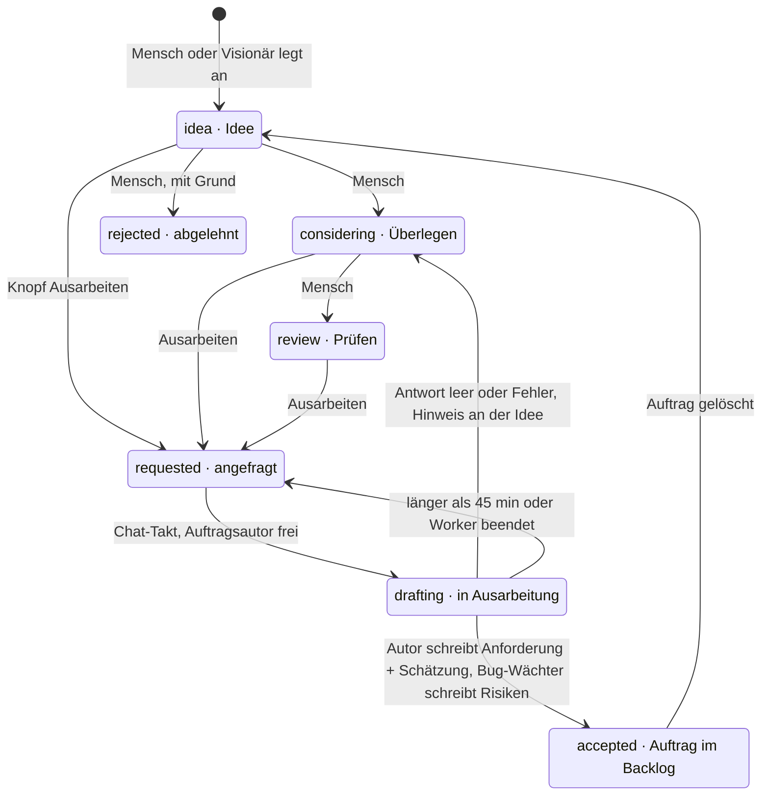
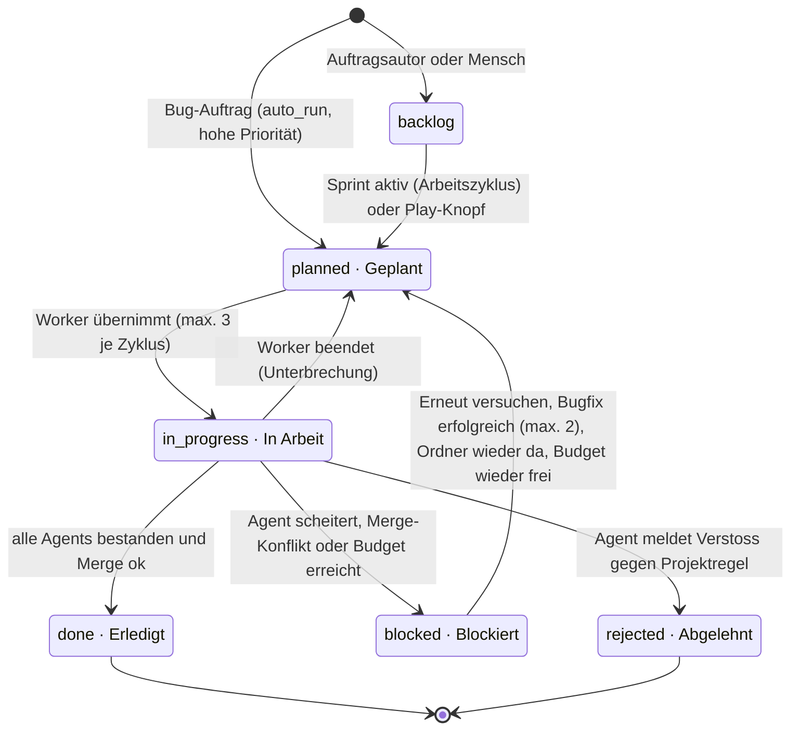
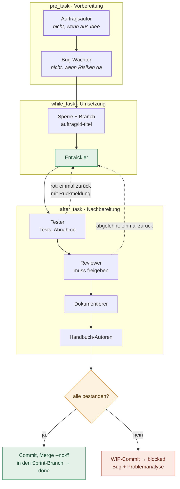
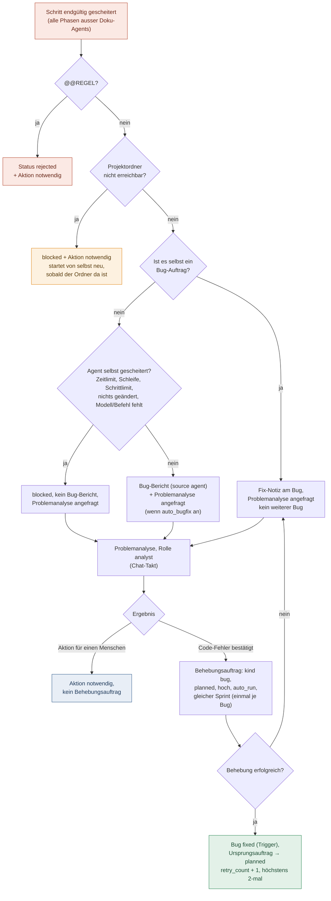
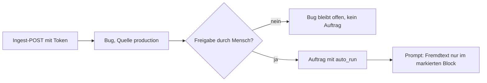
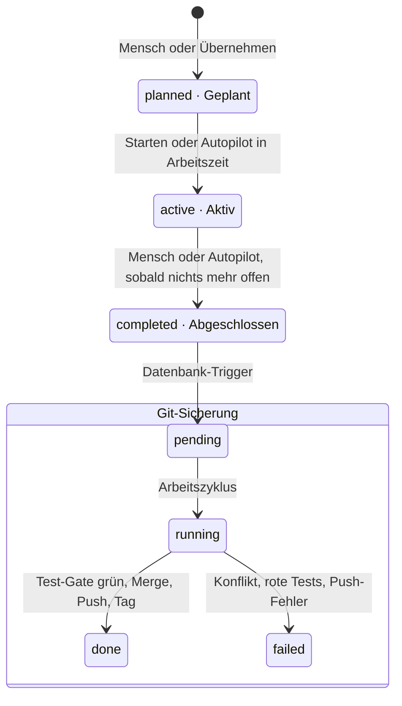
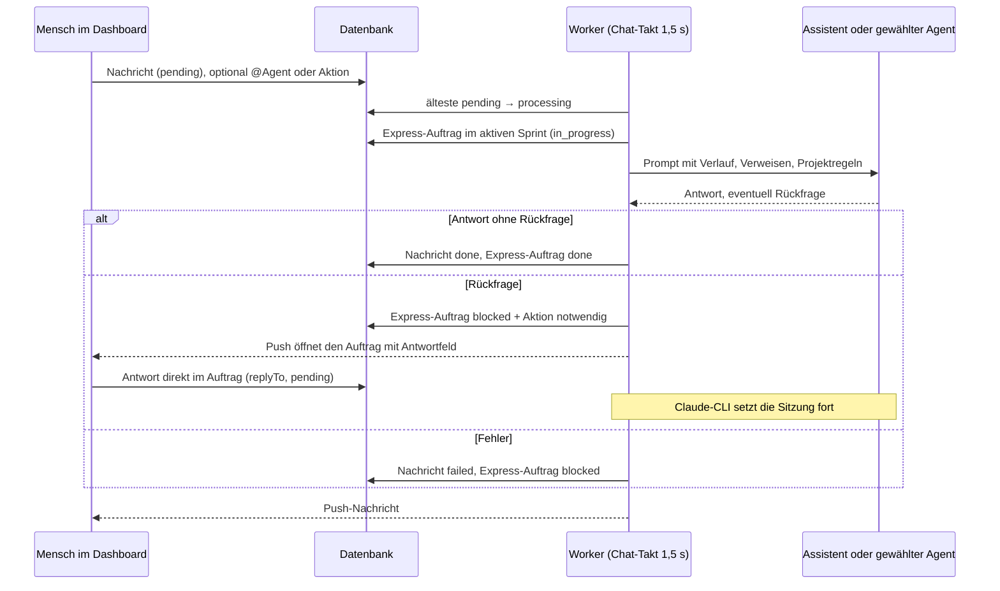

# AIdeation zur Laufzeit

Was der Worker wann tut, welcher Status welchen Schritt auslöst, wann welcher Agent startet und was er darf – abgeleitet aus dem Quellcode (`src/runner`, `src/agent`, `src/db/schema.ts`). Stand: 19.10.2026. Details zu Abläufen und Rechten stehen in „Workflows“ und „Agents und Rechte“.

## 1 · Prozesse und Takte

Drei Prozesse laufen dauerhaft. Gearbeitet wird nur im Worker auf dem Mac; der Frontend-Container liefert die Oberfläche und leitet `/api` an den Backend-Container weiter; der schreibt nur Wünsche in die Datenbank.

| Takt          | Schleife im Worker | Was je Projekt passiert                                                                                                                                                                                                                                                                                                               |
| ------------- | ------------------ | ------------------------------------------------------------------------------------------------------------------------------------------------------------------------------------------------------------------------------------------------------------------------------------------------------------------------------------- |
| 0,5 s         | Einrichtung        | Host-Aufgaben des Projekt-Assistenten (Ordner, Git, GitHub, Vorlagen, Agent-Tests), bis zu 4 parallel.                                                                                                                                                                                                                                |
| 1,5 s         | Chat-Takt          | Nacheinander angestoßen, jede Spur höchstens einmal gleichzeitig: Testanforderung → _falls kein Chat läuft:_ Schnellschätzung → Auftragsautor (Ideen) → KI-Kommentar zum Sprintvorschlag → Visionär → Chat-Nachricht → Problemanalyse, danach Abnahmeprüfung.                                                                         |
| 5 s           | Neustart           | „AIdeation neu starten“ (von Hand oder nach dem Sprint-Abschluss): wartet, bis nichts läuft (max. 15 min), prüft Branch `main` und sauberen Stand, `docker compose up -d --build`, prüft bis 2 min `/health`; antwortet AIdeation nicht, zurück aufs vorherige Abbild + Push. Sonst beendet sich der Worker, launchd startet ihn neu. |
| 15 s          | Heartbeat          | Worker-Badge, Modelle der System-Agents veröffentlichen; jede Minute Git-Verlauf, alle 5 min Favicon.                                                                                                                                                                                                                                 |
| 30 s · sofort | Arbeitszyklus      | Sofort, wenn die Datenbank neue Arbeit meldet (`NOTIFY devlog_work`: Auftrag eingeplant, Sprint gestartet) oder ein Platz frei wird; sonst alle 30 s. `runWorkflow` je Projekt, höchstens **2 Projekte gleichzeitig** (Einstellung, max. 8); wer am längsten wartet, kommt zuerst. Ablauf in Abschnitt 4.                             |
| 30 s · Job    | Wartungs-Jobs      | Projektübergreifend, nach jedem Arbeitszyklus im Hintergrund (nie zwei Durchgänge gleichzeitig): fällige aktive Zeilen aus `scheduled_jobs` beanspruchen (`FOR UPDATE SKIP LOCKED`, `next_run_at` + Intervall, Sperre `locked_until`), dann mit Zeitlimit (Standard 20–120 s, max. 300 s) ausführen. Nur feste Job-Arten aus `src/runner/scheduler.ts`; Status und Meldung landen in der Zeile. Einstellbar über `GET`/`PATCH /api/scheduled-jobs` (nur Administration). |
| 6 h           | `backup_check`     | Neuestes `aideation-*.dump` in `./backups` (relativ zum AIdeation-Ordner): jünger als `maxAgeHours` (26), mindestens `minBytes` (1024). Fehlender Ordner = „fehlgeschlagen“ + Push.                                                                                                                                               |
| 15 min        | `watchdog_logs`    | Wächter-Prüfungen (`collectProblems`, ohne `git status`) im Worker; gleiche Probleme erst nach 6 h (`REMIND_MS`) erneut per Push, Merkzustand in der Datenbank.                                                                                                                                                                       |
| 1 h · Fehler  | `push_alert`       | Push an Projektkreis (`config.project`) oder Administration, wenn ein beobachteter Job fehlgeschlagen ist; nach jedem Fehlschlag sofort fällig. Gleiche Fehlschläge erst nach 6 h wieder, Entwarnung einmal.                                                                                                                       |
| 1 Tag · aus   | `close_old_sprints`| Standardmäßig aus. Schliesst aktive, nicht pausierte Sprints über `completeSprint`, wenn alle Aufträge erledigt sind (`sprintSettled`), kein Agent läuft und seit `inactiveDays` (14, 1–365) nichts passiert ist.                                                                                                                  |
| Start         | Wiederherstellung  | Zuerst die Prozessgruppen des alten Workers beenden: jeder Befehl (Agent-Schritte, Chat, Auftragsautor, Visionär, Testanforderungen, `npm test` …) steht während des Laufs mit PID und Startzeit in `agent_processes`. Lebt die PID noch, muss die Startzeit passen (sonst neu vergeben, nicht angefasst); ist nur der Gruppenführer weg, wird die Restgruppe beendet. Danach: unterbrochene Läufe → Auftrag wieder „Geplant“, Chat → „pending“, Testanforderungen „fehlgeschlagen“, Abnahmeprüfungen und Visionär neu angefragt, Neustart als „erledigt“ markiert. Lässt sich ein Altprozess nicht sicher beenden, wird nichts doppelt gestartet: Chat → „failed“, Aufträge nicht neu eingeplant, Eintrag bleibt für den nächsten Start. |
| Signal        | Herunterfahren     | Alle Agent-Prozesse werden beendet; laufende Aufträge → „Geplant“, Chat → „pending“, Ideen in Arbeit → „requested“.                                                                                                                                                                                                                   |
| 1 h · API     | Sitzungen          | Im Backend, nicht im Worker (`startSessionCleanup` in `src/api/auth.ts`): beim Start sofort im Hintergrund, danach stündlich `DELETE FROM auth_sessions` für abgelaufene Sitzungen, Sitzungen ohne Bindung und Sitzungen des Systemadministrators mit altem `.env`-Passwort. Gültige Sitzungen bleiben. Der Timer endet beim Herunterfahren. |
| Befehlsende   | Aufräumen          | Jeder Befehl läuft als eigene Prozessgruppe. Nach seinem Ende (Erfolg, Fehler, Zeitlimit, Abbruch) wird die ganze Gruppe beendet, damit gestartete Dev-Server keine Ports belegen. Wer einen Dienst dauerhaft starten will, braucht einen eigenen Dienst-Manager (launchd, Docker).                                                     |

## 2 · Idee → Auftrag

Die ersten drei Status setzt nur der Mensch. Ab „Ausarbeiten“ übernimmt der Worker im Chat-Takt, eine Idee pro Projekt gleichzeitig.

### Schnellschätzung

Ideen in idea, considering, review oder requested ohne jeden Schätzwert bekommen im Chat-Takt Stunden, Tokens, Nutzen und Kosten (bis 5 pro Takt). Läuft mit dem Modell der Rolle `author`, eine externe CLI in einem temporären Ordner.

### Visionär

Auf Knopfdruck (Ideation oder Aktionen). Liest das Projekt nur, legt Ideen mit Begründung an, überspringt Dubletten und abgelehnte Ideen. Ein Lauf pro Projekt, abbrechbar.

## 3 · Status eines Auftrags

Arten: `feature`, `bug` (Behebungsauftrag) und `express` (Chat-Anfrage; läuft nie im Arbeitszyklus). Ausgewählt wird ein Auftrag nur, wenn er „planned“ ist _und_ sein Sprint aktiv ist, ein Agent fest zugewiesen ist (Play) oder `auto_run` gesetzt ist.

Unter **Aufträge hinzufügen** auf der Sprintseite übernimmt `POST /api/development/:id/take-into-sprint` offene und abgebrochene Aufträge in einer Abfrage in den gewählten Sprint. Bei abgebrochenen werden Vermerk, Fehler und ein von Hand zugewiesener Agent zurückgesetzt, ohne Umweg über den aktiven Sprint. `auto_run` wird nur gesetzt, wenn der Ziel-Sprint aktiv ist. In einem geplanten Sprint wartet der Auftrag also, bis der Sprint startet. Auch ein PATCH mit `sprintId` auf einen nicht aktiven Sprint setzt `auto_run` zurück.

### Play-Knopf (ein Agent)

Setzt `agent_id`, merkt den alten Status in `return_status` und plant ein. Es läuft nur dieser Agent; danach kehrt der Auftrag zum alten Status zurück (aus „Blockiert“ wird bei Erfolg „Geplant“). Bei Misserfolg: „Blockiert“.

### Automatik der Datenbank

- Bug-Auftrag in Arbeit → Bug „in_progress“; erledigt → Bug „fixed“; abgelehnt → Bug „rejected“; zurück → Bug „open“.
- „done“ oder „rejected“ löscht „Aktion notwendig“.
- Pro Auftrag höchstens ein laufender Lauf. Er gilt erst als gescheitert, wenn er rund 9 h kein Lebenszeichen gegeben hat (`ABANDONED_RUN_MS`, abgeleitet aus 2 × 240 min Schritt-Zeitlimit samt Wiederholung plus Reserve).

### Schema-Migrationen beim Start

API und Worker rufen beim Start `createDatabasePool` auf (`src/db/database.ts`). Dieser führt nur die noch fehlenden Schritte aus `src/db/migrations.ts` aus und vermerkt jeden in `schema_migrations`.

- Alle Schritte laufen unter einer Advisory-Sperre (727401), deshalb migrieren gleichzeitig startende Prozesse nacheinander. Jeder Schritt hat eine eigene Transaktion. Scheitert ein Schritt, wird er zurückgerollt und nicht vermerkt, und der Start bricht mit „Migration n (Name) fehlgeschlagen“ ab.
- Ist die Datenbank auf dem Stand, liest der Start nur die vermerkten Versionen. Es läuft kein `ALTER TABLE` und keine Daten-Änderung.
- Schritt 1 `basis` ist das bisherige `src/db/schema.ts`, also nur Struktur und Grundeinträge. Er ist idempotent, damit Bestands-Datenbanken ihn einmal nachholen.
- Schritt 2 `daten-altbestand` enthält die Daten-Korrekturen, die früher bei jedem Start liefen (z. B. Systemagent-Einstellungen aus `app_settings`, Kostenbremse nach `budgets`, Dateirechte `files`). Er läuft genau einmal.
- Schritt 3 legt den Index `agent_run_steps (agent_id)` an.
- Neue Änderungen kommen als weiterer Schritt hinten an die Liste. Bestehende Schritte werden nie geändert.

## 4 · Arbeitszyklus `runWorkflow` (sofort bei neuer Arbeit, sonst alle 30 s)

Die Reihenfolge ist fest. Aufträge eines Zyklus laufen parallel, aber nur einer hält gleichzeitig die Umsetzungssperre (siehe Abschnitt 5).

## 5 · Agent-Kette eines Auftrags

Standard-Workflow jedes neuen Projekts (einmalig angelegt, danach frei änderbar). Reihenfolge: Phase, dann Position. Der erste gescheiterte Schritt beendet den Lauf.

### Wann ein Schritt besteht

- Exit-Code 0 und nicht abgebrochen. Vorübergehender Fehler des Agents (Modell weg, überlastet, Rate-Limit, Zeitlimit): nach 30 s einmal wiederholt, wenn das Budget es noch erlaubt. Ergebnisse der Projekttests und der visuellen Prüfung werden nie wiederholt.
- Tester mit eigener CLI: jedes Akzeptanzkriterium und jeder DoD-Punkt erfüllt (`@@ACCEPTANCE`); nur manuell prüfbare Punkte werden „Aktion notwendig“ + Push.
- Reviewer: eindeutige Freigabe, sonst gescheitert.
- Kein `@@REGEL`-Einspruch (sonst Auftrag „rejected“).
- Entwickler (lokales Modell) hat Dateien geändert oder „KEINE ÄNDERUNG NÖTIG“ gemeldet.

### Sperre und Parallelität

- Ab dem ersten Agent, der Dateien ändert (Phase while_task, Entwickler, Tester), hält der Auftrag die Umsetzungssperre bis zum Merge.
- Vorbereitung und Doku-Agents laufen parallel zur Umsetzung eines anderen Auftrags.
- Erneuter Versuch: bereits bestandene Agents werden übersprungen, ihre Ausgabe geht weiter.
- Zeitlimit je Schritt 30 min (Standard).
- Abbruch („Abbrechen“ in der Oberfläche, Zeitlimit, Worker-Ende): Ein Signal erreicht Modellanfragen, jedes Werkzeug des lokalen Modells und laufende Befehle samt Prozessgruppe. Nach dem Abbruch startet kein weiteres Werkzeug (`write_file`, `replace_in_file`, `run_command`, `run_sql`), auch ein schon abgebrochenes Signal wird geprüft. Der Schritt wartet auf das echte Ende des Agents, bevor Commit oder `checkout` laufen. Tokens und Kosten des abgebrochenen Laufs bleiben erhalten. Ein Abbruch von aussen meldet „Abgebrochen: Der Agent wurde gestoppt.“ und gilt weder als vorübergehender Fehler noch als Erfolg.
- Budget: Vor jedem Agent werden Tages-, Sprint- und Auftragslimit geprüft; ab 80 % eine Push-Warnung je Periode, ab 100 % → blocked mit „Aktion notwendig: Budget erreicht“, kein Bug. Der Zeitraum gibt den Auftrag wieder frei (Folgetag bzw. höheres Limit).
- Modell-Routing: Die Regeln des Projekts wählen je Schritt lokal (Ollama) oder stark (CLI); Modell und Regel stehen am Schritt.

## 6 · Fehler, Problemanalyse und Bugfix

Wenn ein Schritt endgültig scheitert (nach Nachbesserung bzw. Wiederholung; Doku-Agents ausgenommen), entscheidet `registerFailure`, was folgt. Die Problemanalyse läuft im Chat-Takt und entscheidet, ob ein Behebungsauftrag entsteht.

`auto_bugfix` ist für neue Projekte aus (bestehende Projekte behalten ihren Wert). Fehlt die Projektzeile, gilt es als aus.

### Bugs aus fremden Quellen (Betrieb, GitHub)

Das Ingest-Token steht im Browser-Snippet und ist damit praktisch öffentlich; GitHub-Issues schreibt jeder. Ihr Text kann Anweisungen an Agents enthalten (Prompt-Injection). Deshalb gilt, unabhängig von `auto_bugfix`:

- Ein neuer Betriebs-Bug und eine Regression legen **keinen** Behebungsauftrag an. Eine Regression setzt eine frühere Freigabe zurück.
- Die Runner-Auswahl (`selectItems`, auch `--item`) und der Start im Runner überspringen jeden Auftrag, dessen Bug aus `production` oder `github` stammt und kein `approved_at` hat. Das gilt für alle Wege: Sprint, `auto_run`, Wiederholungen, Retries. Altdaten ohne Freigabe bleiben gesperrt.
- Die Freigabe setzt ein Mensch mit Recht „Ausführen“ im Bug („Für Agents freigeben“, `POST /api/bugs/:id/approve`). Per `PATCH /api/bugs/:id` lässt sie sich nicht setzen. Bei Betriebs-Bugs entsteht mit der Freigabe der Behebungsauftrag (bzw. der erledigte Auftrag wird erneut eingeplant).
- Meldung, Stack und Herkunft stehen in der Bug-Beschreibung nur im Block `<<<FREMDER-TEXT aus dem Produktions-Rückkanal …>>>`, ohne Steuerzeichen, auf 2000 Zeichen gekürzt. Prompts mit solchen Aufträgen bekommen den Sicherheitshinweis „fremder Text“. Nicht freigegebene fremde Bugs erscheinen nicht unter „Bekannte Bugs“ im Prompt.

## 7 · Sprint, Autopilot und Git

Pro Projekt höchstens ein aktiver Sprint (Datenbank-Regel). Modus in den Einstellungen: `manual`, `suggest` oder `autopilot`.

### Autopilot (Beginn jedes Arbeitszyklus)

- Sicherung gescheitert → pausiert, bis sie gelingt oder „Autopilot freigeben“.
- Sicherung läuft → wartet.
- Aktiver Sprint ohne backlog, planned, in_progress und nur noch Blockaden mit „Aktion notwendig“ → abschliessen (auch nachts).
- Nächsten Vorschlag übernehmen und starten: nur in den Arbeitszeiten (Standard Mo–Fr 08–18 Uhr).

### Git je Ebene

- **Auftrag:** Branch `auftrag/…` vom Sprint-Branch; Erfolg → Merge, Misserfolg → WIP-Commit.
- **Sprint:** Branch `sprint/…`; Sicherung committet Reste, Test-Gate, Push.
- **Abschluss:** Merge nach `main` (--no-ff), erneutes Test-Gate, gegebenenfalls GitHub-Actions abwarten, Push, Tag `sprint-name-id`.
- **AIdeation selbst:** `main` liegt im Arbeitsordner der Menschen. Mit „Nach dem Sprint-Abschluss neu starten“ merged der Worker dort nur, wenn nichts offen ist, prüft die Tests (rot → `reset --keep`) und fordert den Neustart an.
- Nie committet: `.env`, Backups, Schlüsseldateien, Zeilen mit Tokens.

## 8 · Chat, Aktionen und Anfragen auf Knopfdruck

Alles, was im Dashboard angestoßen wird, landet als Zeile in der Datenbank und wird im Chat-Takt abgeholt. Pro Projekt läuft je Spur nur eine Anfrage.

Jeder dieser Knöpfe (und „Erneut versuchen“, „Sprintvorschlag übernehmen“) öffnet zuerst ein Bestätigungsfenster mit optionalem Kommentar, der mitgegeben wird.

| Knopf im Dashboard                                 | Schreibt                                 | Abgeholt von                                                                            |
| -------------------------------------------------- | ---------------------------------------- | --------------------------------------------------------------------------------------- |
| Aktionen → gespeicherte Aktion                     | Chat-Nachricht an den hinterlegten Agent | Chat-Spur                                                                               |
| Aktionen → Kompletter Test / Nur Oberfläche        | `test_requests` requested                | Test-Spur, startet erst, wenn im Projekt kein Agent-Lauf aktiv ist; Befunde werden Bugs |
| Aktionen → Visionär / Ideation → Ideen vorschlagen | `visionary_runs` requested               | Visionär-Spur                                                                           |
| Aktionen → System → AIdeation neu starten (Admin)  | `app_settings` system:restart            | Neustart-Takt 5 s                                                                       |
| Auftrag → Analysieren                              | `analysis_status` requested              | Analyse-Spur                                                                            |
| Sprint → KI-Kommentar                              | `sprint_proposal_comments`               | Auftragsautor, nur Text                                                                 |
| Sprint → Git hoch / runter                         | `git_sync` pending, push oder pull       | Arbeitszyklus, Schritt 1 und 11                                                         |

## 9 · Rechte je Agent

Zwei Ausführungswege mit unterschiedlichen Grenzen. **Claude-CLI**: Rechte aus den freigeschalteten Gruppen des Projekts, AIdeation setzt sie als `--allowedTools`, der Wächter prüft jeden Schreib- und Shell-Zugriff. **Lokales Modell (Ollama)**: eingebaute Werkzeuge, Schreiben nur für Entwickler und Assistent. Die Standardrechte werden je Agent gespeichert und lassen sich im Agent-Formular einzeln ändern.

Legende: ✅ erlaubt · ⚠️ eingeschränkt · ⛔ gesperrt

| Agent · Rolle                                                                             | Startet                                                                                              | Lesen               | Dateien schreiben (Claude)           | Shell (Claude)                                                        | Lokales Modell                                  |
| ----------------------------------------------------------------------------------------- | ---------------------------------------------------------------------------------------------------- | ------------------- | ------------------------------------ | --------------------------------------------------------------------- | ----------------------------------------------- |
| **Auftragsautor** · `author`                                                              | Idee „requested“ (Chat-Takt); im Workflow nur für Aufträge ohne Idee; KI-Kommentar; Schnellschätzung | ✅ ja               | ⚠️ teils anlegen + ändern im Projekt | ⛔ nein                                                               | nur lesen, 25 Schritte                          |
| **Bug-Wächter** · `bug_reviewer`                                                          | direkt nach dem Autor; im Workflow nur, wenn keine Risiken da                                        | ✅ ja               | ⚠️ teils anlegen + ändern            | ⛔ nein                                                               | nur lesen                                       |
| **Entwickler** · `developer`                                                              | while_task, mit Sperre und Auftrags-Branch                                                           | ✅ ja               | ✅ ja im Projekt                     | ✅ ja alle freigeschalteten Gruppen                                   | schreiben + Befehle + SQL, 80 Schritte, Backups |
| **Tester** · `tester`                                                                     | after_task; auch Abnahmeprüfung auf Anfrage                                                          | ✅ ja               | ✅ ja                                | ✅ ja alle Gruppen                                                    | kein Modell: führt nur die Projekttests aus     |
| **Reviewer** · `reviewer`                                                                 | after_task, nach dem Tester                                                                          | ✅ ja               | ✅ ja                                | ✅ ja alle Gruppen                                                    | nur lesen                                       |
| **Dokumentierer, Handbuch-Autoren** · `documenter`, `manual_writer`, `user_manual_writer` | after_task; Ausgabe wird Doku                                                                        | ✅ ja               | ⚠️ teils anlegen + ändern            | ⛔ nein                                                               | nur lesen                                       |
| **Eigene Rolle** · `custom`                                                               | frei gewählte Phase                                                                                  | ✅ ja               | ⚠️ teils anlegen + ändern            | ⛔ nein                                                               | nur lesen                                       |
| **Dashboard-Assistent** · `assistant`                                                     | Chat-Nachricht, Aktion                                                                               | ✅ ja + Dienst-Logs | ✅ ja                                | ✅ ja alle Gruppen; mit `--dangerously-skip-permissions` ohne Wächter | schreiben + Befehle + SQL + Docker/Git-Clone    |
| **Problemanalyse** · `analyst`                                                            | analysis_status requested                                                                            | ✅ ja               | ⛔ nein                              | ⛔ nein                                                               | nur lesen                                       |
| **Visionär** · `visionary`                                                                | Knopfdruck                                                                                           | ✅ ja               | ⛔ nein                              | ⛔ nein                                                               | nur lesen                                       |

### Gruppen, die Projekte freischalten

- **Dateien** (immer), **Diagnose** (ps, lsof, netstat, WebFetch localhost), **Dienst-Logs** (~/Library/Logs), **Projekt-Datenbank** (nur lokales Modell).
- **Build und Tests** (npm test/run, npx --no-install ng/tsc/vitest/playwright), **Pakete** (npm install/ci --ignore-scripts), **Git** (status, diff, log, fetch, pull --ff-only – kein checkout: den Branch eines Auftrags verwaltet AIdeation), **Docker** (compose ps/logs/up/stop/…), **Projekt-Dienste** (launchctl kickstart ch.*).
- Eigene Gruppen je Projekt, nur Administration; Regeln mit „DevLog“, .env oder .ssh werden abgelehnt.

### Was der Wächter immer sperrt

- Schreiben ausserhalb des Projekts oder der Ordner-Einschränkung des Agents.
- `.git`, `.claude`, `.ssh`, `.aws`, `.env*`, `*.pem`, `*.key`.
- Umleitungen in Dateien, riskante Git-Optionen, npx ohne --no-install, unsichere Compose-Dateien.
- Ausnahme: Assistent mit voller Freigabe im Befehl.

### Projektcode nur mit gefiltertem Environment

- Tests, Test-Gate, Komplettlauf, Coverage-Messung und Befehle des Chat-Assistenten laufen über `runProjectCommand` bzw. `projectEnvironment` (`src/runner/project-command.ts`). Weitergegeben wird nur eine Allowlist: `PATH`, `HOME`, `TMPDIR`, Locale, Terminal, `CI`, `NODE_ENV`, `SSH_AUTH_SOCK` sowie `LC_*`, `NPM_CONFIG_*`, `PLAYWRIGHT_*`, `DOCKER_*`, `XDG_*`, `NVM_*`. `DEV_LOG_*` und alles mit SECRET, TOKEN, PASSWORD, API_KEY, DATABASE_URL oder CREDENTIAL im Namen fehlen immer; einen Rückfall auf `process.env` gibt es nicht.
- Git und gh des Workers laufen mit `gitEnvironment`: dieselbe Allowlist plus GitHub-Token für den Push, Hooks aus (`core.hooksPath=/dev/null`) und kein fsmonitor. Alle Commits zusätzlich mit `--no-verify`.
- Die eigene Coverage-Messung führt Vorbereitungsschritte aus dem `test`-Skript nur aus, wenn sie `npm run`, `npm ci`, `tsc`, `ng build` oder `vite build` sind. Sonst entfällt die Messung; die Ablehnung steht im Tester-Schritt (Ausgabe und Verlauf). Testbefehle je Auftrag (`npx tsx --test <Dateien>`, `node --test …`) misst AIdeation direkt mit `--experimental-test-coverage`, ohne Skript und ohne Vorbereitung.
- Agent-CLIs (Claude, Codex) und Deploy-Befehle behalten `agentEnvironment` (nur `DEV_LOG_*` entfernt), weil sie API-Schlüssel bzw. Hoster-Zugänge brauchen.

## 10 · Neu im aktuellen Stand

Die vier Auffälligkeiten der ersten Fassung sind behoben (Tester/Reviewer melden Bugs, Problemanalyse nur lesend, Doku angeglichen). Dazu kamen diese Änderungen am Ablauf.

### Nachbesserung im selben Lauf

Rote Tests oder ein abgelehntes Review gehen einmal direkt zurück an den Entwickler. Erst wenn auch das scheitert: Bug, Problemanalyse, Bugfix.

### Kurze Ausfälle

Modell nicht erreichbar, überlastet, Rate-Limit, Verbindungsabbruch oder Zeitlimit: Der Schritt wird nach 30 s einmal wiederholt, statt den Auftrag sofort zu blockieren. Das gilt nur für Fehler des Agents selbst, nicht für rote Projekttests (deren Ausgabe kann ebenfalls `ECONNREFUSED` enthalten). Vor dem zweiten Versuch wird das Budget neu geprüft; ist es erreicht, hält der Lauf an wie vor einem Schritt.

### Sofortstart

Datenbank-Trigger melden neue Arbeit per `NOTIFY`; der Worker legt sofort los. Das 30-s-Intervall bleibt als Absicherung.

### Budget und Modell-Routing

Einstellungen → Budget: Limits je Tag, Sprint und Auftrag (Tokens/USD), Anzeige in USD oder CHF zum festen Kurs, Routing-Regeln und Modell je Stufe. Dashboard-Kachel „Budget heute / Sprint“, Statistik mit Verbrauch gegen Budget, Verbrauch je Modell und geschätzter Ersparnis durch das Routing. Der Auftragsautor bekommt die Median-Ist-Werte erledigter Aufträge derselben Kategorie in den Prompt (sichtbar im Prompt-Protokoll der Statistik). „Erneut versuchen“ startet ein neues Auftragsbudget.

### Zeitleiste und Rückfragen im Auftrag

Der Auftrag zeigt, worauf er wartet, wer wann was gemacht hat, und nimmt Antworten auf Rückfragen direkt entgegen; die Push-Nachricht öffnet das Antwortfeld.

### Neustart mit Prüfung

Optional nach dem Sprint-Abschluss automatisch; nach dem Neubau Gesundheitsprüfung und bei Bedarf Rücksetzen auf das vorherige Abbild. Auswertung „Was klappt“ unter Verbrauch.

Alle Compose-Aufrufe dabei (`images`, `up -d --build`, Rücksetzen mit `up -d --no-build`) laufen ohne `DEV_LOG_*`- und `COMPOSE_*`-Variablen aus der Worker-Umgebung (`composeEnvironment` in `src/runner/system-restart.ts`). Compose zieht Shell-Variablen der `.env` vor, auch leere; so gilt für die Container allein die `.env`, etwa der `DEV_LOG_SECRET_KEY`, und nicht der Wert aus `worker.env` oder das vom Worker gesetzte `DEV_LOG_PROJECT_ROOTS`.

### Fehlversuch-Bremse bei der Anmeldung

`FailureLimiter` in `src/api/security.ts`, geprüft in `src/api/auth.ts` (Login, Basic Auth, Zwei-Faktor-Bestätigung) **vor** dem scrypt-Lauf:

- **Schlüssel:** Herkunft und Benutzername (klein, ohne Leerraum). Die Herkunft ist die Client-IP, IPv4-mapped IPv6 zählt als IPv4, IPv6 als ganzes /64 (`clientSource`). Eine Sperre allein nach Benutzername gibt es bewusst nicht: Sonst könnte jeder den Admin für alle aussperren.
- **Backoff statt harter Sperre:** Die ersten 10 Fehlversuche je Schlüssel sind frei. Danach heißt es 1 min warten, jeder weitere Fehlversuch verdoppelt die Wartezeit bis höchstens 15 min. Nach 15 min ohne Fehlversuch beginnt der Zähler neu, eine erfolgreiche Anmeldung setzt ihn zurück. Die Antwort ist 429 mit `Retry-After`.
- **Limit je Herkunft:** höchstens 300 Fehlversuche pro Minute über alle Benutzernamen. Massen-Logins mit Zufallsnamen kosten dadurch weder CPU noch Speicher, andere Adressen bleiben frei.
- **Speicher:** Beide Tabellen haben höchstens 10 000 Einträge. Beim Einfügen werden zuerst abgelaufene, dann die ältesten Einträge gelöscht.
- **Client-IP:** kommt aus `X-Forwarded-For`, aber nur von Proxys aus `DEV_LOG_TRUST_PROXY`. Erlaubt sind `loopback`, `linklocal`, `uniquelocal` sowie IP- oder CIDR-Angaben. `true`, `*` oder Hop-Zahlen werden mit Warnung verworfen; dann gilt die Socket-Adresse (`trustProxySetting`).

### Log-Scan im Produktions-Rückkanal

Für jedes Projekt mit `log_services` liest der Worker alle 15 min und nach jedem Deploy mit derselben Logik (`scanLogs` in `src/runner/production-monitor.ts`) `docker compose logs --timestamps --no-color` (ohne Shell, nur gültige Dienstnamen). Projekte ohne `log_services` lösen keinen Aufruf aus und bekommen keinen Eintrag in `production_status.logs_scanned_at`.

- **Fenster:** vom letzten erfolgreichen Scan (`logs_scanned_at`) bis jetzt. Ein verspäteter Tick wird so vollständig abgedeckt; Zeilen mit Zeitstempel bis zur Grenze zählen nicht erneut. Beim ersten Scan gilt das Standardintervall.
- **Begrenzung:** Liegt der letzte Scan länger als `LOG_MAX_WINDOW_MS` (1 h) zurück, wird das Fenster begrenzt und die Lücke in `production_status.log_gap` vermerkt, statt Zeilen still zu verwerfen.
- **Fehler:** Schlägt der Aufruf fehl, wird `log_error` gesetzt (höchstens 300 Zeichen), es entstehen keine Ereignisse und der Scan-Zeitpunkt bleibt stehen. Der nächste erfolgreiche Scan setzt `log_error` zurück.
- **Fingerabdruck:** `scanLogs` und `recordEvent` bilden den Schlüssel gleich (Meldung bzw. Titel, oberster Stack-Frame). Zehn gleiche Fehler ergeben einen Bug mit Zähler 10; nach einem behobenen Bug öffnet ein neues Ereignis ihn als Regression wieder. Ausschlussmuster (`production_ignore`) wirken vor der Gruppierung.
- **Anzeige:** Die Einstellungen „Betrieb“ zeigen je Projekt letzten Scan, letzten Fehler, Lücke und Zahl erfasster Ereignisse. Aufbewahrung: `production_retention_days`.

Worauf zu achten ist: Schlägt das Speichern einzelner Ereignisse teilweise fehl, bleibt der Scan-Zeitpunkt stehen; der nächste Scan zählt diese Zeilen dann doppelt (unverändertes Verhalten). Die Anzeige in den Einstellungen ist nur per `log-scan.spec.ts` getestet, nicht per E2E.

### Review-Container ohne echte Zugänge

Der Review-Container (Worker-Takt 5 s, `src/runner/review-slots.ts`) führt Code aus Agent-Commits aus, inklusive `npm ci` mit Lifecycle-Skripten. Deshalb bekommt er nichts, was sich missbrauchen liesse:

- **Keine `.env`, kein Projektordner:** Eingebunden sind nur die Git-Objekte (`<repo>/.git/objects` schreibgeschützt unter `/source/objects`). Der Stand wird daraus nach `/work` ausgecheckt. Review-Befehle, die noch auf `/source/…` zeigen, laufen dort ebenfalls (`/source/` → `/work/`). Für AIdeation selbst lautet der Befehl `sh deploy/review/aideation-review.sh`.
- **Kein root:** Der Container läuft als Benutzer `node`, mit `--cap-drop ALL` und `no-new-privileges`.
- **npm-Cache je Projekt:** Volume `aideation_review_npm_<projekt>` statt eines gemeinsamen Caches.
- **Eigener DB-User:** `DEV_LOG_REVIEW_DATABASE_URL` im Worker zeigt auf einen User ohne Superuser-Rechte und auf dessen Basis-Datenbank (`scripts/setup-review-db.sh` legt beides an und entzieht `PUBLIC` das `CONNECT` auf `aideation` und `postgres`). Projekte ohne eigene Datenbank bekommen damit die leere Slot-Datenbank `aideation_review_<n>` (`REVIEW_DATABASE_URL`, `DATABASE_URL`). Angelegt wird sie vom Worker, und zwar über die Basis-Datenbank, nie über `postgres`. Projekte mit eigener Datenbank bekommen wie bisher eine Kopie `<db>_review_<n>`.
- **Kein Rückfall:** Fehlt der Review-User, gleicht er dem Haupt-User (User, Passwort oder Datenbank) oder enthielte das Env das Haupt-DB-Passwort, den Haupt-User oder die DB `postgres`, dann wird der Container gar nicht erst gestartet. Der Slot steht dann auf „fehlgeschlagen“ mit Meldung, Docker-Ausgaben werden maskiert. Das betrifft nur den Review-Container, nicht den Auftrag und nicht den Autofix.
