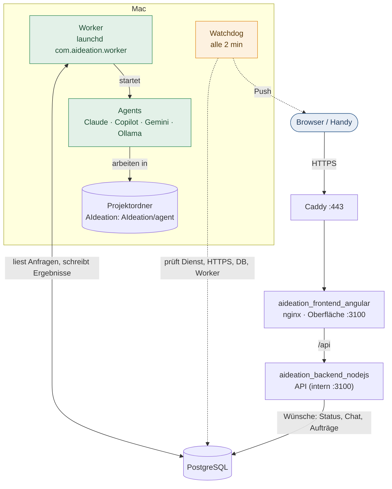
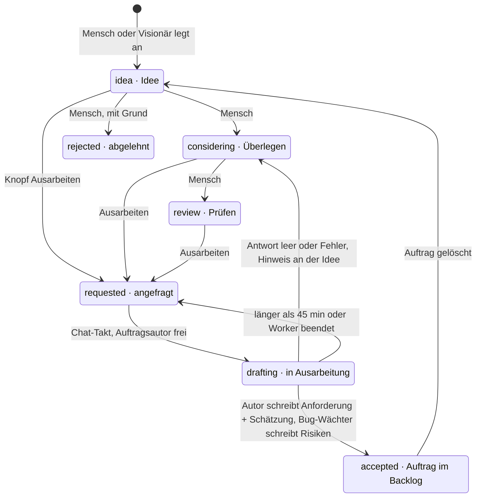
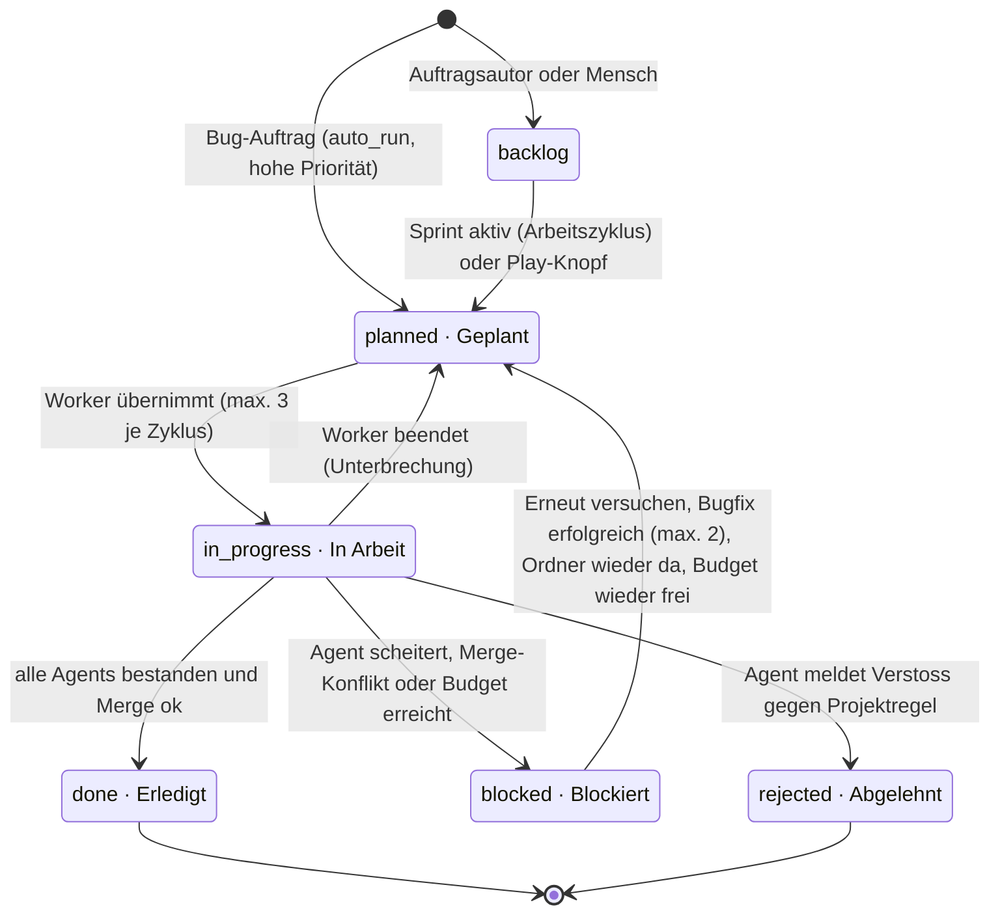
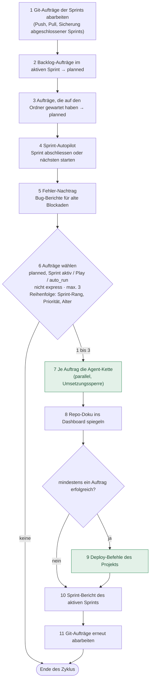
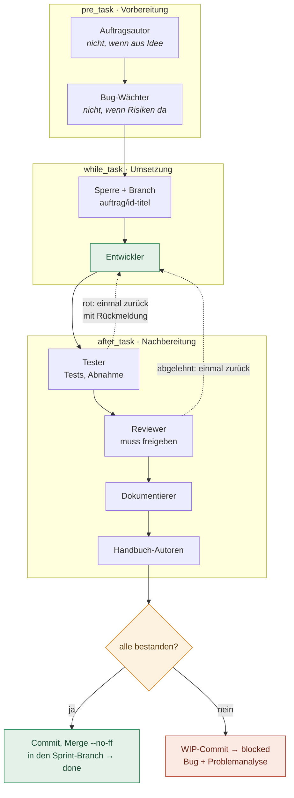
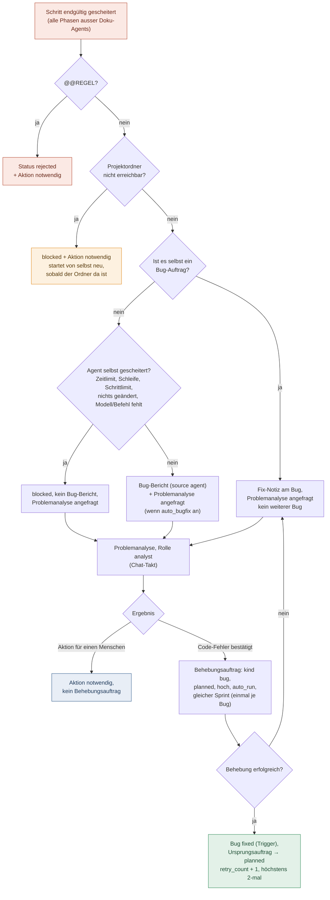
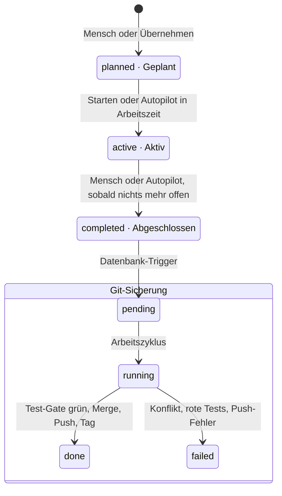
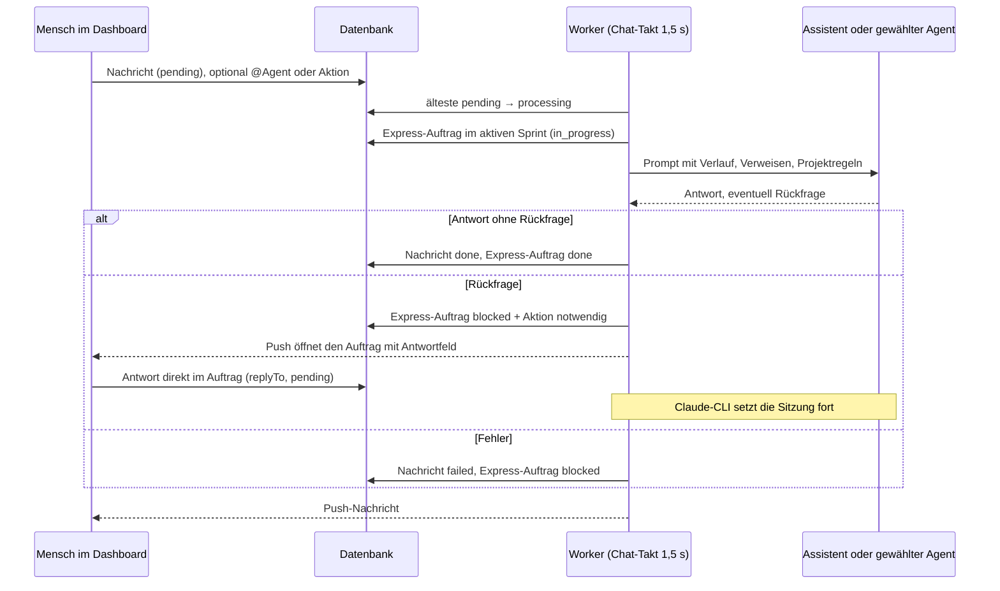

# AIdeation zur Laufzeit

Was der Worker wann tut, welcher Status welchen Schritt auslöst, wann welcher Agent startet und was er darf – abgeleitet aus dem Quellcode (`src/runner`, `src/agent`, `src/db/schema.ts`). Stand: 19.10.2026. Details zu Abläufen und Rechten stehen in „Workflows“ und „Agents und Rechte“.

## 1 · Prozesse und Takte

Drei Prozesse laufen dauerhaft. Gearbeitet wird nur im Worker auf dem Mac; der Frontend-Container liefert die Oberfläche und leitet `/api` an den Backend-Container weiter; der schreibt nur Wünsche in die Datenbank.

| Takt          | Schleife im Worker | Was je Projekt passiert                                                                                                                                                                                                                                                                                                               |
| ------------- | ------------------ | ------------------------------------------------------------------------------------------------------------------------------------------------------------------------------------------------------------------------------------------------------------------------------------------------------------------------------------- |
| 0,5 s         | Einrichtung        | Host-Aufgaben des Projekt-Assistenten (Ordner, Git, GitHub, Vorlagen, Agent-Tests), bis zu 4 parallel.                                                                                                                                                                                                                                |
| 1,5 s         | Chat-Takt          | Nacheinander angestoßen, jede Spur höchstens einmal gleichzeitig: Testanforderung → _falls kein Chat läuft:_ Schnellschätzung → Auftragsautor (Ideen) → KI-Kommentar zum Sprintvorschlag → Visionär → Chat-Nachricht → Problemanalyse, danach Abnahmeprüfung.                                                                         |
| 5 s           | Neustart           | „AIdeation neu starten“ (von Hand oder nach dem Sprint-Abschluss): wartet, bis nichts läuft (max. 15 min), prüft Branch `main` und sauberen Stand, `docker compose up -d --build`, prüft bis 2 min `/health`; antwortet AIdeation nicht, zurück aufs vorherige Abbild + Push. Sonst beendet sich der Worker, launchd startet ihn neu. |
| 15 s          | Heartbeat          | Worker-Badge, Modelle der System-Agents veröffentlichen; jede Minute Git-Verlauf, alle 5 min Favicon.                                                                                                                                                                                                                                 |
| 30 s · sofort | Arbeitszyklus      | Sofort, wenn die Datenbank neue Arbeit meldet (`NOTIFY devlog_work`: Auftrag eingeplant, Sprint gestartet) oder ein Platz frei wird; sonst alle 30 s. `runWorkflow` je Projekt, höchstens **2 Projekte gleichzeitig** (Einstellung, max. 8); wer am längsten wartet, kommt zuerst. Ablauf in Abschnitt 4.                             |
| 30 s · Job    | Wartungs-Jobs      | Projektübergreifend, nach jedem Arbeitszyklus im Hintergrund (nie zwei Durchgänge gleichzeitig): fällige aktive Zeilen aus `scheduled_jobs` beanspruchen (`FOR UPDATE SKIP LOCKED`, `next_run_at` + Intervall, Sperre `locked_until`), dann mit Zeitlimit (Standard 20–120 s, max. 300 s) ausführen. Nur feste Job-Arten aus `src/runner/scheduler.ts`; Status und Meldung landen in der Zeile. Einstellbar über `GET`/`PATCH /api/scheduled-jobs` (nur Administration). |
| 6 h           | `backup_check`     | Neuestes `aideation-*.dump` in `./backups` (relativ zum AIdeation-Ordner): jünger als `maxAgeHours` (26), mindestens `minBytes` (1024). Fehlender Ordner = „fehlgeschlagen“ + Push.                                                                                                                                               |
| 15 min        | `watchdog_logs`    | Wächter-Prüfungen (`collectProblems`, ohne `git status`) im Worker; gleiche Probleme erst nach 6 h (`REMIND_MS`) erneut per Push, Merkzustand in der Datenbank.                                                                                                                                                                       |
| 1 h · Fehler  | `push_alert`       | Push an Projektkreis (`config.project`) oder Administration, wenn ein beobachteter Job fehlgeschlagen ist; nach jedem Fehlschlag sofort fällig. Gleiche Fehlschläge erst nach 6 h wieder, Entwarnung einmal.                                                                                                                       |
| 1 Tag · aus   | `close_old_sprints`| Standardmäßig aus. Schliesst aktive, nicht pausierte Sprints über `completeSprint`, wenn alle Aufträge erledigt sind (`sprintSettled`), kein Agent läuft und seit `inactiveDays` (14, 1–365) nichts passiert ist.                                                                                                                  |
| Start         | Wiederherstellung  | Unterbrochene Läufe → Auftrag wieder „Geplant“, Testanforderungen „fehlgeschlagen“, Abnahmeprüfungen und Visionär neu angefragt, Neustart als „erledigt“ markiert.                                                                                                                                                                    |
| Signal        | Herunterfahren     | Alle Agent-Prozesse werden beendet; laufende Aufträge → „Geplant“, Chat → „pending“, Ideen in Arbeit → „requested“.                                                                                                                                                                                                                   |

## 2 · Idee → Auftrag

Die ersten drei Status setzt nur der Mensch. Ab „Ausarbeiten“ übernimmt der Worker im Chat-Takt, eine Idee pro Projekt gleichzeitig.

### Schnellschätzung

Ideen in idea, considering, review oder requested ohne jeden Schätzwert bekommen im Chat-Takt Stunden, Tokens, Nutzen und Kosten (bis 5 pro Takt). Läuft mit dem Modell der Rolle `author`, eine externe CLI in einem temporären Ordner.

### Visionär

Auf Knopfdruck (Ideation oder Aktionen). Liest das Projekt nur, legt Ideen mit Begründung an, überspringt Dubletten und abgelehnte Ideen. Ein Lauf pro Projekt, abbrechbar.

## 3 · Status eines Auftrags

Arten: `feature`, `bug` (Behebungsauftrag) und `express` (Chat-Anfrage; läuft nie im Arbeitszyklus). Ausgewählt wird ein Auftrag nur, wenn er „planned“ ist _und_ sein Sprint aktiv ist, ein Agent fest zugewiesen ist (Play) oder `auto_run` gesetzt ist.

### Play-Knopf (ein Agent)

Setzt `agent_id`, merkt den alten Status in `return_status` und plant ein. Es läuft nur dieser Agent; danach kehrt der Auftrag zum alten Status zurück (aus „Blockiert“ wird bei Erfolg „Geplant“). Bei Misserfolg: „Blockiert“.

### Automatik der Datenbank

- Bug-Auftrag in Arbeit → Bug „in_progress“; erledigt → Bug „fixed“; abgelehnt → Bug „rejected“; zurück → Bug „open“.
- „done“ oder „rejected“ löscht „Aktion notwendig“.
- Pro Auftrag höchstens ein laufender Lauf; älter als 3 h gilt als gescheitert.

## 4 · Arbeitszyklus `runWorkflow` (sofort bei neuer Arbeit, sonst alle 30 s)

Die Reihenfolge ist fest. Aufträge eines Zyklus laufen parallel, aber nur einer hält gleichzeitig die Umsetzungssperre (siehe Abschnitt 5).

## 5 · Agent-Kette eines Auftrags

Standard-Workflow jedes neuen Projekts (einmalig angelegt, danach frei änderbar). Reihenfolge: Phase, dann Position. Der erste gescheiterte Schritt beendet den Lauf.

### Wann ein Schritt besteht

- Exit-Code 0 und nicht abgebrochen. Vorübergehender Fehler (Modell weg, überlastet, Rate-Limit, Zeitlimit): nach 30 s einmal wiederholt.
- Tester mit eigener CLI: jedes Akzeptanzkriterium und jeder DoD-Punkt erfüllt (`@@ACCEPTANCE`); nur manuell prüfbare Punkte werden „Aktion notwendig“ + Push.
- Reviewer: eindeutige Freigabe, sonst gescheitert.
- Kein `@@REGEL`-Einspruch (sonst Auftrag „rejected“).
- Entwickler (lokales Modell) hat Dateien geändert oder „KEINE ÄNDERUNG NÖTIG“ gemeldet.

### Sperre und Parallelität

- Ab dem ersten Agent, der Dateien ändert (Phase while_task, Entwickler, Tester), hält der Auftrag die Umsetzungssperre bis zum Merge.
- Vorbereitung und Doku-Agents laufen parallel zur Umsetzung eines anderen Auftrags.
- Erneuter Versuch: bereits bestandene Agents werden übersprungen, ihre Ausgabe geht weiter.
- Zeitlimit je Schritt 30 min (Standard).
- Budget: Vor jedem Agent werden Tages-, Sprint- und Auftragslimit geprüft; ab 80 % eine Push-Warnung je Periode, ab 100 % → blocked mit „Aktion notwendig: Budget erreicht“, kein Bug. Der Zeitraum gibt den Auftrag wieder frei (Folgetag bzw. höheres Limit).
- Modell-Routing: Die Regeln des Projekts wählen je Schritt lokal (Ollama) oder stark (CLI); Modell und Regel stehen am Schritt.

## 6 · Fehler, Problemanalyse und Bugfix

Wenn ein Schritt endgültig scheitert (nach Nachbesserung bzw. Wiederholung; Doku-Agents ausgenommen), entscheidet `registerFailure`, was folgt. Die Problemanalyse läuft im Chat-Takt und entscheidet, ob ein Behebungsauftrag entsteht.

## 7 · Sprint, Autopilot und Git

Pro Projekt höchstens ein aktiver Sprint (Datenbank-Regel). Modus in den Einstellungen: `manual`, `suggest` oder `autopilot`.

### Autopilot (Beginn jedes Arbeitszyklus)

- Sicherung gescheitert → pausiert, bis sie gelingt oder „Autopilot freigeben“.
- Sicherung läuft → wartet.
- Aktiver Sprint ohne backlog, planned, in_progress und nur noch Blockaden mit „Aktion notwendig“ → abschliessen (auch nachts).
- Nächsten Vorschlag übernehmen und starten: nur in den Arbeitszeiten (Standard Mo–Fr 08–18 Uhr).

### Git je Ebene

- **Auftrag:** Branch `auftrag/…` vom Sprint-Branch; Erfolg → Merge, Misserfolg → WIP-Commit.
- **Sprint:** Branch `sprint/…`; Sicherung committet Reste, Test-Gate, Push.
- **Abschluss:** Merge nach `main` (--no-ff), erneutes Test-Gate, gegebenenfalls GitHub-Actions abwarten, Push, Tag `sprint-name-id`.
- **AIdeation selbst:** `main` liegt im Arbeitsordner der Menschen. Mit „Nach dem Sprint-Abschluss neu starten“ merged der Worker dort nur, wenn nichts offen ist, prüft die Tests (rot → `reset --keep`) und fordert den Neustart an.
- Nie committet: `.env`, Backups, Schlüsseldateien, Zeilen mit Tokens.

## 8 · Chat, Aktionen und Anfragen auf Knopfdruck

Alles, was im Dashboard angestoßen wird, landet als Zeile in der Datenbank und wird im Chat-Takt abgeholt. Pro Projekt läuft je Spur nur eine Anfrage.

Jeder dieser Knöpfe (und „Erneut versuchen“, „Sprintvorschlag übernehmen“) öffnet zuerst ein Bestätigungsfenster mit optionalem Kommentar, der mitgegeben wird.

| Knopf im Dashboard                                 | Schreibt                                 | Abgeholt von                                                                            |
| -------------------------------------------------- | ---------------------------------------- | --------------------------------------------------------------------------------------- |
| Aktionen → gespeicherte Aktion                     | Chat-Nachricht an den hinterlegten Agent | Chat-Spur                                                                               |
| Aktionen → Kompletter Test / Nur Oberfläche        | `test_requests` requested                | Test-Spur, startet erst, wenn im Projekt kein Agent-Lauf aktiv ist; Befunde werden Bugs |
| Aktionen → Visionär / Ideation → Ideen vorschlagen | `visionary_runs` requested               | Visionär-Spur                                                                           |
| Aktionen → System → AIdeation neu starten (Admin)  | `app_settings` system:restart            | Neustart-Takt 5 s                                                                       |
| Auftrag → Analysieren                              | `analysis_status` requested              | Analyse-Spur                                                                            |
| Sprint → KI-Kommentar                              | `sprint_proposal_comments`               | Auftragsautor, nur Text                                                                 |
| Sprint → Git hoch / runter                         | `git_sync` pending, push oder pull       | Arbeitszyklus, Schritt 1 und 11                                                         |

## 9 · Rechte je Agent

Zwei Ausführungswege mit unterschiedlichen Grenzen. **Claude-CLI**: Rechte aus den freigeschalteten Gruppen des Projekts, AIdeation setzt sie als `--allowedTools`, der Wächter prüft jeden Schreib- und Shell-Zugriff. **Lokales Modell (Ollama)**: eingebaute Werkzeuge, Schreiben nur für Entwickler und Assistent. Die Standardrechte werden je Agent gespeichert und lassen sich im Agent-Formular einzeln ändern.

Legende: ✅ erlaubt · ⚠️ eingeschränkt · ⛔ gesperrt

| Agent · Rolle                                                                             | Startet                                                                                              | Lesen               | Dateien schreiben (Claude)           | Shell (Claude)                                                        | Lokales Modell                                  |
| ----------------------------------------------------------------------------------------- | ---------------------------------------------------------------------------------------------------- | ------------------- | ------------------------------------ | --------------------------------------------------------------------- | ----------------------------------------------- |
| **Auftragsautor** · `author`                                                              | Idee „requested“ (Chat-Takt); im Workflow nur für Aufträge ohne Idee; KI-Kommentar; Schnellschätzung | ✅ ja               | ⚠️ teils anlegen + ändern im Projekt | ⛔ nein                                                               | nur lesen, 25 Schritte                          |
| **Bug-Wächter** · `bug_reviewer`                                                          | direkt nach dem Autor; im Workflow nur, wenn keine Risiken da                                        | ✅ ja               | ⚠️ teils anlegen + ändern            | ⛔ nein                                                               | nur lesen                                       |
| **Entwickler** · `developer`                                                              | while_task, mit Sperre und Auftrags-Branch                                                           | ✅ ja               | ✅ ja im Projekt                     | ✅ ja alle freigeschalteten Gruppen                                   | schreiben + Befehle + SQL, 80 Schritte, Backups |
| **Tester** · `tester`                                                                     | after_task; auch Abnahmeprüfung auf Anfrage                                                          | ✅ ja               | ✅ ja                                | ✅ ja alle Gruppen                                                    | kein Modell: führt nur die Projekttests aus     |
| **Reviewer** · `reviewer`                                                                 | after_task, nach dem Tester                                                                          | ✅ ja               | ✅ ja                                | ✅ ja alle Gruppen                                                    | nur lesen                                       |
| **Dokumentierer, Handbuch-Autoren** · `documenter`, `manual_writer`, `user_manual_writer` | after_task; Ausgabe wird Doku                                                                        | ✅ ja               | ⚠️ teils anlegen + ändern            | ⛔ nein                                                               | nur lesen                                       |
| **Eigene Rolle** · `custom`                                                               | frei gewählte Phase                                                                                  | ✅ ja               | ⚠️ teils anlegen + ändern            | ⛔ nein                                                               | nur lesen                                       |
| **Dashboard-Assistent** · `assistant`                                                     | Chat-Nachricht, Aktion                                                                               | ✅ ja + Dienst-Logs | ✅ ja                                | ✅ ja alle Gruppen; mit `--dangerously-skip-permissions` ohne Wächter | schreiben + Befehle + SQL + Docker/Git-Clone    |
| **Problemanalyse** · `analyst`                                                            | analysis_status requested                                                                            | ✅ ja               | ⛔ nein                              | ⛔ nein                                                               | nur lesen                                       |
| **Visionär** · `visionary`                                                                | Knopfdruck                                                                                           | ✅ ja               | ⛔ nein                              | ⛔ nein                                                               | nur lesen                                       |

### Gruppen, die Projekte freischalten

- **Dateien** (immer), **Diagnose** (ps, lsof, netstat, WebFetch localhost), **Dienst-Logs** (~/Library/Logs), **Projekt-Datenbank** (nur lokales Modell).
- **Build und Tests** (npm test/run, npx --no-install ng/tsc/vitest/playwright), **Pakete** (npm install/ci --ignore-scripts), **Git** (status, diff, log, fetch, pull --ff-only, checkout), **Docker** (compose ps/logs/up/stop/…), **Projekt-Dienste** (launchctl kickstart ch.*).
- Eigene Gruppen je Projekt, nur Administration; Regeln mit „DevLog“, .env oder .ssh werden abgelehnt.

### Was der Wächter immer sperrt

- Schreiben ausserhalb des Projekts oder der Ordner-Einschränkung des Agents.
- `.git`, `.claude`, `.ssh`, `.aws`, `.env*`, `*.pem`, `*.key`.
- Umleitungen in Dateien, riskante Git-Optionen, npx ohne --no-install, unsichere Compose-Dateien.
- Ausnahme: Assistent mit voller Freigabe im Befehl.

## 10 · Neu im aktuellen Stand

Die vier Auffälligkeiten der ersten Fassung sind behoben (Tester/Reviewer melden Bugs, Problemanalyse nur lesend, Doku angeglichen). Dazu kamen diese Änderungen am Ablauf.

### Nachbesserung im selben Lauf

Rote Tests oder ein abgelehntes Review gehen einmal direkt zurück an den Entwickler. Erst wenn auch das scheitert: Bug, Problemanalyse, Bugfix.

### Kurze Ausfälle

Modell nicht erreichbar, überlastet, Rate-Limit, Verbindungsabbruch oder Zeitlimit: Der Schritt wird nach 30 s einmal wiederholt, statt den Auftrag sofort zu blockieren.

### Sofortstart

Datenbank-Trigger melden neue Arbeit per `NOTIFY`; der Worker legt sofort los. Das 30-s-Intervall bleibt als Absicherung.

### Budget und Modell-Routing

Einstellungen → Budget: Limits je Tag, Sprint und Auftrag (Tokens/USD), Anzeige in USD oder CHF zum festen Kurs, Routing-Regeln und Modell je Stufe. Dashboard-Kachel „Budget heute / Sprint“, Statistik mit Verbrauch gegen Budget, Verbrauch je Modell und geschätzter Ersparnis durch das Routing. Der Auftragsautor bekommt die Median-Ist-Werte erledigter Aufträge derselben Kategorie in den Prompt (sichtbar im Prompt-Protokoll der Statistik). „Erneut versuchen“ startet ein neues Auftragsbudget.

### Zeitleiste und Rückfragen im Auftrag

Der Auftrag zeigt, worauf er wartet, wer wann was gemacht hat, und nimmt Antworten auf Rückfragen direkt entgegen; die Push-Nachricht öffnet das Antwortfeld.

### Neustart mit Prüfung

Optional nach dem Sprint-Abschluss automatisch; nach dem Neubau Gesundheitsprüfung und bei Bedarf Rücksetzen auf das vorherige Abbild. Auswertung „Was klappt“ unter Verbrauch.
