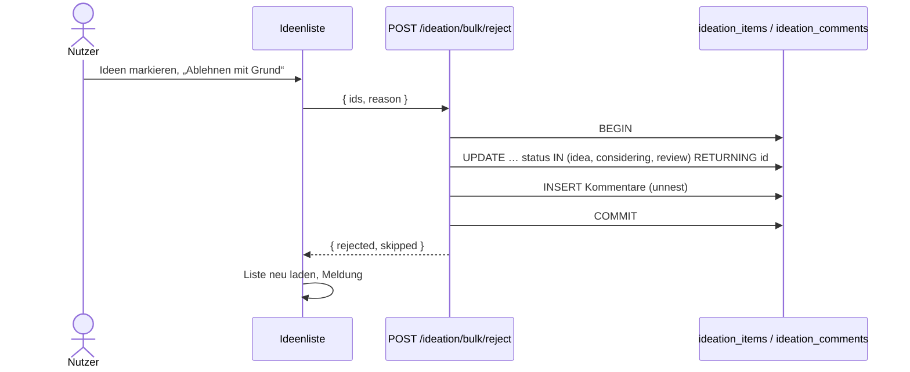

# Massen-Ablehnen und Priorität in der Ideenliste

Auftrag e8de4bd4 (Entwicklung). Stand: 30.10.2026.

## Ziel

Mehrere Ideen lassen sich in einem Schritt mit einem Grund ablehnen oder priorisieren, und jede Zeile hat einen Schnell-Ablehnen-Knopf. Abgelehnte Ideen mit Grund füllen den Abschnitt „Abgelehnte Ideen“, den der Visionär bei späteren Läufen beachtet (`src/agent/visionary.ts` liest `rejection_reason` bereits, keine Änderung dort).

## Umsetzung

### Server (`src/api/ideation.ts`)

Zwei neue Routen, **vor** `POST /ideation/:id/reject` registriert (sonst fängt `:id` das Wort `bulk` ab). Beide: Rolle `plan`, Mandant `global`. Die IDs stehen im Body, daher filtern die Abfragen selbst nach `allowedProjects`. Ideen fremder Projekte gelten als „nicht gefunden“.

| Route | Body | Antwort |
| --- | --- | --- |
| `POST /ideation/bulk/reject` | `{ ids, reason }` | `{ rejected: [{id, title}], skipped: [{id, title, status, reason}] }` |
| `POST /ideation/bulk/priority` | `{ ids, priority }` | `{ changed: [{id, title}], skipped: [...] }` |

- Validierung: 1 bis `MAX_BULK_IDEAS` (200) IDs, sonst 400. Grund Pflicht, höchstens `MAX_REJECTION_REASON` (1000) Zeichen, sonst 400. Priorität gegen `PRIORITIES` (`low`, `medium`, `high`), sonst 400.
- Statusregel wie bei der Einzel-Ablehnung: bedingtes `UPDATE … WHERE id = ANY($1::uuid[]) AND status = ANY($3)` mit `EDITABLE_IDEATION_STATUSES` (`idea`, `considering`, `review`). Ideen in `requested`, `drafting`, `accepted`, `rejected` bleiben unverändert und erscheinen in `skipped` mit „nicht möglich“. Unbekannte oder fremde IDs: „nicht gefunden“. Das schützt auch vor gleichzeitigen Läufen des Auftragsautors.
- Massenablehnung in einer Transaktion (`BEGIN`/`COMMIT`, bei Fehler `ROLLBACK`): `UPDATE … RETURNING id, title`, danach ein einziger `INSERT … SELECT unnest($1::uuid[])` mit dem Kommentar `**Abgelehnt:** <Grund>`. Entweder alles oder nichts.
- Alle IDs und Werte laufen als Parameter, es gibt kein `UPDATE` ohne `WHERE`.
- Die Priorität-Route ist ein einzelnes `UPDATE` und braucht keine Transaktion.

### Oberfläche (`frontend/src/app/features/ideation/`)

- `reject-reason-form.component.ts` (neu): gemeinsames Formular (Textarea, `maxlength` 1000, Pflicht). Wird von `idea-detail`, dem Schnell-Popover und der Bulk-Eingabe genutzt, die Validierung steht nur dort.
- `idea-options.ts`: gemeinsame Optionen/Konstanten (u. a. Prioritäten).
- `ideation.component.html/.ts`: Bulk-Leiste (`app-bulk-bar`) zeigt neben „Aufträge erstellen“ nun „Ablehnen mit Grund“ und „Priorität setzen“. „Ablehnen mit Grund“ ist ohne Grund (leer oder nur Leerzeichen) deaktiviert. In der Aktionsspalte steht neben ✎ der Knopf ⊘ „Schnell ablehnen“, nur bei `editable(idea)`, mit Popover. Escape schließt nur das Popover und speichert nichts. Nach jeder Aktion wird die Liste neu geladen und das Ergebnis (geändert/übersprungen) als Meldung angezeigt.
- Alle neuen Knöpfe prüfen `auth.can('plan')`, passend zu `src/api/roles.ts`, auch auf dem Handy.
- `idea-detail.component.ts/.html`: nutzt das gemeinsame Formular, Verhalten unverändert.
- `core/project-store.ts`: Aufrufe der neuen Routen.
- `styles/10-ideas.css`: Popover-Styles.

### Keine Änderung

`src/db/schema.ts` (Spalten `rejection_reason`, `priority` existieren), `src/core/status.ts`, Visionär-Prompt, „Aufträge erstellen“, „Übernehmen“.

## Worauf zu achten ist

- Die Server-Regeln sind maßgeblich. Die Oberfläche spiegelt sie nur. Bei einem Konflikt kommt die Idee in `skipped`, nicht als Fehler.
- Neue Routen unter `/ideation/` mit festem Pfadteil müssen vor `/ideation/:id/…` stehen.
- Die Auswahlmenge (`IDEA_SELECTABLE_STATUSES`, `canPromote`) sollte für Ablehnen nur bearbeitbare Status enthalten. Sonst werden Zeilen gewählt, die der Server überspringt.
- Bei Nicht-Admins prüft der Server `allowedProjects`; Ideen fremder Projekte werden als „nicht gefunden“ gemeldet (siehe `access.test.ts`).
- Der Schnell-Ablehnen-Knopf und das Popover dürfen dem Such-/Filterfeld der `DataTableComponent` den Fokus nicht nehmen. Bestehende Knopfnamen nicht umbenennen, ohne `full-ui.check.ts` und `e2e/app.spec.ts` anzupassen.
- Einen Rückgängig-Weg, Massen-Löschen und Prioritätsänderung für `development_items` gibt es bewusst nicht.

## Tests

- `src/api/app.test.ts`: je ein neuer Test für Massenablehnung und Massenpriorität.
- `src/api/access.test.ts`: Projektgrenzen bei Nicht-Admins.
- `src/api/roles.test.ts`: Rolle „Planen“ für die neuen Routen.

- `src/api/access.test.ts`: zusätzlich der Fall Nicht-Admin mit fremden Projekten.
- `e2e/app.spec.ts`: Test „Ideen: mehrere markieren …“ (Bulk-Leiste, Schnell-Ablehnen-Popover, Escape schließt ohne Speichern, abgelehnte Idee wechselt zu „Abgeschlossene Ideen“).
- `e2e/full-ui.check.ts`: Rollen-Check der Autorin. Ohne Planen-Recht gibt es keinen Knopf „Schnell ablehnen“, beide Bulk-Routen antworten mit 403.

**Teststand:** Der Testlauf des Testers ist fehlgeschlagen, weil in der Sandbox `tsc` und `npx tsx` nicht ausführbar waren (Exit 127 bzw. `EACCES` im npm-Cache). Das ist ein Umgebungsproblem, kein Testergebnis. Weder `npm run typecheck` noch `src/api/app.test.ts` noch die neuen E2E-Tests wurden bisher ausgeführt. Sie müssen in einer Umgebung mit Werkzeugen laufen.

## Geänderte Dateien

- `src/api/ideation.ts`, `src/api/app.test.ts`, `src/api/access.test.ts`, `src/api/roles.test.ts`
- `frontend/src/app/core/project-store.ts`
- `frontend/src/app/features/ideation/idea-options.ts`, `reject-reason-form.component.ts`, `idea-detail.component.ts`, `idea-detail.component.html`, `ideation.component.ts`, `ideation.component.html`
- `frontend/src/styles/10-ideas.css`
- `e2e/app.spec.ts`, `e2e/full-ui.check.ts`
- `docs/massen-ablehnen-und-prioritaet-in-der-ideenliste-2026-10-30.md`, `docs/benutzerhandbuch-massen-ablehnen-und-prioritaet-in-der-ideenliste-2026-10-30.md`

## Ablauf

## Sprint und Anfrage/TODO

- Auftrag e8de4bd4: umgesetzt (Entwickler, `while_task` bestanden). Dokumentation hiermit abgeschlossen.
- Offen: Typecheck, `src/api/app.test.ts` und die neuen E2E-Tests in einer Umgebung mit `tsc`/`tsx` ausführen (Tester scheiterte an der Sandbox). Danach Browser-Prüfung mit Nicht-Admin und Printscreens.
- Der letzte Bug-Wächter-Lauf scheiterte am Monatslimit der Claude-CLI. Er liefert kein Prüfergebnis und sollte nach dem Zurücksetzen des Limits wiederholt werden.
