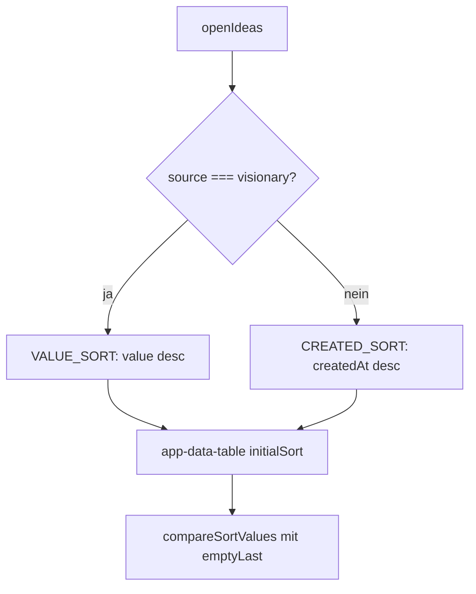

# Nutzen-, Kosten- und Wertspalten in Offene Ideen

Auftrag ef5e6c78 (Entwicklung, Frontend).

## Aufträge

### Was umgesetzt wurde

Die Tabelle „Offene Ideen“ (Ideen-Seite) hat drei neue Spalten:

- **Nutzen** und **Kosten** (je 0–10): Balken mit Zahl, aufgebaut wie die Meter im Ideen-Dialog (`.meter`, `.meter-bar`). Nutzen 8 füllt 80 %, Kosten 3 füllen 30 %. Beide sind sortierbar und per Auswahl 0–10 filterbar.
- **Wert** = Nutzen / Kosten mit einer Nachkommastelle und deutschem Komma (8 und 3 → „2,7“). Nur sortierbar, kein Filter. Ohne Nutzen, ohne Kosten oder bei Kosten 0 bleibt die Zelle leer.
- Ideen ohne Wert (bzw. ohne Nutzen/Kosten beim Sortieren dieser Spalten) stehen in **beiden** Sortierrichtungen am Ende (`emptyLast`).
- **Standard-Sortierung:** „Wert“ absteigend, sobald die offenen Ideen mindestens eine Idee mit `source === 'visionary'` enthalten, sonst „Erstellt“ absteigend. Berechnet als `computed` aus `openIdeas()`.
- Die Spalte „Aufwand (Agent-Std.)“ bleibt, geht aber nicht in den Wert ein. Ideen-Dialog sowie die Gruppen „In Bearbeitung“ und „Abgeschlossen“ sind unverändert. Backend, Visionär-Lauf und Datenbank sind nicht berührt.

### Geänderte Dateien

- `frontend/src/app/features/ideation/idea-options.ts`: `SCORE_FILTER_OPTIONS`, `ideaValue`, `ideaValueText`, `VALUE_SORT`, `CREATED_SORT`, `openIdeasSort`.
- `frontend/src/app/features/ideation/ideation.component.ts` / `.html`: Spalten `benefit`, `cost`, `value`; Zelltemplate `scoreMeter` für die Balken; `[initialSort]="openIdeasSort()"`.
- `frontend/src/app/shared/data-table/sort.ts` (neu): `compareSortValues` mit Option `emptyLast`.
- `frontend/src/app/shared/data-table/data-table.component.ts`: `DataColumn.emptyLast`, `sortingFn` über `compareSortValues`; `sortBy()` behandelt eine voreingestellte Sortierung.
- `frontend/src/styles/04-components.css`: `.meter.table-meter` und Verwandte; die Meter-Styles liegen im gemeinsamen Stylesheet.
- Tests: `idea-value.spec.ts` (Formel, Formatierung, Filterwerte, Standard-Sortierung), `sort.spec.ts` (leere Werte in beiden Richtungen).

### Worauf zu achten ist

- TanStack dreht das Ergebnis der Sortierfunktion bei absteigender Sortierung um. Damit leere Werte trotzdem hinten stehen, spiegelt `compareSortValues` den Vergleich für leere Werte vorab (`desc`).
- Ein Klick auf eine Spalte mit nur voreingestellter Sortierung (hier „Wert“ absteigend) muss die Reihenfolge umkehren; `sortBy()` setzt dafür beim ersten Klick `desc: !preset.desc`. Danach gilt der normale Ablauf aufsteigend → absteigend → ohne.
- Der Leertext der Tabelle erwähnt Filter nur, wenn gefiltert oder gesucht wird (unverändert).
- Beschriftungen bestehender Tabellen wurden nicht geändert; die neuen Köpfe können aber E2E-Locators in `e2e/full-ui.check.ts` berühren.
- Die Formel ist eine Annahme (Nutzen/Kosten, Kosten 0 ausgeschlossen); ein Wechsel betrifft nur `ideaValue`.

### Tests

- Die Entwickler-Stufe konnte nichts ausführen (`tsx`/`tsc` fehlen, `node_modules` zeigt auf einen Host-Pfad). Die Dokumentation hat nichts erneut ausgeführt.
- Offen für den Tester: `npm run typecheck`, `lint`, `format:check`, `test:unit` sowie die Oberflächentests „Tabellen“, „Ideen“, „Dashboard“ und „Projektwechsel“.

## Sprint

| Auftrag | Titel | Zustand | Details |
| --- | --- | --- | --- |
| ef5e6c78 | Nutzen-, Kosten- und Wertspalten in Offene Ideen | Umsetzung fertig, Prüfung durch Tester offen | Nur Frontend, kleiner Umfang |

## Anfrage / TODO

- Tester: Befehle und Oberflächentests aus „Tests“ ausführen. Prüfen, dass „Wert“-Klick bei Voreinstellung umkehrt und Ideen ohne Wert in beiden Richtungen hinten stehen.
- E2E-Locators (`e2e/full-ui.check.ts`) gegen die neuen Spaltenköpfe prüfen.
- Benutzerhandbuch: Spalten Nutzen/Kosten/Wert, Filter 0–10, Standard-Sortierung nach Wert bei Visionär-Ideen.

## Technische Dokumentation

- `ideaValue(idea)` liefert `benefit / cost` oder `null` (Nutzen/Kosten fehlen oder Kosten ≤ 0). `ideaValueText` formatiert mit `toLocaleString('de-DE')`, eine Nachkommastelle.
- Filter „Nutzen“/„Kosten“: `filter` mit `options = SCORE_FILTER_OPTIONS` (Strings „0“–„10“); die Spaltenwerte sind Zahlen, der Vergleich läuft über die Tabellen-Filterlogik (`shared/data-table/filter.ts`) und ist durch `idea-value.spec.ts` abgedeckt.
- `DataColumn.emptyLast` ist allgemein nutzbar; weitere Tabellen können es pro Spalte setzen.
